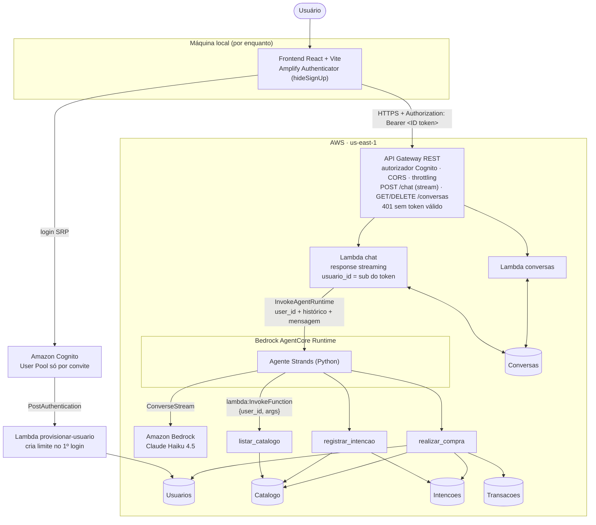
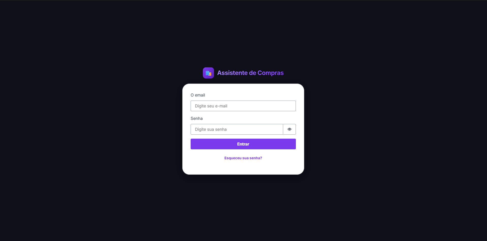
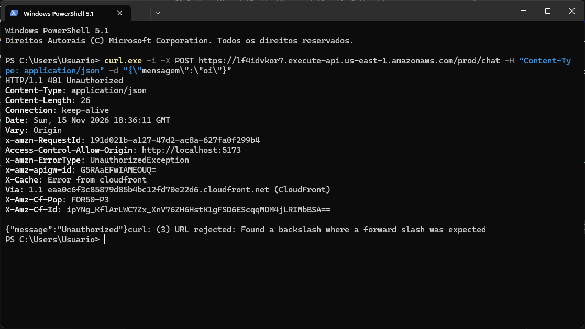
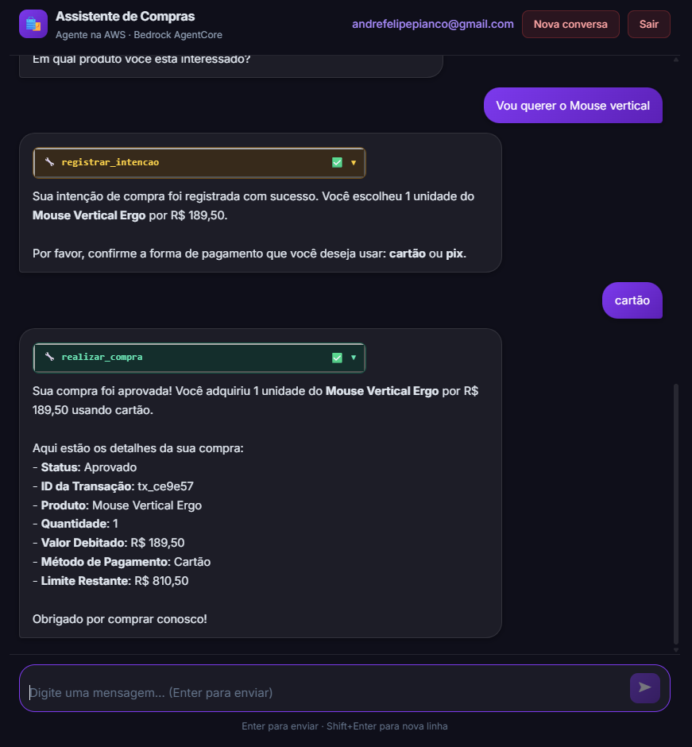
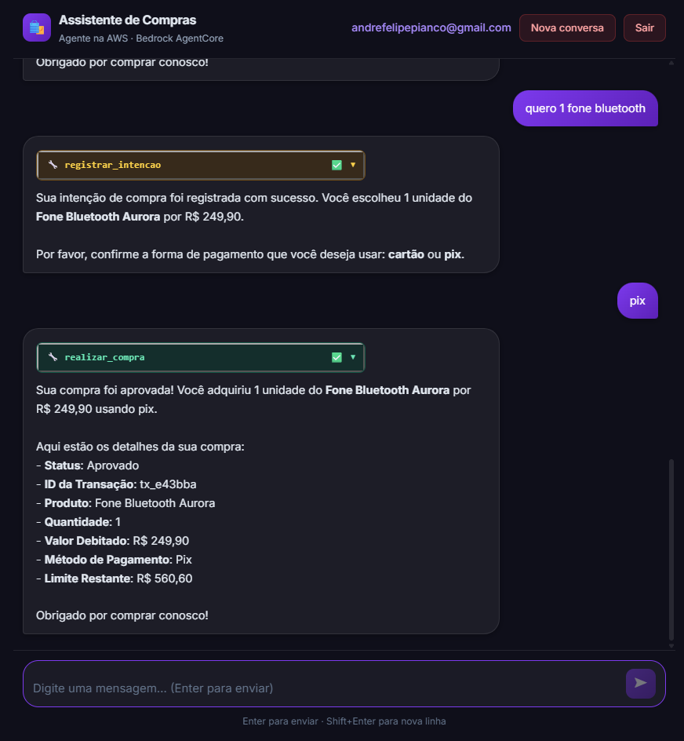
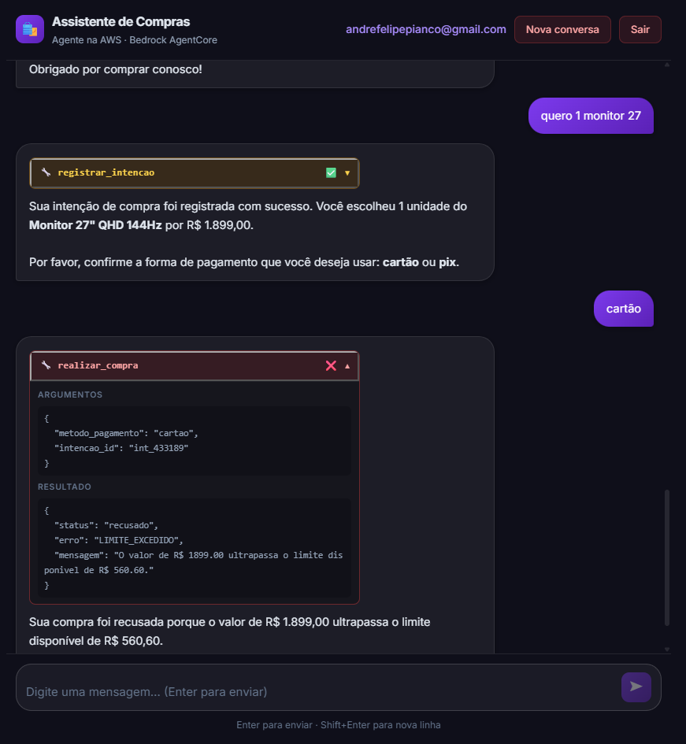
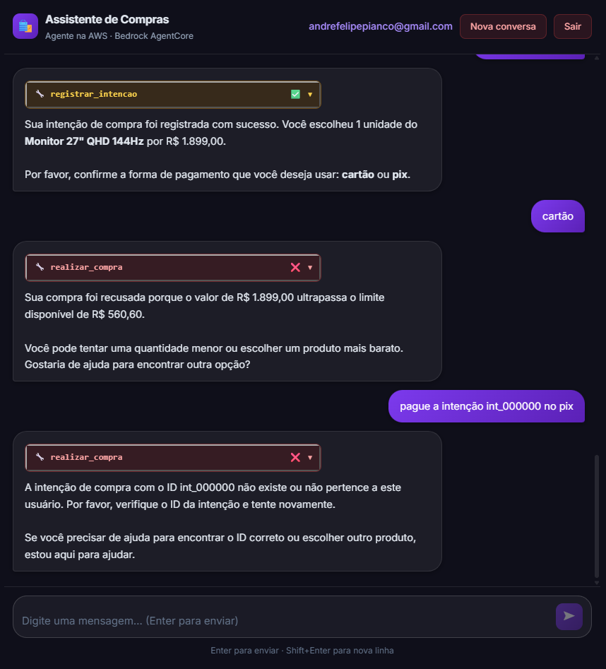

# Agente de Pagamentos na AWS

Chatbot com login que conversa com um agente de IA e faz compras simuladas por meio de
três ferramentas. É o desafio final da Fase 1 (que rodava localmente com Ollama) levado
para a AWS: modelo do **Amazon Bedrock**, agente **Strands** no **Bedrock AgentCore
Runtime**, ferramentas em **AWS Lambda**, estado em **DynamoDB**, login com **Cognito**,
API no **API Gateway** e toda a infraestrutura em **AWS CDK**, na região **us-east-1**.

As regras de negócio são as mesmas da Fase 1: catálogo, intenção de compra, pagamento com
cartão ou Pix, limite por usuário e validação da intenção, com os mesmos códigos de erro.

> **Status do frontend:** por orientação do tech lead (problema de permissão no
> CloudFront da conta), o **backend está na AWS e o frontend roda localmente**
> (`http://localhost:5173`). Login com Cognito e proteção dos endpoints continuam
> obrigatórios e estão implementados. O deploy no Amplify fica para quando a conta
> for liberada (veja [Deploy do frontend no Amplify](#deploy-do-frontend-no-amplify-quando-liberado)).

---

## Sumário

1. [Arquitetura](#1-arquitetura)
2. [Pré-requisitos e deploy](#2-pré-requisitos-e-deploy)
3. [Modelo do Bedrock](#3-modelo-do-bedrock)
4. [Modelagem do DynamoDB](#4-modelagem-do-dynamodb)
5. [Permissões IAM](#5-permissões-iam)
6. [Evidências](#6-evidências)
7. [Remoção dos recursos](#7-remoção-dos-recursos)
8. [Decisões e variações em relação ao enunciado](#8-decisões-e-variações-em-relação-ao-enunciado)
9. [Estrutura do repositório](#9-estrutura-do-repositório)

---

## 1. Arquitetura



### Fluxo de uma mensagem

1. O usuário entra pelo **Authenticator do Amplify**. Não há cadastro na tela, e o user
   pool também recusa cadastro pela API (`AllowAdminCreateUserOnly`).
2. O frontend chama `POST /chat` com `Authorization: Bearer <ID token>`.
3. O **autorizador Cognito do API Gateway** valida o token. Sem token, ou com token
   expirado ou inválido, a resposta é **401** e a Lambda nem é chamada.
4. A **Lambda do chat** lê o `usuario_id` do claim `sub` do token, **nunca do corpo**,
   carrega o **histórico completo** da tabela `Conversas` e invoca o agente no AgentCore.
5. O **agente Strands** chama o modelo do Bedrock. Quando o modelo pede uma tool, o agente
   invoca a Lambda correspondente com `{ user_id, args }`. O `user_id` viaja no
   `invocation_state` do Strands, fora do alcance do modelo: as tools que o modelo vê
   **não têm** parâmetro de usuário nem de valor.
6. A resposta volta em **streaming** (SSE): texto, chamadas de tool e resultados chegam ao
   navegador conforme são gerados. No evento final, a Lambda grava as mensagens novas no
   histórico.

### Por que streaming no API Gateway REST

O enunciado pede stream ou WebSocket. Usei **REST API com response streaming**
(`ResponseTransferMode: STREAM`), que funciona com o **autorizador Cognito nativo**. Assim
o 401 acontece no próprio API Gateway, como o desafio exige, sem precisar de um
autorizador Lambda (que seria necessário em WebSocket). O streaming também afasta o
limite de 29 s de uma integração comum: uma resposta que encadeia várias tools pode
levar mais que isso, e o timeout da integração foi configurado em 2 minutos.

---

## 2. Pré-requisitos e deploy

### Pré-requisitos

| Ferramenta | Versão usada | Para quê |
|---|---|---|
| Conta AWS com acesso em `us-east-1` | — | Todos os recursos |
| AWS CLI v2 | 2.40 | Credenciais e comandos de administração |
| Node.js | 22+ (testado no 26) | CDK, Lambdas e frontend |
| Python | 3.12+ | Ambiente local do agente |
| [uv](https://docs.astral.sh/uv/) | 0.13 | Empacota o agente para Linux arm64 **sem Docker** |
| Git | — | — |

O acesso ao modelo precisa estar liberado no console do Bedrock (`us-east-1`). Para os
modelos da Anthropic, isso inclui o formulário de caso de uso. Teste com:

```bash
aws bedrock-runtime converse --profile SEU_PERFIL --region us-east-1 \
  --model-id us.anthropic.claude-haiku-4-5-20251001-v1:0 \
  --messages '[{"role":"user","content":[{"text":"Reply with exactly: pong"}]}]' \
  --query 'output.message.content[0].text' --output text
```

### Passo a passo

> Os comandos usam `SEU_PERFIL` como perfil da AWS CLI. No Windows, use PowerShell;
> no Linux/macOS, troque `agent/.venv/Scripts/python` por `agent/.venv/bin/python`.

**1. Clonar e instalar as dependências**

```bash
git clone https://github.com/Pedro-Leale-Compass/scholarship-fde-agentic-payments-challenges.git
cd scholarship-fde-agentic-payments-challenges/Desafio-1/AndrePianco
npm install
cd agent && uv sync && cd ..
```

**2. Criar um alerta de custo (recomendado antes do primeiro deploy)**

No console: *Billing → Budgets → Create budget*, ou pela CLI com `aws budgets create-budget`.

**3. Preparar a conta para o CDK (uma vez por conta/região)**

```bash
cd infra
npx cdk bootstrap aws://ID_DA_CONTA/us-east-1 --profile SEU_PERFIL
```

**4. Deploy do backend**

```bash
npx cdk deploy --profile SEU_PERFIL --outputs-file cdk-outputs.json
cd ..
```

O deploy cria tudo de uma vez: tabelas (com o catálogo já carregado), Lambdas, agente no
AgentCore, Cognito e API Gateway. As saídas (`ApiUrl`, `UserPoolId`, `UserPoolClientId`
etc.) ficam em `infra/cdk-outputs.json`, que não é versionado.

Opções de contexto (`-c chave=valor`):

| Opção | Padrão | Uso |
|---|---|---|
| `modelo` | `us.anthropic.claude-haiku-4-5-20251001-v1:0` | Inference profile usado pelo agente |
| `origens` | `http://localhost:5173` | Origens aceitas no CORS, separadas por vírgula |
| `limitePadrao` | `1000` | Limite de gasto (BRL) dado a cada usuário no primeiro login |

**5. Criar um usuário (convite)**

O cadastro é só por convite. Pelo console do Cognito ou pela CLI:

```bash
aws cognito-idp admin-create-user --profile SEU_PERFIL --region us-east-1 \
  --user-pool-id <UserPoolId> \
  --username pessoa@exemplo.com \
  --user-attributes Name=email,Value=pessoa@exemplo.com Name=email_verified,Value=true \
  --desired-delivery-mediums EMAIL
```

A pessoa recebe por e-mail o usuário e uma **senha temporária**. No primeiro login, a
tela obriga a definir uma senha nova. A linha com o limite de gasto é criada
automaticamente no primeiro login, pelo gatilho `PostAuthentication`.

**6. Rodar o frontend localmente**

Se você fez o deploy a partir do código, gere o arquivo de configuração automaticamente:

```powershell
.\scripts\configurar-frontend.ps1     # gera frontend/.env.local a partir de cdk-outputs.json
npm run dev -w frontend               # http://localhost:5173
```

> **Para correção/avaliação (conectar diretamente ao backend ativo na AWS):**  
> O backend já está no ar aguardando avaliação. Para subir apenas o frontend local sem precisar fazer deploy, crie o arquivo `frontend/.env.local` com os valores públicos da stack:
> ```env
> VITE_USER_POOL_ID=us-east-1_vZlFdnHuj
> VITE_USER_POOL_CLIENT_ID=10jh5gk5g7242aurv76ma89k0g
> VITE_API_URL=https://lf4idvkor7.execute-api.us-east-1.amazonaws.com/prod/
> ```
> Em seguida, inicie o servidor:
> ```bash
> npm run dev -w frontend
> ```

### Deploy do frontend no Amplify (quando liberado)

1. No console do Amplify: *Create new app → GitHub →* este repositório, branch `main`.
2. Em *App settings → Build settings*, use `frontend` como diretório do app e a saída
   `frontend/dist`. Em *Environment variables*, defina as três variáveis `VITE_*` acima.
3. Refaça o deploy do backend incluindo a URL do Amplify no CORS:
   `npx cdk deploy -c origens=https://main.<id>.amplifyapp.com,http://localhost:5173`.

### Scripts de teste e operação

| Script | O que faz |
|---|---|
| `scripts/testar-tools.ps1` | Testa as 3 Lambdas direto na AWS: todos os códigos de erro, cartão, Pix e 5 pagamentos simultâneos da mesma intenção |
| `scripts/testar_agente.py` | Conversa com o agente direto no AgentCore (simula a Lambda do chat) |
| `scripts/testar_api.py` | Ponta a ponta pela API: 401 sem token, login real no Cognito e chat em stream |
| `scripts/resetar_dados.py` | Restaura estoque e limites e apaga intenções, transações e conversas |
| `scripts/configurar-frontend.ps1` | Gera `frontend/.env.local` |

---

## 3. Modelo do Bedrock

**Modelo do código: Claude Haiku 4.5** (`us.anthropic.claude-haiku-4-5-20251001-v1:0`),
o recomendado pelo desafio: baixo custo, boa latência e bom desempenho em tool calling.
É o padrão em `infra/lib/backend-stack.ts`.

**O deploy em produção usa o Claude Haiku 4.5.**

> **Histórico.** No início do desenvolvimento, a conta do estágio retornava
> `Model use case details have not been submitted for this account` para o Haiku 4.5
> (`agreementAvailability: NOT_AVAILABLE`), porque faltava enviar o formulário de caso de
> uso da Anthropic. Nesse período o agente foi validado com **Amazon Nova Pro**
> (`-c modelo=us.amazon.nova-pro-v1:0`). O Nova Lite também foi testado, mas gerava tool
> calls malformadas. Depois que o formulário foi enviado, o deploy voltou ao Haiku, o padrão
> do código. O modelo continua configurável com `-c modelo=<inference profile>`.

Ajustes no agente para tool calling confiável: `temperature=0`, limite de 6 turnos por
mensagem (equivalente ao `MAX_ITERACOES=5` da Fase 1) e um filtro que remove blocos
`<thinking>` do texto, que alguns modelos (Nova) escrevem na resposta.

---

## 4. Modelagem do DynamoDB

Todas as tabelas são **sob demanda** (`PAY_PER_REQUEST`): custo zero parado e nenhuma
capacidade para dimensionar. Todas têm `RemovalPolicy.DESTROY`, então somem no `cdk destroy`.

| Tabela | Chave | O que guarda | Quem acessa |
|---|---|---|---|
| **Usuarios** | PK `user_id` (`sub` do Cognito) | `email`, `limite_total`, `limite_disponivel`, `criado_em` | Gatilho de provisionamento (cria); `realizar_compra` (lê e debita) |
| **Catalogo** | PK `id` (ex.: `prod_003`) | `nome`, `descricao`, `categoria`, `preco`, `moeda`, `estoque` | `listar_catalogo`, `registrar_intencao` (leem); `realizar_compra` (baixa o estoque) |
| **Intencoes** | PK `intencao_id` (`int_xxxxxx`) | `user_id`, `produto_id`, `produto_nome`, `quantidade`, `valor_total`, `moeda`, `status` (`pendente`/`pago`), `criada_em`, `expira_em`; ao pagar, `transacao_id`, `metodo_pagamento`, `pago_em` | `registrar_intencao` (cria); `realizar_compra` (lê e marca como paga) |
| **Transacoes** | PK `transacao_id` (`tx_xxxxxx`) · GSI `por_usuario` (`user_id`, `criada_em`) | Compras aprovadas: `intencao_id`, `user_id`, `valor`, `metodo_pagamento`, `criada_em`. Só cresce. | `realizar_compra` (grava) |
| **Conversas** | PK `user_id` · SK `<ISO 8601>#<seq>` | Uma linha por mensagem, campo `mensagem` com o JSON no formato Bedrock Converse (texto, `toolUse`, `toolResult`) | Lambda do chat (lê e grava); Lambda de conversas (lê e apaga) |

**Por que uma linha por mensagem em `Conversas`:** o histórico cresce sem esbarrar no
limite de 400 KB por item, e a `Query` por `user_id` já devolve tudo em ordem cronológica
pela SK.

### Idempotência e concorrência no pagamento

Na Fase 1 o estado ficava na memória de um único processo. Na nuvem, várias instâncias
de Lambda podem processar a mesma intenção ao mesmo tempo. `realizar_compra` grava o
pagamento numa **única `TransactWriteItems` com quatro escritas condicionais**:

| Escrita | Condição |
|---|---|
| Intenção → `pago` | `status = pendente AND user_id = :usuario AND expira_em > :agora` |
| Usuário: `limite_disponivel -= valor` | `limite_disponivel >= valor` |
| Catálogo: `estoque -= quantidade` | `estoque >= quantidade` |
| Nova transação | `attribute_not_exists(transacao_id)` |

Ou tudo acontece, ou nada acontece. Se a mesma chamada chegar duas vezes, a segunda falha
na condição da intenção e vira `INTENCAO_JA_PAGA`. O limite nunca é debitado duas vezes.
Isso foi testado com **5 pagamentos simultâneos da mesma intenção**: 1 aprovado, 4
`INTENCAO_JA_PAGA` e o limite debitado uma única vez (`scripts/testar-tools.ps1`).

A ordem de validação da Fase 1 foi mantida (`INTENCAO_INVALIDA` → `INTENCAO_JA_PAGA` →
`INTENCAO_EXPIRADA` → `METODO_INVALIDO` → `LIMITE_EXCEDIDO`). O valor cobrado vem
**sempre** da intenção gravada no banco, nunca de um parâmetro do modelo.

---

## 5. Permissões IAM

Cada componente tem a sua própria role, com ações explícitas e recursos específicos.
Não há `"Action": "*"`, `"Resource": "*"` nem políticas gerenciadas amplas. Todas as
políticas estão no código, em `infra/lib/`.

| Role | Pode | Não pode |
|---|---|---|
| **Lambda `listar_catalogo`** | `dynamodb:Scan` na tabela Catalogo | Qualquer outra tabela ou ação |
| **Lambda `registrar_intencao`** | `GetItem` em Catalogo; `PutItem` em Intencoes | Ler ou alterar usuários e transações |
| **Lambda `realizar_compra`** | `GetItem`/`UpdateItem` em Intencoes e Usuarios; `UpdateItem` em Catalogo; `PutItem` em Transacoes | Conversas; apagar dados; Bedrock |
| **AgentCore Runtime** | `bedrock:InvokeModel*` só no inference profile escolhido e no modelo base dele; `lambda:InvokeFunction` só nas 3 tools; logs em `/aws/bedrock-agentcore/runtimes/*`; tokens de identidade de workload do próprio runtime; `s3:GetObject` só no seu pacote de código | **Nenhum acesso às tabelas** |
| **Lambda do chat** | `bedrock-agentcore:InvokeAgentRuntime` só neste runtime; `Query`/`BatchWriteItem`/`PutItem` em Conversas | Bedrock; tabelas de intenções, transações, usuários e catálogo |
| **Lambda de conversas** | `Query`/`BatchWriteItem`/`DeleteItem` em Conversas | Qualquer outra tabela; agente; Bedrock |
| **Lambda provisionar-usuario** (gatilho Cognito) | `PutItem` em Usuarios | Ler ou alterar qualquer outra coisa |

| **Lambda do seed do catálogo** (custom resource do CDK, roda só no deploy) | `dynamodb:BatchWriteItem` na tabela Catalogo | Qualquer outra tabela |

Toda Lambda recebe também a política padrão de execução do Lambda
(`AWSLambdaBasicExecutionRole`), que só permite criar e gravar logs no CloudWatch
(`logs:CreateLogGroup`, `logs:CreateLogStream`, `logs:PutLogEvents`).

**Única política ampla:** a role de deploy do CloudFormation criada pelo `cdk bootstrap`
usa `AdministratorAccess` por padrão. Ela é ferramenta de deploy, não é usada pela
aplicação em execução.

---

## 6. Evidências

As imagens ficam em [`docs/evidencias/`](docs/evidencias/). Antes de gravar, os dados
foram restaurados com `scripts/resetar_dados.py`.

| # | Evidência | Como reproduzir |
|---|---|---|
| 1 | Login com Cognito (convite, troca de senha, chat) | `http://localhost:5173` |
| 2 | API sem token rejeitada com **401** | `curl -i -X POST <ApiUrl>chat -H "Content-Type: application/json" -d "{\"mensagem\":\"oi\"}"` |
| 3 | Compra aprovada com **cartão** | "quero 1 mouse vertical" → "cartão" |
| 4 | Compra aprovada com **Pix** | "quero 1 fone" → "pix" |
| 5 | Bloqueio por **limite excedido** | "quero 1 monitor 27" → "cartão" (R$ 1.899 > limite) |
| 6 | **`intencao_id` inválido** recusado | "pague a intenção int_000000 no pix" |








---

## 7. Remoção dos recursos

Depois da correção, para não gerar cobranças:

```bash
cd infra
npx cdk destroy --profile SEU_PERFIL
```

Isso remove tabelas, Lambdas, grupos de log das Lambdas, Cognito (com os usuários), API
Gateway, o runtime do AgentCore e as roles.

**O que não sai com o `cdk destroy` e deve ser conferido:**

| Recurso | Como remover |
|---|---|
| Grupo de logs do runtime do AgentCore (`/aws/bedrock-agentcore/runtimes/agente_pagamentos-*`) | CloudWatch → Log groups, ou `aws logs delete-log-group --log-group-name <nome>` |
| App do Amplify (se tiver sido criado) | Console do Amplify → *Delete app* |
| Stack `CDKToolkit` do bootstrap e seu bucket S3/ECR | Esvazie o bucket `cdk-*-assets-*` e exclua a stack `CDKToolkit` no CloudFormation, **só se nenhum outro projeto da conta usa o CDK** |
| Alerta do AWS Budgets | Billing → Budgets |

No fim, confira no console (CloudFormation, DynamoDB, Lambda, Bedrock AgentCore, Cognito,
API Gateway e CloudWatch Logs, em `us-east-1`) que nada restou.

---

## 8. Decisões e variações em relação ao enunciado

| Tema | Decisão | Motivo |
|---|---|---|
| Frontend | Roda local; Amplify Hosting pendente | Orientação do tech lead: CloudFront com problema de permissão na conta |
| Modelo | Claude Haiku 4.5 (configurável com `-c modelo`) | Recomendado pelo desafio; Nova Pro foi usado temporariamente enquanto o acordo da Anthropic estava pendente (seção 3) |
| API | REST API com response streaming + autorizador Cognito | Atende "stream ou WebSocket" com 401 no próprio API Gateway |
| Agente → tools | Agente invoca as Lambdas por `lambda:InvokeFunction` (desenho de referência) | Mais simples e com IAM direto; AgentCore Gateway (MCP) fica como extra |
| Pacote do agente | *Direct code deployment* (zip arm64 no S3) gerado com `uv` | Dispensa Docker e ECR; deploys mais rápidos |
| Limite do usuário | Criado no 1º login pelo gatilho `PostAuthentication` | Usuários convidados pelo console (ex.: instrutor) já entram com limite, sem passo manual |
| `ESTOQUE_INSUFICIENTE` em `realizar_compra` | Novo resultado possível | Com instâncias concorrentes, o estoque pode acabar entre registrar e pagar; na Fase 1 ele ficava negativo |
| Log de acesso do API Gateway | Não habilitado | Exige configurar uma role de CloudWatch na conta inteira (*account settings*); os logs ficam nas Lambdas |
| Recursos fora do código | Usuários do Cognito (convites), alerta do Budgets e `cdk bootstrap` | São operação da conta, não infraestrutura da aplicação |

---

## 9. Estrutura do repositório

```
agent/      Agente Strands (Python) para o AgentCore Runtime
api/        Lambdas do chat (streaming), de conversas e do gatilho do Cognito
tools/      Lambdas das 3 tools (listar_catalogo, registrar_intencao, realizar_compra)
shared/     Contrato de tipos herdado da Fase 1
infra/      AWS CDK (TypeScript): dados, tools, agente e API
frontend/   React + Vite com Amplify Authenticator
data/       Seed do catálogo
scripts/    Testes, reset de dados e configuração do frontend
docs/       Evidências
```
