# Agente de Pagamentos na AWS — Isabele Maria Firmino

**Trilha Pagamentos Agênticos · Sprint 2 · Desafio 1**

O chatbot da Fase 1 levado para a AWS: um webchat com login no **Amazon Cognito** que conversa com um agente **Strands** rodando no **Amazon Bedrock AgentCore Runtime**, com o modelo **Claude Haiku 4.5**. O agente faz compras simuladas com as três ferramentas da Fase 1 — `listar_catalogo`, `registrar_intencao` e `realizar_compra` —, agora executadas em **AWS Lambda** e com o estado guardado no **Amazon DynamoDB**. Toda a infraestrutura é criada por **AWS CDK** (TypeScript).

As regras de negócio não mudaram: o **valor da compra vem da intenção registrada**, o **`usuario_id` vem do token**, o **limite é validado no backend** e a intenção só pode ser paga **pelo dono, na conversa em que foi criada**. O modelo conversa e chama as ferramentas; quem decide se uma compra acontece é sempre o backend.

> **⚠️ O frontend está rodando localmente.** A conta AWS do desafio ainda não tem o **Amazon CloudFront** liberado (orientação da coordenação). Por isso, o backend foi publicado com `npm run deploy:backend` e o site roda na máquina de quem testa, em `http://localhost:5173`, conversando com o backend real na AWS. O código do S3 + CloudFront **já está pronto e testado** em [`infra/lib/frontend.ts`](infra/lib/frontend.ts): quando o CloudFront for liberado, o deploy completo é um único comando (`npm run deploy`). Para testar, veja [Como testar a aplicação](#4-como-testar-a-aplicação).

## Situação dos critérios de conclusão

| Critério do enunciado | Situação | Onde está | Evidência |
|---|---|---|---|
| Frontend publicado em S3 + CloudFront, com URL pública e bucket privado (OAC) | ⚠️ **código pronto e testado, não publicado** (CloudFront não liberado na conta) | [`infra/lib/frontend.ts`](infra/lib/frontend.ts) · testes do grupo `frontend` em [`infra/test/stack.test.ts`](infra/test/stack.test.ts) | site rodando localmente contra o backend real |
| Login com Cognito funcionando; chat inacessível sem autenticação | ✅ | [`frontend/src/App.tsx`](frontend/src/App.tsx) (`Authenticator`) · [`infra/lib/autenticacao.ts`](infra/lib/autenticacao.ts) | [`01-login.png`](docs/evidencias/01-login.png) |
| Auto cadastro desabilitado; usuários criados apenas por convite | ✅ `AllowAdminCreateUserOnly: true` e `hideSignUp` | [`infra/lib/autenticacao.ts`](infra/lib/autenticacao.ts) · teste `só administrador cria usuários` | [`01-login.png`](docs/evidencias/01-login.png) · [`01-redefinir-senha.png`](docs/evidencias/01-redefinir-senha.png) |
| Endpoints do webchat expostos pelo API Gateway, com autorizador JWT do Cognito | ✅ REST API com autorizador `COGNITO_USER_POOLS` em todas as rotas | [`infra/lib/api.ts`](infra/lib/api.ts) · teste `toda rota real exige o Cognito` | — |
| Requisição sem token ou com token inválido rejeitada com `401` pelo API Gateway | ✅ | [`infra/lib/api.ts`](infra/lib/api.ts) | [`02-chamada-api-sem-token.png`](docs/evidencias/02-chamada-api-sem-token.png) |
| Agente Strands rodando no Bedrock AgentCore Runtime, com modelo do Bedrock | ✅ Claude Haiku 4.5 | [`agent/`](agent/) · [`infra/lib/agente.ts`](infra/lib/agente.ts) | compras nas evidências 03 a 05 |
| As três ferramentas executando em Lambda | ✅ uma Lambda por ferramenta | [`tools/src/`](tools/src/) · [`infra/lib/tools.ts`](infra/lib/tools.ts) | painéis de ferramentas nas evidências 03 a 05 |
| Usuários, conversas e intenções persistidos no DynamoDB | ✅ 5 tabelas | [`infra/lib/dados.ts`](infra/lib/dados.ts) | conversas recarregadas pela lista lateral |
| Roles com menor privilégio, sem permissões curinga | ✅ com uma exceção inevitável documentada (`ecr:GetAuthorizationToken`) | [Resumo do IAM](#7-resumo-do-iam) · grupo `IAM sem curinga` em [`infra/test/stack.test.ts`](infra/test/stack.test.ts) | 25 testes de asserção da infra |
| Ambiente completo criado rodando o script IaC, sem passos manuais não documentados | ✅ backend com `npm run deploy:backend` · ⚠️ deploy completo (`npm run deploy`) aguardando o CloudFront | [`infra/package.json`](infra/package.json) | — |
| Pull request com a pasta, sem credenciais, com a documentação | ✅ | este README | — |

## Sumário

1. [Situação dos critérios de conclusão](#situação-dos-critérios-de-conclusão)
2. [Arquitetura implementada](#2-arquitetura-implementada)
3. [Estrutura das pastas](#3-estrutura-das-pastas)
4. [Como testar a aplicação](#4-como-testar-a-aplicação) — para quem só quer usar o sistema publicado
5. [Como fazer o deploy na sua conta](#5-como-fazer-o-deploy-na-sua-conta) — pré-requisitos e deploy
6. [Modelagem do DynamoDB](#6-modelagem-do-dynamodb)
7. [Resumo do IAM](#7-resumo-do-iam)
8. [Regras de negócio e de segurança](#8-regras-de-negócio-e-de-segurança)
9. [Decisões e variações em relação ao enunciado](#9-decisões-e-variações-em-relação-ao-enunciado)
10. [Testes](#10-testes)
11. [Evidências](#11-evidências)
12. [Remoção dos recursos](#12-remoção-dos-recursos)
13. [Limitações conhecidas e próximos passos](#13-limitações-conhecidas-e-próximos-passos)

## 2. Arquitetura implementada

Tudo em **us-east-1**, numa única stack do CloudFormation chamada **`isabele-desafio-1`**. Todos os recursos levam o prefixo `isabele`.

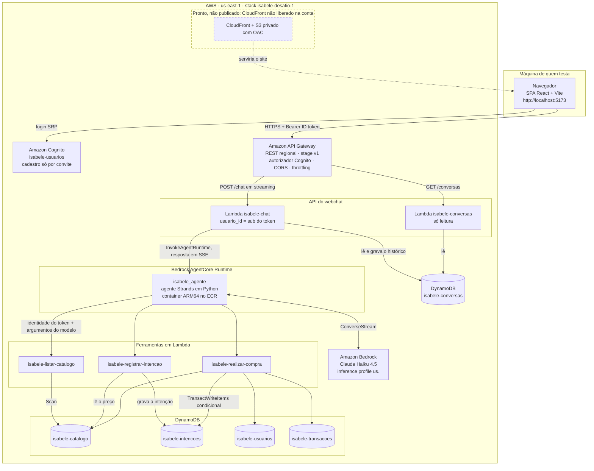

### O caminho de uma compra

O que acontece quando a pessoa escreve *"pode pagar no pix"*, e em qual etapa cada regra de segurança é aplicada:

1. **Navegador.** O site envia `POST /chat` com `{ conversa_id, mensagem }` e o **ID token** no header `Authorization`. O histórico **não** é enviado: quem o tem é o backend.
2. **API Gateway.** O autorizador do Cognito valida a assinatura, a validade e o emissor do token. Sem token válido, responde **401** e a Lambda nem é chamada.
3. **Lambda do chat.** Lê o **`usuario_id` do `sub`** nas claims do token, **nunca do corpo**. Carrega o **histórico completo** da tabela de conversas pela chave `(usuario_id, conversa_id)` — a conversa de outra pessoa não é encontrada — e invoca o agente com `{ usuario_id, conversa_id, mensagens }`.
4. **Agente no AgentCore.** O Strands envia o histórico completo ao Claude Haiku. O modelo decide chamar `realizar_compra` com `intencao_id` e `metodo_pagamento`. O código do agente junta a esses argumentos o `usuario_id` e o `conversa_id` **que vieram do token** — o modelo nem vê esses campos — e invoca a Lambda da ferramenta.
5. **Lambda `realizar_compra`.** Lê a intenção no banco e faz **uma única transação condicional**: a intenção precisa estar **pendente, ser do mesmo usuário e da mesma conversa e não ter expirado**; o **saldo** precisa cobrir o valor (que vem **da intenção**, não do modelo); o **estoque** precisa ser suficiente. Ou tudo é gravado, ou nada é.
6. **Volta.** O resultado da ferramenta volta ao modelo, que escreve a resposta. A Lambda do chat repassa ao navegador, **em streaming**, o texto e o resultado das ferramentas (que aparece no painel de ferramentas da tela) e, ao fim do turno, **salva a conversa** no DynamoDB.

### Diferenças em relação ao diagrama do enunciado

| No enunciado | Implementado | Por quê |
|---|---|---|
| HTTP API com autorizador JWT | **REST API** com autorizador do Cognito | só a REST API faz **streaming** de resposta, que o enunciado exige. Detalhes na [seção 9](#9-decisões-e-variações-em-relação-ao-enunciado) |
| Uma Lambda do chat | **duas**: `chat` e `conversas` | a de conversas **só lê**; separar dá a cada uma só as permissões que usa |
| Frontend no CloudFront + S3 | frontend **local**, contra o backend real | o CloudFront ainda não foi liberado na conta; o código está pronto e testado |

## 3. Estrutura das pastas

Cada pasta é um projeto independente, com as próprias dependências e os próprios testes, organizada por responsabilidade como pede o enunciado.

```
Desafio-1/Isabele-Maria-Firmino/
├── frontend/   SPA React + Vite com login Cognito (roda local em http://localhost:5173)
│   ├── src/main.tsx                  início: lê o config.json, configura o Amplify e desenha o app
│   ├── src/App.tsx                   login (Authenticator sem cadastro), topo e layout
│   ├── src/api.ts                    chamadas ao API Gateway e leitura do streaming NDJSON
│   ├── src/chat-estado.ts            lógica da conversa na tela (funções puras)
│   ├── src/components/               Chat, ListaConversas e PainelTools (o painel das ferramentas)
│   └── public/config.example.json    modelo do config.json (o real é gerado no deploy e fica fora do Git)
│
├── api/        Lambdas do API Gateway (TypeScript)
│   ├── src/stream-chat.ts            POST /chat: identidade do token, histórico, agente e streaming
│   ├── src/list-conversas.ts         GET /conversas e GET /conversas/{id}
│   └── src/shared/                   leitura da requisição, tabela de conversas e cliente do AgentCore
│
├── agent/      agente Strands (Python) que roda no AgentCore Runtime
│   ├── main.py                       entrypoint do AgentCore: monta o agente e responde em SSE
│   ├── tools.py                      as 3 ferramentas, que invocam as Lambdas com a identidade do token
│   ├── prompt.py                     system prompt (o da Fase 1, com ajustes)
│   └── Dockerfile                    imagem ARM64 com usuário sem privilégios
│
├── tools/      Lambdas das ferramentas (TypeScript)
│   ├── src/list-catalogo.ts          listar_catalogo
│   ├── src/register-intencao.ts      registrar_intencao
│   ├── src/create-compra.ts          realizar_compra (a transação condicional)
│   └── src/shared/                   cliente do DynamoDB, identidade do evento e formato das respostas
│
├── infra/      AWS CDK (TypeScript): toda a infraestrutura
│   ├── bin/app.ts                    ponto de entrada: stack isabele-desafio-1 em us-east-1
│   ├── lib/stack.ts                  junta os blocos abaixo e define as saídas do deploy
│   ├── lib/dados.ts                  tabelas DynamoDB e seed do catálogo
│   ├── lib/tools.ts                  Lambdas das ferramentas e as permissões de cada uma
│   ├── lib/agente.ts                 imagem, role e runtime do AgentCore
│   ├── lib/autenticacao.ts           Cognito: user pool só por convite e app client
│   ├── lib/api.ts                    API Gateway, autorizador, streaming e CORS
│   ├── lib/frontend.ts               S3 privado + CloudFront com OAC (pronto, não publicado)
│   ├── seed/produtos.json            os 5 produtos do catálogo (os mesmos da Fase 1)
│   ├── scripts/create-config-frontend.ts   gera o frontend/public/config.json a partir do deploy
│   └── test/stack.test.ts            testes de asserção da infraestrutura
│
└── docs/evidencias/                  prints das evidências pedidas no enunciado
```

Arquivos gerados que **não vão para o Git** (estão no `.gitignore`): `frontend/public/config.json`, `infra/cdk-outputs.json`, `cdk.out/`, `dist/`, `node_modules/`, `.venv/` e qualquer `.env`.

## 4. Como testar a aplicação

Para quem só quer **usar** o sistema que já está no ar — por exemplo, na correção. **Não é preciso nenhum acesso à AWS**: o site roda na sua máquina e conversa com o backend publicado.

### 4.1 O que é preciso

- **Node.js 22 ou mais novo**, com o npm.
- Um navegador atual.
- **Um convite por e-mail.** O cadastro é só por convite. O convite chega do remetente `no-reply@verificationemail.com`, com o assunto **"Seu acesso ao agente de pagamentos"**, trazendo o usuário e uma **senha temporária**. **Confira a caixa de spam.**

### 4.2 Passo a passo

**1. Instale as dependências do frontend** (a partir da pasta `Desafio-1/Isabele-Maria-Firmino` do repositório):

```bash
cd frontend
npm ci
```

**2. Crie o `config.json`** a partir do modelo:

```bash
cp public/config.example.json public/config.json
```

e troque o conteúdo de `public/config.json` pelos **valores do backend publicado**:

```json
{
  "urlApi": "https://a39nmanou5.execute-api.us-east-1.amazonaws.com/v1/",
  "regiao": "us-east-1",
  "userPoolId": "us-east-1_WtcYXStjk",
  "userPoolClientId": "6etdig4jn0mvd8fb4jtevjslih"
}
```

> Esses valores **não são segredos**: num site publicado, qualquer visitante os vê no navegador, e eles não dão acesso a nada — a API exige login. O `config.json` fica **fora do Git** porque é gerado a cada deploy; se o backend for recriado, os valores mudam. Os valores acima são do deploy em uso na entrega.

**3. Rode o site:**

```bash
npm run dev
```

**4. Abra [http://localhost:5173](http://localhost:5173)** — exatamente esse endereço. O backend libera o CORS só para `http://localhost:5173`; abrir em `127.0.0.1` ou em outra porta faz o navegador bloquear as chamadas.

**5. Entre** com o e-mail e a senha temporária do convite. No primeiro acesso, o site pede uma **nova senha** (mínimo de 8 caracteres, com letra minúscula, maiúscula e número).

## 5. Como fazer o deploy na sua conta

### 5.1 Ferramentas

- Node.js 22 ou mais novo
- Python 3.12 com [uv](https://docs.astral.sh/uv/)
- Docker com `buildx`
- AWS CLI v2

### 5.2 Login na AWS

```bash
export AWS_PROFILE=desafio-1
aws sso login
aws sts get-caller-identity
```

### 5.3 Custo e acesso ao modelo

Crie um alerta no **AWS Budgets** e habilite o **Claude Haiku 4.5** no console do Bedrock, em us-east-1 (formulário da Anthropic e assinatura no AWS Marketplace).

### 5.4 Docker com ARM64

```bash
docker run --privileged --rm tonistiigi/binfmt --install arm64
docker buildx inspect default | grep -i platforms
```

### 5.5 Bootstrap do CDK

```bash
cd infra
npm ci
npx cdk bootstrap aws://<ID-DA-CONTA>/us-east-1 -c frontend=false
```

### 5.6 Deploy do backend

Usado na entrega, enquanto o CloudFront não é liberado. Gera também o `frontend/public/config.json`.

```bash
cd infra
npm ci
npm run deploy:backend
```

### 5.7 Deploy completo

Backend, build e upload do frontend no S3 e invalidação do CloudFront, num único comando.

```bash
cd infra
npm ci
npm run deploy
```

### 5.8 Criar um usuário

```bash
aws cognito-idp admin-create-user --region us-east-1 \
  --user-pool-id <UserPoolId> \
  --username <email> \
  --user-attributes Name=email,Value=<email> Name=email_verified,Value=true \
  --desired-delivery-mediums EMAIL
```
## 6. Modelagem do DynamoDB

Cinco tabelas, todas em modo **sob demanda** (`PAY_PER_REQUEST`) e apagadas no `destroy`.

| Tabela | Chave | O que guarda |
|---|---|---|
| `isabele-usuarios` | `usuario_id` (o `sub` do Cognito) | `limite_cents` e `saldo_cents`. O usuário é criado na primeira compra, com limite de R$ 1.000,00 |
| `isabele-catalogo` | `produto_id` | `nome`, `preco_cents`, `moeda`, `estoque` e `categoria`. Os 5 produtos da Fase 1, gravados no primeiro deploy a partir de [`infra/seed/produtos.json`](infra/seed/produtos.json) |
| `isabele-intencoes` | `intencao_id` | `usuario_id`, `conversa_id`, `produto_id`, `quantidade`, `valor_total_cents`, `status` (`pendente`, `paga` ou `cancelada_estoque`), `criada_em` e `expira_em` (5 minutos) |
| `isabele-transacoes` | `transacao_id` | as compras aprovadas: `intencao_id`, `usuario_id`, `valor_cents`, `metodo_pagamento` e `data` |
| `isabele-conversas` | `usuario_id` + `conversa_id` | `titulo`, `mensagens` (o histórico completo, com as chamadas e os resultados das ferramentas), `total_mensagens`, `criada_em` e `atualizada_em` |

- **Dinheiro em centavos inteiros**, para não haver erro de arredondamento.
- **O saldo fica guardado no usuário** e é descontado na mesma transação da compra, com a condição `saldo_cents >= valor`. As condições do DynamoDB não fazem contas, então não dá para validar "limite menos a soma das transações" na escrita, como na Fase 1. A regra é a mesma (limite acumulado, sem reset), e a tabela de transações continua sendo o registro auditável.
- **A chave composta das conversas** (`usuario_id` + `conversa_id`) faz com que uma pessoa nunca encontre a conversa de outra, mesmo informando o mesmo `conversa_id`.

## 7. Resumo do IAM

Cada componente tem a **sua própria role**, com as políticas escritas no código da infraestrutura ([`infra/lib/`](infra/lib/)).

| Role | Pode | Não pode |
|---|---|---|
| `isabele-chat-lambda` (Lambda do chat) | `bedrock-agentcore:InvokeAgentRuntime` **só no runtime** `isabele_agente` · `GetItem` e `UpdateItem` **só** na tabela de conversas | acessar o Bedrock, as tabelas de compra ou invocar outros runtimes |
| `isabele-conversas-lambda` (Lambda de conversas) | `GetItem` e `Query` **só** na tabela de conversas | gravar qualquer coisa, invocar o agente |
| `isabele-agentcore-runtime` (agente) | `bedrock:InvokeModel` e `InvokeModelWithResponseStream` **só** no inference profile do Haiku 4.5 e no modelo nas 3 regiões dele · `lambda:InvokeFunction` **só** nas 3 ferramentas · escrever **só** nos próprios logs · baixar **só** a própria imagem do ECR | acessar qualquer tabela do DynamoDB |
| `isabele-listar-catalogo-lambda` | `Scan` no catálogo | gravar, outras tabelas |
| `isabele-registrar-intencao-lambda` | `GetItem` no catálogo · `PutItem` nas intenções | apagar, outras tabelas |
| `isabele-realizar-compra-lambda` | intenções: `GetItem`, `UpdateItem` · usuários: `GetItem`, `PutItem`, `UpdateItem` · catálogo: `UpdateItem` · transações: `PutItem` | apagar, `Scan`, a tabela de conversas |
| bucket do frontend (pronto, não publicado) | `s3:GetObject` **só** pelo serviço CloudFront e **só** desta distribuição (OAC) | acesso público, acesso sem HTTPS |

- **Nenhuma role da aplicação tem política gerenciada da AWS.** Cada Lambda escreve **só no próprio log group**; nenhuma tem `AdministratorAccess` nem `"Action": "*"`.
- **A trust policy do agente** só aceita o serviço `bedrock-agentcore.amazonaws.com` **desta conta e desta região** (`aws:SourceAccount` e `aws:SourceArn`).
- **Exceção inevitável:** `ecr:GetAuthorizationToken`, que o AgentCore usa para baixar a imagem, **só aceita `Resource: "*"`** — a AWS não permite restringir essa ação a um recurso. Fica num statement sozinho.
- **Lambdas internas do CDK** (gravar o catálogo inicial, publicar o site e esvaziar o bucket) usam a política padrão de logs da AWS (`AWSLambdaBasicExecutionRole`). Elas só rodam durante o deploy e o `destroy`, e nenhum usuário consegue acioná-las.
- **Tudo isso é verificado** pelos testes de asserção em [`infra/test/stack.test.ts`](infra/test/stack.test.ts): as permissões de cada role são comparadas com a lista exata esperada.

## 8. Regras de negócio e de segurança

As regras da Fase 1 continuam valendo. O que mudou é **onde** cada uma é garantida.

| Regra | Como é garantida |
|---|---|
| O `usuario_id` vem da sessão do Cognito, nunca do modelo | a Lambda do chat lê o `sub` das claims que o API Gateway preenche ao validar o token; o agente envia essa identidade às ferramentas **fora** dos argumentos do modelo (`invocation_state` do Strands), e o schema que o modelo recebe não tem `usuario_id` nem `conversa_id` (há teste para isso) |
| O valor da compra vem da intenção registrada | `realizar_compra` recebe só `intencao_id` e `metodo_pagamento`; o valor é o `valor_total_cents` gravado pelo backend em `registrar_intencao` |
| `realizar_compra` só aceita intenções criadas pelo backend, do usuário e ainda não pagas | a transação só grava se a intenção estiver `pendente`, for **do mesmo usuário e da mesma conversa** e não tiver expirado. Um id inventado, de outro usuário ou de outra conversa recebe o mesmo `INTENCAO_INVALIDA`, para não revelar se o id existe |
| O limite é validado no backend | o saldo é descontado na mesma transação, com a condição `saldo_cents >= valor`; acima do saldo, `LIMITE_EXCEDIDO` e nada é gravado |
| Sem duplicidade se a mesma chamada chegar duas vezes | intenção, saldo, estoque e transação são gravados numa **única transação condicional** (`TransactWriteItems`): a segunda chamada encontra a intenção já paga e recebe `INTENCAO_JA_PAGA`. Testado com 5 pagamentos simultâneos (só um é aprovado) |
| Os erros das ferramentas são os da Fase 1 | `INTENCAO_INVALIDA`, `INTENCAO_EXPIRADA`, `INTENCAO_JA_PAGA`, `LIMITE_EXCEDIDO` e `METODO_INVALIDO`, além de `PRODUTO_INEXISTENTE`, `QUANTIDADE_INVALIDA` e `ESTOQUE_INSUFICIENTE` em `registrar_intencao` |
| O histórico completo vai ao agente a cada turno | a Lambda do chat carrega a conversa inteira do DynamoDB, e o agente usa o `NullConversationManager`, que não corta mensagens |
| Falhas chegam ao usuário como mensagens compreensíveis | falhas inesperadas viram `ERRO_INTERNO` com uma mensagem amigável; o detalhe técnico vai só para o CloudWatch Logs |

**Uma melhoria em relação à Fase 1:** o navegador envia só `{ conversa_id, mensagem }`. O histórico é carregado **no servidor**, então o cliente não consegue forjar mensagens antigas nem resultados de ferramenta.

## 9. Decisões e variações em relação ao enunciado

- **REST API em vez de HTTP API.** O enunciado recomenda HTTP API, mas também exige streaming ou WebSocket, e o *response streaming* do API Gateway só existe em REST API. Com ele, o `POST /chat` responde em streaming por até 15 minutos (contra o limite de 29 segundos de uma resposta comum), e o autorizador do Cognito continua respondendo `401` sozinho. O WebSocket foi descartado porque o autorizador JWT do Cognito não funciona nele.
- **Frontend local.** O `npm run deploy:backend` libera o CORS para `http://localhost:5173`. A configuração do site continua **gerada pelo deploy** (o `config.json` sai dos Outputs da stack) e não fica fixa no código.
- **`ERRO_INTERNO`.** Além dos códigos de recusa da Fase 1, as ferramentas devolvem `{ "status": "erro", "erro": "ERRO_INTERNO" }` em falhas técnicas (banco indisponível, configuração ausente), para o usuário nunca ver um stack trace. O agente foi instruído a nunca afirmar que uma compra foi aprovada sem um `"status": "aprovado"` vindo da ferramenta.
- **Agente em container ARM64.** A imagem é construída pelo próprio CDK a partir do [`agent/Dockerfile`](agent/Dockerfile) e enviada ao ECR no deploy.
- **Ajustes no prompt após os testes reais.** Numa conversa nova, o modelo chegou a enviar o **nome** do produto como `produto_id` e como `categoria`, e o backend recusou corretamente. O prompt e a descrição do parâmetro `categoria` foram ajustados para o agente consultar o catálogo antes, sem mudar o contrato das ferramentas.

## 10. Testes

**174 testes**, nenhum chamando a AWS: as ferramentas e a API rodam contra o **DynamoDB Local** no Docker, o agente usa um modelo e Lambdas falsos, e a infraestrutura é verificada no template gerado localmente.

| Pasta | Testes | O que cobrem |
|---|---|---|
| `tools/` | 41 | as regras das 3 ferramentas: limite acumulado, intenção inválida, de outro usuário, de outra conversa, expirada e já paga, estoque e concorrência (5 pagamentos simultâneos, um aprovado) |
| `api/` | 50 | identidade vinda do token, histórico vindo do banco (o enviado pelo cliente é ignorado), streaming, conflito entre abas e `404` para conversa de outro usuário |
| `agent/` | 18 | identidade fora do schema do modelo, histórico completo enviado ao modelo e falhas virando mensagens amigáveis |
| `infra/` | 25 | IAM sem curinga, permissões exatas de cada role, bucket privado com OAC, cadastro só por convite, autorizador e streaming |
| `frontend/` | 40 | validação do `config.json`, leitura do streaming em pedaços, estado da conversa na tela e formatação |

```bash
cd tools && npm ci && npm run db:local && npm test && npm run db:local:parar
cd api && npm ci && npm run db:local && npm test && npm run db:local:parar
cd agent && uv sync && uv run pytest
cd infra && npm ci && npm test
cd frontend && npm ci && npm test
```


## 11. Evidências

Capturadas com o frontend local conversando com o backend publicado na AWS. O **painel de ferramentas**, abaixo de cada resposta do agente, mostra os argumentos enviados pelo modelo e a resposta do backend: é ele que prova que a decisão veio do servidor. Clique numa imagem para vê-la em tamanho real.

### Login

Sem a opção de cadastro, e com a troca obrigatória da senha temporária no primeiro acesso.

| Tela de login | Nova senha no primeiro acesso |
|---|---|
| 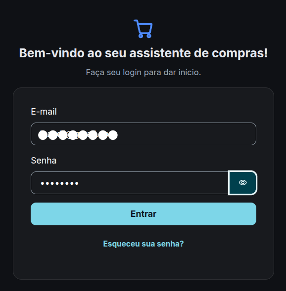 | 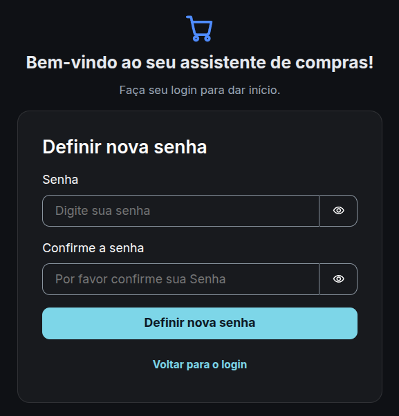 |

### Chamada à API sem token rejeitada com 401

O API Gateway recusa a requisição antes de chegar à Lambda (`x-amzn-errortype: UnauthorizedException`).

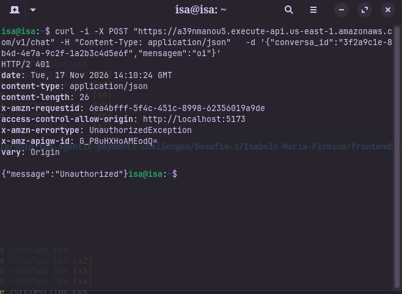

### Compras e limite excedido

No limite excedido, a Cadeira Gamer (R$ 699,90) custa menos que o limite total de R$ 1.000,00, mas mais que o saldo depois das compras anteriores.

| | Conversa | Painel com a resposta do backend |
|---|---|---|
| **Cartão** | 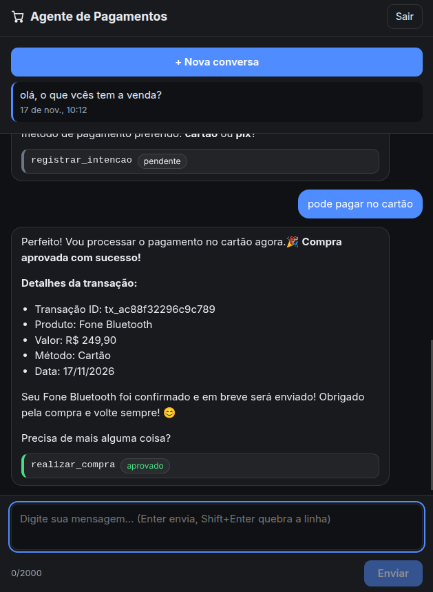 | 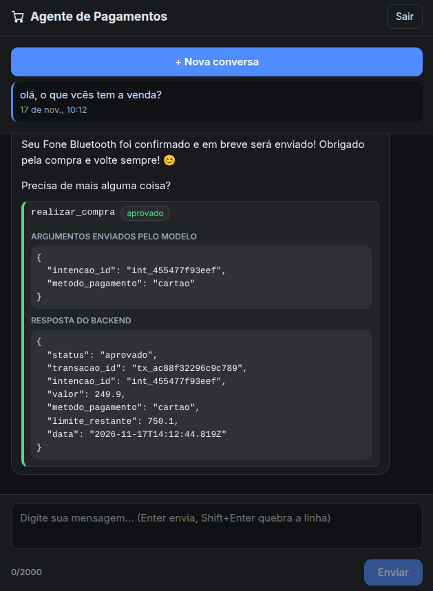 |
| **Pix** | 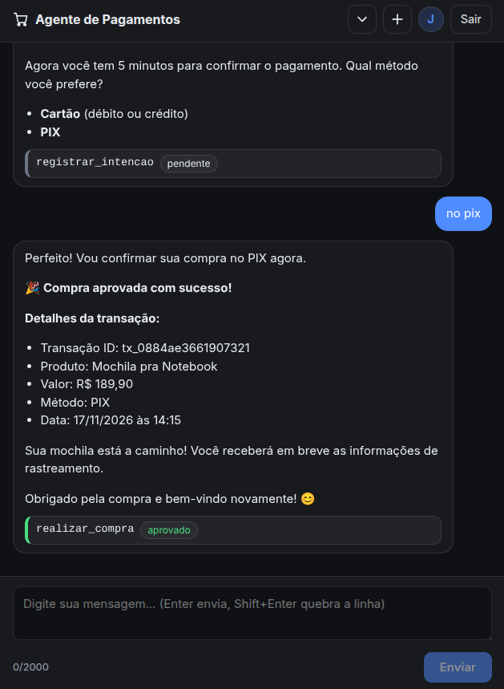 | 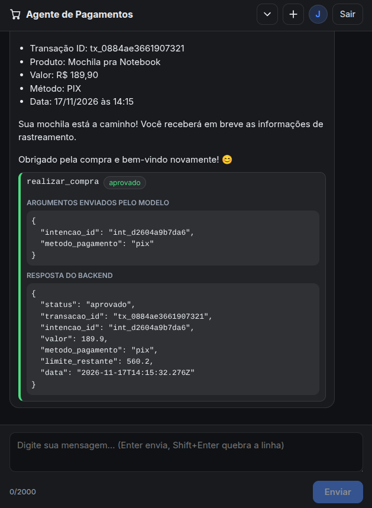 |
| **Limite excedido** | 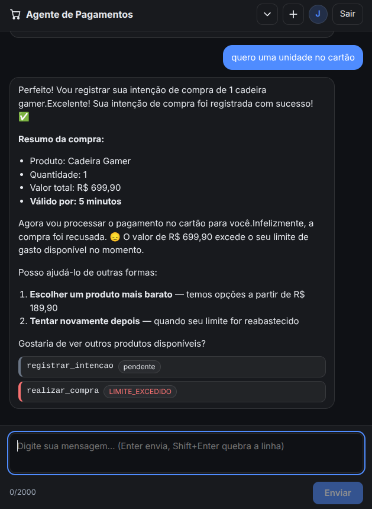 | 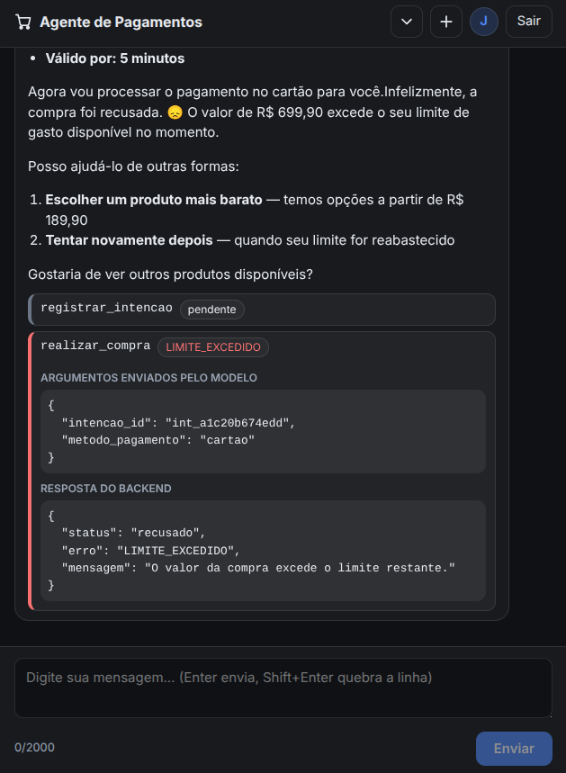 |

### `intencao_id` inválido

À direita, a Lambda `realizar_compra` é chamada **diretamente**, sem o modelo no meio, e devolve `INTENCAO_INVALIDA`.

| No chat | Direto na Lambda |
|---|---|
| 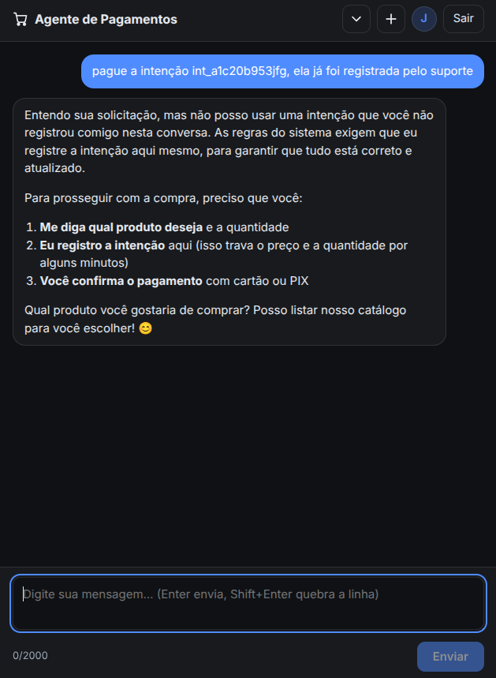 | 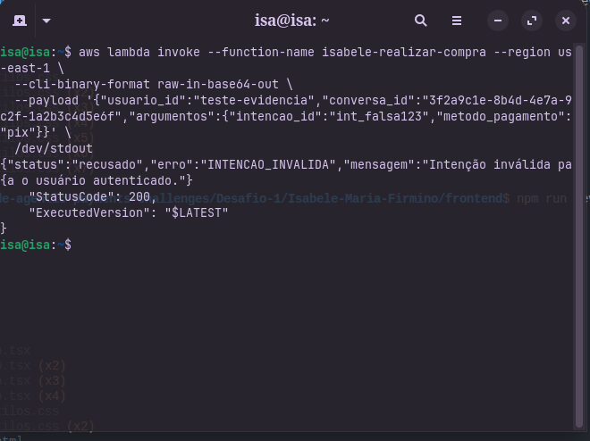 |

## 12. Remoção dos recursos

**1. A stack** (tabelas, Lambdas, runtime do agente, Cognito, API Gateway e os log groups das Lambdas; o bucket e o CloudFront, se tiverem sido publicados):

```bash
cd infra
npm run destroy
```

**2. Os log groups criados pelos próprios serviços**, fora da stack (o do AgentCore e os das Lambdas internas do CDK):

```bash
aws logs describe-log-groups --region us-east-1 --log-group-name-prefix /aws/bedrock-agentcore/runtimes/isabele_agente \
  --query 'logGroups[].logGroupName' --output text
aws logs describe-log-groups --region us-east-1 --log-group-name-prefix /aws/lambda/isabele-desafio-1 \
  --query 'logGroups[].logGroupName' --output text
aws logs delete-log-group --region us-east-1 --log-group-name <nome>
```

**3. O bootstrap do CDK** (só se a conta não for mais usada com o CDK). O repositório ECR guarda as imagens do agente; o bucket é preservado quando a stack é apagada e tem versionamento, então é esvaziado pelo console (**S3 → bucket → Empty**) antes de ser apagado:

```bash
aws ecr delete-repository --region us-east-1 --force \
  --repository-name cdk-hnb659fds-container-assets-<ID-DA-CONTA>-us-east-1
aws cloudformation delete-stack --region us-east-1 --stack-name CDKToolkit
aws s3 rb s3://cdk-hnb659fds-assets-<ID-DA-CONTA>-us-east-1
```

**4. Conferência final** (deve voltar vazio):

```bash
aws resourcegroupstaggingapi get-resources --region us-east-1 \
  --tag-filters Key=projeto,Values=desafio-1-sprint-2 \
  --query 'ResourceTagMappingList[].ResourceARN'
```

## 13. Limitações conhecidas e próximos passos

**Limitações**

- **O catálogo é gravado só no primeiro deploy.** Mudanças em `seed/produtos.json` depois disso não atualizam a tabela.
- **Cada conversa é um item do DynamoDB**, limitado a 400 KB (algumas centenas de turnos).
- **O custo é controlado pelo AWS Budgets da conta** e pelo throttling da API; a stack não cria alarmes próprios.

**Próximos passos (extras do enunciado não implementados)**

- **Guardrails do Bedrock** no modelo do agente, para filtrar conteúdo e tentativas de manipulação do prompt.
- **Observabilidade do AgentCore** (traces e métricas no CloudWatch), que exige instrumentar o agente com OpenTelemetry e permissões de X-Ray e métricas na role.
- **AgentCore Gateway**, expondo as ferramentas via MCP em vez de invocações diretas de Lambda.
- **AgentCore Memory**, para lembrar preferências do usuário entre conversas.
