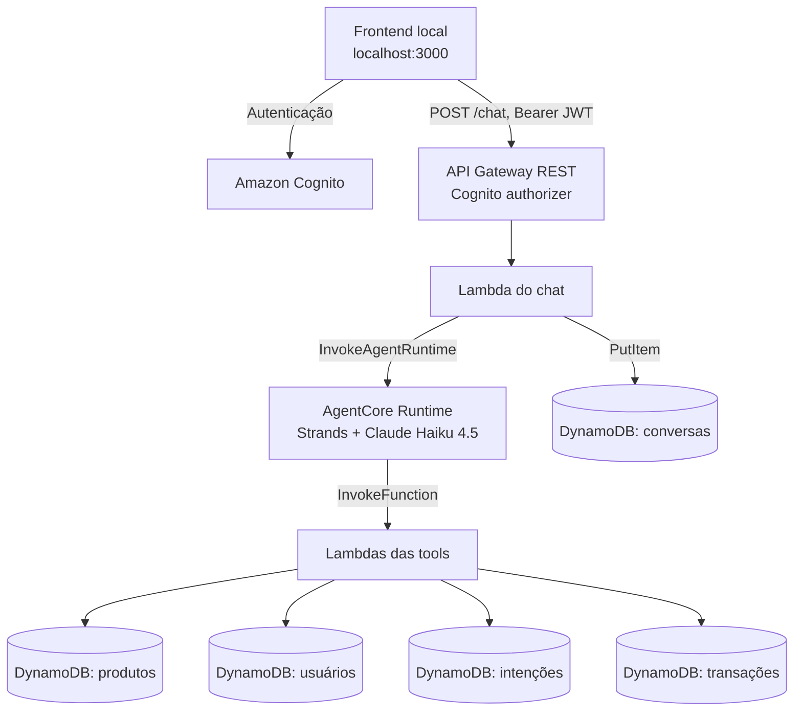

# Desafio 1 — Alan Lorenz

## Visão geral

A entrega consiste em uma solução de atendimento via chat implantada na AWS em
`us-east-1` (stack `AlanLorenzInfraStack`), com frontend Next.js executado
localmente em `http://localhost:3000`. A solução integra autenticação com Amazon
Cognito, endpoint de chat protegido no API Gateway, agente Strands executado no
Bedrock AgentCore Runtime com o modelo Claude Haiku do Amazon Bedrock e três
ferramentas de negócio executadas em AWS Lambda, com persistência e regras de
compra em Amazon DynamoDB. O fluxo foi validado com recursos reais e as
evidências anonimizadas estão registradas em [`evidências/`](./evidências/).

Como adaptação documentada, a hospedagem do frontend em S3/CloudFront não foi
provisionada: o frontend é executado localmente e consome os recursos AWS
implantados. A aplicação e o acesso do usuário instrutor permanecem disponíveis
até a correção, e os recursos são removidos após a avaliação.

## Arquitetura

O endpoint de chat exige token JWT do Cognito. A identidade do usuário é
obtida exclusivamente do claim `sub` validado pelo autorizador (nunca de dados
enviados pelo cliente ou pelo modelo). A resposta do chat é transmitida em
streaming. O CORS da API é restrito à origem local `http://localhost:3000`.

## Modelo

O agente utiliza o perfil de inferência `us.anthropic.claude-haiku-4-5-20251001-v1:0`
do Amazon Bedrock na região `us-east-1`. A invocação do modelo depende de acesso
habilitado na conta e pode gerar custos.

## Modelagem do DynamoDB

| Tabela | Chave de partição | Chave de ordenação | Conteúdo |
|---|---|---|---|
| `AlanLorenz-Produtos` | `id` | — | Catálogo, preço em centavos, estoque e categoria |
| `AlanLorenz-Usuarios` | `userId` (`sub`) | — | Limite total e saldo restante em centavos; perfil criado/garantido de forma idempotente no primeiro acesso autenticado ao chat (limite inicial de R$ 1.000,00 / 100000 centavos) |
| `AlanLorenz-Conversas` | `userId` (`sub`) | `messageKey` | Mensagens e eventos de ferramentas por conversa/turno, com chave determinística para idempotência em retentativas |
| `AlanLorenz-Intencoes` | `intentionId` | — | Usuário, conversa, produto, quantidade, total calculado, status e expiração (5 minutos) |
| `AlanLorenz-Transacoes` | `intentionId` | — | Registro da transação simulada; uma transação por intenção, evitando duplicidade |

As tabelas utilizam cobrança sob demanda com limite de throughput configurado
(5 unidades de leitura e 5 de escrita por tabela), o que não constitui teto de
gasto mensal. Não há TTL nem índices secundários. A conclusão da compra aplica
atualizações condicionais/transacionais envolvendo intenção, limite do usuário,
estoque e transação.

**Limitação conhecida:** as mensagens são persistidas e o histórico do turno é
enviado ao agente, porém não há endpoint para restaurar conversas salvas após
o recarregamento da página.

## Ferramentas e regras de negócio

As três ferramentas — `listar_catalogo`, `registrar_intencao` e
`realizar_compra` — são executadas em funções Lambda dedicadas e invocadas pelo
agente no runtime. O contexto autenticado (`userId`/`sub` e identificador da
conversa) é fornecido pela camada de integração, separado dos argumentos do
modelo. A intenção de compra tem validade de 5 minutos e não reserva estoque;
o valor é calculado no backend. A compra valida intenção, propriedade, conversa,
expiração, método de pagamento, saldo/limite e estoque, registrando o resultado
de forma consistente (aprovação, recusa por limite excedido, intenção inválida
ou expirada, entre outros casos).

## Revisão de permissões IAM

As funções de aplicação possuem papéis separados e permissões limitadas aos
recursos necessários, sem uso de `AdministratorAccess`.

| Papel/Função | Permissões principais |
|---|---|
| `AlanLorenz-ChatHandler` | Escrita de logs no próprio log group; `bedrock-agentcore:InvokeAgentRuntime` no runtime; `dynamodb:PutItem` em `AlanLorenz-Conversas`; `dynamodb:GetItem` e `dynamodb:PutItem` em `AlanLorenz-Usuarios` para provisionamento idempotente do perfil no primeiro acesso autenticado |
| `AlanLorenz-ListCatalog` | `dynamodb:Scan` em `AlanLorenz-Produtos`; escrita de logs no próprio log group |
| `AlanLorenz-RegisterIntention` | `dynamodb:GetItem` em Produtos; `dynamodb:GetItem` e `dynamodb:PutItem` em Usuários; `dynamodb:PutItem` em Intenções; escrita de logs no próprio log group |
| `AlanLorenz-RealizarCompra` | `dynamodb:GetItem`, `dynamodb:UpdateItem` e `dynamodb:TransactWriteItems` em Intenções e Produtos; `dynamodb:GetItem`, `dynamodb:UpdateItem` e `dynamodb:TransactWriteItems` em Usuários; `dynamodb:PutItem` e `dynamodb:TransactWriteItems` em Transações; escrita de logs no próprio log group |
| `ChatAgentRuntimeExecutionRole` | Invocação apenas das três Lambdas de ferramentas; acesso ao perfil de inferência e aos foundation models de destino correspondentes (condicionado ao perfil); permissões operacionais/telemetria necessárias ao AgentCore |

Permissões globais `Resource: "*"` associadas a X-Ray/métricas do construct do
AgentCore foram removidas, e a validação da infraestrutura inclui verificação
para impedir seu reaparecimento. Permanecem padrões curinga delimitados em
permissões operacionais geradas pelo AgentCore (logs, identidade e invocação do
runtime, restritos a região/conta), sem concessão global de acesso a dados. O
papel utilizado para implantação é distinto dos papéis de execução, e credenciais
não são armazenadas no repositório.

## Infraestrutura, implantação e provisionamento

A infraestrutura é definida com AWS CDK em TypeScript na pasta [`infra/`](./infra/).
A validação local abrange testes e síntese da stack, testes do agente e
verificações do frontend e das ferramentas. A implantação publica a stack
`AlanLorenzInfraStack` em `us-east-1` (com bootstrap do CDK quando necessário),
criando backend, autenticação, API, runtime do agente, Lambdas e tabelas
DynamoDB, sem provisionar hospedagem para o frontend.

Os outputs relevantes do deploy incluem `UserPoolId`, `UserPoolClientId`,
`ChatApiEndpoint` e `AgentRuntimeArn`. Após a implantação, o catálogo inicial
é semeado na tabela `AlanLorenz-Produtos` (pasta [`tools/`](./tools/), sem
sobrescrever itens existentes) e os usuários da aplicação são criados por
convite administrativo no Cognito (cadastro público desabilitado). Usuários de
teste e o usuário do instrutor são provisionados dessa forma, sendo que o
acesso do instrutor permanece disponível até a correção.

## Execução do frontend local

O frontend (Next.js) está em [`frontend/`](./frontend/) e é executado localmente,
consumindo os recursos implantados na AWS.

- **Configuração:** em `frontend/.env.local` são definidos `NEXT_PUBLIC_USER_POOL_ID`,
  `NEXT_PUBLIC_USER_POOL_CLIENT_ID` e `NEXT_PUBLIC_CHAT_API_URL`, preenchidos com
  os valores dos outputs do deploy (`UserPoolId`, `UserPoolClientId` e
  `ChatApiEndpoint`). O arquivo de exemplo `.env.example` serve de referência.
- **Dependências e execução:** na pasta `frontend/`, as dependências são
  instaladas com `npm ci` (ou `npm install`) e o servidor de desenvolvimento é
  iniciado com `npm run dev`.
- **Acesso:** a aplicação fica disponível em `http://localhost:3000`. O login é
  realizado com usuário criado por convite no Cognito; no primeiro acesso, a
  senha temporária é substituída conforme o fluxo do Cognito. Após o login, o
  perfil do usuário é provisionado/garantido em `AlanLorenz-Usuarios` com o
  limite inicial configurado.
- **Observações:** alterações em `.env.local` exigem reinício do servidor de
  desenvolvimento. O CORS do endpoint de chat permite a origem
  `http://localhost:3000`.

## Evidências de validação

Os registros a seguir são capturas anonimizadas (sem tokens JWT, senhas ou
dados pessoais sensíveis), armazenadas em [`evidências/`](./evidências/):

| Cenário exigido | Estado | Evidência |
|---|---|---|
| Login com Cognito | Validado | [login-cognito.png](./evidências/login-cognito.png) |
| Requisição sem token válido (401) | Validado | [401-sem-token.png](./evidências/401-sem-token.png) |
| Compra simulada com cartão | Validado | [realizar-compra-cartao.png](./evidências/realizar-compra-cartao.png) |
| Compra simulada com Pix | Validado | [realizar-compra-pix.png](./evidências/realizar-compra-pix.png) |
| Compra recusada por limite excedido | Validado | [limite-excedido.png](./evidências/limite-excedido.png) |
| `intencao_id` inválido / não autorizado | Validado | [intencao-invalida.png](./evidências/intencao-invalida.png) |

Evidências complementares do fluxo de ferramentas: [listar-catalogo.png](./evidências/listar-catalogo.png)
e [registrar-intencao.png](./evidências/registrar-intencao.png).

## Remoção da infraestrutura

Após a correção/avaliação, e com a devida autorização, a stack é removida a
partir da pasta `infra/` com `npm run cdk -- destroy AlanLorenzInfraStack`. A
remoção elimina os recursos da stack (tabelas DynamoDB, usuários do Cognito,
API, Lambdas e runtime do AgentCore), sendo recomendada a preservação prévia de
dados necessários. O bootstrap CDK compartilhado da conta/região não é removido
por esse comando.

## Estrutura de pastas

- [`frontend/`](./frontend/) — interface web local e integração com Cognito/chat.
- [`api/`](./api/) — Lambda de chat, provisionamento idempotente do perfil de usuário e persistência de conversas.
- [`agent/`](./agent/) — agente Strands executado no AgentCore Runtime.
- [`tools/`](./tools/) — ferramentas de catálogo, intenção e compra, além do seed do catálogo.
- [`infra/`](./infra/) — definição da stack AWS CDK e validações de infraestrutura.
- [`evidências/`](./evidências/) — registros anonimizados dos cenários validados.
