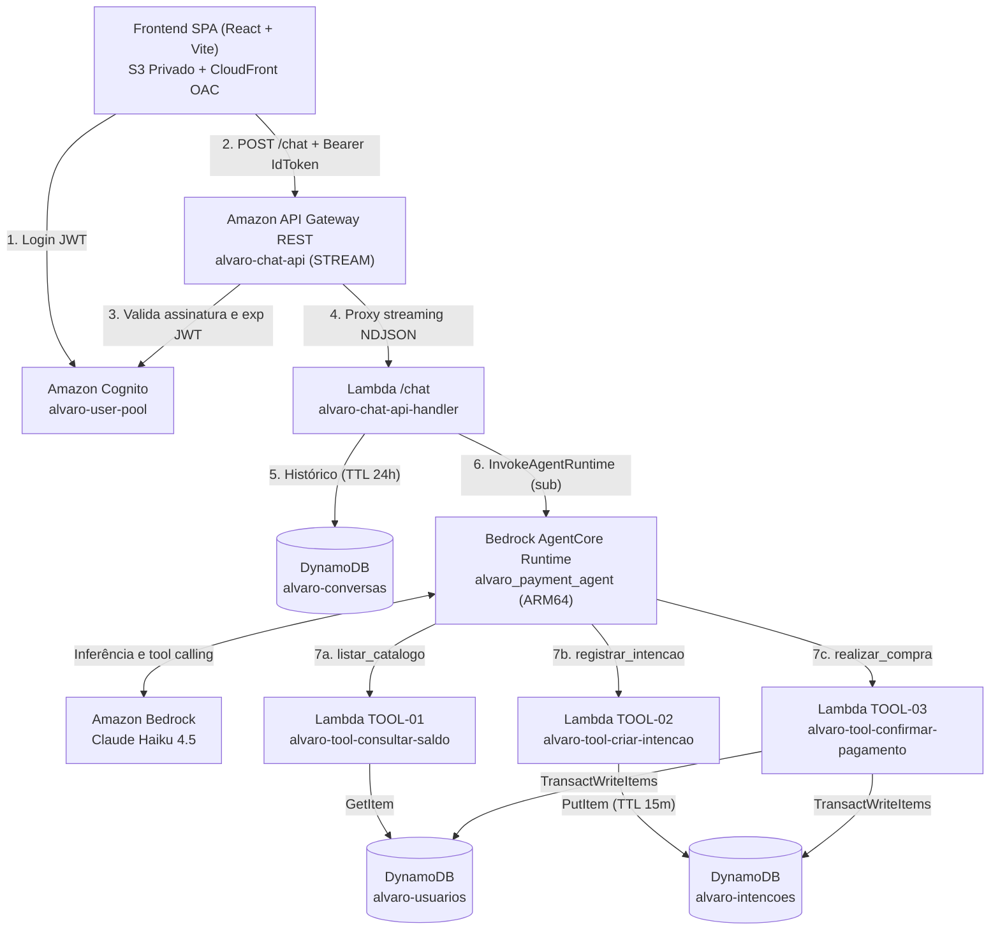

# Nexus Store: Agente de Pagamentos Serverless na AWS

Migração do chatbot de pagamentos da Nexus Store (Fase 1 local) para infraestrutura serverless na AWS (`us-east-1`), definida com AWS CDK v2 em TypeScript.

## 1. Arquitetura Implementada



### Controles e estrutura do projeto

- **Identidade na borda:** o `CognitoUserPoolsAuthorizer` valida o JWT antes de acionar a Lambda `/chat`. O `usuario_id` é lido apenas de `requestContext.authorizer.claims.sub` e repassado ao AgentCore via `invocationState`.
- **Preços no backend:** `registrar_intencao` lê os preços em `tools/shared/catalog.ts` e grava a intenção como `PENDENTE` com TTL de 15 minutos; `realizar_compra` liquida usando o valor salvo no banco.
- **Auto cadastro fechado:** `alvaro-user-pool` usa `selfSignUpEnabled: false` (`AllowAdminCreateUserOnly: true`).

| Pasta | Papel |
| :--- | :--- |
| `frontend/` | SPA React 19 + TypeScript + Vite (24 testes Vitest) |
| `infra/` | Stack CDK `alvaro-agentic-payments-stack` e construtos |
| `api/` | Handler streaming NDJSON `POST /chat` (8 testes) |
| `agent/` | Container `linux/arm64` com `@strands-agents/sdk` + Express `:8080` (14 testes) |
| `tools/` | 3 Lambdas determinísticas (`consultar-saldo`, `criar-intencao`, `confirmar-pagamento`) |
| `scripts/` | Script unificado de deploy e teardown (`deploy.sh`) |
| `docs/` | ADRs ([`adr/`](docs/fase-2-desafio-1-aws/adr/)) e [evidências](docs/fase-2-desafio-1-aws/evidencias.md) |
| `backend/`, `mcp-tools/` | Referência local mantida da Fase 1 (não implantada na AWS) |

---

## 2. Deploy Passo a Passo

### Pré-requisitos

- Node.js 22+, npm e Docker Desktop em execução (para build `linux/arm64` do `PaymentAgent`).
- AWS CLI v2 autenticada via SSO na conta `006739439488` em `us-east-1`.
- Acesso ao modelo `us.anthropic.claude-haiku-4-5-20251001-v1:0` habilitado no Bedrock em `us-east-1` (formulário de uso da Anthropic enviado na conta).

### Instalação e bootstrap

```bash
aws sso login --profile alvaro-fellowship
npx --prefix infra cdk bootstrap aws://006739439488/us-east-1 --profile alvaro-fellowship

npm --prefix frontend ci
npm --prefix infra ci
npm --prefix agent ci
```

### Deploy completo em comando único

Execute em `Desafio-1/alvaro-santos/`:

```bash
bash scripts/deploy.sh --profile alvaro-fellowship
```

O script compila a SPA, valida os tipos da stack CDK, cria/atualiza os recursos via `cdk deploy --all`, extrai os outputs de `infra/cdk-outputs.json` para `frontend/.env.local` (sem valores fixos no código), recompila o frontend com os IDs reais e publica no S3 privado com invalidação `/*` no CloudFront. *(No PowerShell em `infra/`: `npm run deploy -- --profile alvaro-fellowship`.)*

### Contorno para bloqueio temporário de `cloudfront:*`

Quando a conta compartilhada restringir `cloudfront:*`, use a flag `--skip-frontend` (`-c skipFrontendHost=true`). Ela implanta todo o backend na AWS, libera CORS para `http://localhost:5173` e gera `frontend/.env.local`:

```bash
bash scripts/deploy.sh --skip-frontend --profile alvaro-fellowship
npm --prefix frontend run dev
```

*(No PowerShell em `infra/`: `npm run deploy:backend-only -- --profile alvaro-fellowship`.)*

### Cadastro do usuário avaliador e saldo inicial

```bash
POOL_ID="<AuthUserPoolIdOutput>"

aws cognito-idp admin-create-user \
  --user-pool-id "$POOL_ID" \
  --username avaliador \
  --user-attributes Name=email,Value="instrutor@exemplo.com" Name=email_verified,Value=true \
  --region us-east-1 \
  --profile alvaro-fellowship

USER_SUB=$(aws cognito-idp admin-get-user \
  --user-pool-id "$POOL_ID" \
  --username avaliador \
  --query "UserAttributes[?Name=='sub'].Value | [0]" \
  --output text \
  --region us-east-1 \
  --profile alvaro-fellowship)

aws dynamodb put-item \
  --table-name alvaro-usuarios \
  --item "{\"usuario_id\":{\"S\":\"$USER_SUB\"},\"nome\":{\"S\":\"Avaliador\"},\"saldo_disponivel\":{\"N\":\"5000\"},\"limite_total\":{\"N\":\"5000\"}}" \
  --region us-east-1 \
  --profile alvaro-fellowship
```

---

## 3. Modelo do Amazon Bedrock

- **ID configurado:** `us.anthropic.claude-haiku-4-5-20251001-v1:0` (Claude Haiku 4.5, inference profile US em `us-east-1`).
- **Arquivos:** [infra/lib/agent.ts](infra/lib/agent.ts) e [agent/src/prompt.ts](agent/src/prompt.ts).
- **Motivo:** segue a família recomendada pelo desafio (Claude Haiku) pela combinação de baixa latência (compatível com o timeout do API Gateway em chamadas sequenciais de tools), custo baixo por token e precisão em tool calling com Zod. A geração anterior (`us.anthropic.claude-3-haiku-20240307-v1:0`) entrou em EOL na AWS e foi substituída pelo Claude Haiku 4.5.

---

## 4. Modelagem do Amazon DynamoDB

Provisionamento em [infra/lib/database.ts](infra/lib/database.ts) com `PAY_PER_REQUEST`, criptografia `AWS_MANAGED` e `RemovalPolicy.DESTROY`:

| Tabela | Partition Key | TTL (`expires_at`) | Atributos e função |
| :--- | :--- | :--- | :--- |
| `alvaro-usuarios` | `usuario_id` (`S`) | Não | Chave igual ao `sub` do Cognito; guarda `nome`, `saldo_disponivel`, `limite_total` e `atualizado_em`. |
| `alvaro-intencoes` | `intencao_id` (`S`) | 15 minutos | UUID v4; guarda `usuario_id`, produto, `quantidade`, `preco_unitario`, `valor_total`, `status` (`PENDENTE`/`PAGO`), `transacao_id`, `metodo_pagamento` e `pago_em`. |
| `alvaro-conversas` | `session_id` (`S`) | 24 horas | Formato `<sub_cognito>:<sessionId>`; guarda `usuario_id`, até 50 entradas em `messages` (com tags `[intencao_id: ...]`) e `updated_at`. |

Em [tools/confirmar-pagamento/index.ts](tools/confirmar-pagamento/index.ts), a liquidação executa `TransactWriteCommand` exigindo `attribute_exists(intencao_id) AND usuario_id = :usuarioId AND #status = :pendente AND expires_at > :nowEpochSec` e `attribute_exists(usuario_id) AND saldo_disponivel >= :valor`. Chamadas duplicadas falham com `TransactionCanceledException` e retornam `INTENCAO_JA_PAGA` ou `LIMITE_EXCEDIDO`.

---

## 5. Permissões IAM (Menor Privilégio)

Nenhuma role usa `"Action": "*"` com `"Resource": "*"` nem `AdministratorAccess`:

| Componente | Permitido | Restrito / Negado |
| :--- | :--- | :--- |
| Lambda `/chat` (`alvaro-chat-api-handler`) | Leitura/escrita apenas em `alvaro-conversas`; `bedrock-agentcore:InvokeAgentRuntime*` em `alvaro_payment_agent`. | Sem acesso a `alvaro-usuarios`, `alvaro-intencoes` ou `bedrock:InvokeModel`. |
| AgentCore Runtime (`alvaro_payment_agent`) | `bedrock:InvokeModel*` no Claude Haiku 4.5; `lambda:InvokeFunction` nas 3 Tool Lambdas; logs em `/aws/bedrock-agentcore/runtimes/*`. | Sem acesso direto ao DynamoDB. |
| Lambda `TOOL-01` (`alvaro-tool-consultar-saldo`) | `dynamodb:GetItem` em `alvaro-usuarios`. | Sem escrita e sem acesso às demais tabelas. |
| Lambda `TOOL-02` (`alvaro-tool-criar-intencao`) | `dynamodb:PutItem` em `alvaro-intencoes`. | Sem acesso a `alvaro-usuarios` nem atualização de itens. |
| Lambda `TOOL-03` (`alvaro-tool-confirmar-pagamento`) | `dynamodb:GetItem`, `UpdateItem`, `ConditionCheckItem` em `alvaro-intencoes` e `alvaro-usuarios`. | Sem `DeleteItem` e sem acesso a `alvaro-conversas`. |
| Bucket `alvaro-frontend-bucket-*` | `s3:GetObject` apenas para `cloudfront.amazonaws.com` com condição `AWS:SourceArn` (OAC). | `BlockPublicAccess.BLOCK_ALL` e static website hosting desativados. |

---

## 6. Evidências de Execução

O relatório visual completo com as capturas de tela está em **[`docs/fase-2-desafio-1-aws/evidencias.md`](docs/fase-2-desafio-1-aws/evidencias.md)**:

| Cenário | Evidência |
| :--- | :--- |
| 1. Login no Cognito (`alvaro-user-pool`) | [evidencia-01-login-cognito.jpg](docs/screenshots/evidencia-01-login-cognito.jpg) |
| 2. API Gateway rejeitando sem token (`401 Unauthorized`) | [evidencia-02-api-401-unauthorized.png](docs/screenshots/evidencia-02-api-401-unauthorized.png) |
| 3. Compra aprovada com comprovante e saldo atualizado | [evidencia-03a-compra-aprovada-pix.jpg](docs/screenshots/evidencia-03a-compra-aprovada-pix.jpg) |
| 4. Tentativa bloqueada por limite excedido | [evidencia-04-limite-excedido.jpg](docs/screenshots/evidencia-04-limite-excedido.jpg) |
| 5. Tentativa com intenção já paga / inválida recusada | [evidencia-05-intencao-invalida.jpg](docs/screenshots/evidencia-05-intencao-invalida.jpg) |

---

## 7. Remoção dos Recursos (Teardown)

```bash
# Stack completa:
bash scripts/deploy.sh --destroy --profile alvaro-fellowship

# Stack implantada com --skip-frontend:
bash scripts/deploy.sh --destroy --skip-frontend --profile alvaro-fellowship
```

*(No PowerShell em `infra/`: `npm run destroy -- --profile alvaro-fellowship` ou `npm run destroy:backend-only -- --profile alvaro-fellowship`.)*

Após o comando, confira no Console AWS (`us-east-1`) que não restaram recursos em: CloudFormation (`alvaro-agentic-payments-stack`), S3 (`alvaro-frontend-bucket-*`) e CloudFront, DynamoDB (`alvaro-*`), Cognito (`alvaro-user-pool`), API Gateway (`alvaro-chat-api`), Lambda (`alvaro-*`), Bedrock AgentCore (`alvaro_payment_agent`), imagens no ECR e grupos de log no CloudWatch.
