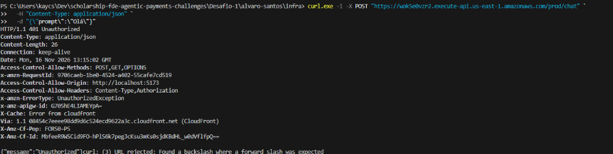
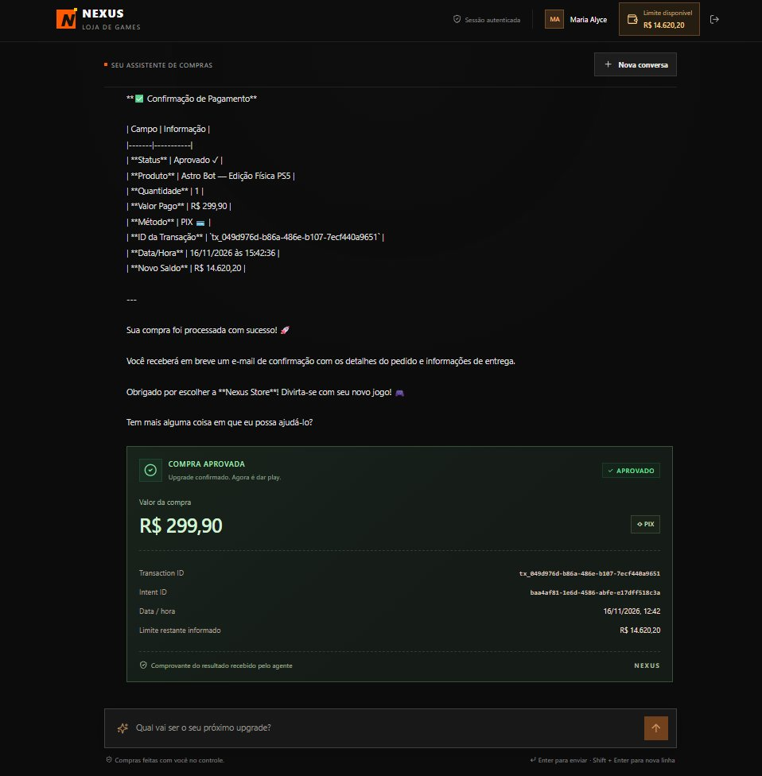
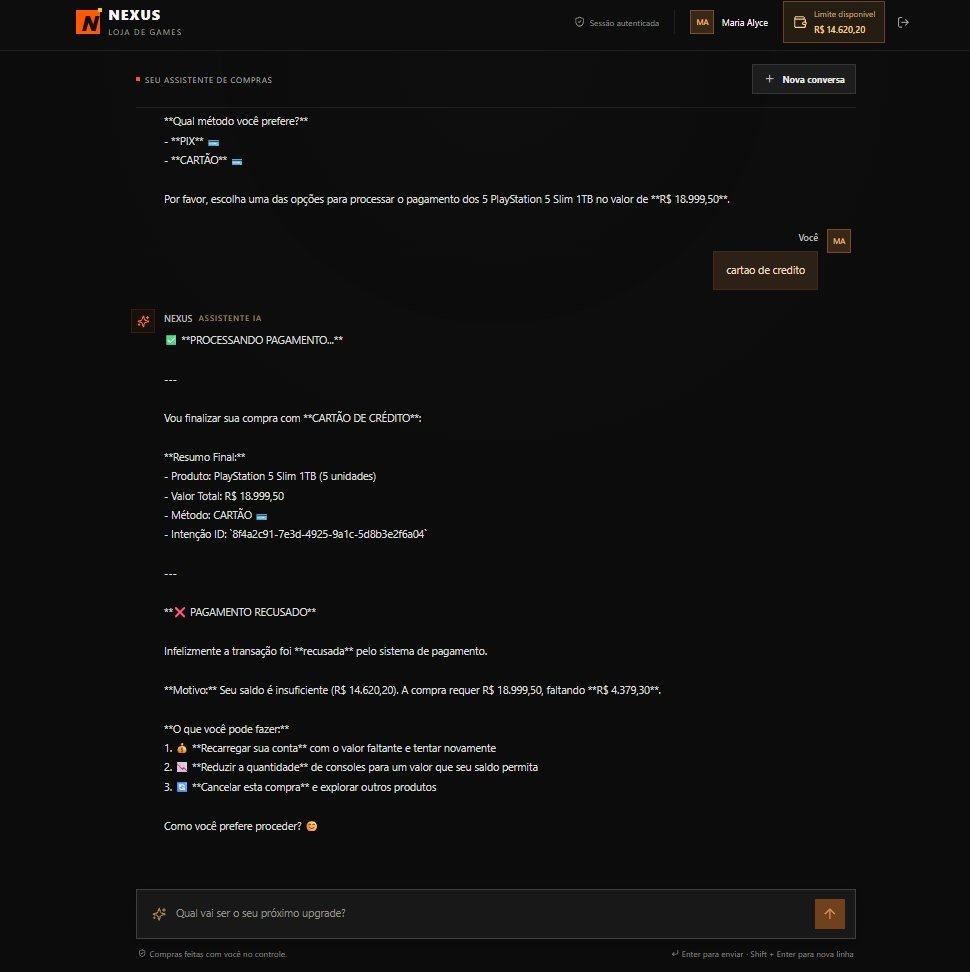
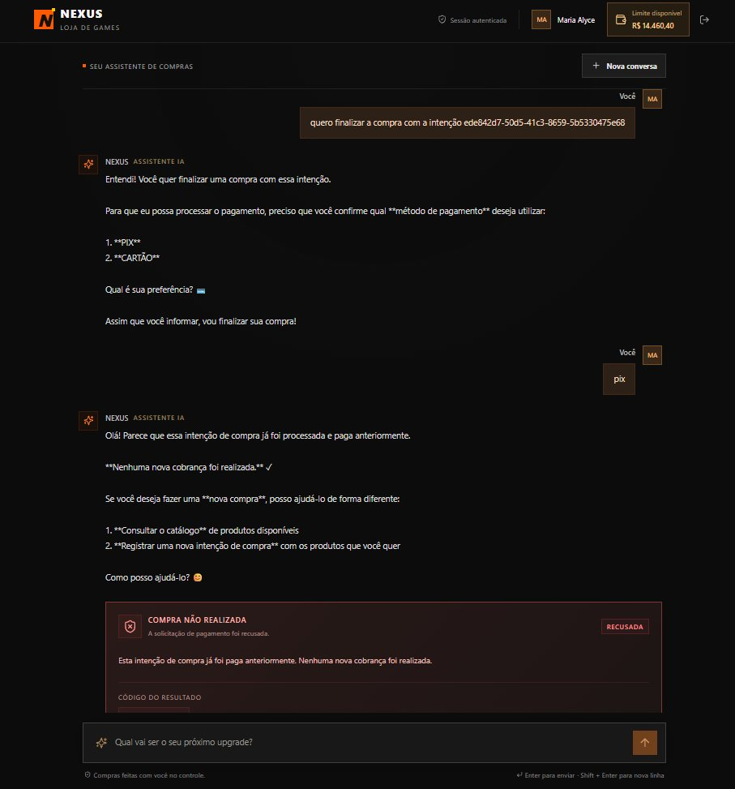

# Evidências de Execução na AWS (`us-east-1`)

Registro das validações executadas contra a infraestrutura provisionada em `us-east-1` (conta `006739439488`, stack `alvaro-agentic-payments-stack`).

> Nota de ambiente: durante a coleta inicial, a conta compartilhada estava com restrição temporária para `cloudfront:*`. O backend (Cognito, API Gateway, Lambda `/chat`, Bedrock AgentCore, Tool Lambdas e DynamoDB) rodou integralmente na AWS e o frontend React operou localmente apontando para os endpoints reais via `--skip-frontend`.

---

## 1. Login funcionando no Amazon Cognito (`alvaro-user-pool`)

Sessão autenticada com `USER_PASSWORD_AUTH` emitindo `IdToken` JWT com claim `sub`, exibindo usuário e saldo inicial na interface após redirecionamento para `/chat`.

---

## 2. Chamada à API sem token rejeitada com `401 Unauthorized`

Requisição `POST /prod/chat` enviada sem header `Authorization` rejeitada na borda pelo `CognitoUserPoolsAuthorizer` do API Gateway com status `HTTP/1.1 401 Unauthorized` (`{"message":"Unauthorized"}`) e headers CORS configurados nos `GatewayResponses`.

---

## 3. Compra bem-sucedida com comprovante e atualização de saldo

Compra de `Astro Bot — Edição Física PS5` (R$ 299,90) finalizada via `realizar_compra` com método Pix (`tx_049d976d-b86a-486e-b107-7ecf440a9651`), debitando o saldo em `alvaro-usuarios` para R$ 14.620,20 e refletindo o novo limite no cabeçalho e no card de comprovante.

---

## 4. Tentativa de compra bloqueada por limite excedido (`LIMITE_EXCEDIDO`)

Tentativa de pagamento de 5 unidades de PlayStation 5 Slim (R$ 18.999,50) contra saldo disponível de R$ 14.620,20 bloqueada pela condição `saldo_disponivel >= :valor` na `TOOL-03` (`alvaro-tool-confirmar-pagamento`).

---

## 5. Tentativa com intenção já paga / inválida recusada (`INTENCAO_JA_PAGA`)

Tentativa de liquidar novamente uma intenção já paga (`ede842d7-50d5-41c3-8659-5b5330475e68`) recusada atomicamente pelo DynamoDB sem gerar nova cobrança e preservando o saldo em R$ 14.460,40.

