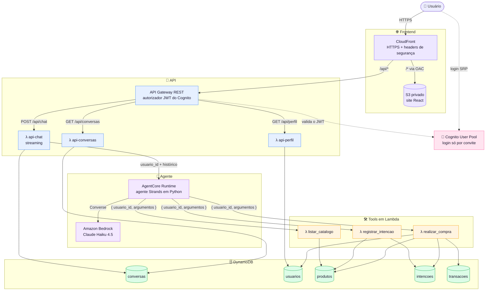
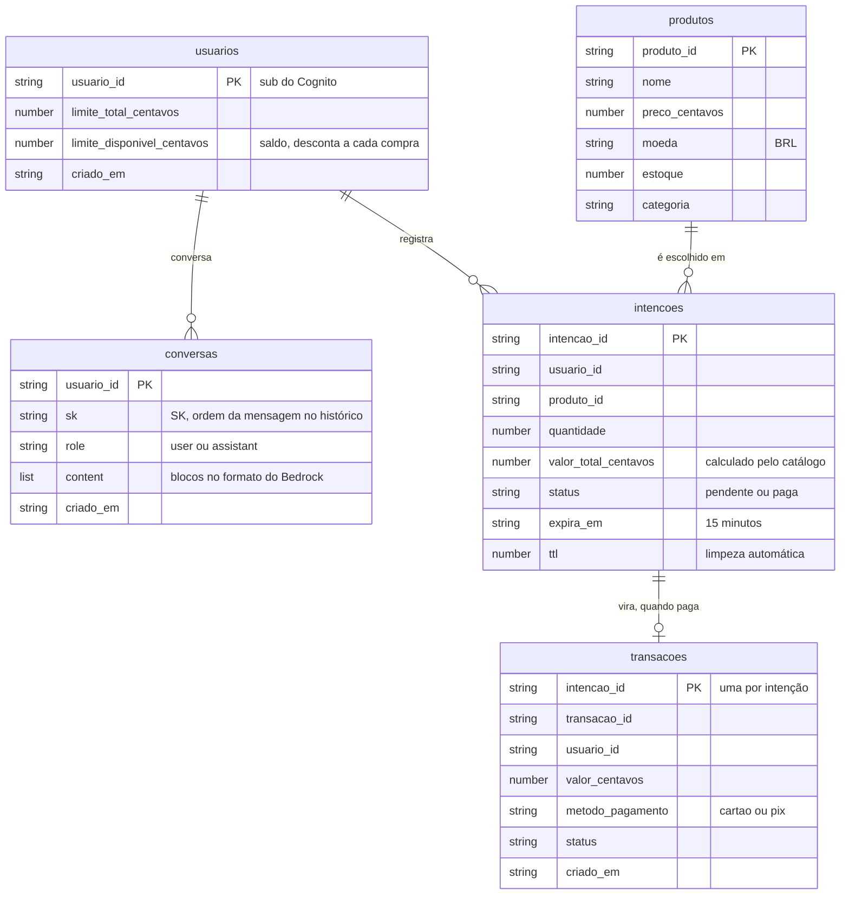
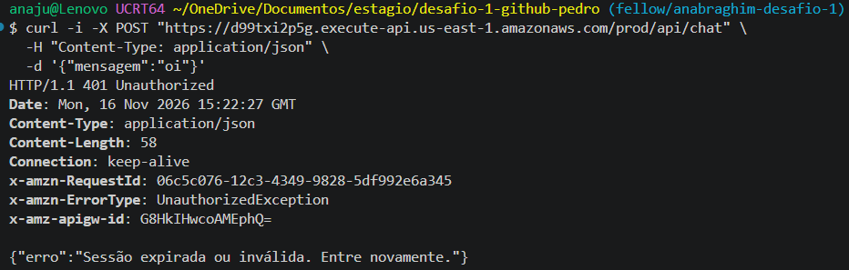
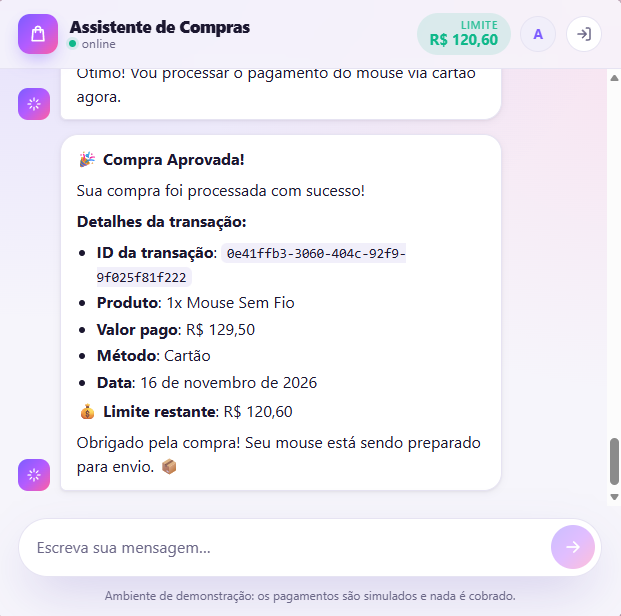
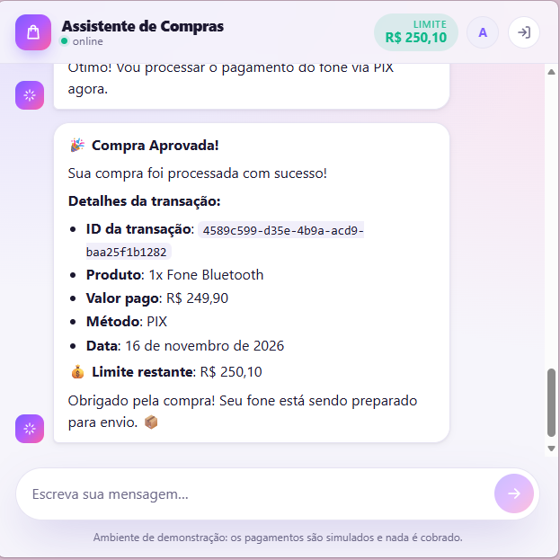
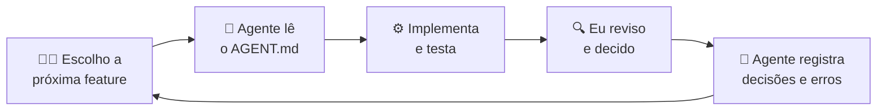

<div align="center">

# 💳 Chatbot de Pagamentos na AWS

**Um assistente de compras que conversa em linguagem natural, mostra o catálogo e conclui o pagamento com segurança, rodando 100% na AWS.**


</div>

---

## ✨ Visão geral

O usuário entra com login, conversa com o assistente e compra pelo chat:

> 🗨️ *"o que vocês têm à venda?"* → *"quero o fone"* → *"pode pagar no pix"* ✅

> [!NOTE]
> **Os pagamentos são simulados.** Nenhum cartão ou Pix real é cobrado e nada passa por um provedor de pagamento: a compra só desconta um limite fictício do usuário, guardado no DynamoDB.

**O que o projeto entrega:**

- 🤖 **Compra conversacional:** um agente com **Claude Haiku** consulta o catálogo, registra a intenção e conclui a compra simulada (cartão ou Pix).
- 🔐 **Acesso controlado:** só usuários convidados entram, e toda chamada à API exige um token válido do Cognito.
- 🛡️ **Pagamento confiável:** o preço e a identidade do usuário nunca vêm do modelo, e limite, estoque e pagamento duplicado são validados de forma atômica no DynamoDB.
- ⚡ **Respostas em tempo real:** o texto aparece em streaming, e o histórico da conversa fica salvo no servidor.
- 🚀 **Um comando para subir tudo:** toda a infraestrutura está em CloudFormation, e um script faz o deploy (e outro remove tudo).

---

## 📑 Sumário

- [Arquitetura](#️-arquitetura)
- [Deploy](#-deploy)
- [Modelo do Bedrock](#-modelo-do-bedrock)
- [Modelagem do DynamoDB](#️-modelagem-do-dynamodb)
- [Permissões IAM](#-permissões-iam)
- [Evidências](#evidências)
- [Remover todos os recursos](#-remover-todos-os-recursos)
- [Desenvolvimento com IA](#-desenvolvimento-com-ia)

---

## 🏗️ Arquitetura



| Etapa | O que acontece |
|---|---|
| 1. Login | O frontend autentica no **Cognito** (sem cadastro aberto, só por convite) e recebe o JWT. |
| 2. API | O **API Gateway** valida o JWT. Sem token válido, responde **401** e a Lambda nem é chamada. |
| 3. Chat | A **Lambda `api-chat`** pega o `usuario_id` do token, carrega o histórico de `conversas` e chama o agente. |
| 4. Agente | O **agente Strands** conversa com o Claude e chama as **tools**, passando o `usuario_id` da sessão (nunca do modelo). |
| 5. Resposta | As tools aplicam as regras no **DynamoDB**, a resposta volta em streaming e o turno é salvo no histórico. |

O site e a API ficam no mesmo domínio do **CloudFront** (`/api/*` vai para o API Gateway), então não há CORS. No deploy sem CloudFront (`SEM_FRONTEND=1`), o frontend roda local e o Vite faz esse papel.

---

## 🚀 Deploy

### Pré-requisitos

| Ferramenta | Versão |
|---|---|
| AWS CLI | v2, com um perfil configurado (`aws configure` ou SSO) |
| Node.js + npm | 22.12 ou mais recente |
| Python + pip | 3.12 ou mais recente |
| Git Bash | no Windows, porque os scripts são bash |

Antes do primeiro deploy:

- ✅ Libere o acesso ao **Claude Haiku 4.5** no console do **Amazon Bedrock** (`us-east-1`).
- ✅ Crie um alerta de custo no **AWS Budgets** (recomendado).
- ✅ Use uma credencial que possa criar stacks com roles IAM nomeadas (`CAPABILITY_NAMED_IAM`).

### Comando de deploy (IaC)

Na pasta do projeto, pelo Git Bash:

```bash
export AWS_PROFILE=<seu-perfil>
./infra/deploy.sh
```

O script roda os testes, faz o build, cria as stacks **`ana-braghim-bootstrap`** (bucket de artefatos) e **`ana-braghim-pagamentos`** (aplicação) a partir de [`infra/template.yaml`](infra/template.yaml), faz o seed do catálogo, publica o site e imprime a URL final (`https://<id>.cloudfront.net`).

> 💡 Sem permissão para o CloudFront? Use `SEM_FRONTEND=1 ./infra/deploy.sh` e rode o frontend local com `cd frontend && npm install && npm run dev`.

### Criar um usuário

```bash
./infra/scripts/criar-usuario.sh pessoa@exemplo.com         # limite padrão de R$ 500,00
./infra/scripts/criar-usuario.sh pessoa@exemplo.com 5000    # limite customizado
```

A pessoa recebe um e-mail com uma senha temporária e define uma nova no primeiro login.

---

## 🧠 Modelo do Bedrock

| | |
|---|---|
| **Modelo** | Claude Haiku 4.5 |
| **Inference profile** | `us.anthropic.claude-haiku-4-5-20251001-v1:0` |
| **Modelo base** | `anthropic.claude-haiku-4-5-20251001-v1:0` |
| **Integração** | `BedrockModel` do Strands, rodando no AgentCore Runtime |

- **Por que o Haiku:** a tarefa é conversa com chamada de ferramentas, e ele entrega baixa latência e o menor custo da família Claude.
- **Por que não o Haiku 5.5:** ele ainda não está liberado na conta do programa. Trocar é só configuração: os parâmetros `ModeloId` e `ModeloBaseId` do template (ou `MODELO_ID` e `MODELO_BASE_ID` no deploy).

---

## 🗄️ Modelagem do DynamoDB

Cinco tabelas `ana-braghim-<nome>`, sob demanda (`PAY_PER_REQUEST`) e criptografadas. Os valores em dinheiro ficam em **centavos** (inteiros), para evitar erros de arredondamento.



| Tabela | Chave | Para que serve | Exemplo de acesso |
|---|---|---|---|
| 👤 `usuarios` | `usuario_id` | Limite de compra de cada usuário | Ler o limite para o cabeçalho; descontar numa compra |
| 💬 `conversas` | `usuario_id` + `sk` | Histórico do chat, uma mensagem por item | `Query` pelo usuário, em ordem, para montar o contexto |
| 📦 `produtos` | `produto_id` | Catálogo com preço e estoque | `Scan` para listar; baixar o estoque numa compra |
| 📝 `intencoes` | `intencao_id` | Pedido registrado, ainda não pago | Criar no `registrar_intencao`; marcar como paga |
| 💳 `transacoes` | `intencao_id` | Comprovante da compra aprovada | Criada só se a intenção ainda não tiver transação |

🔒 **Pagamento atômico:** `realizar_compra` usa um único `TransactWriteItems` com quatro escritas condicionais, **tudo ou nada**:

| # | Escrita | Só acontece se |
|---|---|---|
| 1 | Intenção `pendente` → `paga` | É do usuário, está pendente e não expirou |
| 2 | Limite do usuário diminui | O limite disponível cobre o valor |
| 3 | Estoque do produto diminui | O estoque cobre a quantidade |
| 4 | Transação é criada | Ainda não existe transação para essa intenção |

Se qualquer condição falhar, nada é gravado. Por isso uma chamada repetida não paga duas vezes (`INTENCAO_JA_PAGA`).

---

## 🔐 Permissões IAM

Uma role por função, cada uma com uma policy inline chamada `menor-privilegio`, e **nenhum `*`** em ação ou recurso. Isso é conferido por [`infra/verificar_template.py`](infra/verificar_template.py). Os nomes abaixo (role e `Sid`) são os mesmos do [`template.yaml`](infra/template.yaml).

#### 🛠️ Tools

**`ana-braghim-tool-listar-catalogo`**

| Sid | Ações | Recurso | Uso no código |
|---|---|---|---|
| `LerCatalogo` | `dynamodb:Scan` | tabela `produtos` | Lista o catálogo, com filtro opcional por categoria |
| `Logs` | `logs:CreateLogStream`, `logs:PutLogEvents` | log group da própria Lambda | Logs de execução |

**`ana-braghim-tool-registrar-intencao`**

| Sid | Ações | Recurso | Uso no código |
|---|---|---|---|
| `LerProduto` | `dynamodb:GetItem` | tabela `produtos` | Busca o preço real do produto (o valor nunca vem do modelo) |
| `GravarIntencao` | `dynamodb:PutItem` | tabela `intencoes` | Cria a intenção `pendente` com o valor calculado |
| `Logs` | `logs:CreateLogStream`, `logs:PutLogEvents` | log group da própria Lambda | Logs de execução |

**`ana-braghim-tool-realizar-compra`**

| Sid | Ações | Recurso | Uso no código |
|---|---|---|---|
| `IntencaoLerEPagar` | `dynamodb:GetItem`, `dynamodb:UpdateItem` | tabela `intencoes` | Lê a intenção e a marca como `paga` na transação |
| `UsuarioLimite` | `dynamodb:GetItem`, `dynamodb:PutItem`, `dynamodb:UpdateItem` | tabela `usuarios` | Cria o usuário com o limite padrão, se não existir; lê e desconta o limite |
| `ProdutoEstoque` | `dynamodb:GetItem`, `dynamodb:UpdateItem` | tabela `produtos` | Confere e baixa o estoque |
| `GravarTransacao` | `dynamodb:PutItem` | tabela `transacoes` | Cria a transação da compra |
| `Logs` | `logs:CreateLogStream`, `logs:PutLogEvents` | log group da própria Lambda | Logs de execução |

> O `TransactWriteItems` não tem ação IAM própria: o IAM confere a ação de cada item (`UpdateItem`/`PutItem`) na tabela correspondente.

#### 🤖 Agente

**`ana-braghim-agente-runtime`**, que só o AgentCore desta conta pode assumir (`aws:SourceAccount` e `aws:SourceArn`)

| Sid | Ações | Recurso | Uso no código |
|---|---|---|---|
| `ModeloClaudeHaiku` | `bedrock:InvokeModel`, `bedrock:InvokeModelWithResponseStream` | **só** o inference profile do Haiku e o modelo base (us-east-1, us-east-2, us-west-2) | O agente conversa com o Claude em streaming |
| `InvocarTools` | `lambda:InvokeFunction` | **só** as 3 Lambdas de tools | O agente executa as ferramentas pedidas pelo modelo |
| `Logs` | `logs:CreateLogGroup`, `logs:CreateLogStream`, `logs:PutLogEvents`, `logs:DescribeLogStreams` | log group do próprio runtime | Logs do agente |
| `IdentidadeDoWorkload` | `bedrock-agentcore:GetWorkloadAccessToken`, `…ForJWT`, `…ForUserId` | identidade do próprio runtime | Token que o AgentCore obtém a cada invocação |

#### 🚪 API

**`ana-braghim-api-chat`**

| Sid | Ações | Recurso | Uso no código |
|---|---|---|---|
| `HistoricoDoUsuario` | `dynamodb:Query`, `dynamodb:PutItem` | tabela `conversas` | Lê o histórico e grava o turno (numa transação) |
| `InvocarAgente` | `bedrock-agentcore:InvokeAgentRuntime` | **só** este runtime (endpoint `DEFAULT`) | Chama o agente e repassa a resposta em streaming |
| `Logs` | `logs:CreateLogStream`, `logs:PutLogEvents` | log group da própria Lambda | Logs de execução |

**`ana-braghim-api-conversas`**

| Sid | Ações | Recurso | Uso no código |
|---|---|---|---|
| `LerHistorico` | `dynamodb:Query` | tabela `conversas` | Devolve o histórico ao abrir o chat |
| `Logs` | `logs:CreateLogStream`, `logs:PutLogEvents` | log group da própria Lambda | Logs de execução |

**`ana-braghim-api-perfil`**

| Sid | Ações | Recurso | Uso no código |
|---|---|---|---|
| `LerLimite` | `dynamodb:GetItem` | tabela `usuarios` | Mostra o limite disponível no cabeçalho |
| `Logs` | `logs:CreateLogStream`, `logs:PutLogEvents` | log group da própria Lambda | Logs de execução |

#### 🧱 Políticas de recurso

- **Lambdas das tools:** só a role do agente pode invocá-las. Elas não têm URL nem gatilho público.
- **Lambdas da API:** cada uma só aceita o API Gateway, no stage `prod`, no seu método e na sua rota (`AWS::Lambda::Permission` com `SourceArn` exato).
- **Bucket do site:** `s3:GetObject` só para a distribuição do CloudFront (OAC), e qualquer acesso sem HTTPS é negado.

---

## Evidências

> 📸 Capturas do deploy real, em [`screenshots/aws/`](screenshots/aws/).

**Alerta de custo criado no AWS Budgets** (antes do primeiro deploy)


| Login (sem opção de cadastro) | API sem token → 401 |
|---|---|
|  |  |

| Compra aprovada com cartão | Compra aprovada com Pix |
|---|---|
|  |  |

| Bloqueada por limite excedido | `intencao_id` inválido |
|---|---|
|  |  |

---

## 🧹 Remover todos os recursos

```bash
./infra/destroy.sh    # pede para digitar o prefixo (ana-braghim) como confirmação
```

Remove as duas stacks, esvazia os buckets e apaga os logs do agente. ⚠️ **Isso apaga todos os dados** (usuários, conversas e transações).

---

## 🤖 Desenvolvimento com IA

O projeto foi desenvolvido com o **Claude Code** como agente de programação, e eu no controle: escolhendo cada etapa, tomando as decisões e revisando tudo antes de seguir. A base desse trabalho é o [**`AGENT.md`**](AGENT.md), um arquivo de contexto que serve para **qualquer agente** (ou pessoa) continuar o projeto sem depender do histórico de uma conversa.



| Prática | Como apareceu no projeto |
|---|---|
| 📜 **Regras explícitas** | O que o agente pode e não pode fazer: nunca `git push`, nenhum segredo no código, nenhuma chamada à AWS sem minha autorização, uma feature por vez. |
| 🧭 **Decisões registradas** | 13 decisões de arquitetura com o motivo de cada uma (ex.: trocar o Haiku 5.5 pelo 4.5, que era o liberado na conta). O agente propõe opções; a escolha é minha. |
| 🧠 **Erros aprendidos** | Mais de 60 lições anotadas para não se repetirem (ex.: a AWS CLI do Windows devolve `\r` na saída, o CloudFront não repassa o `Authorization` em GET). |
| ✅ **Verificação antes do commit** | Testes com a AWS mockada (vitest e pytest), `tsc`, `cfn-lint`, build e um verificador do template que barra `*` no IAM. Nada era dado como pronto sem passar. |
| 🔁 **Contexto portátil** | O status das features, a arquitetura e o "para a próxima feature" ficam no arquivo: trocar de agente ou de sessão não perde nada. |
| 🏷️ **Transparência** | Os commits feitos com o agente levam `Co-Authored-By: Claude`. |

> 💡 A IA acelerou a escrita do código; a engenharia (o que fazer, em que ordem, com que limites e como validar) ficou comigo.
