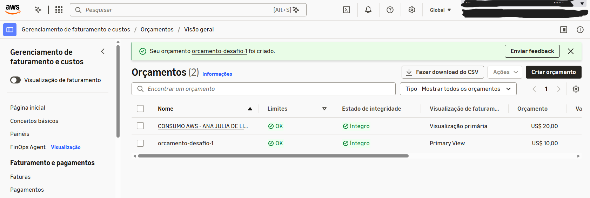
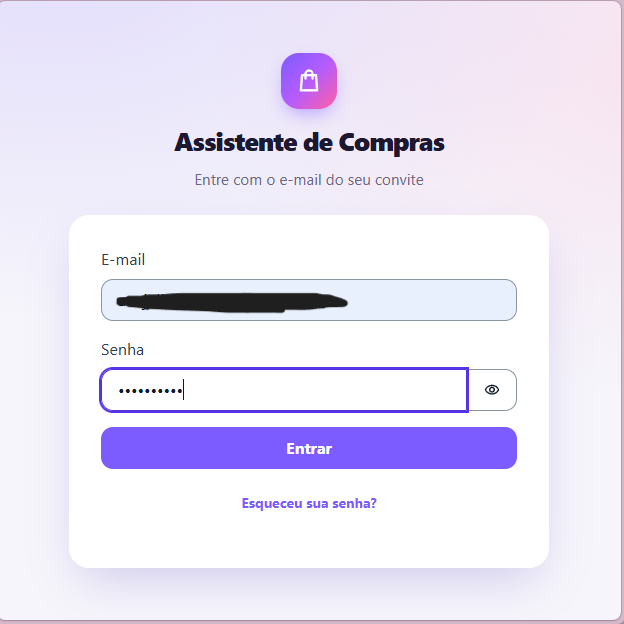
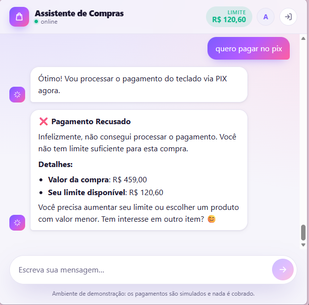
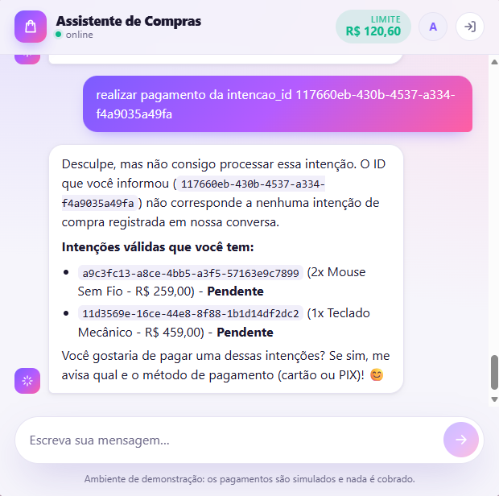

<div align="center">

# 💳 Chatbot de Pagamentos na AWS

**Um assistente de compras que conversa em linguagem natural, mostra o catálogo e conclui o pagamento com segurança, rodando 100% na AWS.**


</div>

---

## ✨ Visão geral

O usuário entra com login, conversa com o assistente e compra pelo chat:

> 🗨️ *"o que vocês têm à venda?"* → *"quero o fone"* → *"pode pagar no pix"* ✅

> [!NOTE]
> **Os pagamentos são simulados.** Nenhum cartão ou Pix real é cobrado e nada passa por um provedor de pagamento: a compra só desconta um limite fictício do usuário, guardado no DynamoDB.

**O que o projeto entrega:**

- 🤖 **Compra conversacional:** um agente com **Claude Haiku** consulta o catálogo, registra a intenção e conclui a compra simulada (cartão ou Pix).
- 🔐 **Acesso controlado:** só usuários convidados entram, e toda chamada à API exige um token válido do Cognito.
- 🛡️ **Pagamento confiável:** o preço e a identidade do usuário nunca vêm do modelo, e limite, estoque e pagamento duplicado são validados de forma atômica no DynamoDB.
- ⚡ **Respostas em tempo real:** o texto aparece em streaming, e o histórico da conversa fica salvo no servidor.
- 🚀 **Um comando para subir tudo:** toda a infraestrutura está em CloudFormation, e um script faz o deploy (e outro remove tudo).

---

## 📑 Sumário

- [Arquitetura](#️-arquitetura)
- [Deploy](#-deploy)
- [Modelo do Bedrock](#-modelo-do-bedrock)
- [Modelagem do DynamoDB](#️-modelagem-do-dynamodb)
- [Permissões IAM](#-permissões-iam)
- [Evidências](#evidências)
- [Remover todos os recursos](#-remover-todos-os-recursos)

---

## 🏗️ Arquitetura

```
    ┌────────────────────────────────────────┐
    │ Frontend (React)                       │
    │ CloudFront + S3 privado                │
    │ login com Amazon Cognito               │
    └────────────────────┬───────────────────┘
                         │  HTTPS + Authorization: Bearer <JWT>
                         ▼
    ┌────────────────────────────────────────┐
    │ Amazon API Gateway                     │
    │ autorizador JWT (Cognito)              │
    │ rotas /api/chat, /conversas e /perfil  │
    │ sem token válido → 401                 │
    └────────────────────┬───────────────────┘
                         │
                         ▼
    ┌────────────────────────────────────────┐      ┌────────────────────────┐
    │ Lambda do chat                         │  ──► │ Amazon DynamoDB        │
    │ extrai o usuario_id do token,          │      │ conversas              │
    │ carrega o histórico e invoca o agente  │      └────────────────────────┘
    └────────────────────┬───────────────────┘
                         │  usuario_id + histórico
                         ▼
    ┌────────────────────────────────────────┐      ┌────────────────────────┐
    │ Agente Strands                         │  ──► │ Amazon Bedrock         │
    │ Bedrock AgentCore Runtime              │      │ Claude Haiku 4.5       │
    └────────────────────┬───────────────────┘      └────────────────────────┘
                         │  chamadas de ferramenta
                         ▼
    ┌────────────────────────────────────────┐      ┌────────────────────────┐
    │ Tools em AWS Lambda                    │  ──► │ Amazon DynamoDB        │
    │ • listar_catalogo                      │      │ usuários e limites     │
    │ • registrar_intencao                   │      │ produtos               │
    │ • realizar_compra                      │      │ intenções e transações │
    └────────────────────────────────────────┘      └────────────────────────┘
```

| Etapa | O que acontece |
|---|---|
| 1. Login | O frontend autentica no **Cognito** (sem cadastro aberto, só por convite) e recebe o JWT. |
| 2. API | O **API Gateway** valida o JWT. Sem token válido, responde **401** e nada é executado. |
| 3. Chat | A **Lambda do chat** pega o `usuario_id` do token, carrega o histórico e chama o agente. |
| 4. Agente | O **agente Strands** conversa com o Claude e chama as **tools**, passando o `usuario_id` da sessão. |
| 5. Resposta | As tools aplicam as regras no **DynamoDB**, e a resposta volta em streaming até o navegador. |

O site e a API ficam no mesmo domínio do **CloudFront** (`/api/*` vai para o API Gateway), então não há CORS.

---

## 🚀 Deploy

### Pré-requisitos

| Ferramenta | Versão |
|---|---|
| AWS CLI | v2, com um perfil configurado (`aws configure` ou SSO) |
| Node.js + npm | 22.12 ou mais recente |
| Python + pip | 3.12 ou mais recente |
| Git Bash | no Windows, porque os scripts são bash |

Antes do primeiro deploy:

- ✅ Libere o acesso ao **Claude Haiku 4.5** no console do **Amazon Bedrock** (`us-east-1`).
- ✅ Crie um alerta de custo no **AWS Budgets** (recomendado).
- ✅ Use uma credencial que possa criar stacks com roles IAM nomeadas (`CAPABILITY_NAMED_IAM`).

### Comando de deploy (IaC)

Na pasta do projeto, pelo Git Bash:

```bash
export AWS_PROFILE=<seu-perfil>
./infra/deploy.sh
```

O script roda os testes, faz o build, cria as stacks **`ana-braghim-bootstrap`** (bucket de artefatos) e **`ana-braghim-pagamentos`** (aplicação) a partir de [`infra/template.yaml`](infra/template.yaml), faz o seed do catálogo, publica o site e imprime a URL final (`https://<id>.cloudfront.net`).

> 💡 Sem permissão para o CloudFront? Use `SEM_FRONTEND=1 ./infra/deploy.sh` e rode o frontend local com `cd frontend && npm install && npm run dev`.

### Criar um usuário

```bash
./infra/scripts/criar-usuario.sh pessoa@exemplo.com         # limite padrão de R$ 500,00
./infra/scripts/criar-usuario.sh pessoa@exemplo.com 5000    # limite customizado
```

A pessoa recebe um e-mail com uma senha temporária e define uma nova no primeiro login.

---

## 🧠 Modelo do Bedrock

| | |
|---|---|
| **Modelo** | Claude Haiku 4.5 |
| **Inference profile** | `us.anthropic.claude-haiku-4-5-20251001-v1:0` |
| **Modelo base** | `anthropic.claude-haiku-4-5-20251001-v1:0` |
| **Integração** | `BedrockModel` do Strands, rodando no AgentCore Runtime |

- **Por que o Haiku:** a tarefa é conversa com chamada de ferramentas, e ele entrega baixa latência e o menor custo da família Claude.
- **Por que não o Haiku 5.5:** ele ainda não está liberado na conta do programa. Trocar é só configuração: os parâmetros `ModeloId` e `ModeloBaseId` do template (ou `MODELO_ID` e `MODELO_BASE_ID` no deploy).

---

## 🗄️ Modelagem do DynamoDB

Cinco tabelas `ana-braghim-<nome>`, sob demanda (`PAY_PER_REQUEST`) e criptografadas. Os valores em dinheiro ficam em **centavos** (inteiros).

| Tabela | Chave | O que guarda |
|---|---|---|
| `usuarios` | `usuario_id` | Limite total e limite disponível |
| `conversas` | `usuario_id` + `sk` | Uma mensagem por item, em ordem |
| `produtos` | `produto_id` | Nome, preço, estoque e categoria |
| `intencoes` | `intencao_id` | Produto, quantidade, valor, status e expiração |
| `transacoes` | `intencao_id` | Pagamento realizado (uma transação por intenção) |

🔒 **Pagamento atômico:** `realizar_compra` usa um único `TransactWriteItems`. Ele marca a intenção como paga, desconta o limite e o estoque e cria a transação, **tudo ou nada**. Uma chamada repetida não paga duas vezes.

---

## 🔐 Permissões IAM

Uma role por função, com o mínimo necessário e **nenhum `*`** em ação ou recurso. Isso é conferido por [`infra/verificar_template.py`](infra/verificar_template.py).

| Role | Pode |
|---|---|
| `tool-listar-catalogo` | Ler `produtos` |
| `tool-registrar-intencao` | Ler `produtos` e gravar em `intencoes` |
| `tool-realizar-compra` | Atualizar `intencoes`, `usuarios` e `produtos` e gravar em `transacoes` |
| `agente-runtime` | Chamar **só** o Claude Haiku no Bedrock e invocar **só** as 3 tools |
| `api-chat` | Ler e gravar `conversas` e invocar **só** o agente |
| `api-conversas` | Ler `conversas` |
| `api-perfil` | Ler `usuarios` |

Todas as roles têm o prefixo `ana-braghim-` e só podem escrever nos próprios logs. Além disso, as tools só podem ser invocadas pelo agente, e o bucket do site só é acessível pelo CloudFront.

---

## Evidências

> 📸 Capturas do deploy real, em [`screenshots/aws/`](screenshots/aws/).

**Alerta de custo criado no AWS Budgets** (antes do primeiro deploy)



| Login (sem opção de cadastro) | API sem token → 401 |
|---|---|
|  |  |

| Compra aprovada com cartão | Compra aprovada com Pix |
|---|---|
|  |  |

| Bloqueada por limite excedido | `intencao_id` inválido |
|---|---|
|  |  |

---

## 🧹 Remover todos os recursos

```bash
./infra/destroy.sh    # pede para digitar o prefixo (ana-braghim) como confirmação
```

Remove as duas stacks, esvazia os buckets e apaga os logs do agente. ⚠️ **Isso apaga todos os dados** (usuários, conversas e transações).
