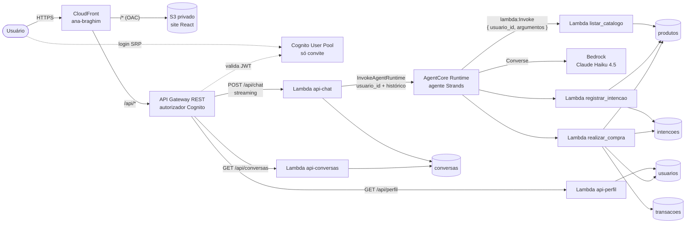

# Assistente de Compras na AWS

Chatbot que conversa com um modelo **Claude Haiku (Amazon Bedrock)** e faz compras simuladas usando três ferramentas: listar o catálogo, registrar a intenção de compra e pagar. Começou como projeto local (Fase 1) e foi migrado para a AWS (Sprint 2), com **as mesmas regras de negócio**:

- login só para usuários convidados, no **Cognito**;
- **API Gateway** com JWT e resposta em streaming;
- agente **Strands** no **Bedrock AgentCore Runtime**;
- tools em **Lambda**;
- dados no **DynamoDB**;
- site em **S3 + CloudFront**;
- tudo descrito em **CloudFormation** e criado com um único comando.

`us-east-1` · prefixo `ana-braghim` · `CloudFormation` · `Cognito` · `API Gateway REST` · `Lambda (Node 22, arm64)` · `Bedrock AgentCore Runtime` · `Strands Agents (Python 3.12)` · `Claude Haiku 4.5` · `DynamoDB` · `S3` · `CloudFront (OAC)` · `React 19 + Vite` · `Amplify UI`

Duas regras de segurança da Fase 1 continuam valendo:

- **O valor nunca é argumento de tool.** `registrar_intencao` calcula o total a partir do catálogo, e `realizar_compra` lê o valor da intenção gravada. O modelo não inventa nem negocia preço.
- **A identidade nunca é argumento de tool.** O `usuario_id` vem do JWT validado pelo API Gateway. Ele viaja fora dos argumentos que o modelo preenche e não aparece no schema das tools, então o modelo não consegue nem ver nem forjar esse valor.

---

## Sumário

- [Arquitetura](#arquitetura)
- [Requisitos do desafio](#requisitos-do-desafio)
- [Deploy passo a passo](#deploy-passo-a-passo)
- [Como usar](#como-usar)
- [Modelo do Bedrock](#modelo-do-bedrock)
- [Modelagem do DynamoDB](#modelagem-do-dynamodb)
- [Permissões IAM](#permissões-iam)
- [Evidências](#evidências)
- [Remover todos os recursos](#remover-todos-os-recursos)
- [Estrutura do repositório](#estrutura-do-repositório)
- [Desenvolvimento e testes locais](#desenvolvimento-e-testes-locais)
- [Decisões e limitações](#decisões-e-limitações)

---

## Arquitetura



Caminho de uma mensagem:

1. **Login.** O frontend faz o login no Cognito com o Amplify (SRP) e guarda o **ID token**. Não existe cadastro: o user pool só aceita usuários criados pelo administrador.
2. **Envio.** O frontend chama `POST /api/chat` no **mesmo domínio** do site. O CloudFront encaminha `/api/*` para o API Gateway, então não há CORS.
3. **Autorização.** O autorizador `COGNITO_USER_POOLS` do API Gateway valida o JWT. Sem token, ou com token inválido, responde **401** e a Lambda nem é chamada.
4. **Chamada do agente.** A **Lambda do chat** pega o `usuario_id` de `claims.sub`, lê o histórico da tabela `conversas` e chama o agente no **AgentCore Runtime**. Cada usuário tem a própria sessão.
5. **Ferramentas.** O **agente Strands** conversa com o Claude Haiku. Quando o modelo pede uma ferramenta, o código do agente invoca a Lambda correspondente com `{ usuario_id, argumentos }`. O `usuario_id` vem da sessão autenticada, não do modelo.
6. **Resposta.** As **Lambdas das ferramentas** aplicam as regras no DynamoDB. A resposta volta em streaming até o navegador, e a Lambda do chat grava o turno inteiro no histórico.

## Requisitos do desafio

| Requisito | Onde está |
|---|---|
| ✅ Tudo em CloudFormation, us-east-1, prefixo `ana-braghim`, um comando de deploy | [`infra/template.yaml`](infra/template.yaml) (região travada em `Rules`) · [`infra/deploy.sh`](infra/deploy.sh) |
| ✅ Cognito com cadastro só por convite | `AllowAdminCreateUserOnly` no `UserPool` · [`criar-usuario.sh`](infra/scripts/criar-usuario.sh) · `<Authenticator hideSignUp>` em [`App.tsx`](frontend/src/App.tsx) |
| ✅ API Gateway com JWT (401 sem token) e streaming | `ApiAutorizador` e `ApiMetodoChat` (`ResponseTransferMode: STREAM`) no template |
| ✅ Lambda do chat | [`api/src/chat.ts`](api/src/chat.ts) |
| ✅ Agente Strands no AgentCore Runtime com Claude Haiku | [`agent/`](agent/) · `AgenteRuntime` no template |
| ✅ Tools em Lambda, mesmos contratos e códigos de erro da Fase 1 | [`tools/`](tools/) |
| ✅ DynamoDB para usuários, conversas, catálogo, intenções e transações | [modelagem](#modelagem-do-dynamodb) |
| ✅ Frontend em S3 privado + CloudFront com OAC | `SiteBucket`, `SiteOAC` e `Distribuicao` no template |
| ✅ Compra com `cartao` e `pix`; recusa por limite e por `intencao_id` inválido | [`realizar-compra.ts`](tools/src/realizar-compra.ts) · [evidências](#evidências) |
| ✅ Histórico completo enviado ao modelo a cada turno | [`api/src/shared/conversas.ts`](api/src/shared/conversas.ts) · [`agent/agente/execucao.py`](agent/agente/execucao.py) |
| ✅ Menor privilégio (uma role por função, sem `*`) | [permissões](#permissões-iam) · [`infra/verificar_template.py`](infra/verificar_template.py) |
| ✅ Instruções para remover tudo | [`infra/destroy.sh`](infra/destroy.sh) |

Além do mínimo:
- **Regras extras:** intenção que expira em 15 minutos, estoque insuficiente e método de pagamento inválido.
- **Concorrência:** pagamento em dobro e corridas de limite e de estoque são fechados com escritas condicionais no DynamoDB.
- **Histórico:** fica no servidor e sobrevive a recarregar a página.
- **Proteções:** limite de requisições na API e headers de segurança (CSP, HSTS) no site.
- **Testes automatizados:** 139 no total, rodados pelo próprio deploy.

---

## Deploy passo a passo

Use o **Git Bash** (no Windows), na raiz do repositório.

### 1. Pré-requisitos na máquina

- AWS CLI v2, com um perfil da conta configurado (`aws configure` ou SSO). Nunca coloque credenciais no repositório.
- Node.js 22.12 ou mais recente, com npm. O Node 20 não serve: os testes usam vitest 5, e o deploy confere a versão.
- Python 3.12 ou mais recente, com pip.
- No Windows, Git Bash, porque os scripts de `infra/` são bash.
- Acesso à internet para o npm e o PyPI durante o build.

### 2. Preparação da conta (uma vez, antes do primeiro deploy)

- **Alerta de custo (AWS Budgets):** crie o alerta **antes** do primeiro deploy, pelo console:
  1. **AWS Budgets** → **Create budget** → **Use a template (simplified)** → **Monthly cost budget**.
  2. Use o nome `ana-braghim-orcamento`, o seu teto mensal em dólares (ex.: `10.00`) e o seu e-mail.
  3. O modelo já avisa em 85% e 100% do gasto real e em 100% do previsto.

  O alerta não fica no CloudFormation de propósito: ele vigia a conta inteira, precisa existir antes da stack e não deve ser apagado pelo `destroy.sh`. Ele **só avisa**, não bloqueia gastos, e os custos são atualizados algumas vezes por dia, não em tempo real.
- **Acesso ao modelo:** no console do **Amazon Bedrock** em `us-east-1`, confirme o acesso ao **Claude Haiku 4.5**. Se a conta pedir, aceite o formulário de caso de uso da Anthropic. **Este é um passo manual.** Para testar pela CLI:
  ```bash
  aws bedrock-runtime converse --region us-east-1 \
    --model-id us.anthropic.claude-haiku-4-5-20251001-v1:0 \
    --messages '[{"role":"user","content":[{"text":"Responda apenas: ok"}]}]' \
    --inference-config '{"maxTokens":10}' --query "output.message.content[0].text" --output text
  ```
- **IDs do modelo:** o padrão é o inference profile `us.anthropic.claude-haiku-4-5-20251001-v1:0`. Se o ID for outro na conta, passe `MODELO_ID` e `MODELO_BASE_ID` no deploy (passo 3).
- **Permissões da credencial:** quem roda o deploy precisa poder criar stacks do CloudFormation, roles IAM com nome (`CAPABILITY_NAMED_IAM`), Lambdas, DynamoDB, Cognito, API Gateway, AgentCore, S3 e CloudFront.

### 3. Deploy (comando único)

Na raiz do repositório, pelo Git Bash:

```bash
export AWS_PROFILE=<seu-perfil>
./infra/deploy.sh
```

> Opcional, se os IDs do modelo na conta forem outros:
> `MODELO_ID=<inference-profile> MODELO_BASE_ID=<modelo-base> ./infra/deploy.sh`

O script, em ordem:

1. Confere as credenciais (`aws sts get-caller-identity`).
2. Cria ou atualiza a stack de bootstrap `ana-braghim-bootstrap` (bucket privado de artefatos).
3. Roda **todos os testes** e faz o build. Se algum teste falhar, o deploy para **antes** de tocar na stack.
   - `tools/`, `api/` e `frontend/`: `npm ci`, testes e bundle.
   - `agent/`: venv, `pytest` e o zip Linux ARM64.
4. Publica o zip do agente e cria ou atualiza a stack principal `ana-braghim-pagamentos` com `cloudformation package` e `deploy`.
5. Publica a API no stage `prod`.
6. Configura a retenção de 14 dias dos logs do agente.
7. Faz o seed do catálogo, que é idempotente: não reseta o estoque.
8. Gera o `config.json` do frontend a partir dos Outputs da stack, envia o site ao S3 e invalida o CloudFront.
9. Imprime a URL: `https://<id>.cloudfront.net`.

Na primeira execução, criar a distribuição do CloudFront leva alguns minutos.

#### Deploy só do backend (sem CloudFront), com o frontend local

Se o CloudFront não puder ser criado na conta (por exemplo, por falta de permissão), publique só o backend:

```bash
SEM_FRONTEND=1 ./infra/deploy.sh
cd frontend && npm install && npm run dev      # abre em http://localhost:5173
```

- **O que é criado:** tudo, menos o hosting. Cognito, API Gateway com o autorizador, Lambdas, agente e tabelas são criados normalmente. O bucket do site e o CloudFront ficam de fora (parâmetro `ComFrontend=nao` do template).
- **Frontend local:** o script já gera `frontend/public/config.json` e `frontend/.env.local`, ambos ignorados pelo git. No `npm run dev`, o Vite repassa `/api/*` para a API publicada, fazendo o papel que seria do CloudFront.
- **Segurança:** igual à do deploy completo. O login continua no Cognito, e a API continua recusando chamadas sem token (401).
- **Publicar o site depois:** rode `./infra/deploy.sh` **sem** a variável. O CloudFormation só acrescenta o bucket do site e o CloudFront à stack existente: o backend, os usuários e os dados não são recriados. Se a criação do CloudFront falhar nessa atualização, a stack volta ao estado anterior, e o backend continua funcionando.

### 4. Criar usuários (somente por convite)

```bash
./infra/scripts/criar-usuario.sh pessoa@exemplo.com          # limite padrão de R$ 500,00
./infra/scripts/criar-usuario.sh pessoa@exemplo.com 5000     # limite customizado
```

A pessoa recebe o e-mail **"Seu convite para o Assistente de Compras"** com uma senha temporária válida por 7 dias. No primeiro login, a tela pede uma nova senha: no mínimo 8 caracteres, com maiúscula, minúscula e número.

### 5. Validar

Abra a URL impressa pelo deploy e entre com um usuário convidado. Os roteiros de cada fluxo estão em [Como usar](#como-usar). Confira:
- login sem cadastro;
- compras com cartão e com Pix;
- as recusas;
- histórico mantido depois de recarregar a página.

Pelo terminal:

```bash
SITE=$(aws cloudformation describe-stacks --stack-name ana-braghim-pagamentos \
  --query "Stacks[0].Outputs[?OutputKey=='SiteUrl'].OutputValue" --output text)
CONTA=$(aws sts get-caller-identity --query Account --output text)
curl -i -X POST "$SITE/api/chat"                                        # 401 sem token
curl -I "$SITE"                                                         # HSTS, CSP e X-Frame-Options
curl -I "https://ana-braghim-site-$CONTA.s3.amazonaws.com/index.html"   # 403: bucket só pelo CloudFront
```

Se o deploy falhar, veja o motivo com:
```bash
aws cloudformation describe-stack-events --stack-name ana-braghim-pagamentos \
  --query "StackEvents[?contains(ResourceStatus, 'FAILED')].[LogicalResourceId, ResourceStatusReason]" --output table
```

Se a stack falhar na **primeira** criação (`ROLLBACK_COMPLETE`), apague-a antes de tentar de novo: `aws cloudformation delete-stack --stack-name ana-braghim-pagamentos`.

---

## Como usar

Catálogo inicial ([`infra/seed/produtos.jsonl`](infra/seed/produtos.jsonl)):

| Produto | Preço | Estoque |
|---|---|---|
| Fone Bluetooth | R$ 249,90 | 12 |
| Teclado Mecânico | R$ 459,00 | 5 |
| Mouse Sem Fio | R$ 129,50 | 30 |

Um caminho feliz:

| Você diz | O agente faz |
|---|---|
| *"o que vocês têm à venda?"* | Chama `listar_catalogo` e lista os produtos |
| *"quero o fone, uma unidade"* | Chama `registrar_intencao` e informa o `intencao_id`, o valor e que nada foi pago ainda |
| *"pode pagar no pix"* | Chama `realizar_compra` e responde com o `transacao_id` e o limite restante |

Recusas, sempre explicadas pelo agente em linguagem natural:

| Erro | Como reproduzir |
|---|---|
| `LIMITE_EXCEDIDO` | Com o limite padrão (R$ 500,00), peça **2 Teclados Mecânicos** (R$ 918,00) e mande pagar |
| `INTENCAO_INVALIDA` | *"pague a intenção 123e4567-e89b-12d3-a456-426614174000 no pix"*, um id inventado |
| `INTENCAO_JA_PAGA` | Peça para pagar de novo uma intenção já paga |
| `INTENCAO_EXPIRADA` | Registre uma intenção e só peça para pagar depois de 15 minutos |
| `ESTOQUE_INSUFICIENTE` | Peça mais unidades do que o estoque |
| `METODO_INVALIDO` | Insista em pagar com boleto |

Contratos das tools (argumentos, retornos e a tabela de todos os códigos de erro) em [`tools/README.md`](tools/README.md). Contratos da API em [`api/README.md`](api/README.md).

---

## Modelo do Bedrock

**Claude Haiku 4.5**, da família Claude Haiku recomendada pelo desafio. Ele é usado pelo inference profile de região cruzada **`us.anthropic.claude-haiku-4-5-20251001-v1:0`** (modelo base `anthropic.claude-haiku-4-5-20251001-v1:0`), com o `BedrockModel` do Strands.

- **Por que o 4.5 e não o Haiku 5.5:** o projeto foi preparado para o Haiku 5.5, a geração mais nova. Mas, na conta AWS do programa, o Bedrock recusa o 5.5 com *"not available for this account"*: o modelo aparece no catálogo, mas não está liberado para a conta. O Haiku 4.5 está liberado e foi testado. A troca é só de configuração: o código do agente é o mesmo para os dois.
- **Por que o Haiku:** a tarefa é conversa com chamada de ferramentas e regras simples. O Haiku atende com baixa latência e o menor custo da família Claude. As regras de negócio não dependem do modelo, porque são validadas nas Lambdas.
- **Por que o inference profile:** o profile `us.*` distribui as chamadas entre `us-east-1`, `us-east-2` e `us-west-2`, para ter mais capacidade. Todos os **recursos** do projeto continuam só em `us-east-1`. Só a inferência pode ser atendida nas outras regiões dos EUA.
- **Configuração:** `max_tokens` de 4096 e no máximo 8 iterações por turno, como na Fase 1. O agente não define `temperature` nem `top_p` e usa a amostragem padrão do modelo, que é aceita por todos os Claude atuais (os mais novos recusam valores diferentes do padrão).
- **Como trocar** (por exemplo, para o Haiku 5.5 quando a conta for liberada): os parâmetros `ModeloId` e `ModeloBaseId` do template, ou as variáveis `MODELO_ID` e `MODELO_BASE_ID` do `deploy.sh`.

---

## Modelagem do DynamoDB

Cinco tabelas `ana-braghim-<nome>`, todas `PAY_PER_REQUEST` e com criptografia. São separadas para que cada role acesse **só** as tabelas de que precisa. Os valores em dinheiro são guardados em **centavos** (inteiros); os contratos devolvem reais.

| Tabela | Chave | O que guarda | Quem acessa |
|---|---|---|---|
| `usuarios` | PK `usuario_id` (sub do Cognito) | `limite_total_centavos`, `limite_disponivel_centavos`, `criado_em` | `realizar_compra` (lê, cria com o padrão e desconta) · `api-perfil` (lê) |
| `conversas` | PK `usuario_id`, SK `sk` = `msg#<início do turno>#<turno>#<posição>` | Uma mensagem por item: `role`, `content` (blocos `text`, `toolUse`, `toolResult` e `reasoningContent`, no formato do Bedrock), `criado_em` | `api-chat` (lê e grava) · `api-conversas` (lê) |
| `produtos` | PK `produto_id` | `nome`, `preco_centavos`, `moeda`, `estoque`, `categoria` | as 3 tools |
| `intencoes` | PK `intencao_id` | `usuario_id`, `produto_id`, `quantidade`, `valor_unitario_centavos`, `valor_total_centavos`, `status` (`pendente` ou `paga`), `expira_em`, `ttl` (TTL ativo, só para limpeza) | `registrar_intencao` (grava) · `realizar_compra` (lê e marca como paga) |
| `transacoes` | PK `intencao_id` (uma transação por intenção) | `transacao_id`, `usuario_id`, `valor_centavos`, `moeda`, `metodo_pagamento`, `status`, `criado_em` | `realizar_compra` (grava) |

Pontos de modelagem:

- **Pagamento atômico.** `realizar_compra` grava tudo num único `TransactWriteItems`: ou tudo entra, ou nada. São quatro escritas condicionais:

  | Escrita | Condição |
  |---|---|
  | Intenção `pendente` → `paga` | É do usuário, ainda está pendente e não expirou |
  | Limite do usuário diminui | O limite disponível cobre o valor |
  | Estoque do produto diminui | O estoque cobre a quantidade |
  | Transação é criada | Ainda não existe transação para essa intenção |

  Uma chamada repetida ou simultânea falha nas condições e vira `INTENCAO_JA_PAGA`, sem descontar nada duas vezes.
- **Limite como saldo.** Na Fase 1, o limite disponível era calculado somando as transações (SQL). O DynamoDB não faz SUM, então o limite virou um **saldo** com decremento condicional. Um usuário sem registro nasce com **R$ 500,00** na primeira compra; o `criar-usuario.sh` pode gravar outro valor.
- **Histórico consistente.** O turno inteiro é gravado numa transação. O agente recebe as últimas 399 mensagens, e se esse corte cair no meio de um turno, ele avança até a próxima mensagem do usuário, para o Bedrock nunca receber um `toolResult` sem o `toolUse` correspondente.
- **Busca por categoria.** O filtro de categoria do catálogo usa Scan, que basta para 3 produtos. Com um catálogo grande, o certo seria um GSI por `categoria`.

---

## Permissões IAM

Uma role por função, com policies inline e **sem nenhum `*`** em ação ou recurso. Isso é conferido por [`infra/verificar_template.py`](infra/verificar_template.py).

| Role | Pode | Não pode |
|---|---|---|
| `ana-braghim-tool-listar-catalogo` | `dynamodb:Scan` em `produtos` · logs do próprio log group | Escrever em qualquer tabela; ler outras tabelas |
| `ana-braghim-tool-registrar-intencao` | `GetItem` em `produtos` · `PutItem` em `intencoes` · logs | Mexer em limite, estoque ou transações |
| `ana-braghim-tool-realizar-compra` | `GetItem`/`UpdateItem` em `intencoes` · `GetItem`/`PutItem`/`UpdateItem` em `usuarios` · `GetItem`/`UpdateItem` em `produtos` · `PutItem` em `transacoes` · logs | Ler conversas; apagar itens |
| `ana-braghim-agente-runtime` (AgentCore) | `bedrock:InvokeModel` e `InvokeModelWithResponseStream` **só** no inference profile do Haiku e no modelo base (us-east-1/2, us-west-2) · `lambda:InvokeFunction` **só** nas 3 tools · logs e token de identidade **só** do próprio runtime. Só o AgentCore desta conta pode assumir a role (`aws:SourceAccount`/`SourceArn`). | Acessar tabelas diretamente; usar outros modelos |
| `ana-braghim-api-chat` | `Query`/`PutItem` em `conversas` · `bedrock-agentcore:InvokeAgentRuntime` **só** neste runtime (endpoint `DEFAULT`) · logs | Chamar o Bedrock; tocar em intenções, transações e limites |
| `ana-braghim-api-conversas` | `Query` em `conversas` · logs | Escrever |
| `ana-braghim-api-perfil` | `GetItem` em `usuarios` · logs | Escrever; ler outras tabelas |

Políticas de recurso:
- **Lambdas das tools:** só podem ser invocadas pela role do agente. Elas não têm URL nem gatilho público.
- **Lambdas da API:** cada uma só aceita o API Gateway, no stage `prod`, no seu método e na sua rota (`AWS::Lambda::Permission` com `SourceArn` exato).
- **Bucket do site:** `s3:GetObject` só para a distribuição CloudFront (OAC com `AWS:SourceArn`), e nenhuma requisição sem HTTPS.
- **Bucket de artefatos:** privado, aceita só HTTPS e não tem leitura pública.

---

## Evidências

> **Pendente:** as capturas abaixo serão tiradas depois do deploy real e salvas em [`screenshots/aws/`](screenshots/aws/) com estes nomes. Antes de salvar, confira o que cada imagem deve mostrar no [README da pasta](screenshots/aws/README.md).

**Login.** Tela do Cognito em `https://<id>.cloudfront.net`, sem a opção de criar conta.


**API sem token.** `POST /api/chat` sem `Authorization` (curl ou Postman), respondendo **401** em JSON.


| Compra com cartão | Compra com Pix |
|---|---|
|  |  |
| Catálogo, intenção registrada e pagamento com `cartao` aprovado, com `transacao_id` e limite restante | O mesmo fluxo, pagando com `pix` |

| Limite excedido | `intencao_id` inválido |
|---|---|
|  |  |
| 2 Teclados Mecânicos (R$ 918,00) com limite de R$ 500,00: `LIMITE_EXCEDIDO`, explicado pelo agente | Pagamento de um id inventado: `INTENCAO_INVALIDA` |

As evidências opcionais (streaming, histórico recarregado, 403 no bucket, itens no DynamoDB e stack no CloudFormation) estão descritas em [`screenshots/aws/README.md`](screenshots/aws/README.md).

---

## Remover todos os recursos

```bash
./infra/destroy.sh     # pede para digitar o prefixo (ana-braghim) como confirmação
```

O script, em ordem:

1. Esvazia o bucket do site.
2. Remove a stack `ana-braghim-pagamentos`: CloudFront, API, Lambdas, AgentCore, tabelas, Cognito e roles. A remoção do CloudFront leva alguns minutos.
3. Apaga o log group do agente, que é criado fora do CloudFormation.
4. Esvazia o bucket de artefatos.
5. Remove a stack `ana-braghim-bootstrap`.

**Isso apaga os dados:** usuários do Cognito, conversas, intenções e transações.

Depois, confira no console que não sobrou nenhum recurso `ana-braghim-*` (CloudFormation, S3, CloudWatch Logs).

---

## Estrutura do repositório

| Pasta | Conteúdo |
|---|---|
| [`infra/`](infra/) | `template.yaml` (stack principal) · `bootstrap.yaml` (bucket de artefatos) · `deploy.sh` · `destroy.sh` · `config.sh` · `scripts/` (`criar-usuario.sh`, `seed-catalogo.sh`) · `seed/` · `verificar_template.py` |
| [`tools/`](tools/) | As 3 tools em Lambda, em TypeScript, com o pagamento atômico ([README](tools/README.md)) |
| [`agent/`](agent/) | Agente Strands em Python para o AgentCore Runtime, com empacotamento ARM64 ([README](agent/README.md)) |
| [`api/`](api/) | Lambdas `chat` (streaming), `conversas` e `perfil` ([README](api/README.md)) |
| [`frontend/`](frontend/) | React com Amplify `Authenticator` e leitura do stream ([README](frontend/README.md)) |
| [`screenshots/`](screenshots/) | Evidências do deploy na AWS, em `aws/` |

O código da Fase 1 local (`backend/`, `mcp-server/`) foi removido. Ele continua no histórico do git, no commit `fe92855`.

## Desenvolvimento e testes locais

Nenhum teste acessa a AWS: os SDKs são substituídos por mocks e as credenciais usadas são falsas.

```bash
(cd tools && npm ci && npm test)          # 33 testes: regras de compra, transação e erros
(cd api && npm ci && npm test)            # 39 testes: chat com streaming, histórico, perfil
(cd frontend && npm ci && npm test)       # 24 testes: leitura do stream, cliente da API, estado da conversa
(cd agent && python -m venv .venv && .venv/Scripts/pip install -r requirements-dev.txt && .venv/Scripts/python -m pytest -q)  # 43 testes (Linux/macOS: .venv/bin/)
pip install cfn-lint && cfn-lint infra/*.yaml && python infra/verificar_template.py   # templates e regras de segurança
```

Para rodar o frontend localmente contra a stack já publicada, veja [`frontend/README.md`](frontend/README.md#desenvolvimento-local-contra-a-stack-já-publicada).

## Decisões e limitações

| Tema | Decisão |
|---|---|
| **Mesma origem** | O site e a API ficam no mesmo domínio do CloudFront (`/api/*`), então não existe CORS. Chamar a API direto pelo domínio do API Gateway também exige o JWT. |
| **Streaming** | O agente responde em SSE, e a Lambda repassa a resposta como NDJSON pelo API Gateway e pelo CloudFront. Um evento `pulso` a cada 15 s evita que o CloudFront corte a conexão, que cai depois de 60 s sem dados. |
| **ID token** | O autorizador do API Gateway valida o ID token do Cognito, que também traz o e-mail exibido no perfil. |
| **Pagamento simulado** | `cartao` e `pix` não passam por nenhum provedor real. |
| **E-mail do Cognito** | O e-mail padrão tem cota baixa (cerca de 50 por dia). Para mais convites seria preciso configurar o SES. |
| **Logs de acesso do API Gateway** | Desligados, porque exigem uma configuração que vale para a conta inteira. O diagnóstico é feito pelos logs das Lambdas e do agente, todos com 14 dias de retenção. |
| **Limite de requisições** | 10 por segundo, com picos de 20, no stage, e não por usuário. |
| **Histórico** | O agente recebe as últimas 399 mensagens. Em conversas muito longas, as mais antigas ficam fora do contexto, mas continuam no DynamoDB. |
| **Agente** | O AgentCore Runtime usa código zipado (não contêiner), com dependências de [`agent/requirements.lock`](agent/requirements.lock) resolvidas para Linux ARM64. |
| **Extra não feito** | AgentCore Gateway com as tools via MCP (F12). Hoje o agente invoca as Lambdas diretamente. |
