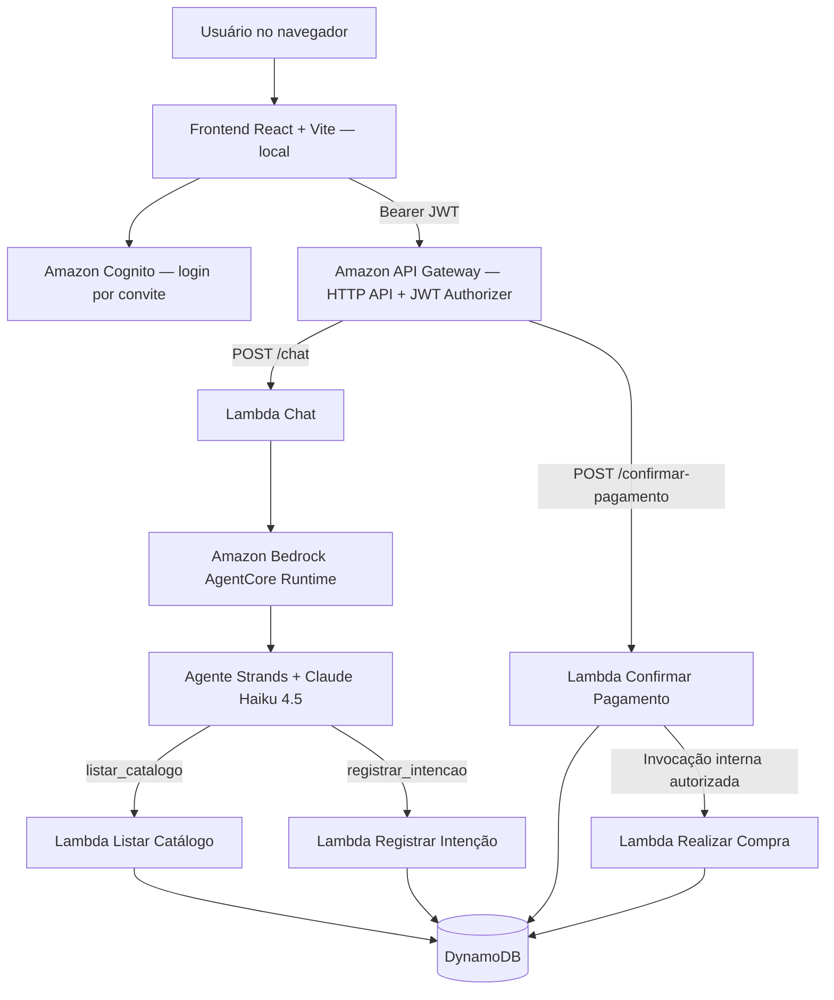
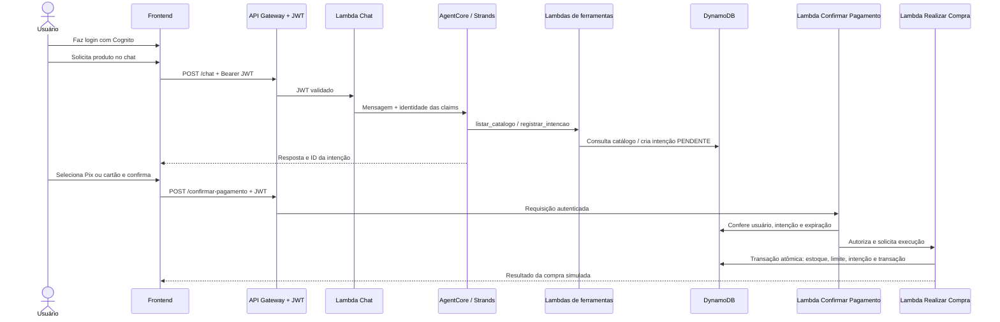
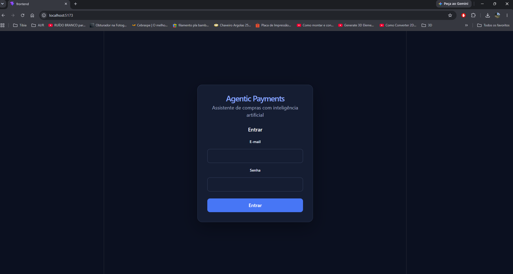
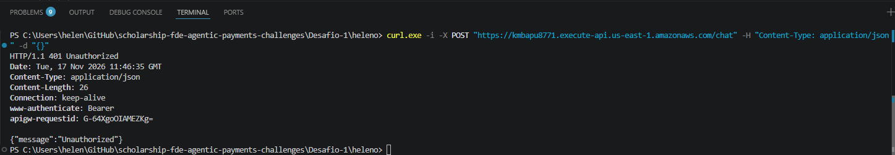
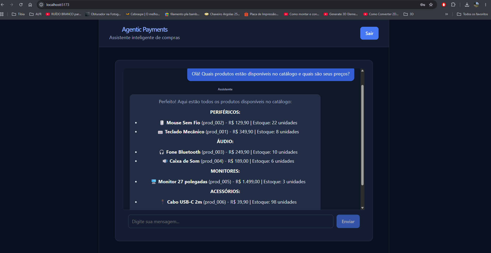
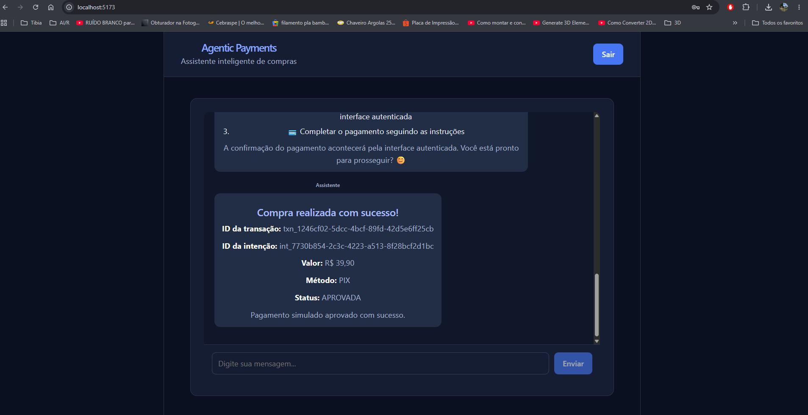
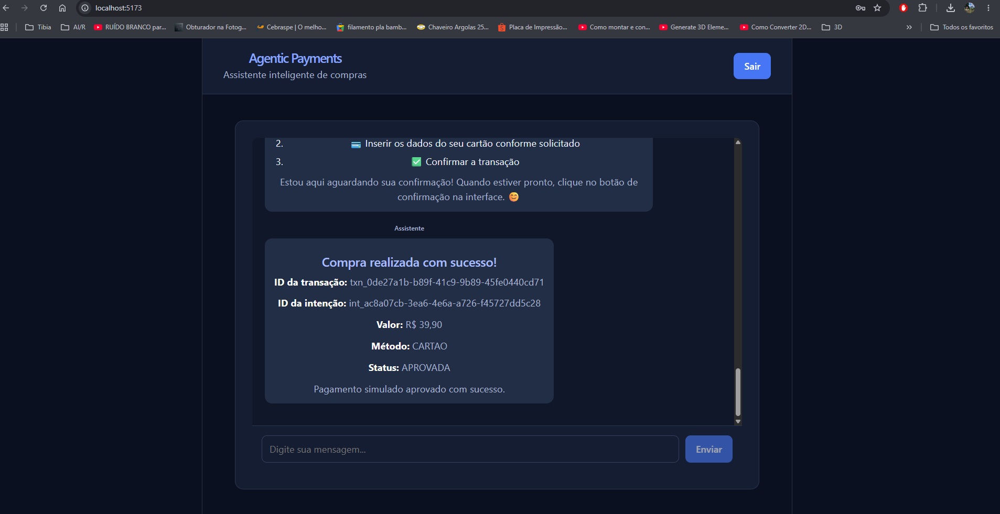
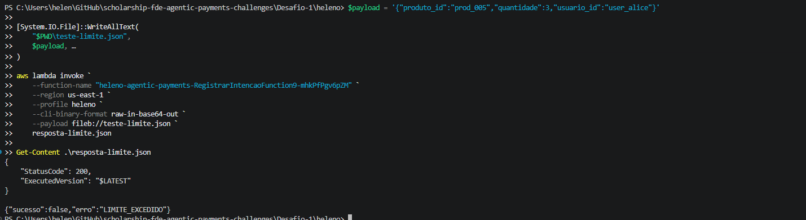
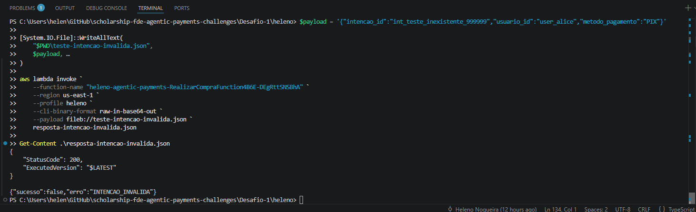
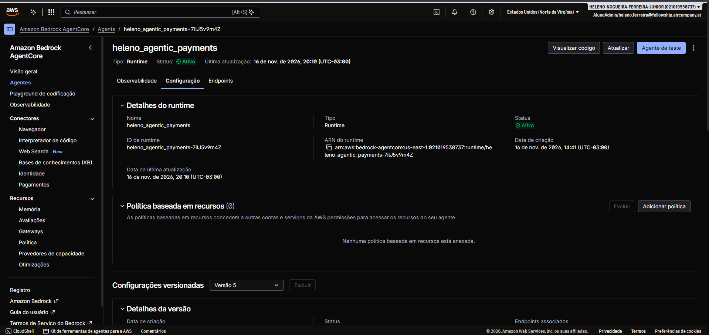

# Desafio 1 — Agente de Pagamentos na AWS

> **Trilha:** Agentic Payments — Sprint 2  
> **Implementação:** Heleno Nogueira Ferreira Junior   
> **Região AWS:** `us-east-1`  
> **Repositório:** [Código-fonte no GitHub](https://github.com/helenonogueira/scholarship-fde-agentic-payments-challenges/tree/fellow/heleno-desafio-1/Desafio-1/heleno)

## 1. Visão geral

Aplicação de **compras simuladas** com autenticação Amazon Cognito e assistente conversacional construído com **Strands Agents**. O agente é executado no **Amazon Bedrock AgentCore Runtime**, utiliza **Claude Haiku 4.5** no Amazon Bedrock e consulta ferramentas implementadas em **AWS Lambda**. O estado de catálogo, usuários, intenções e transações é armazenado em **Amazon DynamoDB**.

O agente pode **consultar o catálogo e registrar intenções de compra**, mas **não possui ferramenta nem permissão de invocação para efetivar compras**. Para pagar, o usuário autenticado escolhe **Pix** ou **cartão** e confirma a operação na interface. Uma rota separada no API Gateway valida a identidade e encaminha o pagamento ao backend.

**Escopo atual do frontend:** execução local pelo Vite. O documento original cita AWS Amplify Hosting; a publicação no Amplify ainda não está documentada como realizada nesta implementação.

## 2. Arquitetura implementada



**Separação de responsabilidades:** o modelo não recebe a ferramenta `realizar_compra`. A compra é autorizada somente no fluxo autenticado da interface, por meio da Lambda `confirmar-pagamento` e da Lambda interna `realizar-compra`.

### 2.1. Fluxo da compra



## 3. Tecnologias

| Camada | Tecnologia |
|---|---|
| Frontend | React, TypeScript, Vite |
| Login | Amazon Cognito, `amazon-cognito-identity-js` |
| API | Amazon API Gateway HTTP API com JWT Authorizer |
| Backend | AWS Lambda, Node.js 22, TypeScript |
| Agente | Strands Agents, Python 3.12, Bedrock AgentCore Runtime |
| Modelo | Amazon Bedrock — Claude Haiku 4.5 |
| Dados | Amazon DynamoDB |
| Infraestrutura | AWS CDK em TypeScript |
| Empacotamento do agente | Docker e Amazon ECR |
| Observabilidade | Amazon CloudWatch Logs |

O modelo é configurado em `agent/agent.py` pelo identificador padrão `us.anthropic.claude-haiku-4-5-20251001-v1:0`. Foi escolhido por adequação a um agente de ferramentas e pelo foco em latência/custo, conforme a recomendação de usar Claude Haiku no desafio.

## 4. Estrutura do projeto

```text
heleno/
├── agent/
│   ├── agent.py                 # Agente Strands e tools disponíveis
│   ├── app.py                   # Entrypoint do AgentCore Runtime
│   ├── dockerfile               # Imagem do agente
│   └── requirements.txt
├── api/
│   └── src/handlers/chat.ts     # Lambda do chat
├── frontend/
│   ├── src/components/         # Login e chat
│   ├── src/services/           # Autenticação e chamadas HTTP
│   └── package.json
├── infra/
│   ├── bin/infra.ts            # Inicialização da stack CDK
│   ├── lib/infra-stack.ts      # Infraestrutura AWS
│   └── package.json
├── tools/
│   └── src/handlers/           # Catálogo, intenção, compra e confirmação
└── .gitignore
```

## 5. Como executar o projeto existente (Windows / PowerShell)

> **Importante:** os passos desta seção iniciam o **frontend local** usando o backend AWS **já implantado**. Não é necessário fazer `cdk deploy`, reconstruir a imagem ou recriar tabelas para demonstrar o projeto existente.
### 5.1. Pré-requisitos

- Git, Node.js e npm compatíveis com Vite 8 e as dependências do repositório;
- Navegador atualizado;
- Acesso à conta AWS e à região `us-east-1` para consultar as saídas da stack;
- AWS CLI configurado com perfil `heleno` (para consultar a infraestrutura, não para autenticar o frontend);
- Usuário já criado no Cognito por administrador, com senha definida.

### 5.2. Abrir a pasta correta

```powershell
cd "C:\Users\helen\GitHub\scholarship-fde-agentic-payments-challenges\Desafio-1\heleno"
git status
```

Se estiver em outro computador, clone o fork e selecione a branch:

```powershell
git clone https://github.com/helenonogueira/scholarship-fde-agentic-payments-challenges.git
cd scholarship-fde-agentic-payments-challenges
git checkout fellow/heleno-desafio-1
cd Desafio-1/heleno
```

### 5.3. Consultar os identificadores da stack

```powershell
aws cloudformation describe-stacks `
  --stack-name heleno-agentic-payments `
  --region us-east-1 `
  --profile heleno `
  --query "Stacks[0].Outputs[].[OutputKey,OutputValue]" `
  --output table
```

Identifique as saídas `PaymentsApiUrl`, `CognitoUserPoolId` e `CognitoUserPoolClientId`. **Não publique tokens JWT, senhas, chaves ou dados pessoais nas capturas.**

### 5.4. Configurar o frontend

Na pasta `frontend`, crie um arquivo **local** `.env.local` com os valores obtidos da stack:

```dotenv
VITE_API_URL=https://SEU_API_ID.execute-api.us-east-1.amazonaws.com
VITE_COGNITO_USER_POOL_ID=us-east-1_SEU_POOL_ID
VITE_COGNITO_CLIENT_ID=SEU_APP_CLIENT_ID
```

> Esses valores são identificadores de integração, não uma senha de usuário. Mesmo assim, mantenha o `.env.local` fora do Git e nunca coloque segredos no frontend.

### 5.5. Instalar e iniciar

```powershell
cd frontend
npm ci
npm run dev
```

Abra a URL local mostrada pelo Vite (normalmente `http://localhost:5173`). Faça login com o usuário do Cognito. Se for o primeiro acesso, conclua a troca de senha temporária.

**Observação:** se a porta usada pelo Vite for diferente, confirme que ela está autorizada no CORS da API. A stack atual permite `http://localhost:3000` e `http://localhost:5173`.

### 5.6. Encerrar a execução local

No terminal do Vite, pressione `Ctrl+C`. Isso **não remove** os serviços AWS implantados.

## 6. Infraestrutura e deploy do backend

A infraestrutura está definida em `infra/lib/infra-stack.ts` e inicializada em `infra/bin/infra.ts`, com a stack `heleno-agentic-payments` na região `us-east-1`.

Para preparar dependências e verificar a definição de infraestrutura:

```powershell
cd infra
npm ci
npx cdk synth --profile heleno
```

Para implantar **alterações** em um ambiente AWS devidamente configurado:

```powershell
npx cdk deploy heleno-agentic-payments --profile heleno
```

**Atenção à reprodutibilidade:** o código CDK atual referencia explicitamente o ARN de um **AgentCore Runtime já existente**. Portanto, o comando `cdk deploy` **não é, sozinho, um deploy completo do zero**. Um novo ambiente requer provisionar e publicar a imagem Docker ARM64 no ECR, criar/configurar o runtime AgentCore e suas variáveis (`LISTAR_CATALOGO_ARN`, `REGISTRAR_INTENCAO_ARN`, `BEDROCK_MODEL_ID`), e então ajustar a referência ao runtime no CDK. O procedimento automatizado integral de bootstrap do runtime ainda deve ser consolidado e testado antes de ser descrito como reproduzível.

O agente usa `agent/dockerfile`, expõe a porta `8080` e inicia `python app.py`. O runtime já utilizado neste projeto foi implantado com imagem ARM64. **Não altere ou recrie o runtime existente apenas para coletar evidências.**

## 7. Endpoints e autenticação

| Método | Rota | Autenticação | Finalidade |
|---|---|---|---|
| POST | `/chat` | Bearer JWT Cognito | Enviar mensagem ao agente |
| POST | `/confirmar-pagamento` | Bearer JWT Cognito | Confirmar compra simulada via Pix ou cartão |

A Lambda de chat obtém `usuario_id` da claim `sub` do JWT já validado pelo API Gateway, e não de um campo informado pelo navegador. O frontend envia `mensagem` e `sessao_id` ao chat; o pagamento recebe `intencao_id` e `metodo_pagamento`.

### Exemplo: API sem token (evidência obrigatória)

No PowerShell, configure apenas a URL da API (sem token):

```powershell
$apiUrl = "https://SEU_API_ID.execute-api.us-east-1.amazonaws.com"
curl.exe -i -X POST "$apiUrl/chat" -H "Content-Type: application/json" --data '{"mensagem":"oi"}'
```

**Esperado:** `HTTP/2 401` (ou `HTTP/1.1 401`, conforme a negociação HTTP). Tire um print do terminal mostrando a rota e o status. A resposta 401 deve ser produzida pelo autorizador, antes da Lambda.

## 8. DynamoDB — tabelas e chaves

A stack atual declara quatro tabelas, todas com chave de partição **`id` (String)** e cobrança sob demanda (`PAY_PER_REQUEST`).

| Tabela | Chave | Finalidade |
|---|---|---|
| `heleno-agentic-catalog` | `id` | Produtos, preços, categorias e estoque |
| `heleno-agentic-users` | `id` | Usuários vinculados à identidade Cognito e limite disponível |
| `heleno-agentic-intentions` | `id` | Intenções, usuário, produto, quantidade, valor, expiração e status |
| `heleno-agentic-transactions` | `id` | Compras aprovadas, método, valor e referência à intenção |

**Integridade:** a Lambda de compra usa `TransactWriteCommand` para atualizar estoque, limite do usuário, status da intenção e registro da transação de forma atômica. Escritas condicionais impedem consumo duplicado de uma intenção e protegem contra falta de estoque/limite.

**Limitação a verificar:** não foi identificada uma tabela de conversas na stack consultada. A sessão do frontend é identificada por UUID e vinculada ao usuário no backend, mas a persistência durável do histórico completo no DynamoDB **não está comprovada**. Não apresentar como implementada sem nova verificação.

## 9. Segurança e IAM

| Componente | Permissões e controles identificados |
|---|---|
| API Gateway | JWT Authorizer do Cognito nas duas rotas |
| Lambda Chat | Invocação do runtime AgentCore; identidade extraída do JWT |
| AgentCore Runtime | Invocação do modelo Claude Haiku 4.5, invocação somente das Lambdas de catálogo e intenção, logs e acesso de leitura da imagem ECR |
| Lambda Listar Catálogo | Leitura da tabela de catálogo |
| Lambda Registrar Intenção | Leitura de catálogo e usuários; escrita de intenções |
| Lambda Confirmar Pagamento | Leitura/escrita de intenções; invocação da Lambda de compra |
| Lambda Realizar Compra | Leitura/escrita de catálogo, usuários, intenções e transações; transação DynamoDB |

A role do AgentCore **não recebe** permissão de invocar diretamente `RealizarCompraFunction`. A operação financeira simulada exige confirmação por rota autenticada.

**Revisão pendente:** a lista acima descreve as permissões declaradas no CDK consultado; não substitui auditoria de todas as políticas efetivas da conta. O runtime AgentCore recebe um `usuario_id` no payload enviado pela Lambda de chat; acessos diretos privilegiados ao runtime devem ser controlados por IAM. Há também uma permissão `ecr:GetAuthorizationToken` com `Resource: "*"`, uma exigência habitual da ação AWS que deve ser explicada na revisão de menor privilégio.

## 10. Regras de negócio

- O agente lista produtos reais e registra intenções **PENDENTES**.
- Pagamentos simulados são confirmados pelo usuário na interface, com **Pix** ou **cartão**.
- A intenção deve pertencer ao usuário autenticado, existir, estar pendente e não ter expirado.
- O valor e a quantidade da compra vêm da intenção armazenada, não de valores livres fornecidos pelo modelo.
- A compra verifica estoque e limite disponível e registra o resultado atomicamente.
- Repetições de pagamento aprovado com o mesmo método podem recuperar a transação original sem nova cobrança (idempotência).
- Erros tratados incluem `INTENCAO_INVALIDA`, `INTENCAO_EXPIRADA`, `INTENCAO_JA_PAGA`, `METODO_INVALIDO` e recusas de autorização/compra.

## 11. Evidências de execução


### 11.1. Login com Cognito

**Evidência:** tela de login e, após autenticar, chat acessível. Se possível, incluir o fluxo de troca da senha temporária sem mostrar a senha.



### 11.2. API rejeita requisição sem JWT — HTTP 401

**Teste de autenticação:** foi realizada uma requisição HTTP ao endpoint `/chat` da API sem fornecer um token JWT no cabeçalho `Authorization`. A API retornou **HTTP 401 (Unauthorized)**, demonstrando que o acesso ao endpoint protegido exige autenticação válida pelo Amazon Cognito.



### 11.3. Catálogo e intenção de compra

**Evidência complementar:** agente consultando catálogo e retornando intenção pendente com ID e valor.



### 11.4. Compra simulada com Pix

**Evidência:** interface mostrando escolha de Pix, confirmação e transação aprovada. Usar uma intenção nova e um usuário de teste.



### 11.5. Compra simulada com cartão

**Evidência:** interface mostrando escolha de cartão, confirmação e transação aprovada. Usar uma **segunda intenção** válida.



### 11.6. Bloqueio por limite excedido

**Evidência:** usuário de teste com limite insuficiente; tentativa de compra recusada sem alterar indevidamente o estoque/limite. **Não reduza o limite de um usuário real para produzir o print.** Preparar um caso de teste controlado.



### 11.7. Intenção inválida recusada

**Teste de validação de intenção de compra:** realizado diretamente na AWS Lambda `realizar-compra`, utilizando um identificador de intenção inexistente. O backend retornou `{"sucesso":false,"erro":"INTENCAO_INVALIDA"}`, comprovando que o sistema rejeita tentativas de pagamento associadas a intenções não cadastradas.



### 11.8. Evidência complementar — Amazon Bedrock AgentCore Runtime

A captura apresenta o AgentCore Runtime utilizado pelo projeto,
demonstrando a implantação do agente na infraestrutura AWS.




## 12. Como remover os recursos


1. Confirmar com o instrutor que a avaliação terminou.
2. Identificar quais recursos pertencem à stack e quais foram criados separadamente.
3. Destruir a stack CDK **somente após confirmar o impacto**:

```powershell
cd infra
npx cdk destroy heleno-agentic-payments --profile heleno
```

4. Verificar o runtime AgentCore criado fora da stack, a imagem e o repositório ECR, eventuais recursos Amplify, tabelas retidas, User Pool Cognito, grupos de logs CloudWatch e alarmes/orçamentos. **O comando `cdk destroy` não remove automaticamente os recursos externos à stack.**
5. Conferir no console AWS se não restaram recursos cobrados. O User Pool Cognito desta stack está configurado com política `RETAIN`, exigindo verificação específica após a destruição.

## 13. Entrega via fork e Pull Request

1. Manter a implementação na branch `fellow/heleno-desafio-1` do fork.
2. Completar este README e versionar os prints em `docs/evidencias/`.
3. Conferir `git status`, executar commit e push da documentação.
4. Enviar o **link do fork** ao grupo, conforme orientação do instrutor.
5. Abrir um **Pull Request do fork para o repositório original**, na branch de destino indicada pelo instrutor, para centralizar a entrega.

## 14. Pendências e diferenças em relação ao enunciado original

Esta seção deve ser revisada antes da entrega final:

- **Amplify Hosting:** o frontend está documentado em execução local; o PDF original exige URL pública no Amplify. Confirmar se a orientação posterior do instrutor substitui esse requisito.
- **Histórico de conversas:** persistência em DynamoDB não identificada na stack consultada; verificar e implementar se exigida.
- **Streaming/WebSocket:** a API atual é HTTP API convencional; o PDF solicita streaming ou WebSocket.
- **CORS:** atualmente autoriza origens locais; adaptar se houver hospedagem pública.
- **Deploy do zero:** a stack referencia um AgentCore Runtime existente; falta automatizar/documentar o bootstrap completo do runtime para outra conta.
- **Segurança do AgentCore:** conferir IAM efetivo e acesso direto ao runtime antes de afirmar isolamento integral por usuário.
- **Evidências:** inserir os prints reais, sem simular resultados não observados.

---

**Nota:** esta documentação descreve a implementação observada na branch `fellow/heleno-desafio-1` e deve ser atualizada com os resultados dos testes de entrega.
