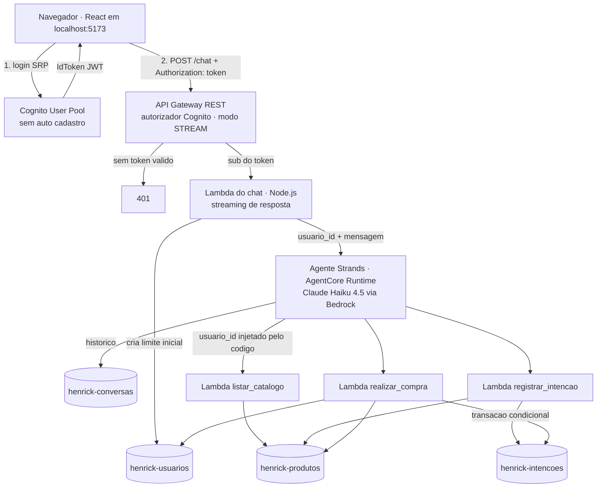

# Desafio 1 · Agente de Pagamentos na AWS — Henrick de Oliveira Ferreira

Chatbot da Fase 1 levado para a AWS: o agente Strands roda no **Amazon Bedrock AgentCore Runtime** com o **Claude Haiku 4.5**, as três tools (`listar_catalogo`, `registrar_intencao`, `realizar_compra`) rodam em **AWS Lambda**, os dados ficam no **DynamoDB**, o login é feito pelo **Cognito** e a API é um **API Gateway** com resposta em **streaming**. Toda a infraestrutura é definida com **AWS CDK (Python)** e criada por um único comando.

Conforme orientação do mentor, o **frontend roda localmente** (`localhost:5173`); somente o backend é implantado na AWS.

## Diagrama implementado



A resposta do modelo volta em pedaços (SSE) pelo caminho inverso: agente → Lambda do chat → API Gateway → navegador.

## Estrutura

```
henrick/
├── agent/      agente Strands (main.py) e requirements.txt
├── tools/      as 3 tools em Lambda (Python 3.12)
├── api/        Lambda do chat (Node.js, streaming)
├── infra/      stack CDK (Python) e seed do catalogo
├── frontend/   React + Vite (login com Cognito, chat em streaming)
├── docs/evidencias/
└── deploy.ps1  deploy completo com um comando
```

## Modelo usado

**Claude Haiku 4.5** no Amazon Bedrock, pelo perfil de inferência entre regiões dos EUA: `us.anthropic.claude-haiku-4-5-20251001-v1:0` (substitui o `qwen2.5:7b` do Ollama da Fase 1).

## Passo a passo de deploy

**Pré-requisitos (Windows):** Python 3.12, Node.js 20+, AWS CLI v2 (2.22+), CDK CLI (`npm install -g aws-cdk`) e a conta com o bootstrap do CDK em `us-east-1` (`cdk bootstrap aws://<conta>/us-east-1`, uma única vez por conta).

```powershell
cd Desafio-1/henrick
$env:AWS_PROFILE = "desafio-1"
aws sso login
.\deploy.ps1
```

O `deploy.ps1` executa, em ordem: prepara o ambiente Python da infra; monta o pacote do agente para Linux ARM64 (com `uv`); instala as dependências da Lambda do chat; roda o `cdk deploy`; e gera o `frontend/.env.local` a partir dos outputs da stack.

Para abrir o frontend:

```powershell
cd frontend
npm run dev    # http://localhost:5173
```

Usuários entram somente por convite (o cadastro está fechado):

```powershell
aws cognito-idp admin-create-user --user-pool-id <UserPoolId> --username <email> --user-attributes Name=email,Value=<email> Name=email_verified,Value=true
```

O Cognito envia uma senha temporária por e-mail; no primeiro acesso, o frontend pede a senha definitiva.

## Modelagem do DynamoDB

Todas as tabelas são *on-demand* e são apagadas no `cdk destroy`.

| Tabela | Chave de partição | Atributos | Uso |
|---|---|---|---|
| `henrick-usuarios` | `usuario_id` (o `sub` do Cognito) | `nome`, `limite_restante` | limite de gasto; criado com R$ 1.500 na primeira mensagem (`attribute_not_exists`, sem resetar depois) |
| `henrick-produtos` | `produto_id` | `nome`, `descricao`, `categoria`, `preco`, `moeda`, `estoque` | catálogo da Fase 1, gravado pelo próprio CDK no deploy |
| `henrick-intencoes` | `intencao_id` | `usuario_id`, `produto_id`, `produto_nome`, `quantidade`, `valor_total`, `status`, `criada_em`, `expira_em`, e após o pagamento `transacao_id`, `metodo_pagamento`, `pago_em` | intenções e transações no mesmo item |
| `henrick-conversas` | `usuario_id` | `mensagens` (JSON com `role` e `content`) | histórico enviado ao modelo a cada turno |

**Pagamento sem duplicidade.** `realizar_compra` mantém a ordem de validação da Fase 1 (`INTENCAO_INVALIDA` → `INTENCAO_JA_PAGA` → `INTENCAO_EXPIRADA` → `METODO_INVALIDO` → `LIMITE_EXCEDIDO`) e cobra com um único `TransactWriteItems` com três escritas condicionais, executadas todas ou nenhuma:

1. intenção `pendente` → `pago`, somente se ainda estiver pendente, for do usuário e não tiver expirado;
2. `limite_restante -= valor`, somente se `limite_restante >= valor`;
3. `estoque -= quantidade`, somente se `estoque >= quantidade`.

Duas chamadas simultâneas para a mesma intenção resultam em uma aprovada e outra `INTENCAO_JA_PAGA`. O valor sempre vem da intenção salva, nunca do modelo.

## Segurança

- `usuario_id` vem **somente** do `sub` do token validado pelo API Gateway. O corpo da requisição só carrega a mensagem.
- As tools do agente são criadas por usuário (*closure*): o modelo vê apenas `produto_id`, `quantidade`, `intencao_id` e `metodo_pagamento`. **Nenhuma tool recebe `usuario_id` nem valor do modelo.**
- Apenas a Lambda do chat pode invocar o agente, e apenas o agente pode invocar as tools.
- Cognito sem auto cadastro (`AllowAdminCreateUserOnly`); API responde `401` sem token válido; CORS restrito a `http://localhost:5173`.
- Nenhum segredo no Git: login via IAM Identity Center (SSO) e `.env.local` ignorado.

## Resumo do IAM

| Role | Permissões | Recursos |
|---|---|---|
| `listar_catalogo` | `dynamodb:GetItem/Scan/Query/...` (leitura) | `henrick-produtos` |
| `registrar_intencao` | `dynamodb:GetItem`; `dynamodb:PutItem` | `henrick-produtos`; `henrick-intencoes` |
| `realizar_compra` | `GetItem`, `UpdateItem`; `GetItem`, `UpdateItem`; `UpdateItem` | `henrick-intencoes`; `henrick-usuarios`; `henrick-produtos` |
| Agente (AgentCore) | `bedrock:InvokeModel`, `InvokeModelWithResponseStream`; `lambda:InvokeFunction`; `dynamodb:GetItem`, `PutItem` | só o Claude Haiku 4.5 (perfil `us.` e as 3 regiões); só as 3 tools; só `henrick-conversas` |
| Lambda do chat | `bedrock-agentcore:InvokeAgentRuntime`; `dynamodb:PutItem` | só o runtime do agente; só `henrick-usuarios` |
| API Gateway | `lambda:InvokeFunction` | só a Lambda do chat, com condição de origem na rota `POST /chat` |

Nenhuma política criada pelo projeto usa `*` como ação nem `AdministratorAccess`. Exceções que vêm de padrões da AWS, documentadas:

- O construct do AgentCore adiciona `xray:PutTraceSegments` (e afins) e `cloudwatch:PutMetricData` com `Resource: *`: **essas ações não aceitam recurso específico** na AWS. O `PutMetricData` está limitado pela condição `cloudwatch:namespace = bedrock-agentcore`.
- As Lambdas usam a política gerenciada `AWSLambdaBasicExecutionRole` (somente escrita de logs), que internamente usa `Resource: *`. Possível melhoria: substituí-la por uma política restrita ao grupo de logs de cada função.

## Evidências

| Situação | Print |
|---|---|
| Login | [`01-login.png`](docs/evidencias/01-login.png) · [`08-tela-login.png`](docs/evidencias/08-tela-login.png) |
| `401` sem token | [`02-401-sem-token.png`](docs/evidencias/02-401-sem-token.png) |
| Compra com cartão | [`10-intencao-compra-mouse.png`](docs/evidencias/10-intencao-compra-mouse.png) → [`03-compra-cartao.png`](docs/evidencias/03-compra-cartao.png) |
| Compra com Pix | [`11-intencao-compra-fone.png`](docs/evidencias/11-intencao-compra-fone.png) → [`04-compra-pix.png`](docs/evidencias/04-compra-pix.png) |
| Limite excedido | [`12-intencao-compra-monitor.png`](docs/evidencias/12-intencao-compra-monitor.png) → [`05-limite-excedido.png`](docs/evidencias/05-limite-excedido.png) |
| `intencao_id` inválido | [`06-intencao-invalida.png`](docs/evidencias/06-intencao-invalida.png) |
| Catálogo | [`07-listando-catalogo.png`](docs/evidencias/07-listando-catalogo.png) |
| Streaming | [`09-chat-streaming-curl.png`](docs/evidencias/09-chat-streaming-curl.png) |

Sobre o `intencao_id` inválido: o *system prompt* orienta o modelo a só usar ids devolvidos por `registrar_intencao`, mas a garantia real está na Lambda, que recusa ids inexistentes ou de outro usuário com a mesma resposta (`INTENCAO_INVALIDA`, sem revelar se o id existe). O print mostra a Lambda sendo chamada diretamente com um id inexistente.

## Decisões e limitações

- **Lambda do chat em Node.js:** o streaming de resposta nativo da Lambda existe apenas no runtime Node.js; o restante do backend é em Python.
- **Empacotamento do agente com `uv`:** o `pip --platform` avalia marcadores de sistema do Windows (ex.: `pywin32` no `mcp`) e resolvia uma versão antiga do Strands; o `uv` avalia para Linux ARM64. As versões ficam fixadas no `requirements.txt`.
- **Histórico** guardado apenas com `role` e `content`, para não depender de campos internos de cada versão do Strands.
- O frontend começa com a tela vazia a cada carregamento; o agente mantém o histórico no DynamoDB.

## Remoção

```powershell
cd infra
cdk destroy
```

Depois, confirme que não restou nada:

```powershell
aws cloudformation describe-stacks --stack-name henrick-desafio-1          # deve dar "does not exist"
aws dynamodb list-tables --query "TableNames[?starts_with(@, 'henrick-')]"
aws lambda list-functions --query "Functions[?starts_with(FunctionName, 'henrick')].FunctionName"
aws logs describe-log-groups --log-group-name-prefix /aws/lambda/henrick --query "logGroups[].logGroupName"
aws logs describe-log-groups --log-group-name-prefix /aws/lambda/henrick-desafio-1 --query "logGroups[].logGroupName"
aws logs describe-log-groups --log-group-name-prefix /aws/bedrock-agentcore/runtimes/henrick --query "logGroups[].logGroupName"
aws bedrock-agentcore-control list-agent-runtimes --query "agentRuntimes[?starts_with(agentRuntimeName, 'henrick')]"
```

Grupos de logs que sobrarem (por exemplo, o da função auxiliar do CDK) podem ser removidos com `aws logs delete-log-group --log-group-name <nome>`. O projeto não usa ECR nem S3 próprios: o código das Lambdas e do agente vai para o bucket do bootstrap do CDK (`CDKToolkit`), que é compartilhado pela conta e **não** deve ser removido.