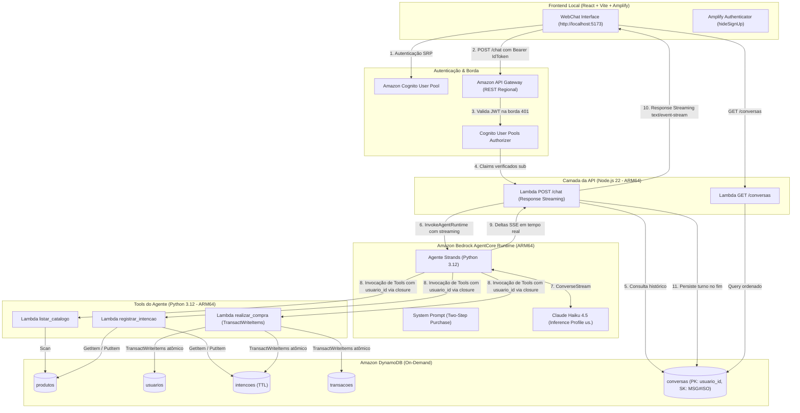

# Agente Financeiro de Pagamentos na AWS

Este repositório contém a solução do **Desafio 1 (Sprint 2)** do Fellowship: um ecossistema serverless de compras mediado por um **Agente de IA Autônomo** executando no **Amazon Bedrock AgentCore Runtime** com o framework **Strands**, integrado a ferramentas Lambda, transações ACID no **Amazon DynamoDB**, autenticação com **Amazon Cognito** e API REST com **Response Streaming (SSE)** no **Amazon API Gateway**.

> [!NOTE]
> **Modo de Execução do Frontend**: Por conta de uma Service Control Policy (SCP `p-cwpx03lm`) da AWS Organization bloqueando `cloudfront:*` durante a sprint, o CloudFront foi pausado via flag (`"habilitarCloudFront": false` em `infra/cdk.json`). Seguindo a orientação da coordenação, todo o backend (Cognito, API Gateway, DynamoDB, AgentCore Runtime e Lambdas) roda **100% na AWS**, enquanto o frontend roda **localmente via Vite (`http://localhost:5173`)**. O bucket S3 privado e o construct de CloudFront + OAC permanecem prontos na infraestrutura CDK.

---

## 1. Arquitetura da Solução



### Justificativas de Design:
* **REST API com Response Streaming vs. HTTP API ou WebSocket**: A REST API do API Gateway oferece suporte nativo ao `ResponseTransferMode.STREAM` (repassando eventos SSE do agente diretamente ao navegador sem buffering), enquanto protege os endpoints nativamente na borda com o `CognitoUserPoolsAuthorizer` (rejeitando requisições inválidas com HTTP 401 sem invocar Lambdas). Evita a sobrecarga de gerenciamento de conexões do WebSocket.
* **Divisão de Runtimes (TypeScript na API/Infra + Python no Agente/Tools)**: A camada de API e o AWS CDK em TypeScript oferecem bundling rápido com `esbuild` e tipagem estrita; o agente Strands e as tools em Python 3.12 aproveitam o SDK oficial do Strands Agents e `bedrock-agentcore` em containers ARM64.
* **Agente Strands no Bedrock AgentCore Runtime**: O runtime executa o container Python ARM64 em microVMs isoladas, permitindo streaming contínuo de deltas e injeção do `usuario_id` via closure léxica. O runtime **não possui permissão direta no DynamoDB**, garantindo isolamento total.
* **Ferramentas como Lambdas Dedicadas**: Cada ferramenta (`listar_catalogo`, `registrar_intencao`, `realizar_compra`) roda em sua própria função Lambda com uma Role IAM restrita às tabelas estritamente necessárias.
* **Transação Atômica ACID (`TransactWriteItems`)**: Na ferramenta `realizar_compra`, a validação do status pendente da intenção, o decremento do limite do usuário e o registro da transação ocorrem atomicamente em uma única transação DynamoDB, eliminando qualquer risco de race condition ou pagamento duplicado.

---

## 2. Como Rodar o Frontend Localmente

O frontend foi desenvolvido com React, TypeScript, Vite e AWS Amplify v6, rodando localmente em `http://localhost:5173` e conectando-se diretamente ao backend na AWS.

### Passo 1: Instalar as Dependências
Abra um terminal e acesse a pasta `frontend`:
```bash
cd Desafio-1/joao-matheus/frontend
npm install
```

### Passo 2: Configurar os Endpoints da AWS
A aplicação busca suas configurações dinamicamente em `public/config.json` (arquivo ignorado pelo Git) ou, em modo de desenvolvimento (`npm run dev`), via `.env.local`.

Após o deploy da infraestrutura (ou usando os valores ativos da stack já publicados na AWS), crie o arquivo `frontend/public/config.json`:
```json
{
  "apiUrl": "https://gmtmb97y6l.execute-api.us-east-1.amazonaws.com/prod",
  "userPoolId": "us-east-1_hbZ3wz25z",
  "userPoolClientId": "lbqun35uoa19c915apruf7cgr",
  "region": "us-east-1"
}
```
*(Alternativamente, copie `frontend/.env.example` para `frontend/.env.local` e preencha `VITE_API_URL`, `VITE_USER_POOL_ID`, `VITE_USER_POOL_CLIENT_ID` e `VITE_AWS_REGION`).*

### Passo 3: Iniciar o Servidor de Desenvolvimento
```bash
npm run dev
```
O servidor Vite será iniciado em `http://localhost:5173`.

### Passo 4: Acessar, Fazer Login e Testar
1. Abra `http://localhost:5173` no seu navegador;
2. A tela de login do **AWS Amplify Authenticator** será exibida em português (`pt-br`), **sem opção de auto-cadastro**;
3. Utilize o e-mail e a senha do usuário criado pelo administrador no Cognito;
4. Caso seja o primeiro acesso (convite com senha temporária), o Authenticator conduzirá automaticamente a troca obrigatória de senha (`NEW_PASSWORD_REQUIRED`);
5. Após autenticar, o WebChat restaurará o histórico via `GET /conversas` e estará pronto para conversar com o agente em streaming SSE (`POST /chat`).

> [!NOTE]
> O backend na AWS está configurado com `permitirLocalhost=true` em `infra/cdk.json`, liberando `Access-Control-Allow-Origin: http://localhost:5173` no API Gateway e nas Lambdas para que o frontend local opere sem bloqueios de CORS.

---

## 3. Pré-Requisitos e Deploy do Backend

### Pré-requisitos:
1. **AWS CLI v2** instalado e autenticado via SSO (`$env:AWS_PROFILE = "joao_fellowship"`, região `us-east-1`);
2. **Node.js** v22+ e **npm**;
3. **Docker Desktop** em execução (necessário para o build do container ARM64 do agente via emulação);
4. **AWS CDK Bootstrap** já executado na conta/região (`aws://ACCOUNT_ID/us-east-1`);
5. Acesso habilitado ao modelo **Anthropic Claude Haiku 4.5** no console do Amazon Bedrock em `us-east-1`;
6. **Alerta no AWS Budgets** configurado na conta antes do primeiro deploy.

### Deploy em Um Comando:
Instale as dependências dos módulos Node.js na primeira execução e rode o deploy:
```bash
cd Desafio-1/joao-matheus
npm --prefix api ci
npm --prefix frontend ci
npm --prefix infra ci

cd infra
npm run deploy
```
Esse comando executa `build:frontend`, empacota as Lambdas TypeScript com `esbuild`, builda/publica a imagem ARM64 do agente no ECR (quando alterada), sintetiza o template CDK e aplica tudo na AWS, salvando as saídas em `infra/cdk-outputs.json`.
* **Tempo estimado**: ~10–15 minutos no primeiro deploy (devido ao build Docker ARM64 sob emulação) e ~1–2 minutos nos deploys subsequentes com cache da imagem.

### Criando Usuários no Cognito:
Como o auto-cadastro foi desabilitado por segurança, utilize o script auxiliar na pasta `infra/`:
```bash
npm run usuario -- --email usuario@exemplo.com --limite 500
```
Isso cria o usuário no Cognito User Pool, dispara o convite com senha temporária por e-mail e cadastra o registro inicial de saldo na tabela `joao-matheus-usuarios`.

---

## 4. Modelo do Bedrock

* **Modelo**: Anthropic **Claude Haiku 4.5**
* **Inference Profile ID padrão**: `us.anthropic.claude-haiku-4-5-20251001-v1:0`
* **Parâmetros de inferência**: `max_tokens=1024`, `temperature=0.2`
* **Por que o prefixo `us.`?** A AWS utiliza *Cross-Region Inference Profiles* para modelos mais recentes, roteando dinamicamente as requisições entre regiões dos EUA (`us-east-1`, `us-east-2`, `us-west-2`) para maior disponibilidade e throughput. Por isso, a Role IAM do runtime autoriza o `inference-profile` e os `foundation-model` correspondentes com curinga de região (`arn:aws:bedrock:*:...`).
* **Como trocar o modelo**: Basta passar o parâmetro de contexto no CDK:
  ```bash
  npx cdk deploy -c modelId=<novo-inference-profile-id>
  ```

---

## 5. Modelagem do Banco de Dados (Amazon DynamoDB)

Todas as 5 tabelas foram provisionadas em modo **On-Demand** (`PAY_PER_REQUEST`) com `RemovalPolicy.DESTROY`:

| Tabela | Partition Key (PK) | Sort Key (SK) | Acessada por | Descrição e Atributos |
|---|---|---|---|---|
| `joao-matheus-produtos` | `produto_id` (S) | — | `listar_catalogo`, `registrar_intencao` | Catálogo seedado no deploy (`nome`, `preco`, `descricao`, `moeda`). |
| `joao-matheus-usuarios` | `usuario_id` (S) | — | `realizar_compra` | Saldo do cliente (`limite_total`, `limite_restante`, `atualizado_em`). |
| `joao-matheus-intencoes` | `intencao_id` (S) | — | `registrar_intencao`, `realizar_compra` | Intenções com expiração de 10 min e TTL (`ttl`), `valor_total`, `quantidade`, `status`. |
| `joao-matheus-transacoes`| `transacao_id` (S) | — | `realizar_compra` | Pagamentos aprovados (`intencao_id`, `usuario_id`, `valor`, `metodo_pagamento`, `data`). |
| `joao-matheus-conversas` | `usuario_id` (S) | `sk` (S) | `api-chat`, `api-conversas` | Histórico de chat (`sk = MSG#<ISO-8601>#<rand>`, `role`, `texto`, `criado_em`). |

### Mecanismo de Transação ACID (`realizar_compra`):
Ao confirmar uma compra, a Lambda executa `TransactWriteItems` com 3 operações atômicas:
1. `Update` em `intencoes`: Atualiza `status = 'paga'` sob a condição `attribute_exists(intencao_id) AND usuario_id = :u AND #status = :pendente AND expira_em_epoch >= :agora`;
2. `Update` em `usuarios`: Decrementa `limite_restante = limite_restante - :valor` sob a condição `limite_restante >= :valor`;
3. `Put` em `transacoes`: Registra a transação com `transacao_id = 'tx_' + intencao_id` sob a condição `attribute_not_exists(transacao_id)`.

Se qualquer condição falhar, **nenhuma alteração é persistida** e a tool retorna erros estruturados (`LIMITE_EXCEDIDO`, `INTENCAO_JA_PAGA`, `INTENCAO_EXPIRADA` ou `INTENCAO_INVALIDA`).

---

## 6. Matriz de Menor Privilégio IAM

Nenhuma Role utiliza `AdministratorAccess` ou políticas gerenciadas amplas. Todas as Lambdas têm CloudWatch Logs restritos exclusivamente ao seu próprio Log Group:

| Role / Recurso | Ações Permitidas | Recursos Específicos | O que NÃO possui |
|---|---|---|---|
| `joao-matheus-tool-listar-catalogo` | `dynamodb:Scan` | Tabela `produtos` | Sem acesso a usuários, intenções, transações ou Bedrock. |
| `joao-matheus-tool-registrar-intencao` | `dynamodb:GetItem`, `dynamodb:PutItem` | Tabelas `produtos` e `intencoes` | Sem acesso a usuários, transações ou Bedrock. |
| `joao-matheus-tool-realizar-compra` | `dynamodb:GetItem`, `dynamodb:UpdateItem`, `dynamodb:PutItem` | Tabelas `intencoes`, `usuarios`, `transacoes` | Sem acesso a produtos, conversas ou Bedrock. |
| `Agente/RoleRuntime` | `bedrock:InvokeModel*`, `lambda:InvokeFunction`, `ecr:BatchGetImage`, `logs:*` | Perfil do Haiku 4.5, ARNs das 3 tools, ECR do asset e `/aws/bedrock-agentcore/runtimes/*` | **Zero permissão no DynamoDB**. |
| `joao-matheus-api-chat` | `bedrock-agentcore:InvokeAgentRuntime`, `dynamodb:Query`, `dynamodb:BatchWriteItem` | ARN do AgentCore Runtime e tabela `conversas` | Sem acesso a produtos, intenções, transações ou Bedrock direto. |
| `joao-matheus-api-conversas` | `dynamodb:Query` | Tabela `conversas` | Sem acesso a qualquer outra tabela ou ao AgentCore. |

**Exceções de `Resource: "*"` exigidas pela AWS** (auditadas no template CloudFormation sintetizado):
* `ecr:GetAuthorizationToken` na role do AgentCore Runtime (API de nível de conta/registry);
* `cloudwatch:PutMetricData` na role do AgentCore Runtime, restringida pela condição `StringEquals: { "cloudwatch:namespace": "bedrock-agentcore" }`.

---

## 7. Recursos de Segurança Implementados

1. **Injeção de Identidade por Closure**: O `usuario_id` é extraído exclusivamente do claim `sub` do ID Token validado pelo Cognito no API Gateway e capturado em uma closure Python ao instanciar as tools do agente. O schema OpenAPI das tools não expõe `usuario_id`.
2. **Cálculo de Valor no Backend**: A tool `registrar_intencao` consulta o preço oficial na tabela `produtos` usando `Decimal`; a tool `realizar_compra` nunca aceita valor monetário como argumento.
3. **Rejeição 401 na Borda**: Requisições sem token ou com JWT inválido são barradas pelo `CognitoUserPoolsAuthorizer` antes de invocar qualquer Lambda.
4. **Imunidade a Prompt Injection**: Tentativas de induzir o agente a alterar o comprador ou o preço são inócuas, pois identidade e preço não são controláveis pelo modelo.
5. **Auto-Cadastro Desabilitado**: `allowAdminCreateUserOnly: true` no Cognito + `<Authenticator hideSignUp>` no React.
6. **Bucket Privado e CORS Restritivo**: S3 com `BlockPublicAccess.BLOCK_ALL` e `enforceSSL: true`; CORS no API Gateway restrito às origens configuradas.

---

## 8. Evidências de Testes

As evidências completas (espaços para screenshots e saídas de execução) estão documentadas em [`docs/evidencias/README.md`](./docs/evidencias/README.md).

---

## 9. Estrutura de Pastas

```text
Desafio-1/joao-matheus/
├── agent/            # Agente Strands em Python 3.12 (Dockerfile ARM64, tools, prompt, histórico)
├── api/              # Handlers da API REST em TypeScript (chat streaming SSE, conversas, histórico DynamoDB)
├── docs/             # Documentação de evidências de testes (evidencias/), prints da Fase 1 (fase-1/) e desafio.md
├── frontend/         # Interface Web React + Vite + AWS Amplify v6 (Chat.tsx, App.tsx, config.ts)
├── infra/            # Infraestrutura como Código com AWS CDK em TypeScript (lib/constructs/, scripts/)
└── tools/            # Lambdas Python das ferramentas de negócio (listar_catalogo, registrar_intencao, realizar_compra)
```

---

## 10. Desmontagem dos Recursos (Teardown)

Para destruir completamente a infraestrutura criada na AWS e evitar custos residuais:

```bash
cd Desafio-1/joao-matheus/infra
npm run destroy
```

O script interativo `infra/scripts/destroy.mjs` irá:
1. Solicitar a confirmação digitando o nome da stack (`joao-matheus-desafio-1`);
2. Executar `cdk destroy --force`;
3. Remover unicamente a tag da imagem Docker do agente no repositório ECR do bootstrap (preservando imagens de outros colegas);
4. Excluir os log groups residuais do CloudWatch.

**Checklist de verificação pós-teardown**:
```bash
aws cloudformation describe-stacks --stack-name joao-matheus-desafio-1 --profile joao_fellowship
aws dynamodb list-tables --profile joao_fellowship | findstr joao-matheus
aws bedrock-agentcore-control list-agent-runtimes --profile joao_fellowship
```

---

## 11. Custos Estimados e Cuidados

* **API Gateway**: Throttling configurado no estágio `prod` (`rateLimit: 5 req/s`, `burstLimit: 10`) para proteção contra picos de uso ou loops.
* **Bedrock (Claude Haiku 4.5)**: Modelo rápido e econômico, limitado a `max_tokens=1024` por resposta.
* **DynamoDB**: Provisionado em modo **On-Demand** (custo zero quando ocioso, cobrado apenas por leitura/escrita executada).
* **Boas práticas**: Manter alerta ativo no **AWS Budgets** e executar `npm run destroy` após a conclusão das avaliações.
