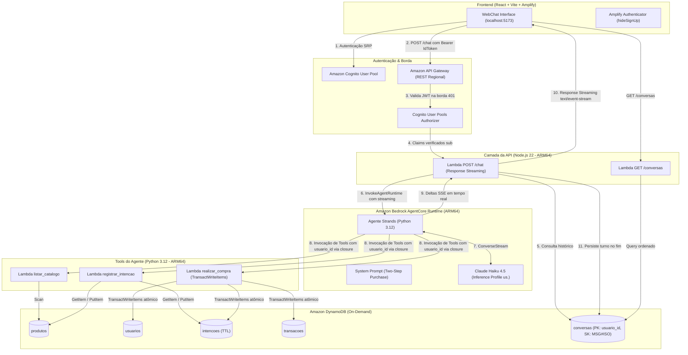

# Agente Financeiro de Pagamentos na AWS

Este repositório contém a solução do **Desafio 1 (Sprint 2)** do Fellowship: um ecossistema serverless de compras mediado por um **Agente de IA Autônomo** executando no **Amazon Bedrock AgentCore Runtime** com o framework **Strands**, integrado a ferramentas Lambda, transações ACID no **Amazon DynamoDB**, autenticação com **Amazon Cognito** e API REST com **Response Streaming (SSE)** no **Amazon API Gateway**.

---

## 1. Arquitetura da Solução



### Justificativas de Design:
* **REST API com Response Streaming vs. HTTP API ou WebSocket**: A REST API do API Gateway oferece suporte nativo ao `ResponseTransferMode.STREAM` (repassando eventos SSE do agente diretamente ao navegador sem buffering), enquanto protege os endpoints nativamente na borda com o `CognitoUserPoolsAuthorizer` (rejeitando requisições inválidas com HTTP 401 sem invocar Lambdas). Evita a sobrecarga de estado do WebSocket.
* **Agente Strands no Bedrock AgentCore Runtime**: O runtime executa o container Python ARM64 em microVMs isoladas, permitindo streaming contínuo de deltas e injeção do `usuario_id` via closure léxica. O runtime **não possui permissão direta no DynamoDB**, garantindo isolamento total.
* **Ferramentas como Lambdas Dedicadas**: Cada ferramenta (`listar_catalogo`, `registrar_intencao`, `realizar_compra`) roda em sua própria função Lambda com uma Role IAM restrita às tabelas estritamente necessárias.
* **Transação Atômica ACID (`TransactWriteItems`)**: Na ferramenta `realizar_compra`, a validação do status pendente da intenção, o decremento do limite do usuário e o registro da transação ocorrem atomicamente em uma única transação DynamoDB, eliminando qualquer risco de race condition ou pagamento duplicado.

---

## 2. Como Rodar o Frontend Localmente

O frontend foi desenvolvido com React, TypeScript, Vite e AWS Amplify v6, pronto para rodar localmente conectando-se diretamente à infraestrutura na AWS.

### Passo 1: Instalar as Dependências
Abra um terminal e acesse a pasta `frontend`:
```bash
cd Desafio-1/joao-matheus/frontend
npm install
```

### Passo 2: Configuração dos Endpoints da AWS
A aplicação utiliza o arquivo `public/config.json` para descobrir dinamicamente os endpoints da AWS. Ele já foi provisionado com os recursos ativos da stack:
```json
{
  "apiUrl": "https://gmtmb97y6l.execute-api.us-east-1.amazonaws.com/prod",
  "userPoolId": "us-east-1_hbZ3wz25z",
  "userPoolClientId": "lbqun35uoa19c915apruf7cgr",
  "region": "us-east-1"
}
```
*(Caso queira usar variáveis de ambiente Vite, basta copiar o arquivo `.env.example` para `.env.local` e preencher os valores).*

### Passo 3: Iniciar o Servidor de Desenvolvimento
```bash
npm run dev
```
O servidor Vite será iniciado em `http://localhost:5173`.

### Passo 4: Acessar e Fazer Login
1. Abra `http://localhost:5173` no seu navegador;
2. A tela de login do **AWS Amplify Authenticator** será exibida em português;
3. Utilize as credenciais do usuário criado no Cognito (ex: `teste@exemplo.com` / `SenhaForte@123`);
4. Caso seja o primeiro acesso de um usuário convidado, o sistema solicitará a troca obrigatória de senha temporária;
5. Após o login, o WebChat será carregado, exibindo as mensagens anteriores e pronto para streaming em tempo real!

> [!NOTE]
> O backend na AWS está configurado com `Access-Control-Allow-Origin: http://localhost:5173` via flag `permitirLocalhost=true`, permitindo que o frontend local se comunique com a API REST na AWS sem bloqueios de CORS.

---

## 3. Pré-Requisitos e Deploy do Backend

### Pré-requisitos:
1. **AWS CLI v2** instalado e autenticado via SSO (`joao_fellowship` na região `us-east-1`, conta `164574810614`);
2. **Node.js** v20+ e **npm**;
3. **Docker Desktop** em execução (necessário para o build do container ARM64 do agente);
4. Acesso habilitado ao modelo **Anthropic Claude Haiku 4.5** no console do Amazon Bedrock em `us-east-1`.

### Deploy em Um Comando:
Acesse a pasta `infra/` e execute:
```bash
cd Desafio-1/joao-matheus/infra
npm install
npm run deploy
```
Esse comando compila o frontend via Vite, empacota os handlers Node.js com `esbuild`, sintetiza a infraestrutura com o AWS CDK e faz o deploy de todos os recursos para a AWS em ~2 minutos.

### Criando Usuários no Cognito:
Como o auto-cadastro foi desabilitado por segurança, utilize o script auxiliar:
```bash
npm run usuario -- --email usuario@exemplo.com --limite 500
```
Isso cria o usuário no Cognito User Pool, dispara o convite por e-mail e cadastra a linha inicial de saldo na tabela `usuarios`.

---

## 4. Modelagem do Banco de Dados (Amazon DynamoDB)

Todas as 5 tabelas foram provisionadas em modo **On-Demand** (`PAY_PER_REQUEST`) com remoção segura em ambiente de testes:

| Tabela | Partition Key (PK) | Sort Key (SK) | Descrição e Atributos |
|---|---|---|---|
| `joao-matheus-produtos` | `produto_id` (String) | — | Catálogo com `nome`, `preco` (Number), `descricao`, `moeda`. |
| `joao-matheus-usuarios` | `usuario_id` (String) | — | Saldo do cliente: `limite_total`, `limite_restante`, `atualizado_em`. |
| `joao-matheus-intencoes` | `intencao_id` (String) | — | Intenções pendentes com TTL (`ttl`), `valor_total`, `quantidade`, `status`. |
| `joao-matheus-transacoes`| `transacao_id` (String) | — | Histórico de pagamentos aprovados: `intencao_id`, `valor`, `metodo`, `data`. |
| `joao-matheus-conversas` | `usuario_id` (String) | `sk` (String) | Histórico de chat: `sk = MSG#<ISO-8601>#<rand>`, `role`, `texto`, `criado_em`. |

### Mecanismo de Transação ACID (`realizar_compra`):
Ao confirmar uma compra, a Lambda executa `TransactWriteItems` com 3 operações atômicas:
1. `Update` em `intencoes`: Atualiza `status = 'paga'` sob a condição `status = :pendente AND expira_em > :agora`;
2. `Update` em `usuarios`: Decrementa `limite_restante = limite_restante - :valor` sob a condição `limite_restante >= :valor`;
3. `Put` em `transacoes`: Registra a transação com `transacao_id = 'tx_' + intencao_id` sob a condição `attribute_not_exists(transacao_id)`.

Se qualquer condição falhar, **nenhuma alteração é persistida** e o sistema retorna mensagens amigáveis (`LIMITE_EXCEDIDO`, `INTENCAO_JA_PAGA` ou `INTENCAO_EXPIRADA`).

---

## 5. Matriz de Menor Privilégio IAM

Nenhuma Role utiliza AWS Managed Policies amplas (como `AdministratorAccess` ou `PowerUserAccess`). Cada componente possui apenas as ações mínimas necessárias:

| Papel / Recurso | Ações Permitidas | Recursos Específicos | O que NÃO possui |
|---|---|---|---|
| `tool-listar-catalogo` | `dynamodb:Scan` | Tabela `produtos` | Sem acesso a usuários, transações ou Bedrock. |
| `tool-registrar-intencao` | `dynamodb:GetItem`, `dynamodb:PutItem` | Tabelas `produtos` e `intencoes` | Sem acesso a transações ou Bedrock. |
| `tool-realizar-compra` | `dynamodb:GetItem`, `dynamodb:UpdateItem`, `dynamodb:PutItem` | Tabelas `intencoes`, `usuarios`, `transacoes` | Sem acesso a produtos, conversas ou Bedrock. |
| `agente-runtime` | `bedrock:InvokeModelWithResponseStream`, `lambda:InvokeFunction` | Perfil do Haiku 4.5 e ARNs das 3 Lambdas de tool | **Zero permissão no DynamoDB**. |
| `api-chat` | `bedrock-agentcore:InvokeAgentRuntime`, `dynamodb:Query`, `dynamodb:BatchWriteItem` | ARN do AgentCore Runtime e tabela `conversas` | Sem acesso a produtos, intenções, transações ou Bedrock direto. |
| `api-conversas` | `dynamodb:Query` | Tabela `conversas` | Sem acesso a qualquer outra tabela. |

---

## 6. Recursos de Segurança Implementados

1. **Injeção de Identidade por Closure**: O `usuario_id` é capturado do token JWT verificado pelo autorizador Cognito (`claims.sub`) e injetado via closure Python no agente. Nem o prompt do usuário nem o LLM conseguem alterar quem está comprando.
2. **Rejeição 401 na Borda**: Requisições sem token ou com token inválido são bloqueadas imediatamente pelo API Gateway sem acionar Lambdas.
3. **Imunidade a Prompt Injection**: Tentativas de manipular valores ou comprar em nome de terceiros são inócuas, pois o valor total é calculado a partir do catálogo oficial e o saldo é verificado no banco de dados.
4. **Auto-Cadastro Desabilitado**: Apenas administradores podem convidar usuários (`AllowAdminCreateUserOnly = true`).

---

## 7. Evidências de Testes

Os testes e logs de execução estão documentados detalhadamente em [`docs/evidencias/README.md`](./docs/evidencias/README.md), abrangendo:
* Bloqueio 401 do API Gateway sem token;
* Bloqueio de auto-cadastro no Cognito;
* Preflight CORS bloqueando domínios não autorizados;
* Fluxo multi-turno completo com streaming SSE e compra aprovada;
* Validação de escrita transacional contra compras duplicadas (replay attack) e limite insuficiente.

---

## 8. Estrutura de Pastas

```text
Desafio-1/joao-matheus/
├── agent/            # Agente Strands em Python 3.12 (Dockerfile ARM64, tools, prompt, histórico)
├── api/              # Handlers da API REST em TypeScript (chat streaming SSE, conversas, histórico DynamoDB)
├── docs/             # Documentação de evidências de testes (evidencias/) e enunciado histórico (desafio.md)
├── frontend/         # Interface Web React + Vite + AWS Amplify v6 (Chat.tsx, App.tsx, config.ts)
├── infra/            # Infraestrutura como Código com AWS CDK em TypeScript (lib/constructs/, scripts/)
└── tools/            # Lambdas Python das ferramentas de negócio (listar_catalogo, registrar_intencao, realizar_compra)
```

---

## 9. Desmontagem dos Recursos (Teardown)

Para destruir completamente a infraestrutura criada na AWS e evitar cobranças indesejadas:

```bash
cd Desafio-1/joao-matheus/infra
npm run destroy
```

O script interativo `infra/scripts/destroy.mjs` irá:
1. Solicitar a confirmação digitando o nome da stack (`joao-matheus-desafio-1`);
2. Executar `cdk destroy --force`;
3. Remover unicamente a imagem Docker do agente no repositório ECR do bootstrap (preservando imagens de outros colegas);
4. Excluir os log groups residuais do CloudWatch.
