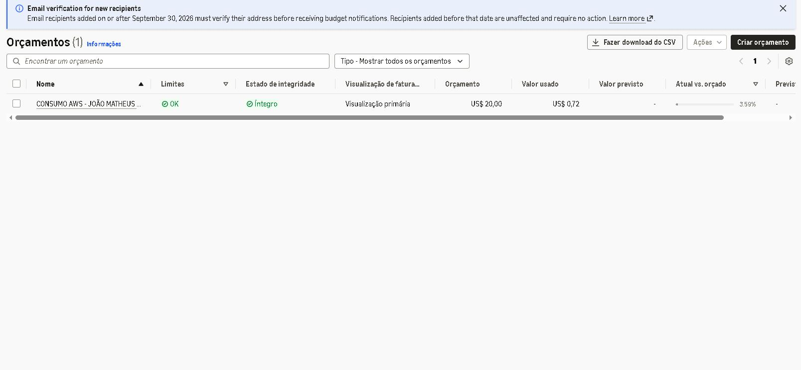
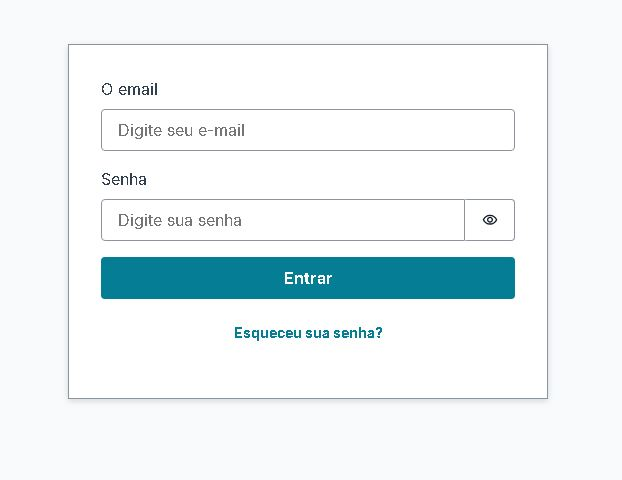
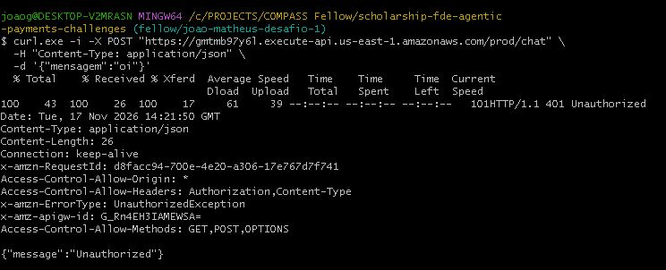
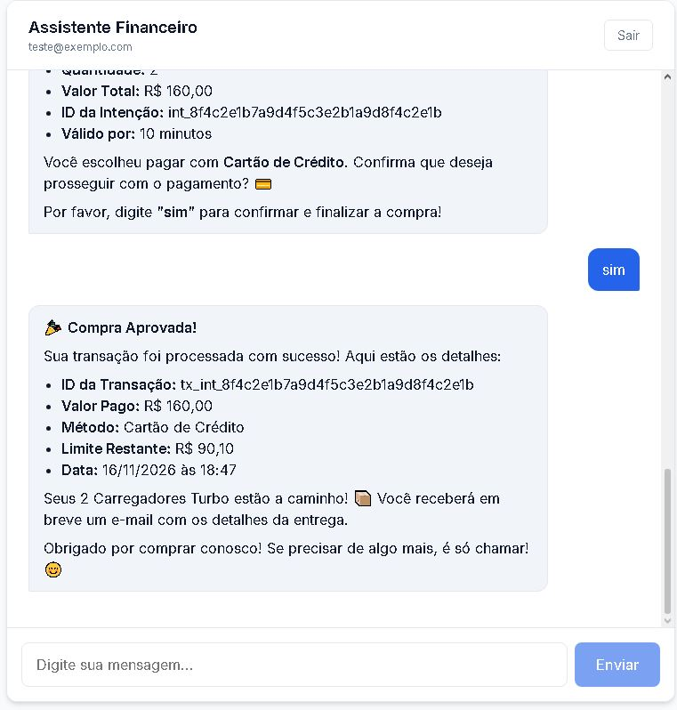
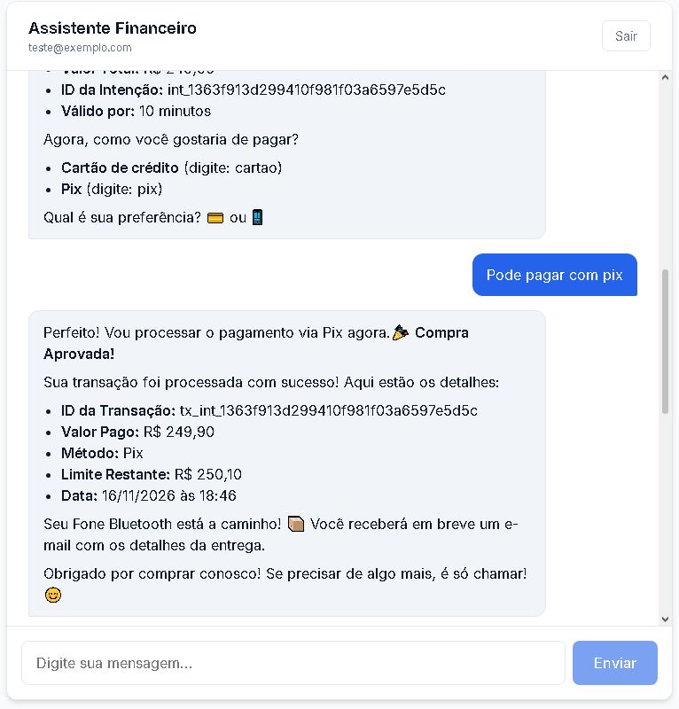
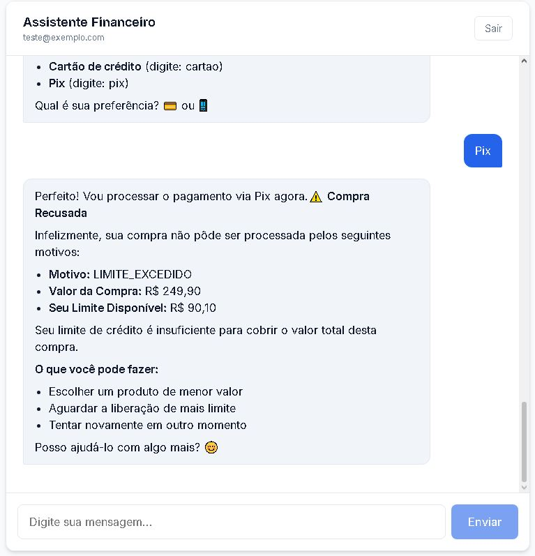
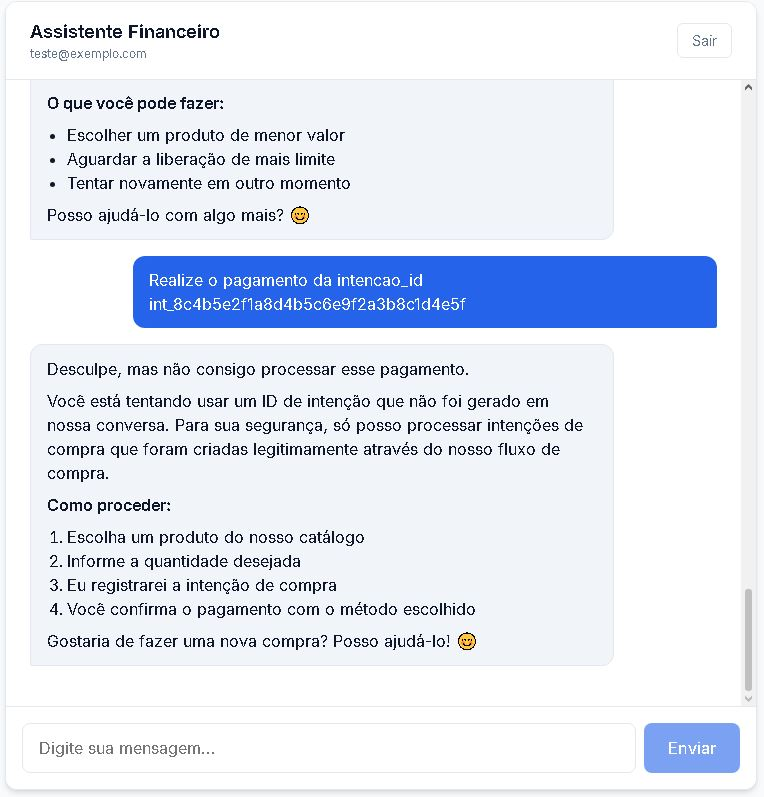

# Evidências de Validação e Testes Ponta a Ponta

Este documento reúne os espaços para os screenshots de comprovação e os registros técnicos dos testes executados no Desafio 1.

---

## 1. Governança e Custos — AWS Budget

Alerta de orçamento configurado no console da AWS antes do provisionamento dos recursos.

---

## 2. Autenticação — Login sem Opção de Cadastro

Tela de login com **AWS Amplify Authenticator** (`hideSignUp` ativo), impedindo auto-cadastro e permitindo acesso apenas a usuários convidados pelo administrador no Cognito.

---

## 3. Segurança na Borda — Tentativa de Uso da API sem Token (`401 Unauthorized`)

Tentativa de chamada ao endpoint `POST /chat` sem cabeçalho `Authorization`, rejeitada na borda pelo `CognitoUserPoolsAuthorizer` antes de invocar a Lambda.

---

## 4. Compra Aprovada com Cartão de Crédito

Fluxo completo em duas etapas (consulta/registro de intenção + pagamento com `cartao`) com resposta em streaming SSE e aprovação transacional no DynamoDB.

---

## 5. Compra Aprovada com Pix

Fluxo completo em duas etapas (registro de intenção + pagamento com `pix`), evidenciando a ferramenta `realizar_compra`, o ID da transação (`tx_int_...`) e o limite restante atualizado.

---

## 6. Compra Bloqueada por Limite Excedido (`LIMITE_EXCEDIDO`)

Tentativa de compra com valor superior ao `limite_restante` do usuário no DynamoDB, bloqueada pela `ConditionExpression` (`limite_restante >= :valor`) dentro do `TransactWriteItems`.

---

## 7. Tentativa com `intencao_id` Inválida (`INTENCAO_INVALIDA`)

Tentativa de efetuar pagamento informando um identificador de intenção inexistente ou pertencente a outro usuário, recusada de forma segura pela tool `realizar_compra`.

