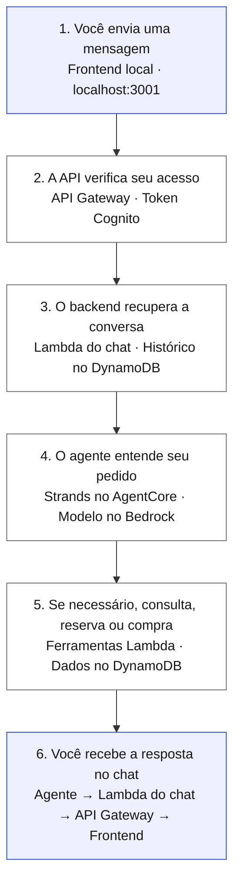
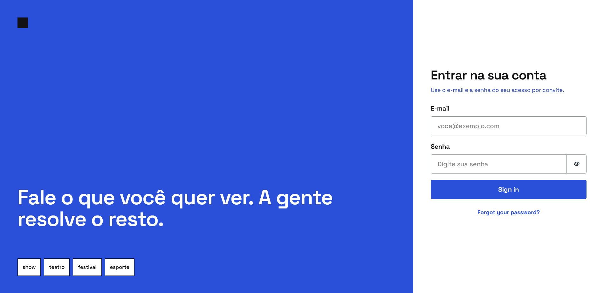
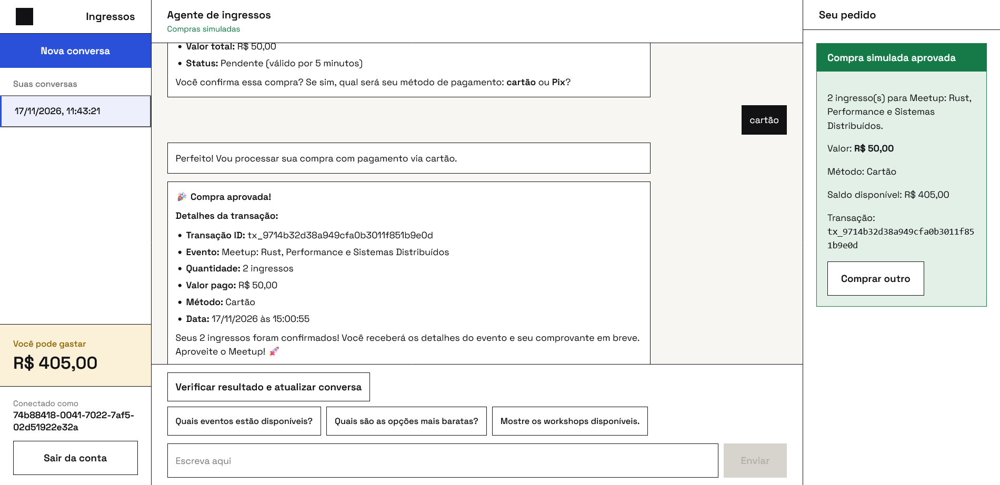
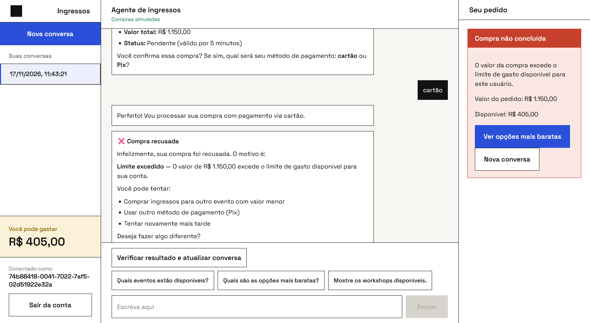
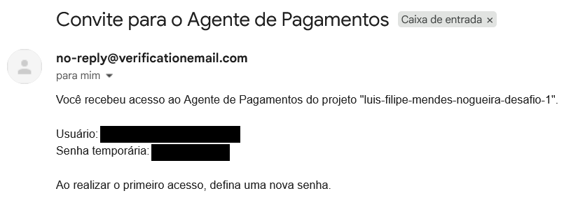
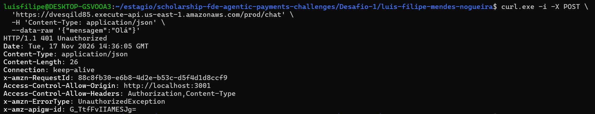

# Agente de Pagamentos na AWS

**Luis Filipe Mendes Nogueira · Desafio 1 · Fase 2**

Chat para consultar eventos, reservar ingressos e fazer compras simuladas por **cartão ou Pix**. O agente usa Strands, Claude Haiku no Bedrock e ferramentas Lambda com DynamoDB.

**O frontend roda localmente em http://localhost:3001. A autenticação e todo o backend ficam na AWS.** Por orientação do instrutor, a publicação do frontend em S3/CloudFront está suspensa.

## Sumário

1. [Como rodar](#1-como-rodar)
2. [Como a solução funciona](#2-como-a-solução-funciona)
3. [Tecnologias usadas](#3-tecnologias-usadas)
4. [Serviços AWS e responsabilidades](#4-serviços-aws-e-responsabilidades)
   - [Cognito](#41-cognito-login-e-identidade)
   - [API Gateway e Lambda](#42-api-gateway-e-lambda-entrada-e-regras-de-negócio)
   - [Bedrock e AgentCore](#43-bedrock-e-agentcore-inteligência-do-agente)
   - [DynamoDB](#44-dynamodb-dados-e-proteção-contra-duplicidade)
   - [IAM](#45-iam-permissões-entre-os-serviços)
   - [CloudWatch, CDK e custos](#46-cloudwatch-cdk-e-custos)
5. [Estrutura do projeto](#5-estrutura-do-projeto)
6. [Testes e validação](#6-testes-e-validação)
7. [Atualizar o backend AWS](#7-atualizar-o-backend-aws)
8. [Atualizar, parar e resolver problemas](#8-atualizar-parar-e-resolver-problemas)
9. [Evidências](#9-evidências)

## 1. Como rodar

Você precisa de **Git, Docker com Compose v2 e conexão com a internet**, além de uma conta convidada no Cognito. O backend AWS deve estar disponível. Para abrir a interface, não é necessário instalar Node.js ou Python nem configurar credenciais AWS na sua máquina.

### 1.1 Entre na pasta do projeto

Se ainda não clonou o repositório:

```bash
git clone https://github.com/luisfilipemendesnogueira/scholarship-fde-agentic-payments-challenges.git
cd scholarship-fde-agentic-payments-challenges/Desafio-1/luis-filipe-mendes-nogueira
```

Se já clonou, abra o terminal na pasta `Desafio-1/luis-filipe-mendes-nogueira/`.

### 1.2 Inicie o frontend

Com o Docker em execução:

```bash
docker compose up -d --build frontend
docker compose ps
```

O comando constrói a interface e inicia o Nginx. A porta esperada é **`127.0.0.1:3001->80/tcp`**. Os serviços antigos `app` e `auth` não são necessários.

### 1.3 Abra e faça login

Acesse **http://localhost:3001**.

Entre com o e-mail e a senha temporária recebidos no convite Cognito. No primeiro acesso, defina sua nova senha e conclua a verificação de e-mail, se solicitada. Não há cadastro livre; peça um convite ao responsável pelo ambiente.

### 1.4 Teste a conversa

Clique em **Nova conversa** e envie:

```text
Quais eventos estão disponíveis? Mostre os preços e as vagas.
```

Para comprar, escolha um evento e a quantidade, confira o total e confirme cartão ou Pix. **Os pagamentos são simulados:** não informe dados reais de cartão. Uma intenção reserva ingressos por cinco minutos; a compra valida prazo, saldo e propriedade da intenção.

O saldo inicial de um novo perfil é **R$ 500,00**. Compras de teste consomem esse limite; recarregar a página não reinicia o saldo.

## 2. Como a solução funciona



**Antes de conversar:** você faz login pelo Cognito, que fornece o token usado para acessar a API. O diagrama mostra a sequência de uma mensagem; quando nenhuma ferramenta é necessária, o agente responde diretamente.

Você abre a interface no seu computador e entra com sua conta. O **Cognito** confirma o login e fornece um token, que funciona como um comprovante de acesso para as próximas chamadas.

Ao enviar uma mensagem, o **API Gateway** verifica esse token. A **Lambda do chat** recupera o histórico e encaminha a conversa ao agente no **AgentCore**. O agente usa o modelo do **Bedrock** para entender seu pedido e preparar a resposta.

Se você pedir uma consulta, reserva ou compra, o agente chama a ferramenta correspondente. As **ferramentas Lambda** consultam o **DynamoDB**, calculam os valores e validam vagas, prazo e saldo antes de confirmar a operação. O modelo não escolhe os preços nem aprova pagamentos por conta própria.

A resposta aparece aos poucos no chat, e o histórico fica salvo para continuar a conversa depois. Repetir uma requisição já concluída com o mesmo identificador reutiliza o resultado, sem executar novamente a compra. Todos os pagamentos são simulados.

## 3. Tecnologias usadas

| Tecnologia | Para que é usada |
|---|---|
| Next.js, React e TypeScript | Construção das páginas e componentes da interface. |
| AWS Amplify | Integração do login da interface com o Cognito. |
| Docker Compose e Nginx | Construção e execução do frontend local. |
| Amazon Cognito | Login por convite e emissão dos tokens de acesso. |
| Amazon API Gateway | Publicação das rotas protegidas e entrega do streaming. |
| AWS Lambda | Execução das APIs e ferramentas de compra. |
| Node.js 24 e JavaScript | Implementação da Lambda que coordena o chat. |
| Python 3.13 e Boto3 | Implementação do agente, perfil e ferramentas, com acesso aos serviços AWS. |
| Strands Agents | Organização do agente, das mensagens e das chamadas às ferramentas. |
| Bedrock AgentCore Runtime | Hospedagem e execução do agente na AWS. |
| Amazon Bedrock e Claude Haiku 4.5 | Modelo de IA que interpreta os pedidos e produz as respostas. |
| Amazon DynamoDB | Armazenamento de usuários, catálogo, conversas, intenções e transações. |
| AWS CDK e CloudFormation | Definição e implantação da infraestrutura por código. |
| Amazon CloudWatch | Registro dos logs dos serviços. |
| unittest, node:test e Vitest | Testes automatizados do backend, agente e frontend. |

## 4. Serviços AWS e responsabilidades

### 4.1 Cognito: login e identidade

O Cognito administra os usuários da aplicação. A configuração usa **login por e-mail, acesso por convite e cadastro público desabilitado**. O cliente do frontend não tem segredo e usa autenticação SRP pelo Amplify.

- **Senha:** mínimo de 12 caracteres, com maiúsculas, minúsculas, números e símbolos.
- **Primeiro acesso:** senha temporária válida por sete dias, com troca obrigatória.
- **Sessão:** tokens de acesso e identidade válidos por uma hora; token de renovação válido por sete dias.
- **Identidade:** o backend usa o `sub` do Cognito para identificar o dono dos dados; não aceita substituição por um usuário informado na mensagem.

Para o responsável pelo ambiente **convidar um novo usuário**, com uma sessão AWS CLI válida e permissão para administrar usuários do Cognito:

```bash
aws cognito-idp admin-create-user \
  --profile NOME_DO_SEU_PERFIL \
  --region us-east-1 \
  --user-pool-id us-east-1_tYHumks4h \
  --username 'EMAIL_DO_CONVIDADO' \
  --user-attributes Name=email,Value='EMAIL_DO_CONVIDADO' \
  --desired-delivery-mediums EMAIL \
  --query 'User.{Usuario:Username,Status:UserStatus}' \
  --output json \
  --no-cli-pager
```

Substitua `NOME_DO_SEU_PERFIL` pelo nome do perfil configurado no AWS CLI e `EMAIL_DO_CONVIDADO` pelo e-mail da pessoa nos dois campos. O User Pool acima corresponde ao ambiente atual; se ele for recriado, use o novo identificador retornado pelo deploy. A pessoa receberá uma senha temporária por e-mail e deverá definir uma nova senha no primeiro acesso.

### 4.2 API Gateway e Lambda: entrada e regras de negócio

São usadas duas APIs, protegidas pelo Cognito:

| API | Rotas e função |
|---|---|
| HTTP API | `GET /sessao` confirma a identidade; `GET /me` consulta ou cria o perfil. |
| REST API | `POST /chat` envia mensagens; `GET /conversas`, `POST /conversas` e `GET /conversas/{conversa_id}` gerenciam as conversas. |

O CORS permite a interface em `http://localhost:3001`. O chat usa integração Lambda com **SSE**, entregando partes da resposta conforme são produzidas.

A Lambda do chat usa **Node.js 24, 256 MB e limite de 120 segundos**. Sessão, perfil e ferramentas usam **Python 3.13**. As ferramentas validam preço, vagas, saldo e prazo; uma recusa de compra é uma resposta de negócio, não uma indisponibilidade do serviço.

### 4.3 Bedrock e AgentCore: inteligência do agente

O **Bedrock** fornece o **Claude Haiku 4.5**, pelo perfil `us.anthropic.claude-haiku-4-5-20251001-v1:0`. O **AgentCore Runtime** executa o agente Strands em Python 3.13, publicado como pacote ZIP para ARM64, com entrada HTTP autenticada por IAM.

O agente recebe a mensagem, o histórico e a identidade encaminhados pelo backend. Ele pode chamar somente as três ferramentas configuradas: `listar_catalogo`, `registrar_intencao` e `realizar_compra`. O modelo interpreta o pedido; as ferramentas determinam se a operação pode ser realizada.

As sessões do runtime têm limite de **60 segundos de inatividade e 15 minutos de duração**. Os recursos da stack ficam em `us-east-1`, mas o perfil de inferência permite execução do modelo em `us-east-1`, `us-east-2` e `us-west-2`. Veja o [registro dessa escolha](docs/fase2/documentacao.md#região-e-escolha-do-acesso-ao-modelo).

### 4.4 DynamoDB: dados e proteção contra duplicidade

As cinco tabelas usam **cobrança por demanda e criptografia em repouso**. Os valores financeiros são armazenados em centavos.

| Tabela | Chave principal | O que guarda |
|---|---|---|
| `usuarios` | `usuario_id` | Identidade e saldo disponível. |
| `catalogo` | `evento_id` | Eventos, preços e vagas. |
| `intencoes` | `intencao_id` | Proprietário, reserva, valor, prazo e situação. |
| `transacoes` | `intencao_id` | Pagamento simulado associado à intenção. |
| `conversas` | `usuario_id` + `registro_id` | Histórico, estado da conversa e controle das requisições. |

O índice `por-status-expiracao` permite localizar reservas vencidas. A devolução de vagas é feita pelas ferramentas, com atualização conjunta da reserva e do estoque; não depende da exclusão automática por TTL.

O pagamento agrupa débito de saldo, atualização da intenção e criação da transação em uma operação transacional. Condições de escrita impedem pagar a mesma intenção duas vezes. Na configuração atual, **remover a stack pode apagar as tabelas e seus dados**.

### 4.5 IAM: permissões entre os serviços

Cada componente assume uma **role**, que define suas permissões de execução. O resumo abaixo mostra como os acessos estão separados:

| Componente | Permissões e recursos |
|---|---|
| Sessão | Escrever nos próprios logs; não acessa tabelas. |
| Perfil | Ler e criar registros na tabela `usuarios`; escrever nos próprios logs. |
| Chat | `GetItem`, `PutItem`, `UpdateItem` e `Query` somente em `conversas`; invocar o runtime e encerrar suas sessões no endpoint `DEFAULT`; escrever logs. |
| Agente no AgentCore | Invocar o perfil Haiku e os modelos de destino condicionados a esse perfil; chamar as três Lambdas exatas; ler seu pacote ZIP no S3 e acessar os próprios logs. |
| Listar catálogo | Ler o catálogo com `Scan`, consultar o índice de expiração e atualizar catálogo/intenção para liberar reservas vencidas. |
| Registrar intenção | Ler/atualizar catálogo, criar/atualizar intenções e consultar o índice de expiração. |
| Realizar compra | Ler/atualizar usuário e intenção, criar transação e atualizar catálogo para devolver reservas vencidas. |
| CloudFormation e bootstrap | Preparar e gerenciar os recursos de implantação, com permissões separadas das roles da aplicação. |

O navegador usa token Cognito e não recebe credenciais IAM. O agente não tem acesso direto ao DynamoDB; a Lambda do chat não acessa as tabelas de compras nem invoca o modelo diretamente. A role do runtime só pode ser assumida pelo serviço AgentCore, com condições de conta e ARN do runtime.

Não há `AdministratorAccess` nas roles da aplicação. Existem padrões de ARN e exceções de implantação: `CreateAgentRuntime` exige `Resource: "*"`, limitado por região e tag; `iam:PassRole` para o runtime fica restrito à role exata e ao serviço AgentCore. A política de deploy das REST APIs abrange os recursos desse tipo na região. Os detalhes e limites estão em [`infra/policies/README.md`](infra/policies/README.md).

### 4.6 CloudWatch, CDK e custos

O **CloudWatch** guarda logs separados por Lambda e runtime, com **retenção de sete dias**. Eles ajudam a localizar falhas sem depender apenas da mensagem apresentada no chat.

O **CDK**, escrito em Python, define os recursos, suas conexões e permissões; o **CloudFormation** aplica essas definições na conta AWS. O S3 do bootstrap guarda os pacotes de implantação, sem hospedar o frontend. Alterar um arquivo de política local não publica automaticamente a mudança no IAM.

O orçamento foi configurado. Modelo, APIs, execução e armazenamento podem gerar custos AWS. O saldo em reais da aplicação é apenas o limite das compras simuladas e não representa créditos AWS. A interface permanece local; S3/CloudFront para hospedagem aguardam liberação do instrutor.

## 5. Estrutura do projeto

```text
luis-filipe-mendes-nogueira/
├── frontend/           # Interface atual, executada localmente
├── api/
│   ├── sessao/         # Confirmação da identidade autenticada
│   ├── perfil/         # Consulta do usuário e saldo
│   └── chat/           # Conversas, histórico e streaming
├── agent/              # Agente Strands publicado no AgentCore
├── tools/
│   └── pagamentos/     # Catálogo, reserva e compra em Lambda
├── infra/              # Infraestrutura CDK, deploy e testes
├── docs/
│   ├── fase1/          # Documentação da versão anterior
│   ├── fase2/          # Documentação técnica da migração AWS
│   └── evidencias/     # Capturas dos testes e da aplicação
├── auth/               # Autenticação local legada
├── gemini-chat/        # Chat com Gemini legado
├── tickets-tools/      # Ferramentas MCP legadas
├── docker-compose.yml  # Configuração de execução local
└── README.md           # Guia de uso do projeto
```

Cada pasta principal tem um README com uma explicação do seu conteúdo:

| Pasta | O que contém |
|---|---|
| [`frontend/`](frontend/README.md) | Interface atual e login Cognito. |
| [`api/`](api/README.md) | Sessão, perfil, conversas e streaming do chat. |
| [`agent/`](agent/README.md) | Agente Strands e integração com o Bedrock. |
| [`tools/`](tools/README.md) | Regras de catálogo, reserva e pagamento em Lambda. |
| [`infra/`](infra/README.md) | Infraestrutura CDK, deploy e testes. |
| [`docs/`](docs/README.md) | Documentação das fases e evidências. |

`auth/`, `gemini-chat/` e `tickets-tools/` são componentes legados da Fase 1.

## 6. Testes e validação

Os testes cobrem autenticação, histórico, streaming, reservas, saldo, erros e proteção contra compras duplicadas. Também foram realizados testes reais de cartão, Pix, concorrência e isolamento entre usuários.

Para executar as suítes locais, prepare as dependências e os ambientes Python conforme a [documentação técnica](docs/fase2/documentacao.md#pré-requisitos). Depois, na pasta principal, com Node.js 24 ativo:

```bash
npm --prefix frontend test
npm --prefix api/chat test
infra/.venv/bin/python -m unittest discover -s infra/tests -p 'test_*.py' -v
(cd agent && .venv/bin/python -m unittest discover -s tests -p 'test_*.py' -v)
```

Essas suítes usam simulações. Os scripts manuais de `agent/tests/testar_*.py` fazem chamadas reais à AWS e estão explicados no [README do agente](agent/README.md). Testes reais de compra alteram saldo e estoque simulados.

## 7. Atualizar o backend AWS

Esta etapa é para quem administra a infraestrutura. **Não é necessário fazer deploy para apenas abrir o frontend.** Prepare AWS CLI, acesso SSO, Node.js 24, CDK, Python 3.13, dependências, bootstrap e permissões, conforme a [documentação técnica](docs/fase2/documentacao.md#deploy-e-configuração-pública).

Com o ambiente preparado, execute na pasta principal:

```bash
aws sso login --profile NOME_DO_SEU_PERFIL
aws sts get-caller-identity --profile NOME_DO_SEU_PERFIL
bash infra/deploy.sh NOME_DO_SEU_PERFIL
```

Substitua **`NOME_DO_SEU_PERFIL` pelo nome do perfil configurado no AWS CLI** com acesso à conta de destino. Não é o usuário Cognito nem o número da conta. Para listar os perfis disponíveis, use `aws configure list-profiles`.

O script publica o backend, atualiza `frontend/public/config.json` e gera a interface local. Depois, reconstrua o container com `docker compose up -d --build frontend` para incorporar as alterações.

Mantenha o backend disponível até a avaliação. Parar o frontend não apaga os dados; remover a stack pode excluir tabelas e usuários. Consulte o [procedimento de limpeza](docs/fase2/documentacao.md#remoção-futura-dos-recursos) antes de remover recursos.

## 8. Atualizar, parar e resolver problemas

Execute os comandos na pasta principal do projeto:

| Ação | Comando |
|---|---|
| Aplicar alterações no frontend ou na configuração | `docker compose up -d --build frontend` |
| Parar a interface | `docker compose stop frontend` |
| Ver os logs | `docker compose logs --tail 80 frontend` |
| Conferir a configuração servida | `curl -fsS http://localhost:3001/config.json` |

- **Porta 3001 ocupada:** encerre outro servidor que esteja usando essa porta antes de iniciar o Compose.
- **Container sem porta publicada após uma falha:** com a porta livre, execute `docker compose up -d --force-recreate --no-deps frontend`.
- **Interface antiga:** reconstrua o frontend e atualize o navegador com `Ctrl + Shift + R`.
- **Sessão recusada:** saia da conta e entre novamente.
- **Resposta interrompida:** use **Verificar resultado e atualizar conversa** antes de repetir uma compra.

Parar o container local não remove os recursos AWS.

## 9. Evidências

As capturas estão em [`docs/evidencias/`](docs/evidencias/). Clique em uma imagem para abrir a captura completa.

<table>
  <tr>
    <td width="50%" valign="top">
      <p><strong>Tela de login</strong></p>
      <a href="docs/evidencias/tela-login.png"></a>
      <p>Interface de entrada com e-mail e senha para o acesso por convite Cognito.</p>
    </td>
    <td width="50%" valign="top">
      <p><strong>Consulta ao catálogo</strong></p>
      <a href="docs/evidencias/eventos.png"></a>
      <p>Conversa autenticada exibindo eventos, preços e vagas disponíveis, com saldo inicial de R$ 500,00 na captura.</p>
    </td>
  </tr>
  <tr>
    <td width="50%" valign="top">
      <p><strong>Registro de intenção</strong></p>
      <a href="docs/evidencias/intencao.png"></a>
      <p>Mensagem do agente informando uma intenção pendente de um ingresso para o Hackathon.</p>
    </td>
    <td width="50%" valign="top">
      <p><strong>Compra por Pix</strong></p>
      <a href="docs/evidencias/pix.png"></a>
      <p>Compra simulada aprovada de um ingresso para o Hackathon por R$ 45,00 no Pix.</p>
    </td>
  </tr>
  <tr>
    <td width="50%" valign="top">
      <p><strong>Compra por cartão</strong></p>
      <a href="docs/evidencias/cartao.png"></a>
      <p>Compra simulada aprovada de dois ingressos para o Meetup de Rust por R$ 50,00 no cartão.</p>
    </td>
    <td width="50%" valign="top">
      <p><strong>Limite excedido</strong></p>
      <a href="docs/evidencias/limite_excedido.png"></a>
      <p>Compra de R$ 1.150,00 recusada por limite insuficiente.</p>
    </td>
  </tr>
  <tr>
    <td width="50%" valign="top">
      <p><strong>Intenção inválida e intenção já paga</strong></p>
      <a href="docs/evidencias/intencao-invalida.png"></a>
      <p>Resposta do chat recusando uma intenção inexistente e outra já paga.</p>
    </td>
    <td width="50%" valign="top">
      <p><strong>Convite Cognito</strong></p>
      <a href="docs/evidencias/convite.png"></a>
      <p>E-mail de convite com instrução para definir a senha no primeiro acesso.</p>
    </td>
  </tr>
  <tr>
    <td width="50%" valign="top">
      <p><strong>Runtime no AgentCore</strong></p>
      <a href="docs/evidencias/agentcore.png"></a>
      <p>Console AWS mostrando o runtime ativo.</p>
    </td>
    <td width="50%" valign="top">
      <p><strong>API sem token</strong></p>
      <a href="docs/evidencias/401-unauthorized.png"></a>
      <p>Chamada POST /chat pelo curl.exe retornando HTTP 401 Unauthorized para API sem token.</p>
    </td>
  </tr>
</table>
