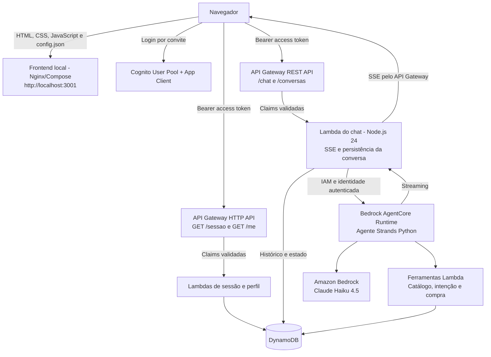
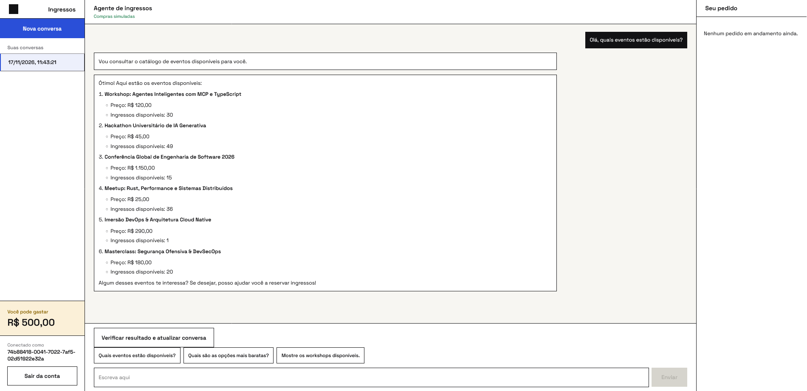
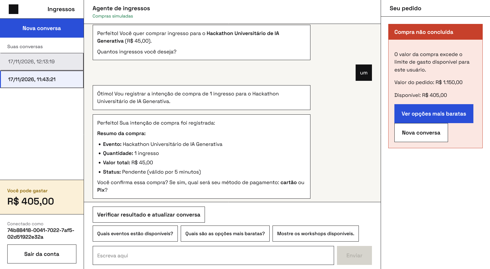
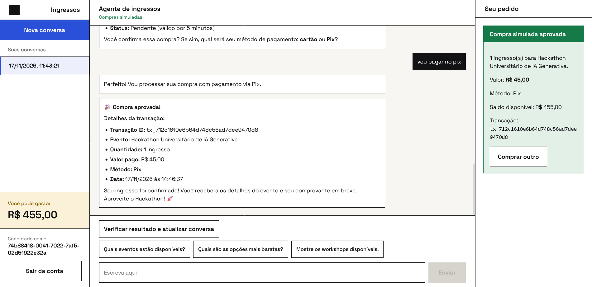
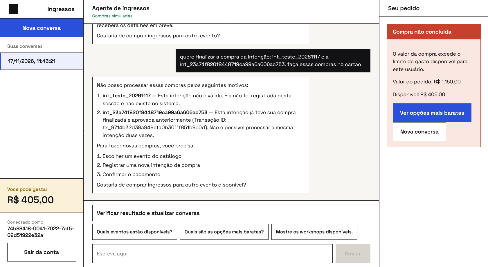
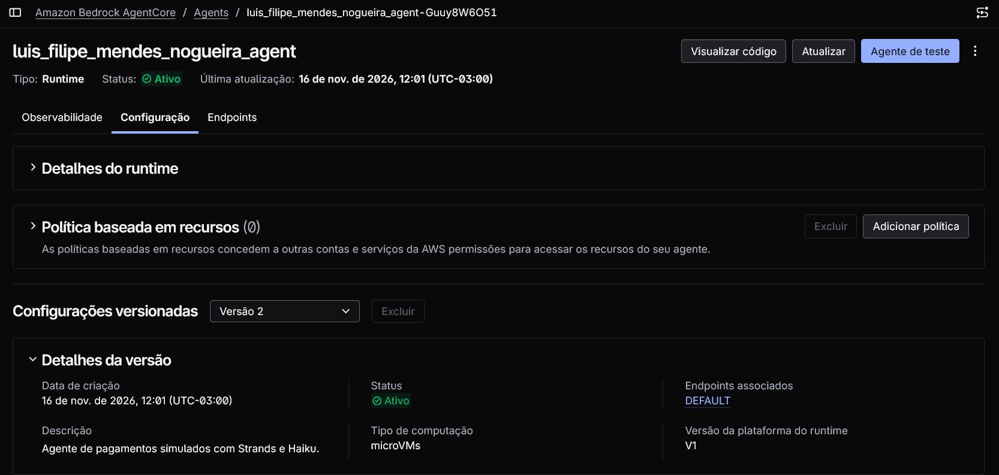

# Desafio — Agente de Pagamentos na AWS

**Trilha Pagamentos Agênticos · Sprint 2 · Trabalho individual**

Migração do chatbot de compras simuladas da Fase 1 para AWS, com login Cognito, agente Strands no Bedrock AgentCore Runtime, modelo Claude Haiku pelo Bedrock, ferramentas Lambda e persistência DynamoDB.

Este README apresenta a execução da implementação de **Luis Filipe Mendes Nogueira**, localizada em [`Desafio-1/luis-filipe-mendes-nogueira/`](Desafio-1/luis-filipe-mendes-nogueira/), e preserva as orientações de organização do desafio. O enunciado original está em [`desafio_1_sprint_2.pdf`](desafio_1_sprint_2.pdf).

## Orientação atual para esta entrega

Por orientação do instrutor, **o frontend permanece local em http://localhost:3001, pelo Docker Compose**. As permissões de CloudFront ainda não foram liberadas. Não é necessário publicar o frontend em S3/CloudFront nesta etapa.

**Autenticação e backend permanecem na AWS.** A interface local usa Cognito e as APIs implantadas; não depende dos serviços legados de autenticação ou agente.

| Componente | Situação |
|---|---|
| Frontend | Exportação estática Next.js, servida localmente por Nginx/Compose |
| Autenticação | Cognito na AWS, com cadastro por convite |
| Perfil e chat | API Gateway e Lambdas na AWS |
| Agente | Strands Python no AgentCore Runtime, com Claude Haiku no Bedrock |
| Ferramentas | Três Lambdas de catálogo, intenção e compra |
| Persistência | DynamoDB |
| Orçamento | Concluído, conforme confirmação do responsável pelo projeto |
| S3/CloudFront/OAC para o frontend | Publicação suspensa conforme orientação do instrutor |

O bucket S3 do bootstrap CDK guarda pacotes de implantação. Ele não é uma hospedagem do frontend.

## Arquitetura implementada



O tráfego do webchat passa pelo API Gateway. O navegador não recebe credenciais IAM para chamar AgentCore ou ferramentas diretamente.

A HTTP API atende perfil e sessão. A REST API regional permite o response streaming utilizado no chat, com autorizador Cognito e integração Lambda proxy em modo `STREAM`. A resposta chega progressivamente por Server-Sent Events (SSE).

## 1. Rodar o frontend local com o backend já implantado

### Pré-requisitos

- Git para obter o projeto.
- Docker e Docker Compose v2 em execução.
- Acesso à internet para o build e as chamadas aos serviços AWS.
- Uma conta Cognito criada por convite no ambiente do projeto.
- Porta local **3001** disponível.

Para este fluxo, o build ocorre dentro do Docker. O acesso do usuário é feito com seu login Cognito; credenciais administrativas AWS são necessárias apenas para as operações de infraestrutura descritas adiante.

### Obter o projeto e iniciar

```bash
git clone https://github.com/luisfilipemendesnogueira/scholarship-fde-agentic-payments-challenges.git
cd scholarship-fde-agentic-payments-challenges/Desafio-1/luis-filipe-mendes-nogueira

docker compose config --quiet
docker compose config --services
docker compose up -d --build
docker compose ps
```

Se o repositório já estiver clonado, entre na pasta individual e execute a partir dos comandos Docker.

Sem perfil legado habilitado, `docker compose config --services` deve mostrar apenas `frontend`. O container deve publicar `127.0.0.1:3001->80/tcp`.

Abra **http://localhost:3001** e entre com o usuário convidado. Use esse endereço: o CORS das APIs está configurado para a origem `http://localhost:3001`.

### Primeiro acesso

1. Receba o convite do Cognito com usuário e senha temporária.
2. Entre no formulário da aplicação.
3. Defina a senha nova solicitada no primeiro acesso.
4. Conclua a verificação de e-mail quando solicitada.
5. Aguarde o carregamento do perfil e abra ou crie uma conversa.

O autocadastro está desabilitado no Cognito e a opção de cadastro está oculta no formulário. Não há credenciais de demonstração ou senhas publicadas neste repositório. O instrutor precisa de um convite para seu próprio e-mail, providenciado pelo responsável pelo ambiente.

### Usar o chat

Uma consulta inicial sem compra:

```text
Mostre os eventos disponíveis com preços e vagas.
Não registre intenções nem realize compras.
```

Para comprar, peça a reserva de um evento, confira quantidade e total e confirme cartão ou Pix. Os pagamentos são simulados e não solicitam dados reais de cartão.

O limite inicial de um perfil novo é **R$ 500**. Perfis existentes preservam seu saldo; recarregar a página ou fazer deploy não o reinicia. A conta usada nos testes já consumiu parte do limite inicial.

### Conferir o que o container está servindo

```bash
docker compose port frontend 80
curl -fsS http://localhost:3001/config.json
curl -s -o /dev/null -w '%{http_code}\n' http://localhost:3001/login/
```

Esperado: porta `127.0.0.1:3001`, configuração com as duas APIs e o Cognito, e HTTP 200 para `/login/`.

Para acompanhar logs e parar a interface:

```bash
docker compose logs --tail 80 frontend
docker compose stop frontend
```

Parar o frontend local não remove nem desliga os recursos AWS.

### Serviços legados

`app` e `auth` permanecem no arquivo Compose sob o perfil `legado`, sem dependência do frontend atual. Não é necessário iniciá-los para usar esta implementação. Caso haja `COMPOSE_PROFILES=legado` no ambiente, desative essa seleção para executar somente o frontend.

Os serviços legados exigem suas próprias variáveis quando iniciados explicitamente. Essas credenciais não são necessárias para o frontend AWS e não devem ser incluídas em commits.

## 2. Configuração pública do frontend

O arquivo [`frontend/public/config.json`](Desafio-1/luis-filipe-mendes-nogueira/frontend/public/config.json) contém:

```json
{
  "apiUrl": "https://yl0xg78oei.execute-api.us-east-1.amazonaws.com",
  "chatApiUrl": "https://dvesqild85.execute-api.us-east-1.amazonaws.com/prod",
  "cognito": {
    "region": "us-east-1",
    "userPoolId": "us-east-1_tYHumks4h",
    "userPoolClientId": "6ccdai8km5lhfo6cbllud51t6b"
  }
}
```

Esses valores correspondem ao ambiente validado. São identificadores públicos, não credenciais, e podem mudar após recriação dos recursos.

O deploy gera a configuração a partir de `infra/cdk.out/outputs.json`, usando `infra/scripts/configurar_frontend.py`. Depois de um deploy que altere URLs ou identificadores, reconstrua o container para incorporar o novo arquivo:

```bash
docker compose up -d --build frontend
```

O build Docker instala as dependências e gera os arquivos estáticos. A imagem final contém Nginx e a exportação, sem executar o agente ou as ferramentas localmente.

## 3. Preparar e atualizar o backend AWS

Esta seção é para quem administra a infraestrutura. O backend usado na avaliação já foi implantado; iniciar a interface local não exige repetir o deploy.

Os comandos seguintes partem da pasta **`Desafio-1/luis-filipe-mendes-nogueira/`**.

### Ferramentas e dependências

- Python 3.13 e suporte a ambientes virtuais.
- Node.js 24 e npm; o script também pode carregar essa versão pelo NVM.
- AWS CLI com acesso SSO autorizado à conta do projeto.
- CDK CLI disponível na versão ativa do Node.
- Acesso ao modelo Bedrock liberado para a conta.

Preparação local, quando os ambientes ainda não existirem:

```bash
nvm install 24
nvm use 24
npm install --global aws-cdk

python3.13 -m venv infra/.venv
infra/.venv/bin/python -m pip install \
  -r infra/requirements.txt \
  -r infra/requirements-dev.txt

python3.13 -m venv agent/.venv
agent/.venv/bin/python -m pip install -r agent/requirements.txt

aws sso login --profile luisfilipe
aws sts get-caller-identity --profile luisfilipe
```

O perfil `luisfilipe` deve ter sido configurado para o acesso SSO autorizado. Ele não é o login Cognito dos usuários da aplicação.

### Conta, região e preparação inicial

| Item | Configuração desta implementação |
|---|---|
| Conta de destino | `631570928305` |
| Região dos recursos da stack | `us-east-1` |
| Stack da aplicação | `luis-filipe-mendes-nogueira-desafio-1` |
| Stack do bootstrap | `luis-filipe-mendes-nogueira-bootstrap` |
| Qualifier CDK | `luisfn001` |
| Política gerenciada de execução | `luis-filipe-mendes-nogueira-cfn-execution` |
| Política inline complementar | `luis-filipe-mendes-nogueira-chat-deploy` |

O bootstrap e as políticas já existem no ambiente validado. Os comandos abaixo documentam a **primeira preparação**, caso seja necessário reproduzi-la em um ambiente autorizado onde esses recursos ainda não existam. Não recrie recursos existentes nem utilize esses nomes para alterar recursos de outro participante.

Criação inicial da política de execução:

```bash
aws iam create-policy \
  --profile luisfilipe \
  --policy-name luis-filipe-mendes-nogueira-cfn-execution \
  --policy-document file://infra/policies/cloudformation-execution.json \
  --query Policy.Arn \
  --output text \
  --no-cli-pager
```

Bootstrap individual, executado da pasta do participante, antes de entrar em `infra/`:

```bash
cdk bootstrap aws://631570928305/us-east-1 \
  --profile luisfilipe \
  --toolkit-stack-name luis-filipe-mendes-nogueira-bootstrap \
  --qualifier luisfn001 \
  --cloudformation-execution-policies arn:aws:iam::631570928305:policy/luis-filipe-mendes-nogueira-cfn-execution
```

Política complementar das APIs REST na role de execução criada pelo bootstrap:

```bash
aws iam put-role-policy \
  --profile luisfilipe \
  --role-name cdk-luisfn001-cfn-exec-role-631570928305-us-east-1 \
  --policy-name luis-filipe-mendes-nogueira-chat-deploy \
  --policy-document file://infra/policies/cloudformation-chat.json \
  --no-cli-pager
```

A publicação inicial ou atualização dessas políticas é separada da stack da aplicação. Alterar apenas o JSON local não modifica a política já publicada. As permissões e exceções estão descritas em [`infra/policies/README.md`](Desafio-1/luis-filipe-mendes-nogueira/infra/policies/README.md).

A conta também precisa ter concluído os requisitos de acesso ao modelo Anthropic no Bedrock. A liberação do modelo não é feita pelo script de deploy da aplicação.

### Comando de deploy do ambiente preparado

```bash
bash infra/deploy.sh luisfilipe
```

Esse comando:

1. Prepara Node 24 e ativa o ambiente Python de infraestrutura.
2. Instala, testa e empacota a Lambda do chat.
3. Gera o ZIP Python 3.13/ARM64 do agente.
4. Publica assets e recursos com CDK/CloudFormation.
5. Executa a carga condicional do catálogo, preservando os itens existentes.
6. Atualiza a configuração pública com os outputs da stack.
7. Instala, testa e gera o frontend estático local.

O script interrompe a sequência no primeiro erro. Se o deploy já tiver concluído e uma etapa local posterior falhar, a AWS não é revertida automaticamente.

Depois de concluir, atualize o frontend local:

```bash
docker compose up -d --build frontend
```

O comando não faz upload para hospedagem pública nem invalida CloudFront, conforme a orientação atual. Não há CI/CD nesta entrega.

## 4. Autenticação e endpoints

O Cognito está configurado com autocadastro desabilitado (`AllowAdminCreateUserOnly`), App Client público sem segredo, autenticação SRP e convite personalizado. No fluxo normal de convite, o primeiro login exige a troca da senha temporária.

O frontend obtém access tokens pelo Amplify e os envia no header `Authorization: Bearer <token>`. O Gateway valida a autenticação antes de encaminhar a chamada. A Lambda do chat confere adicionalmente o client, o tipo de token e a validade.

| API | Endpoint | Finalidade |
|---|---|---|
| HTTP API | `GET /sessao` | Confirmar a identidade |
| HTTP API | `GET /me` | Carregar/criar o perfil e consultar o limite |
| REST API | `POST /conversas` | Criar uma conversa |
| REST API | `GET /conversas` | Listar conversas do usuário |
| REST API | `GET /conversas/{conversa_id}` | Recuperar estado e histórico |
| REST API | `POST /chat` | Enviar uma mensagem e receber SSE |

O `usuario_id` vem exclusivamente do `sub` das claims autenticadas. A API recusa tentativas de informar identidade ou histórico no corpo do chat. Uma conversa de outro usuário retorna 404.

O corpo aceito em `/chat` é:

```json
{
  "conversa_id": "<uuid-da-conversa>",
  "requisicao_id": "<uuid-da-mensagem>",
  "mensagem": "Mostre os eventos disponíveis."
}
```

O histórico é carregado pelo backend. Não envie preço, token ou identidade dentro desse JSON.

### Convidar um usuário ou o instrutor

Com acesso administrativo autorizado, substitua as duas ocorrências de `EMAIL_DO_USUARIO`:

```bash
aws cognito-idp admin-create-user \
  --profile luisfilipe \
  --region us-east-1 \
  --user-pool-id us-east-1_tYHumks4h \
  --username 'EMAIL_DO_USUARIO' \
  --user-attributes Name=email,Value='EMAIL_DO_USUARIO' \
  --desired-delivery-mediums EMAIL \
  --query 'User.{Usuario:Username,Status:UserStatus}' \
  --output json \
  --no-cli-pager
```

O estado inicial esperado é `FORCE_CHANGE_PASSWORD`. O convite é enviado pelo Cognito. Não publicar a senha temporária ou os códigos de verificação nas evidências.

## 5. Agente, ferramentas e regras de compra

O agente utiliza Strands Python no AgentCore Runtime e o perfil Bedrock:

```text
us.anthropic.claude-haiku-4-5-20251001-v1:0
```

Claude Haiku foi mantido por ser a recomendação do desafio. O acesso inicial pelo endpoint regional Bedrock Mantle não estava disponível para a conta; o acesso nativo Bedrock pelo perfil de inferência funcionou e foi validado.

**Observação regional:** a stack e o endpoint de chamada estão em `us-east-1`, mas o perfil `us.` pode executar inferência em `us-east-1`, `us-east-2` e `us-west-2`. Essa diferença em relação à exigência regional do enunciado está registrada para revisão com o instrutor; não se afirma execução integral do modelo em uma única região.

Cada turno recebe o histórico completo persistido. O agente não compartilha identidade nem lista de mensagens entre execuções e não trunca automaticamente o histórico. Existem limites explícitos de tamanho, que exigem abrir outra conversa quando atingidos.

| Ferramenta Lambda | Regra principal |
|---|---|
| `listar_catalogo` | Consulta eventos, preços e vagas; aceita filtro e processa expirações previstas |
| `registrar_intencao` | Valida preço e estoque no backend e reserva vagas por cinco minutos |
| `realizar_compra` | Valida dono, prazo, método, estado e limite antes do pagamento simulado |

O pagamento usa o valor da intenção persistida, nunca um preço informado pelo modelo. Intenção, débito e transação são atualizados atomicamente, com condições contra duplicidade e disputa de saldo. A expiração devolve a reserva uma única vez.

A rotina de expiração é executada pelas operações previstas nas ferramentas; não há um agendador periódico independente. O vencimento impede pagamento mesmo antes de uma consulta atualizar a apresentação do estoque.

As recusas preservam os códigos de negócio, incluindo `INTENCAO_INVALIDA`, `INTENCAO_EXPIRADA`, `INTENCAO_JA_PAGA`, `LIMITE_EXCEDIDO` e `METODO_INVALIDO`. A interface mostra mensagens compreensíveis e não apresenta stack traces.

### Reenvio, concorrência e conexão interrompida

Cada mensagem tem um ID de requisição. Uma requisição concluída pode ser reenviada com o mesmo ID e texto para recuperar a resposta salva, sem executar novamente o agente. IDs reutilizados com outro texto são recusados.

O bloqueio e a versão da conversa impedem processamento conflitante. O resultado final só é confirmado após sua persistência.

Em uma falha de conexão, não se deve presumir que o pagamento não ocorreu. A conversa pode ficar `processando` ou `incerta`. **Verificar resultado** faz somente GET; não repete o pagamento. A implementação não faz estorno ou reconciliação financeira automática.

## 6. Modelagem DynamoDB

As tabelas usam o prefixo `luis-filipe-mendes-nogueira-`, cobrança por demanda e criptografia em repouso. Os valores monetários são persistidos em centavos.

| Tabela | Chaves/índice | Dados |
|---|---|---|
| `usuarios` | PK `usuario_id` | Identidade Cognito e `limite_centavos` |
| `catalogo` | PK `evento_id` | Eventos, categorias, preços e vagas |
| `intencoes` | PK `intencao_id`; GSI `por-status-expiracao`: PK `status`, SK `expira_em_epoch` | Reserva, dono, quantidade, total e validade |
| `transacoes` | PK `intencao_id` | Compra, identificador da transação, valor e método |
| `conversas` | PK `usuario_id`, SK `registro_id` | Metadados, turnos, requisições e progresso |

Na tabela de conversas, os prefixos `CONVERSA#`, `TURNO#`, `REQUISICAO#` e `PROGRESSO#` separam os registros. O histórico guarda as mensagens nativas do Strands, inclusive chamadas e retornos de ferramentas.

O perfil é criado por escrita condicional e não reinicia o saldo existente. O catálogo inicial também é carregado com condição: um novo deploy não sobrescreve vagas já consumidas.

## 7. Permissões e segurança

| Role/componente | Acesso previsto |
|---|---|
| Sessão | Próprios logs |
| Perfil | Leitura/criação do perfil na tabela de usuários e próprios logs |
| Chat | Tabela de conversas, invocação/encerramento do runtime e próprios logs |
| AgentCore | Modelo/perfil permitido, três Lambdas, pacote de código e próprios logs |
| Ferramentas | Apenas operações e tabelas necessárias às suas regras |
| CloudFormation/bootstrap | Preparação e publicação da infraestrutura, separados das roles da aplicação |

O agente não tem acesso direto ao DynamoDB; a Lambda do chat não acessa intenções/transações nem invoca o modelo diretamente. As permissões de chamada das Lambdas pelo API Gateway são delimitadas aos recursos correspondentes. Logs da aplicação têm retenção de sete dias.

O requisito é menor privilégio e ausência de segredos no Git. Não foi associada `AdministratorAccess` às roles da aplicação. Há padrões de ARN, permissões do bootstrap e exceções de criação que precisam ser considerados na revisão. Em particular, a criação do runtime exige uma ação com recurso global, condicionada por região e tag.

As justificativas e limitações estão em [`infra/policies/README.md`](Desafio-1/luis-filipe-mendes-nogueira/infra/policies/README.md). Deploy bem-sucedido e simulação de IAM não equivalem a uma certificação de menor privilégio.

Não versionar senhas, tokens, credenciais AWS, arquivos `.env`, ambientes virtuais, `node_modules`, `dist`, `out` ou `cdk.out`. Os identificadores públicos de API/Cognito no `config.json` não são segredos.

## 8. Testes e validações

### Testes locais

Na pasta individual, com as dependências locais instaladas:

```bash
nvm use 24

npm --prefix api/chat ci --include=dev
npm --prefix api/chat test
npm --prefix api/chat run build

(cd infra && .venv/bin/python -m unittest discover -s tests -p 'test_*.py' -v)
(cd agent && .venv/bin/python -m unittest discover -s tests -p 'test_*.py' -v)

(cd frontend && npm ci --include=dev && npm test && npx tsc --noEmit && npm run build)
```

Últimas execuções apresentadas: 64 testes Python de infraestrutura/ferramentas/scripts, 30 testes do agente/runtime, 22 testes Node.js do chat e nove testes do frontend, além de TypeScript e builds concluídos. Os testes locais usam simulações; não substituem os testes de permissões e integração reais.

### Validações reais concluídas

- Login Cognito por convite, troca de senha, verificação de contato e logout.
- Chamadas sem token e com token inválido retornando 401.
- Histórico persistido e recuperado entre turnos.
- Streaming pelo API Gateway até a interface.
- Recusa de identidade e histórico enviados no corpo.
- Compras simuladas por cartão e Pix.
- Reenvio da confirmação sem novo débito.
- Requisições duplicadas concorrentes gerando um único turno.
- Limite insuficiente preservando o saldo.
- Expiração com devolução única da reserva.
- Segunda conta Cognito recebendo 404 para a conversa da primeira.
- Frontend atualizado funcionando pelo Compose, com os serviços legados parados.

O lote completo do navegador concluiu **18 verificações**, seguido do teste entre dois usuários e da conferência visual. O usuário temporário de isolamento foi removido após o teste.

Testes anteriores das ferramentas também cobriram intenção inválida, intenção de outro usuário, método inválido, pagamento duplicado, estoque e disputa de saldo.

### Reproduzir o lote real, quando necessário

O módulo [`testar_chat_navegador.mjs`](Desafio-1/luis-filipe-mendes-nogueira/infra/scripts/testar_chat_navegador.mjs) usa a sessão Cognito do navegador sem imprimir o token. O procedimento completo está na [documentação técnica](Desafio-1/luis-filipe-mendes-nogueira/docs/fase2/documentacao.md#testes-e-evidências-observadas).

O lote com `compras: true` faz duas compras simuladas de R$ 25, consumindo R$ 50 do saldo da aplicação. Com `expiracao: true`, aguarda cerca de cinco minutos. A execução usa serviços AWS e inferência; não repita um lote financeiro após falha sem consultar suas requisições.

O procedimento registrado utiliza temporariamente a exportação local e o servidor Python, depois de parar o frontend Docker:

```bash
docker compose stop frontend
npm --prefix frontend run build
cp infra/scripts/testar_chat_navegador.mjs frontend/out/testar-chat.mjs
npm --prefix frontend start
```

Após o login, no console do navegador:

```javascript
const { validarChat, baixarRelatorio } = await import("/testar-chat.mjs");
const resultado = await validarChat({ compras: true, expiracao: true });
baixarRelatorio(resultado);
```

O módulo copiado para `out/` não é incluído por essa cópia no build Docker. Ao terminar o teste, encerre o servidor Python e volte ao Compose. Para apenas avaliar a interface ou consultar eventos, não é necessário executar esse lote novamente.

### Evidências de entrega

As capturas estão em [`docs/evidencias/`](docs/evidencias/). Clique em uma imagem para abrir a captura completa.

<table>
  <tr>
    <td width="50%" valign="top">
      <p><strong>Tela de login</strong></p>
      <a href="docs/evidencias/tela-login.png"></a>
      <p>Interface de entrada com e-mail e senha para o acesso por convite Cognito.</p>
    </td>
    <td width="50%" valign="top">
      <p><strong>Consulta ao catálogo</strong></p>
      <a href="docs/evidencias/eventos.png"></a>
      <p>Conversa autenticada exibindo eventos, preços e vagas disponíveis, com saldo inicial de R$ 500,00 na captura.</p>
    </td>
  </tr>
  <tr>
    <td width="50%" valign="top">
      <p><strong>Registro de intenção</strong></p>
      <a href="docs/evidencias/intencao.png"></a>
      <p>Mensagem do agente informando uma intenção pendente de um ingresso para o Hackathon.</p>
    </td>
    <td width="50%" valign="top">
      <p><strong>Compra por Pix</strong></p>
      <a href="docs/evidencias/pix.png"></a>
      <p>Compra simulada aprovada de um ingresso para o Hackathon por R$ 45,00 no Pix,.</p>
    </td>
  </tr>
  <tr>
    <td width="50%" valign="top">
      <p><strong>Compra por cartão</strong></p>
      <a href="docs/evidencias/cartao.png"></a>
      <p>Compra simulada aprovada de dois ingressos para o Meetup de Rust por R$ 50,00 no cartão.</p>
    </td>
    <td width="50%" valign="top">
      <p><strong>Limite excedido</strong></p>
      <a href="docs/evidencias/limite_excedido.png"></a>
      <p>Compra de R$ 1.150,00 recusada por limite insuficiente.</p>
    </td>
  </tr>
  <tr>
    <td width="50%" valign="top">
      <p><strong>Intenção inválida e intenção já paga</strong></p>
      <a href="docs/evidencias/intencao-invalida.png"></a>
      <p>Resposta do chat recusando uma intenção inexistente e outra já paga.</p>
    </td>
    <td width="50%" valign="top">
      <p><strong>Convite Cognito</strong></p>
      <a href="docs/evidencias/convite.png"></a>
      <p>E-mail de convite com instrução para definir a senha no primeiro acesso.</p>
    </td>
  </tr>
  <tr>
    <td width="50%" valign="top">
      <p><strong>Runtime no AgentCore</strong></p>
      <a href="docs/evidencias/agentcore.png"></a>
      <p>Console AWS mostrando o runtime ativo.</p>
    </td>
    <td width="50%" valign="top">
      <p><strong>API sem token</strong></p>
      <a href="docs/evidencias/401-unauthorized.png"></a>
      <p>Chamada POST /chat pelo curl.exe retornando HTTP 401 Unauthorized para API sem token.</p>
    </td>
  </tr>
</table>

## 9. Diagnóstico de problemas comuns

| Problema | Conferência/ação |
|---|---|
| Porta 3001 ocupada | Encerre outro servidor local, como `npm --prefix frontend start`; não execute Python e Docker na mesma porta |
| Container sem porta publicada depois de uma falha de bind | Com a porta livre, use `docker compose up -d --force-recreate --no-deps frontend` e confira `docker compose port frontend 80` |
| Configuração antiga | Confira `/config.json` e reconstrua a imagem após atualizar o arquivo público |
| Login funciona, mas o chat é recusado | Confira a API afetada e a mensagem; uma sessão Cognito existente não garante autorização da chamada |
| `SESSAO_INVALIDA` na Lambda REST | A expiração pode chegar como data UTC; a normalização está implementada e testada em `api/chat/src/autenticacao.mjs` |
| Conversa processando ou incerta | Use a consulta de resultado; não solicite novamente o pagamento automaticamente |
| Credenciais SSO expiradas durante deploy | Execute `aws sso login --profile luisfilipe` |
| Falha de permissão ao criar recursos | Leia os eventos CloudFormation e o CloudTrail; no diagnóstico do AgentCore, o detalhe estava em `responseElements.message` |

Logs locais:

```bash
docker compose logs --tail 80 frontend
```

Logs da Lambda do chat, com acesso AWS autorizado:

```bash
aws logs tail /aws/lambda/luis-filipe-mendes-nogueira-chat \
  --profile luisfilipe \
  --region us-east-1 \
  --since 20m \
  --no-cli-pager
```

Não publique tokens, senhas ou headers de autenticação ao compartilhar um diagnóstico.

## 10. Custos e orçamento

A parte de orçamento foi concluída, conforme confirmação do responsável pelo projeto. Valores, destinatários ou identificadores de alertas não foram informados neste README.

A consulta apresentada para **01/11 a 15/11/2026** totalizou **US$ 0,593541** na conta: US$ 0,513000 de AWS Config, US$ 0,080000 de impostos e US$ 0,000541 dos demais serviços somados. Esse intervalo não inclui os testes e deploys de 16/11; os lançamentos posteriores devem ser acompanhados no faturamento.

São custos da conta, incluindo serviços já existentes. Esse total não comprova saldo de créditos nem deve ser atribuído integralmente ao chat. Não desativar AWS Config ou monitoramento compartilhado para reduzir custos sem autorização.

O saldo em reais mostrado na aplicação é exclusivamente o limite da simulação. Não corresponde ao saldo da conta AWS.

## 11. Organização, entrega e pontos registrados

O trabalho de cada participante fica em sua própria pasta, na branch `fellow/<seu-nome>-desafio-1`, com commits descritivos. A implementação documentada usa `fellow/luis-filipe-mendes-nogueira-desafio-1`. Não alterar pastas de outros participantes.

```text
Desafio-1/luis-filipe-mendes-nogueira/
├── frontend/       # Interface estática e autenticação no navegador
├── api/            # Sessão, perfil e coordenação do chat
├── agent/          # Strands, prompt, ferramentas vinculadas e runtime
├── tools/          # Ferramentas de negócio em Lambda
├── infra/          # CDK, políticas, deploy e scripts
├── docs/fase2/     # Registro técnico da migração
├── docker-compose.yml
└── README.md
```

Registro detalhado: [`docs/fase2/documentacao.md`](Desafio-1/luis-filipe-mendes-nogueira/docs/fase2/documentacao.md). Esse documento é um registro datado; o status de orçamento foi confirmado posteriormente pelo responsável e está atualizado neste README.

Pontos a acompanhar no fechamento:

- Conferir as evidências anexadas em `docs/evidencias/`, complementar os registros de testes quando necessário e concluir o PR, se ainda não estiver aberto.
- Providenciar o convite normal do instrutor para seu e-mail autorizado.
- Revisar IAM e o histórico Git quanto a credenciais.
- Registrar a aceitação da inferência entre regiões utilizada pelo perfil Haiku.
- Complementar a evidência de token realmente expirado recusado pelo autorizador e de renovação real da sessão. Os testes da Lambda cobrem expiração, mas não demonstram esses dois casos completos no serviço.

S3 privado, CloudFront e OAC continuam como arquitetura prevista no enunciado original. Sua implantação, o CORS para a origem pública e o upload/invalidação ficam suspensos para esta etapa por orientação do instrutor. Não são necessários para executar a entrega local documentada acima.

## 12. Limpeza após a correção

**Manter o backend disponível até a avaliação.** As instruções abaixo são para a remoção futura autorizada, não para encerrar uma sessão de uso local.

Para apenas parar a interface:

```bash
docker compose stop frontend
```

Para remover a stack AWS depois da correção, dentro da pasta individual e com o ambiente CDK preparado:

```bash
cd infra
source .venv/bin/activate
nvm use 24
cdk destroy luis-filipe-mendes-nogueira-desafio-1 --profile luisfilipe
```

A configuração de remoção é destrutiva para tabelas e User Pool: dados e usuários podem ser apagados. Conferir a exclusão das APIs, Lambdas, runtime, tabelas, logs e recursos próprios da stack.

O bootstrap e políticas de preparação foram criados separadamente. Depois de confirmar que nenhuma outra stack depende do qualifier `luisfn001`, revisar seus assets S3, versões de objetos, ECR/imagens se existentes, roles, parâmetro SSM e políticas próprias. O destroy da aplicação não garante a remoção desses recursos.

A service-linked role do AgentCore pode ser compartilhada e não deve ser excluída automaticamente. Não remover recursos de colegas nem serviços de monitoramento da conta compartilhada.

Não foram criados bucket de hospedagem do frontend ou distribuição CloudFront nesta implementação atual.
