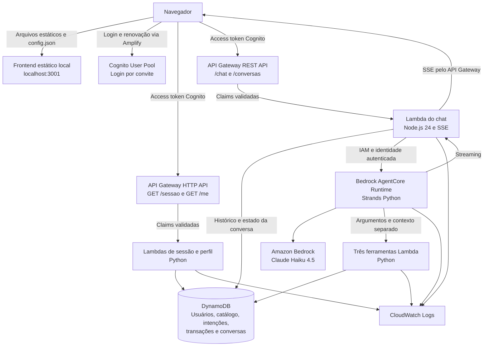

# Fase 2 — Migração do agente de pagamentos para AWS

### Plano executado

| Passo | Implementação e validação |
|---|---|
| 1. Revisar a Fase 1 | Catálogo, contratos das ferramentas, limite, reserva de cinco minutos, métodos e códigos de erro revisados |
| 2. Modelar o DynamoDB | Cinco tabelas para usuários, catálogo, intenções, transações e conversas; condições e transações para concorrência |
| 3. Implementar persistência e perfil | Tabelas no CDK e `GET /me` protegido, com identidade obtida do `sub` do Cognito |
| 4. Migrar as ferramentas | Três ferramentas em Lambda, testes unitários e integração com DynamoDB real |
| 5. Construir o agente | Strands Python com Claude Haiku no Bedrock e ferramentas vinculadas à identidade do backend |
| 6. Preparar o AgentCore | Runtime, pacote ARM64, publicação e permissões definidos em código; runtime validado na AWS |
| 7. Integrar o chat | API de chat, histórico completo, SSE, recuperação de conversas e frontend reconectado |
| 8. Implantar e validar | Deploy concluído, testes reais de cartão/Pix, erros, concorrência e expiração; custos disponíveis consultados |

A conclusão desse plano técnico permite avançar para o fechamento da entrega. As pendências de hospedagem pública, documentação de entrada, orçamento e evidências estão listadas ao final.

## Arquitetura realmente utilizada



O tráfego de chat do navegador passa pelo API Gateway. O navegador não recebe credenciais IAM e não invoca diretamente o runtime nem as ferramentas.

O frontend migrou do fluxo local legado para Cognito e APIs AWS. As pastas antigas da Fase 1 permanecem como referência; o fluxo atual não depende de Gemini, do login local nem do banco SQLite.

### Duas APIs e escolha do streaming

A HTTP API existente atende sessão e perfil. Para o chat foi criada uma REST API regional com autorizador Cognito e integração Lambda proxy configurada como `STREAM`.

Essa escolha permite SSE pelo API Gateway. O suporte de response streaming usado nesta implementação é da REST API, não da HTTP API. A Lambda Node.js usa `awslambda.streamifyResponse`; o agente continua em Python no AgentCore.

A integração e a Lambda do chat têm timeout de 120 segundos. A chamada ao runtime tem prazo de 90 segundos, com tentativa de encerramento da sessão ao terminar. A API REST limita a taxa a duas requisições por segundo, com burst de quatro.

## Ambiente e recursos implantados

Os valores abaixo correspondem aos outputs apresentados após o deploy. Podem mudar quando os recursos forem recriados; o frontend recebe os valores gerados pelo deploy.

| Item | Valor observado |
|---|---|
| Conta AWS | `631570928305` |
| Nome do perfil configurado no AWS CLI | `NOME_DO_SEU_PERFIL` — substitua pelo seu perfil autorizado |
| Região da stack | `us-east-1` |
| Stack da aplicação | `luis-filipe-mendes-nogueira-desafio-1` |
| Stack do bootstrap | `luis-filipe-mendes-nogueira-bootstrap` |
| Qualifier CDK | `luisfn001` |
| HTTP API de perfil/sessão | `https://yl0xg78oei.execute-api.us-east-1.amazonaws.com` |
| REST API de chat | `https://dvesqild85.execute-api.us-east-1.amazonaws.com/prod` |
| User Pool | `us-east-1_tYHumks4h` |
| App Client público | `6ccdai8km5lhfo6cbllud51t6b` |
| AgentCore Runtime ID | `luis_filipe_mendes_nogueira_agent-Guuy8W6O51` |
| Prefixo dos recursos | `luis-filipe-mendes-nogueira` |

**Substitua `NOME_DO_SEU_PERFIL` pelo nome do seu perfil configurado no AWS CLI**, que seleciona as credenciais de acesso à conta de destino. Não é o número da conta, o usuário Cognito ou o perfil de inferência Bedrock. Liste os perfis com `aws configure list-profiles` e confira a conta e a identidade com `aws sts get-caller-identity --profile NOME_DO_SEU_PERFIL`.

URLs, nomes de recursos e identificadores Cognito são dados públicos de configuração. Senhas, tokens e credenciais não devem ser incluídos em código, documentação ou evidências.

## Organização da implementação

Os caminhos desta tabela são relativos à raiz da pasta individual.

| Caminho | Responsabilidade |
|---|---|
| `frontend/` | SPA Next.js exportada, Amplify, streaming, conversas e painel de pedidos |
| `api/sessao/handler.py` | Confirma a identidade lida das claims da HTTP API |
| `api/perfil/handler.py` | Perfil e criação condicional do limite inicial |
| `api/chat/src/autenticacao.mjs` | Identidade e normalização da expiração recebida do autorizador REST |
| `api/chat/src/aplicacao.mjs` | Rotas, validação, coordenação do histórico e eventos SSE |
| `api/chat/src/repositorio.mjs` | Persistência, bloqueio por conversa, requisições e transações DynamoDB |
| `api/chat/src/index.mjs` | Entrada da Lambda, SDKs AWS, streaming e encerramento do runtime |
| `api/chat/src/sse.mjs` | Leitura dos eventos SSE devolvidos pelo AgentCore |
| `agent/agente.py` | Criação do agente Strands e configuração do Bedrock |
| `agent/ferramentas.py` | Ferramentas com identidade vinculada pelo backend |
| `agent/prompt.py` | Instruções do agente e confirmação de compras simuladas |
| `agent/runtime.py` | Entrada JSON e streaming do AgentCore |
| `tools/pagamentos/` | Catálogo, intenção, compra, expiração e erros de negócio |
| `infra/infra/infra_stack.py` | Tabelas, Cognito, Lambdas e HTTP API |
| `infra/infra/agentcore.py` | Runtime, pacote e role do agente |
| `infra/infra/chat.py` | Lambda do chat, REST API, autorizador, CORS e permissões |
| `infra/scripts/empacotar_agent.py` | ZIP do agente e dependências para Python 3.13/ARM64 |
| `infra/scripts/configurar_frontend.py` | Configuração pública a partir dos outputs do deploy |
| `infra/scripts/testar_chat_navegador.mjs` | Validação real da API autenticada pelo navegador |
| `infra/policies/` | Políticas de preparação e execução do CloudFormation |
| `infra/deploy.sh` | Build, publicação, carga condicional e geração do frontend local |

## Autenticação e identidade

O Cognito usa login por e-mail, User Pool Lite e autocadastro desabilitado no próprio serviço (`AllowAdminCreateUserOnly: true`). O frontend também esconde cadastro com `Authenticator` e `hideSignUp`.

O convite personalizado contém usuário e senha temporária. Foram confirmados o recebimento do convite, a definição de nova senha no primeiro acesso e a verificação do e-mail. A senha exige pelo menos 12 caracteres, com maiúsculas, minúsculas, números e símbolos; a senha temporária tem validade de sete dias.

O App Client é público, sem segredo, com SRP e renovação de sessão. Access token e ID token têm validade de uma hora; o refresh token, sete dias. A renovação é administrada pelo Amplify com `fetchAuthSession()`.

As chamadas usam `Authorization: Bearer <access token>`. Ambas as APIs exigem o scope `aws.cognito.signin.user.admin`. A HTTP API usa autorizador JWT; a REST API usa autorizador Cognito User Pools. CORS permite a origem local `http://localhost:3001` nesta etapa.

O backend obtém a identidade exclusivamente das claims validadas:

- HTTP API: `requestContext.authorizer.jwt.claims.sub`.
- REST API: `requestContext.authorizer.claims.sub`.

A Lambda do chat também confere `client_id`, `token_use` e expiração. O `usuario_id` não é aceito do corpo do navegador nem como argumento escolhido pelo modelo. A role da Lambda permite a invocação do AgentCore com IAM; o contexto de identidade é montado pelo backend depois da validação Cognito.

Chamadas sem token e com token inválido foram recusadas com 401 na AWS. A rejeição de um token realmente expirado pelo autorizador e a renovação após expiração real ainda precisam de evidência específica; os testes locais cobrem a checagem de expiração da Lambda. Logout não deve ser descrito como prova de revogação imediata de toda cópia de JWT já emitida.

### Correção do 401 e do ciclo de navegação

Depois do primeiro deploy do chat, a HTTP API retornava 200 e a REST API retornava 401 com o erro `SESSAO_INVALIDA` da própria Lambda. O navegador alternava entre a tela de carregamento do perfil e o chat: o tratamento de 401 encaminhava ao login e o Authenticator, reconhecendo a sessão, voltava à página inicial.

O tratamento foi alterado para manter a recusa visível e oferecer saída da conta, sem redirecionamento automático nesse erro. A validação de identidade foi extraída para `api/chat/src/autenticacao.mjs`.

A checagem anterior convertia `exp` apenas com `Number(...)`. O autorizador REST pode entregar a expiração como data UTC, por exemplo `Mon Nov 16 16:00:00 UTC 2026`. A implementação passou a aceitar epoch numérico, string numérica e esse formato UTC, recusando formatos inválidos, datas impossíveis e sessões expiradas. Foram preservadas as demais validações de identidade.

Após os testes e o deploy da correção, as duas APIs retornaram 200 com a sessão válida. O diagnóstico aceitou tanto Bearer quanto JWT puro; a aplicação mantém o formato Bearer.

## Persistência e regras de negócio

As tabelas usam o prefixo do projeto, cobrança por demanda (`PAY_PER_REQUEST`) e criptografia em repouso. A configuração atual da stack permite sua remoção por `DESTROY`; excluir a stack implica perda desses dados.

| Tabela | Chaves e índices | Conteúdo |
|---|---|---|
| `usuarios` | PK `usuario_id` | Identidade Cognito e `limite_centavos` |
| `catalogo` | PK `evento_id` | Nome, categoria, moeda, preço e vagas |
| `intencoes` | PK `intencao_id`; GSI `por-status-expiracao`, PK `status`, SK `expira_em_epoch` | Proprietário, evento, quantidade, total, prazo e estado da reserva |
| `transacoes` | PK `intencao_id` | Transação, proprietário, valor, método e data |
| `conversas` | PK `usuario_id`, SK `registro_id` | Metadados, turnos, requisições e progresso |

Os nomes completos têm o formato `luis-filipe-mendes-nogueira-<nome-da-tabela>`. O índice de expiração projeta também `evento_id` e `quantidade`. Intenções não usam TTL como mecanismo de devolução de estoque: a expiração exige a atualização transacional da reserva e do catálogo.

### Perfil

`GET /me` cria o perfil no primeiro acesso usando escrita condicional. O limite inicial é **50.000 centavos (R$ 500)**. Se o perfil já existir, o saldo é preservado. Uma disputa entre duas criações é resolvida relendo o perfil que venceu.

O frontend carrega `/me` antes de abrir o chat e consulta novamente o perfil para atualizar o saldo após os turnos. Valores monetários persistidos usam centavos; as respostas de apresentação convertem para reais.

### Catálogo e carga inicial

O catálogo inicial contém seis eventos, com preços de R$ 25 a R$ 1.150. A carga em `seed_catalogo.py` cria somente itens ausentes, com condição `attribute_not_exists(evento_id)`.

Executar o deploy novamente preserva preços e estoques já existentes. No deploy apresentado após a migração do chat, a carga retornou `{"criados": 0, "existentes": 6}`. Isso não restaura vagas consumidas nos testes.

### Ferramentas em Lambda

| Ferramenta | Comportamento |
|---|---|
| `listar_catalogo` | Expira reservas vencidas, consulta todas as páginas, aceita filtro de categoria e devolve os produtos |
| `registrar_intencao` | Valida quantidade, consulta preço/estoque no backend e reserva vagas junto com a intenção em uma transação |
| `realizar_compra` | Valida intenção, proprietário, prazo, método e limite; confirma compra, débito e transação atomicamente |

A intenção vale **300 segundos**. O total vem do preço consultado pelo backend e é salvo na intenção. O pagamento utiliza esse valor persistido, sem aceitar preço enviado pelo modelo.

A transação de pagamento atualiza a intenção pendente para paga, debita o limite com condição sobre o saldo lido e cria a transação somente se ainda não houver uma para aquela intenção. Disputas têm tentativas limitadas e releitura do estado; não há repetição ilimitada.

A expiração altera o status e devolve as vagas na mesma transação. Uma reserva já paga ou já expirada não devolve vagas novamente. Essa limpeza é executada nas operações previstas pelas ferramentas, sem um agendador periódico nesta implementação.

Foram preservados os códigos `INTENCAO_INVALIDA`, `INTENCAO_EXPIRADA`, `INTENCAO_JA_PAGA`, `LIMITE_EXCEDIDO` e `METODO_INVALIDO`, além das recusas de estoque e do erro interno padronizado. A interface apresenta as mensagens de negócio, sem stack traces.

## Agente Strands e modelo Bedrock

O agente utiliza Strands Python, `BedrockModel` e o perfil:

```text
us.anthropic.claude-haiku-4-5-20251001-v1:0
```

As ferramentas são criadas por requisição. Seus schemas expõem apenas argumentos de negócio; a identidade é capturada pelo backend e inserida separadamente no contexto da invocação Lambda:

```json
{
  "argumentos": {
    "intencao_id": "<intencao-criada-pelo-backend>",
    "metodo_pagamento": "pix"
  },
  "contexto": {
    "usuario_id": "<sub-autenticado>"
  }
}
```

O prompt exige apresentar evento, quantidade e total antes do pagamento, obter confirmação e método, não inventar resultados e não repetir automaticamente uma compra inconclusiva. Os pagamentos são simulados e não solicitam dados reais de cartão.

Cada execução recebe uma cópia do histórico completo. O agente usa `NullConversationManager`, sem truncamento automático do histórico, e não compartilha listas de mensagens ou identidade entre usuários. Clientes são fechados ao final, inclusive em falhas.

### Região e escolha do acesso ao modelo

A stack e o endpoint de chamada ficam em `us-east-1`. Entretanto, o perfil Bedrock `us.` permite inferência em `us-east-1`, `us-east-2` e `us-west-2`. Portanto, não se deve afirmar que toda inferência está restrita a uma única região.

A tentativa inicial de Haiku pelo endpoint regional Bedrock Mantle retornou 403 de indisponibilidade para a conta, mesmo após a autorização e o acordo do modelo aparecerem disponíveis. A chamada `converse` pelo perfil de inferência funcionou, e a configuração foi alterada para o provider Bedrock nativo do Strands, mantendo Claude Haiku.

Essa variação precisa acompanhar a documentação da entrega e ser alinhada com o orientador diante da exigência de região do enunciado. As dependências Anthropic ainda presentes no pacote não significam que o fluxo atual esteja usando Mantle.

## AgentCore Runtime e publicação

O runtime foi definido em CDK por `AWS::BedrockAgentCore::Runtime`, com:

- Pacote ZIP Python 3.13 para ARM64, armazenado como asset do CDK.
- Entrada `runtime.py`, protocolo HTTP e autenticação de entrada IAM.
- Rede pública, sessão ociosa de até 60 segundos e vida máxima de 900 segundos.
- ARNs das três ferramentas recebidos por variáveis de ambiente.
- Grupo de logs próprio, com retenção de sete dias.

O empacotador seleciona wheels compatíveis, verifica bibliotecas ELF da arquitetura e inclui os quatro módulos de produção do agente e suas dependências. O pacote apresentado tinha aproximadamente 31,5 MB compactados e 71,08 MB descompactados. O arquivo `agent/dist/dependencias.json` registra as versões resolvidas; ainda não há lockfile completo das dependências transitivas Python.

A entrada JSON continua disponível. Quando o backend solicita `stream: true`, o runtime emite eventos de texto, mensagens nativas e resultado final como SSE. Testes cobrem envio de delta antes do término, falhas, cancelamento e ausência de resultado final.

### Diagnóstico da criação do runtime

A criação inicialmente falhou com `AccessDenied`. A mensagem útil estava em `CloudTrail.responseElements.message`, e não no campo `errorMessage` usado nas primeiras consultas.

O serviço verificava permissões dependentes de criação de endpoint, tags e workload identity. Algumas verificações de criação usam o ARN regional antes de existir o identificador final. Simular apenas um ARN hipotético com o prefixo do runtime não reproduzia essas verificações.

As correções foram limitadas às ações, ARNs e condições necessários. A explicação detalhada está em [infra/policies/README.md](../../infra/policies/README.md). Depois das correções, o runtime foi criado, invocado e validado na AWS.

## API do chat, histórico e idempotência

### Endpoints

| API | Método e caminho | Responsabilidade |
|---|---|---|
| HTTP | `GET /sessao` | Confirmação da identidade |
| HTTP | `GET /me` | Perfil e limite disponível |
| REST | `POST /conversas` | Criação de conversa |
| REST | `GET /conversas` | Listagem das conversas do usuário |
| REST | `GET /conversas/{conversa_id}` | Histórico e estado persistidos |
| REST | `POST /chat` | Envio de mensagem e resposta SSE |

A consulta de uma conversa aceita o parâmetro opcional `requisicao_id` para informar se uma requisição foi concluída, está processando, está incerta ou ainda não foi registrada. Essa consulta faz somente leitura e não executa o agente.

O corpo do chat contém apenas:

```json
{
  "conversa_id": "<uuid-da-conversa>",
  "requisicao_id": "<uuid-desta-mensagem>",
  "mensagem": "Quais eventos estão disponíveis?"
}
```

Identidade, histórico, preço ou outros campos extras enviados nesse corpo são recusados. O backend carrega o histórico do DynamoDB e monta a chamada ao runtime com o `sub` autenticado.

### Registros na tabela de conversas

| Prefixo da sort key | Finalidade |
|---|---|
| `CONVERSA#` | Estado, versão e datas da conversa |
| `TURNO#` | Mensagens nativas de cada turno concluído, ordenadas por versão |
| `REQUISICAO#` | Mensagem recebida, hash, sessão do runtime, estado e resposta salva |
| `PROGRESSO#` | Mensagens recebidas durante a execução, para auditoria em falhas |

Todas as consultas usam a partição do usuário autenticado. Uma conversa de outro usuário retorna 404, assim como uma conversa inexistente.

Uma transação inicia a requisição e bloqueia a conversa. Outra salva o turno, conclui a requisição e libera a conversa. O resultado final só é informado como concluído depois dessa persistência.

O histórico preserva mensagens, chamadas e retornos das ferramentas, identificadores e metadados nativos. As consultas percorrem todas as páginas, inclusive páginas vazias com chave de continuação. Antes de gravar o resultado, o backend confirma que o prefixo do histórico anterior não foi alterado.

O limite explícito do histórico é de 1.000.000 bytes de JSON. Há também limites por turno, mensagem de progresso e resposta. Não se apaga silenciosamente o início da conversa para continuar: quando o limite impede a execução, é necessário abrir outra conversa e verificar o estado do turno anterior.

### Duplicidade, concorrência e falhas

- Mesmo ID de requisição e mesma mensagem concluída: devolve a resposta salva, sem executar novamente o agente.
- Mesmo ID com mensagem diferente: recusa com conflito.
- Requisição em processamento ou incerta: impede repetição automática.
- Requisições concorrentes na mesma conversa: disputam o bloqueio e a versão por condições transacionais.
- Streaming sem resultado final ou falha após o início: tenta registrar estado `incerta` e mantém o progresso disponível para auditoria.

Uma interrupção abrupta pode deixar o estado `processando`. Não há liberação automática por prazo que permita repetir uma compra potencialmente realizada. A reconciliação de uma execução incerta continua sendo uma verificação explícita; não foi criada uma operação automática de estorno ou recuperação financeira.

A idempotência da requisição do chat complementa a proteção de pagamento por intenção. Ela não substitui as condições e transações das ferramentas.

## Frontend e recuperação da conversa

O frontend usa Next.js com exportação estática, React, Amplify e arquivos públicos de configuração. A API de perfil e a API de chat têm URLs separadas em `config.json`.

A interface foi reconectada aos serviços AWS, com:

- Listagem, criação, seleção e recuperação de conversas.
- Leitura progressiva de SSE, incluindo UTF-8 dividido entre pacotes.
- Apresentação das mensagens textuais sem exibir retornos de ferramentas como falas do usuário.
- Conversão do histórico nativo somente para apresentação; o navegador não envia histórico ao agente.
- Painel derivado dos resultados reais das ferramentas, respeitando a ordem dos turnos.
- Prazo visível da reserva e bloqueio do botão de pagamento após expiração ou durante processamento.
- Confirmação explícita da compra, quantidade, total, intenção e método.
- Atualização do saldo pelo perfil, sem inventar limite disponível.
- Mensagens de compra simulada e transação, sem prometer envio de ingresso por e-mail.

O `sessionStorage` administrado pelo chat guarda a conversa selecionada e dados da requisição pendente. Esse código não grava tokens nem o histórico completo; o Amplify mantém seu próprio gerenciamento de sessão.

Após uma interrupção, **Verificar resultado** faz somente GET. Uma requisição só pode ser reenviada pelo botão específico quando a consulta informa que não foi recebida e a conversa está livre; o reenvio conserva o mesmo ID. Não há reenvio automático do lote de compras.

### Execução local atual pelo Docker Compose

O frontend atualizado foi reconstruído e validado pelo Docker Compose. Seu serviço não tem `depends_on` dos backends antigos. Os serviços `app` e `auth` foram associados ao perfil `legado` e não iniciam na execução padrão, desde que esse perfil não esteja habilitado por opção ou pela variável `COMPOSE_PROFILES`.

Na raiz da pasta individual, com Docker e Compose disponíveis e `frontend/public/config.json` atualizado pelos outputs do deploy:

```bash
docker compose up -d --build
docker compose ps
```

O build usa Node 24 para gerar a exportação Next.js. A imagem final usa Nginx para servir os arquivos estáticos, com o mapeamento `127.0.0.1:3001:80`. O navegador acessa **http://localhost:3001** e chama diretamente Cognito e as APIs AWS.

As credenciais do legado não são necessárias para iniciar o frontend. Os serviços legados permanecem disponíveis por ativação explícita do perfil ou seleção de serviço; dentro desses containers, as credenciais necessárias são verificadas antes da execução. O código e o volume `ingressos_db` foram preservados, e os containers antigos foram parados.

Para conferir a configuração e o conteúdo servido:

```bash
docker compose config --quiet
docker compose config --services
docker compose port frontend 80
curl -fsS http://localhost:3001/config.json
curl -s -o /dev/null -w '%{http_code}\n' http://localhost:3001/login/
```

O usuário apresentou configuração válida, somente `frontend` na lista de serviços padrão, porta `127.0.0.1:3001`, `config.json` com as duas APIs e o Cognito, e HTTP 200 para `/login/`. Depois confirmou o funcionamento do chat pelo container. Não foi necessário outro deploy AWS nem repetir o lote de compras.

### Histórico do conflito de porta e alternativa local

Antes desse ajuste, o Compose servia uma imagem antiga, cujo `config.json` não tinha `chatApiUrl`. Durante a migração, o container foi parado e a exportação atual foi validada com `npm --prefix frontend start`, que usa um servidor Python local.

Ao voltar ao Compose, a primeira tentativa encontrou a porta 3001 ocupada. Depois de liberar a porta, o container ainda apareceu sem publicação de porta ativa. Foi necessário recriar somente o frontend:

```bash
docker compose up -d --force-recreate --no-deps frontend
```

Após a recriação, o mapeamento e as chamadas HTTP funcionaram. Esse comando fica como diagnóstico para a situação observada; não precisa ser usado em toda inicialização.

O servidor Python continua disponível como alternativa, mas deve ser encerrado antes de usar o Compose na mesma porta. Novas alterações no frontend ou no `config.json` exigem reconstruir a imagem para que o Nginx entregue a versão atual. O módulo de testes copiado manualmente para `frontend/out/` não é incluído por essa cópia na imagem Docker, pois o build gera sua própria exportação.

O frontend local não fica disponível remotamente para o instrutor apenas porque o backend foi implantado na AWS. A publicação pública continua aguardando liberação.

## Deploy e configuração pública

### Pré-requisitos

- AWS CLI e SSO configurados para o perfil autorizado.
- Python 3.13 e ambientes virtuais separados em `infra/.venv` e `agent/.venv`.
- Dependências de infraestrutura e de desenvolvimento de `infra/` instaladas; dependências do agente em `agent/` para testes locais.
- Node.js 24, NVM e CDK CLI disponíveis.
- `package-lock.json` de `api/chat/` e `frontend/` versionados.
- Acesso ao modelo Bedrock liberado para a conta.
- Bootstrap individual e políticas de execução preparados.

Os ambientes virtuais locais usam direnv. Arquivos `.envrc`, ambientes virtuais, dependências e artefatos de build não são versionados.

### Preparação inicial de infraestrutura

O bootstrap usa `luisfn001` e recursos de apoio próprios, incluindo o bucket `cdk-luisfn001-assets-631570928305-us-east-1`, roles, ECR e o parâmetro SSM de versão. Ele não precisa ser recriado em cada deploy.

A política gerenciada de execução do CloudFormation foi preparada separadamente; a última versão confirmada na correção do runtime foi `v9`. A política complementar `infra/policies/cloudformation-chat.json` foi publicada como política inline `luis-filipe-mendes-nogueira-chat-deploy` na role de execução do CloudFormation, para as operações de API REST em `us-east-1`.

Editar os JSONs locais não publica automaticamente essas políticas. A preparação do bootstrap, a publicação inicial das políticas e as etapas de liberação do modelo continuam sendo pré-requisitos documentados do comando de atualização. Não se deve apresentar esse fluxo como provisionamento completo de uma conta vazia em uma única execução.

### Comando usado para atualização do ambiente preparado

Na raiz da pasta individual:

```bash
aws sso login --profile NOME_DO_SEU_PERFIL
bash infra/deploy.sh NOME_DO_SEU_PERFIL
```

O script:

1. Prepara Node 24 e ativa `infra/.venv`.
2. Instala dependências do chat com `npm ci`, testa e gera o bundle da Lambda.
3. Reconstrói o pacote Python/ARM64 do agente.
4. Publica os assets e a stack com CDK, salvando `infra/cdk.out/outputs.json`.
5. Executa a carga condicional do catálogo.
6. Gera `frontend/public/config.json` a partir dos outputs, sincronizando a exportação existente quando presente.
7. Instala, testa e gera a exportação estática do frontend.

Uma falha interrompe os passos seguintes. Se a AWS já foi atualizada e uma etapa local posterior falhar, o script não desfaz automaticamente o deploy.

A configuração pública contém `apiUrl`, `chatApiUrl` e os identificadores Cognito. O script valida URLs de API Gateway em `us-east-1` antes de escrever. Esse fluxo gera o frontend local; ainda não executa upload para hospedagem pública nem invalidação CloudFront.

## IAM, logs e limites da revisão

| Role/componente | Acesso previsto |
|---|---|
| Sessão | Escrita nos próprios logs |
| Perfil | Leitura e criação condicional na tabela de usuários; próprios logs |
| Chat | Operações necessárias na tabela de conversas, invocação/encerramento do runtime e próprios logs |
| AgentCore | Perfil Haiku/modelos de destino permitidos, três Lambdas exatas, pacote S3 e próprios logs; sem acesso direto ao DynamoDB |
| Catálogo | Consulta do catálogo e operações necessárias à expiração de reservas |
| Registro de intenção | Leitura/atualização do catálogo, criação/atualização de intenções e consulta ao índice de expiração |
| Compra | Leitura/atualização de usuário e intenção, criação de transação e atualização do catálogo para expiração |
| CloudFormation/bootstrap | Preparação, publicação e gerenciamento dos recursos; separados das roles de execução da aplicação |

A Lambda do chat não recebe acesso às tabelas de intenções ou transações nem permissão de invocação direta do modelo. A role do agente não recebe acesso direto às tabelas. Os logs das Lambdas e do runtime têm retenção de sete dias.

Não foi associada `AdministratorAccess` às roles da aplicação. Isso não significa ausência de curingas: existem padrões de ARN, permissões do bootstrap e exceções de criação que precisam constar da revisão final de menor privilégio.

Em particular, a criação do runtime exige `Resource: "*"` para a ação correspondente, com condições de região e tag. As verificações dependentes de criação e o diretório de workload identity têm restrições próprias explicadas em [infra/policies/README.md](../../infra/policies/README.md). A política complementar da API REST permite gerenciar os ARNs de REST APIs da região, pois os IDs são atribuídos pelo serviço; isso não restringe essas operações exclusivamente ao nome do projeto.

A ocorrência de `apigateway:TagResource` apontada pelo provider regional e sinalizada pelo Access Analyzer está registrada no mesmo documento. Validações sintáticas, simulações e deploy bem-sucedido não substituem a revisão final de permissões.

## Testes e evidências observadas

Os números abaixo descrevem as execuções apresentadas pelo usuário em momentos diferentes. Não representam uma única suíte executada novamente nesta atualização.

| Camada | Resultado apresentado |
|---|---|
| Infraestrutura, perfil, ferramentas, deploy e configuração | 64 testes Python passaram |
| Agente, ferramentas vinculadas e runtime/streaming | 30 testes Python passaram |
| Backend Node.js do chat após correção de autenticação | 22 testes passaram |
| Frontend | 9 testes Vitest passaram; TypeScript e build estático concluídos |
| AgentCore real, antes da integração completa do chat | 8 testes passaram |
| Integração completa pelo navegador/API Gateway | 18 verificações passaram |
| Isolamento entre dois usuários Cognito reais | A segunda conta recebeu 404 para a conversa da primeira |
| Conferência visual final | Usuário confirmou histórico, streaming, painel e saldo |
| Frontend atualizado pelo Compose | Somente frontend no fluxo padrão, porta/configuração/login conferidos e funcionamento do chat confirmado pelo usuário |

### Integração real pelo navegador

O módulo de validação foi copiado para a exportação local, sem alterar o código da aplicação:

```bash
cp infra/scripts/testar_chat_navegador.mjs frontend/out/testar-chat.mjs
```

Depois do login, foi executado no console do navegador:

```javascript
const { validarChat, baixarRelatorio } = await import("/testar-chat.mjs");
const resultado = await validarChat({ compras: true, expiracao: true });
baixarRelatorio(resultado);
```

O módulo reutiliza a sessão do navegador e não imprime o token. A cópia em `out/` é um artefato local e pode desaparecer em uma nova geração do frontend.

As 18 verificações concluídas foram:

1. Requisição anônima bloqueada.
2. Token inválido bloqueado.
3. Criação e listagem de conversa.
4. Identidade e histórico enviados no corpo rejeitados.
5. Conversa inexistente retornando 404.
6. Streaming autenticado.
7. Histórico completo entre turnos.
8. Reenvio da mesma requisição sem novo turno.
9. Mesmo ID com mensagem diferente rejeitado.
10. Requisições duplicadas concorrentes gerando um único turno.
11. Consulta de recuperação confirmando a conclusão.
12. Conversa nova sem herdar histórico de outra.
13. Catálogo real por ferramenta.
14. Consultas preservando o saldo.
15. Compra por cartão e reenvio sem novo débito.
16. Compra por Pix e reenvio sem novo débito.
17. Limite insuficiente sem débito.
18. Expiração devolvendo a reserva uma única vez.

Os HTTP 400, 401, 404 e 409 observados nesses casos negativos eram resultados esperados. O lote fez duas compras simuladas de R$ 25 e aguardou cerca de cinco minutos para a expiração. O saldo da conta de teste principal passou de R$ 115 para **R$ 65**. Esses valores são dados da aplicação, não valores da fatura AWS.

Antes desse lote, testes diretos das ferramentas também verificaram intenção inexistente/de outro usuário, método inválido, pagamento já realizado, disputa de saldo, falta de vagas e preservação do catálogo pela carga. A evidência de intenção inválida deve ser organizada junto às demais exigidas para a entrega.

Não se deve repetir um lote financeiro após falha sem consultar o estado das requisições. Os resultados e identificadores do relatório permitem recuperar o estado pelo GET da conversa com `requisicao_id`, sem executar novamente o agente.

### Segundo usuário e conferência visual

Foi criado um usuário Cognito temporário, com convite suprimido e senha definida sem exposição no terminal. Após o login com essa conta, tentar acessar a conversa do primeiro usuário retornou 404 e o módulo confirmou o isolamento.

O usuário temporário e seu perfil DynamoDB foram removidos. A limpeza verificou a identidade, a ausência de conversas próprias e a preservação do saldo inicial. A conta original e os registros das compras de teste foram mantidos.

O usuário confirmou que, ao retornar à conta original, as conversas reaparecem, o histórico abre, a resposta chega progressivamente e o painel apresenta as compras com o saldo correto. O teste visual não exigiu repetir pagamentos.

### Comandos locais de verificação

Executar na raiz; os testes abaixo usam simulações e não fazem inferência ou deploy:

```bash
npm --prefix api/chat test
npm --prefix api/chat run build

(cd infra && .venv/bin/python -m unittest discover -s tests -p 'test_*.py' -v)
(cd agent && .venv/bin/python -m unittest discover -s tests -p 'test_*.py' -v)
(cd frontend && npm test && npx tsc --noEmit && npm run build)
```

Síntese e diff não publicam a stack, mas o diff pode consultar a AWS. Testes reais com o runtime e o navegador utilizam serviços AWS e podem consumir inferência, chamadas, armazenamento e saldo simulado. Não há necessidade de repetir os testes reais somente por alterar documentação.

## Revisão preliminar de custos

A consulta apresentada em 16/11 cobriu **01/11/2026 a 15/11/2026, inclusive**, para a conta `631570928305`. Foi consultada uma página do Cost Explorer.

| Serviço/lançamento | Valor observado (USD) |
|---|---:|
| AWS Config | 0,513000 |
| Impostos | 0,080000 |
| S3 | 0,000439 |
| DynamoDB | 0,000065 |
| CloudWatch | 0,000020 |
| API Gateway | 0,000017 |
| Demais serviços retornados | 0,000000 |
| **Total** | **0,593541** |

O AWS Config concentra o gasto registrado. A conta já tinha consumo desse serviço; não é correto atribuir automaticamente toda essa cobrança ao chat. Monitoramento compartilhado não deve ser desativado como parte da limpeza ou da otimização deste projeto.

A consulta ainda não inclui as implantações, inferências e testes de 16/11, o acesso da conta temporária nem a própria consulta de custos recém-executada. Uma linha com valor zero no relatório não comprova custo futuro zero nem cobertura por créditos.

O relatório foi salvo em `/tmp/luisfilipe-revisao-custos.json`. Ele mostra custos da conta por serviço e tipo de lançamento; não comprova o saldo restante de créditos nem a existência de alerta de orçamento. A revisão deve ser complementada quando os lançamentos estiverem disponíveis.

## Remoção futura dos recursos

A aplicação deve permanecer disponível até a correção. As instruções desta seção são para depois da avaliação e não foram executadas nesta atualização.

Quando houver autorização para remover a aplicação, usar o CDK no ambiente preparado:

```bash
cd infra
source .venv/bin/activate
nvm use 24
cdk destroy luis-filipe-mendes-nogueira-desafio-1 --profile NOME_DO_SEU_PERFIL
```

Conferir a remoção efetiva das APIs, Lambdas, runtime, tabelas, User Pool, roles/políticas próprias da stack e logs. A configuração atual de remoção das tabelas e do User Pool é destrutiva; recriá-los muda identificadores e exige novos usuários/convites e atualização da configuração pública.

O bootstrap, seus assets e a política gerenciada de execução foram preparados fora da stack da aplicação. Antes de remover esses recursos, confirmar que nenhuma outra stack depende do qualifier `luisfn001`. Revisar bucket e versões de objetos, ECR e imagens se existentes, roles, parâmetro SSM e versões/associações das políticas.

A política inline complementar foi associada à role do bootstrap e também deve entrar nessa conferência. A service-linked role do AgentCore é gerenciada pela AWS e pode ser compartilhada; não deve ser excluída automaticamente como recurso exclusivo deste desafio. Não remover recursos de colegas ou o AWS Config da conta compartilhada.

## Pendências antes da entrega completa

### Já implementado e validado no escopo atual

Cognito, sessão/perfil, tabelas, ferramentas Lambda, agente Strands/Bedrock, AgentCore, chat autenticado, SSE, histórico persistido, pagamentos, erros, concorrência, isolamento, geração automática da configuração do frontend e execução local pelo Compose independente dos serviços legados.

### Adiado por orientação

- Hospedagem do frontend em S3 privado com CloudFront e OAC.
- Upload do frontend e invalidação do cache no comando de deploy.
- CORS restrito à origem pública da distribuição.

Esses requisitos continuam pendentes no enunciado. O adiamento precisa ficar explícito na entrega; a validação local não equivale a uma URL pública acessível ao instrutor.

### Fechamento técnico e documental

- Consolidar o README principal de entrega e substituir as instruções genéricas de `infra/README.md` ou apontá-las para o fluxo atualizado.
- Organizar prints/vídeo e relatórios da Fase 2: login, API sem token/401, cartão, Pix, limite excedido e intenção inválida, sem credenciais.
- Configurar ou comprovar o alerta AWS Budgets; concluir a conferência dos custos de 16/11 quando disponíveis.
- Documentar e alinhar a inferência entre regiões do perfil Haiku com o requisito regional do desafio.
- Finalizar a revisão de IAM, das exceções de criação e do histórico Git quanto a segredos.
- Comprovar especificamente a rejeição de token realmente expirado pelo autorizador e a renovação real da sessão.
- Documentar a preparação inicial de bootstrap/políticas/modelo e completar o comando de publicação integral quando a hospedagem for liberada.
- Convidar o instrutor com o e-mail informado, preservando o fluxo normal de convite e troca de senha temporária.
- Abrir o PR da branch individual, se ainda não estiver aberto, e manter o ambiente disponível durante a avaliação.

## Referências

- [Instruções do desafio](../../../../desafio_1_sprint_2.pdf).
- [Políticas e exceções do CloudFormation](../../infra/policies/README.md).
- [Streaming em integrações do API Gateway](https://docs.aws.amazon.com/apigateway/latest/developerguide/response-transfer-mode.html).
- [Configuração Lambda para streaming no API Gateway](https://docs.aws.amazon.com/apigateway/latest/developerguide/response-streaming-lambda-configure.html).
- [Autorização REST com Cognito](https://docs.aws.amazon.com/apigateway/latest/developerguide/apigateway-integrate-with-cognito.html).
- [Criação administrativa de usuários Cognito](https://docs.aws.amazon.com/cognito-user-identity-pools/latest/APIReference/API_AdminCreateUser.html).
- [Permissões do AgentCore](https://docs.aws.amazon.com/service-authorization/latest/reference/list_bedrock-agentcore.html).
- [Datas e atualização dos custos do Cost Explorer](https://docs.aws.amazon.com/cost-management/latest/userguide/ce-exploring-data.html).
