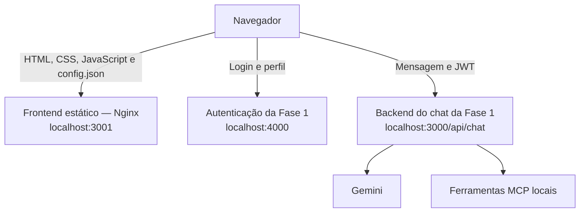

# Fase 2 — Preparação do frontend para AWS

## Objetivo desta etapa

Separar a interface da aplicação da Fase 1 e gerar arquivos estáticos que possam ser hospedados em um bucket S3 privado, servido pelo CloudFront. A hospedagem AWS ainda não foi criada.

Esta etapa está concluída para avançar à integração AWS: o frontend tem pasta própria, exportação estática, configuração pública de URLs e execução pelo Docker Compose. Autenticação e chat ainda usam os serviços locais da Fase 1.

## Arquitetura local atual



O navegador faz as chamadas HTTP ao backend. O Nginx entrega os arquivos estáticos; ele não executa o agente nem encaminha as chamadas da API por proxy.

| Porta | Serviço | Uso |
|---|---|---|
| 3001 | `frontend` | Interface nova; endereço usado nos testes desta etapa |
| 3000 | `app` | Aplicação antiga, mantida como backend do chat |
| 4000 | `auth` | Login e perfil da aplicação antiga |

A porta 3000 ainda apresenta a interface antiga porque `gemini-chat/` continua sendo uma aplicação Next.js completa. Isso é temporário. O frontend novo deve ser acessado em **http://localhost:3001**.

## Alterações realizadas

### Separação da interface

Foi criada a pasta `frontend/`, aproveitando telas, componentes React, estilos e utilitários de apresentação da Fase 1.

Não foram copiados para ela a rota `/api/chat`, o agente Gemini, o cliente MCP ou a validação de JWT do servidor. A aplicação antiga permanece em `gemini-chat/` como referência e backend local durante a transição.

Estrutura principal:

```text
frontend/
├── public/
│   └── config.json
├── src/
│   ├── app/
│   ├── components/
│   ├── services/
│   │   ├── api.ts
│   │   └── config.ts
│   ├── styles/
│   ├── utils/
│   ├── types/
│   └── types.ts
├── .dockerignore
├── Dockerfile
├── nginx.conf
├── next.config.js
├── package.json
└── package-lock.json
```

### Exportação estática e dependências

O `frontend/next.config.js` usa:

```js
output: "export",
trailingSlash: true,
```

O comando `npm run build` gera a pasta `frontend/out/`, com HTML, CSS, JavaScript e arquivos públicos. A rota de login é exportada como `login/index.html`.

O frontend foi atualizado para Next.js 16.4.6 e React 19. O Next.js também ajustou o TypeScript para o runtime JSX automático e incluiu seus tipos de desenvolvimento no `tsconfig.json`.

Foram removidos os pacotes `@modelcontextprotocol/sdk` e `@google/generative-ai` do frontend. O tipo `Content` e as partes das mensagens passaram a ser definidos localmente em `src/types.ts`.

O formato das mensagens existente foi preservado nesta etapa para manter a compatibilidade com o backend antigo. Remover o SDK não significa que o contrato HTTP já foi adaptado ao Strands ou ao Bedrock.

### Configuração pública do backend

Os endereços foram retirados de `src/services/api.ts` e colocados em `public/config.json`:

```json
{
  "authUrl": "http://localhost:4000",
  "chatUrl": "http://localhost:3000/api/chat"
}
```

O módulo `src/services/config.ts` carrega esse arquivo no navegador, valida os campos e protocolos HTTP/HTTPS e compartilha a Promise de carregamento entre as chamadas. Se o carregamento falhar, uma chamada posterior pode tentar novamente.

As funções de login, perfil, cadastro e chat usam essa configuração. Não há chave Gemini, senha ou token no arquivo público.

As URLs usam `localhost` porque são acessadas pelo navegador no computador do usuário. Nomes internos dos serviços Docker, como `auth` e `app`, não substituem essas URLs públicas para o navegador.

Na AWS, o IaC deverá gerar a configuração com os endereços e identificadores reais. O esquema de autenticação também será adaptado ao Cognito; o arquivo atual ainda representa o login da Fase 1.

### CORS para desenvolvimento local

O backend `gemini-chat/` passou a enviar, na rota `/api/chat`, os cabeçalhos que permitem:

- Origem `http://localhost:3001`.
- Métodos `POST` e `OPTIONS`.
- Cabeçalhos `Authorization` e `Content-Type`.

Foi adicionado um handler `OPTIONS` que responde com status `204`, atendendo à verificação prévia do navegador. O serviço `auth/` já permitia CORS na implementação existente.

Esses ajustes ficam no backend. O frontend estático não executa handlers de API. Na AWS, o CORS deverá permitir somente a origem da distribuição CloudFront, conforme o enunciado.

### Execução pelo Docker Compose

O `frontend/Dockerfile` tem dois estágios:

1. Node 24 instala as dependências com `npm ci` e gera `out/`.
2. Nginx recebe somente os arquivos exportados e a configuração do servidor.

O Node é usado durante a construção da imagem, sem executar o frontend em produção dentro desse container. A imagem final serve arquivos estáticos.

O Nginx escuta na porta 80 do container, publicada na porta 3001 do computador. A configuração usa `try_files` para localizar arquivos e diretórios e envia `Cache-Control: no-store` para `config.json`.

O `.dockerignore` exclui dependências, builds, arquivos de ambiente e logs locais do contexto de construção. O `.gitignore` do projeto exclui `frontend/out/` e os arquivos incrementais `frontend/*.tsbuildinfo`.

O serviço `frontend` foi incluído no Compose com dependência de inicialização do serviço `app`. Essa dependência ordena a inicialização; não é uma verificação de saúde do backend.

## Como executar

Pré-requisitos: Docker com Compose funcionando, portas 3000, 3001 e 4000 disponíveis e o `.env` local necessário aos serviços antigos, com `JWT_SECRET` e a configuração Gemini. Não versionar o `.env`.

Na raiz da pasta individual do desafio:

```bash
docker compose up -d --build
docker compose ps
```

Acessar **http://localhost:3001**.

Para reconstruir somente o frontend após alterações:

```bash
docker compose up -d --build frontend
```

Para acompanhar os logs:

```bash
docker compose logs -f frontend app auth
```

Para parar os serviços preservando os volumes:

```bash
docker compose down
```

Como alternativa local ao Compose, dentro de `frontend/`:

```bash
npm ci
npm run build
npm start
```

O script `start` usa Python 3 para servir `out/` na porta 3001. Ele exige Python 3 instalado e não inicia os backends. O fluxo principal é o Compose; não executar os dois servidores do frontend simultaneamente na mesma porta.

## Validações desta etapa

Durante a execução guiada, o usuário apresentou os seguintes resultados:

- Build estático concluído, incluindo as rotas `/`, `/login` e a página de erro.
- Último `npm audit` apresentado com zero vulnerabilidades conhecidas.
- Busca no código sem ocorrências dos SDKs Gemini/MCP, `next/server` ou da constante antiga `AUTH_URL`.
- Arquivo `out/config.json` gerado.

O usuário também confirmou o funcionamento dos testes locais de navegação, login e CORS e passou a acessar o frontend pelo serviço do Compose. Esses resultados são evidências locais da etapa; não representam testes de serviços AWS. O resultado do audit é referente à execução apresentada e deve ser verificado novamente quando as dependências mudarem.

Verificação de CORS que não chama o modelo:

```bash
curl -i -X OPTIONS http://localhost:3000/api/chat \
  -H "Origin: http://localhost:3001" \
  -H "Access-Control-Request-Method: POST" \
  -H "Access-Control-Request-Headers: authorization,content-type"
```

Resultado esperado: status `204` e `Access-Control-Allow-Origin: http://localhost:3001`.

## O que falta para a entrega AWS

- Criar a infraestrutura como código, com prefixo individual e região `us-east-1`.
- Hospedar o frontend em S3 privado, servido por CloudFront com OAC.
- Gerar a configuração pública durante o deploy.
- Substituir o login e o cadastro antigos pelo Cognito, sem auto cadastro e com usuários por convite.
- Expor o backend pelo API Gateway, com validação de JWT e CORS restrito ao CloudFront.
- Adaptar a comunicação do chat ao backend AWS e atender ao requisito de streaming ou WebSocket. O frontend atual desta pasta ainda recebe a resposta JSON completa.
- Implementar o agente Strands no AgentCore Runtime com modelo Bedrock.
- Migrar as três ferramentas para Lambda e a persistência para DynamoDB, preservando as regras de negócio e a atomicidade da compra.
- Definir IAM de menor privilégio, comando único de deploy, alerta de custos, evidências e instruções de remoção.

O Nginx e os backends locais são recursos de desenvolvimento. A hospedagem final exigida pelo desafio será S3 com CloudFront.

## AWS e custos

Nenhum recurso AWS foi criado ou usado nesta etapa. Builds, audit e containers foram executados localmente. Navegação, login local e teste de CORS não invocam o modelo.

Uma mensagem real enviada ao chatbot continua usando a API do Gemini e pode consumir cota ou gerar cobrança conforme a conta. Antes de criar recursos AWS, será necessário conferir créditos, acesso ao modelo e configurar o alerta de orçamento exigido pelo desafio.
