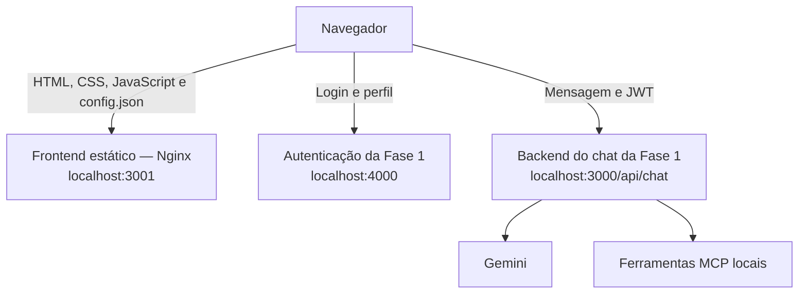
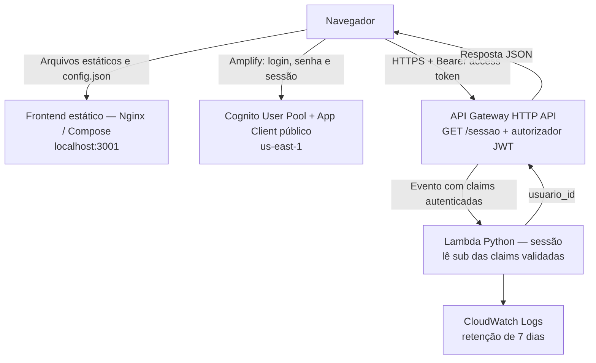

# Fase 2 — Frontend estático e autenticação Cognito

## Estado atual — 14/11/2026

A preparação do frontend estático e a integração inicial de autenticação foram realizadas. O frontend continua local, em **http://localhost:3001**, servido pelo Docker Compose. Cognito, API Gateway e a Lambda de sessão foram implantados em **us-east-1** com AWS CDK em Python.

Foram confirmados pelo usuário: login por convite, definição da nova senha, verificação de e-mail, chamada autenticada ao endpoint de sessão e logout com redirecionamento ao login. Chamadas sem token e com token inválido retornaram `401`.

A tela principal é temporariamente uma confirmação de sessão. **O chat AWS, o perfil com limite e o banco ainda não estão implementados.** S3 e CloudFront para o frontend permanecem adiados por orientação do projeto. O S3 criado pelo bootstrap tem outra finalidade: armazenar pacotes de deploy.

As seções sobre a preparação inicial abaixo preservam o histórico da separação do frontend. A seção **Autenticação — Cognito com frontend local** descreve a configuração vigente e substitui o fluxo antigo de login.

## Histórico — objetivo da preparação inicial do frontend

Separar a interface da aplicação da Fase 1 e gerar arquivos estáticos que possam ser hospedados em um bucket S3 privado, servido pelo CloudFront. A hospedagem AWS ainda não foi criada.

Ao concluir a preparação inicial, o frontend tinha pasta própria, exportação estática, configuração pública de URLs e execução pelo Docker Compose. Naquele momento, autenticação e chat ainda usavam os serviços locais da Fase 1; a autenticação foi posteriormente substituída pelo Cognito, conforme registrado adiante.

## Histórico — arquitetura local antes do Cognito



O navegador faz as chamadas HTTP ao backend. O Nginx entrega os arquivos estáticos; ele não executa o agente nem encaminha as chamadas da API por proxy.

| Porta | Serviço | Uso |
|---|---|---|
| 3001 | `frontend` | Interface nova; endereço usado nos testes desta etapa |
| 3000 | `app` | Aplicação antiga, mantida como backend do chat |
| 4000 | `auth` | Login e perfil da aplicação antiga |

A porta 3000 ainda apresenta a interface antiga porque `gemini-chat/` continua sendo uma aplicação Next.js completa. Isso é temporário. O frontend novo deve ser acessado em **http://localhost:3001**.

## Alterações realizadas

### Separação da interface

Foi criada a pasta `frontend/`, aproveitando telas, componentes React, estilos e utilitários de apresentação da Fase 1.

Não foram copiados para ela a rota `/api/chat`, o agente Gemini, o cliente MCP ou a validação de JWT do servidor. A aplicação antiga permanece em `gemini-chat/` como referência e backend local durante a transição.

Estrutura principal:

```text
frontend/
├── public/
│   └── config.json
├── src/
│   ├── app/
│   ├── components/
│   ├── services/
│   │   ├── api.ts
│   │   └── config.ts
│   ├── styles/
│   ├── utils/
│   ├── types/
│   └── types.ts
├── .dockerignore
├── Dockerfile
├── nginx.conf
├── next.config.js
├── package.json
└── package-lock.json
```

### Exportação estática e dependências

O `frontend/next.config.js` usa:

```js
output: "export",
trailingSlash: true,
```

O comando `npm run build` gera a pasta `frontend/out/`, com HTML, CSS, JavaScript e arquivos públicos. A rota de login é exportada como `login/index.html`.

O frontend foi atualizado para Next.js 16.4.6 e React 19. O Next.js também ajustou o TypeScript para o runtime JSX automático e incluiu seus tipos de desenvolvimento no `tsconfig.json`.

Foram removidos os pacotes `@modelcontextprotocol/sdk` e `@google/generative-ai` do frontend. O tipo `Content` e as partes das mensagens passaram a ser definidos localmente em `src/types.ts`.

O formato das mensagens existente foi preservado nesta etapa para manter a compatibilidade com o backend antigo. Remover o SDK não significa que o contrato HTTP já foi adaptado ao Strands ou ao Bedrock.

### Configuração pública do backend

Os endereços foram retirados de `src/services/api.ts` e colocados em `public/config.json`:

```json
{
  "authUrl": "http://localhost:4000",
  "chatUrl": "http://localhost:3000/api/chat"
}
```

O módulo `src/services/config.ts` carrega esse arquivo no navegador, valida os campos e protocolos HTTP/HTTPS e compartilha a Promise de carregamento entre as chamadas. Se o carregamento falhar, uma chamada posterior pode tentar novamente.

Na preparação inicial, as funções de login, perfil, cadastro e chat usavam essa configuração. Não havia chave Gemini, senha ou token no arquivo público. Os campos `authUrl` e `chatUrl` foram depois substituídos por `apiUrl` e `cognito`, conforme a seção de autenticação.

As URLs usam `localhost` porque são acessadas pelo navegador no computador do usuário. Nomes internos dos serviços Docker, como `auth` e `app`, não substituem essas URLs públicas para o navegador.

Na entrega final, o IaC deverá gerar a configuração com os endereços e identificadores reais. Nesta etapa, os outputs do deploy foram copiados manualmente para o arquivo público.

### CORS para desenvolvimento local

O backend `gemini-chat/` passou a enviar, na rota `/api/chat`, os cabeçalhos que permitem:

- Origem `http://localhost:3001`.
- Métodos `POST` e `OPTIONS`.
- Cabeçalhos `Authorization` e `Content-Type`.

Foi adicionado um handler `OPTIONS` que responde com status `204`, atendendo à verificação prévia do navegador. O serviço `auth/` já permitia CORS na implementação existente.

Esses ajustes ficam no backend. O frontend estático não executa handlers de API. Na AWS, o CORS deverá permitir somente a origem da distribuição CloudFront, conforme o enunciado.

### Execução pelo Docker Compose

O `frontend/Dockerfile` tem dois estágios:

1. Node 24 instala as dependências com `npm ci` e gera `out/`.
2. Nginx recebe somente os arquivos exportados e a configuração do servidor.

O Node é usado durante a construção da imagem, sem executar o frontend em produção dentro desse container. A imagem final serve arquivos estáticos.

O Nginx escuta na porta 80 do container, publicada na porta 3001 do computador. A configuração usa `try_files` para localizar arquivos e diretórios e envia `Cache-Control: no-store` para `config.json`.

O `.dockerignore` exclui dependências, builds, arquivos de ambiente e logs locais do contexto de construção. O `.gitignore` do projeto exclui `frontend/out/` e os arquivos incrementais `frontend/*.tsbuildinfo`.

O serviço `frontend` foi incluído no Compose com dependência de inicialização do serviço `app`. Essa dependência ordena a inicialização; não é uma verificação de saúde do backend.

## Histórico — execução da aplicação local completa

Pré-requisitos: Docker com Compose funcionando, portas 3000, 3001 e 4000 disponíveis e o `.env` local necessário aos serviços antigos, com `JWT_SECRET` e a configuração Gemini. Não versionar o `.env`.

Na raiz da pasta individual do desafio:

```bash
docker compose up -d --build
docker compose ps
```

Acessar **http://localhost:3001**.

Para reconstruir somente o frontend após alterações:

```bash
docker compose up -d --build frontend
```

Para acompanhar os logs:

```bash
docker compose logs -f frontend app auth
```

Para parar os serviços preservando os volumes:

```bash
docker compose down
```

Como alternativa local ao Compose, dentro de `frontend/`:

```bash
npm ci
npm run build
npm start
```

O script `start` usa Python 3 para servir `out/` na porta 3001. Ele exige Python 3 instalado e não inicia os backends. O fluxo principal é o Compose; não executar os dois servidores do frontend simultaneamente na mesma porta.

## Histórico — validações da preparação inicial

Durante a execução guiada, o usuário apresentou os seguintes resultados:

- Build estático concluído, incluindo as rotas `/`, `/login` e a página de erro.
- Último `npm audit` apresentado com zero vulnerabilidades conhecidas.
- Busca no código sem ocorrências dos SDKs Gemini/MCP, `next/server` ou da constante antiga `AUTH_URL`.
- Arquivo `out/config.json` gerado.

O usuário também confirmou o funcionamento dos testes locais de navegação, login e CORS e passou a acessar o frontend pelo serviço do Compose. Esses resultados são evidências locais da etapa; não representam testes de serviços AWS. O resultado do audit é referente à execução apresentada e deve ser verificado novamente quando as dependências mudarem.

Verificação de CORS que não chama o modelo:

```bash
curl -i -X OPTIONS http://localhost:3000/api/chat \
  -H "Origin: http://localhost:3001" \
  -H "Access-Control-Request-Method: POST" \
  -H "Access-Control-Request-Headers: authorization,content-type"
```

Resultado esperado: status `204` e `Access-Control-Allow-Origin: http://localhost:3001`.

Na preparação inicial, builds e containers foram locais. O chat legado pode consumir a API Gemini se for usado; isso é separado da autenticação Cognito descrita a seguir.

## Autenticação — Cognito com frontend local

### Arquitetura implementada



O frontend local chama diretamente os serviços AWS pelo navegador. Não usa o login do `auth/` nem envia o token Cognito ao backend legado. Os serviços antigos continuam no Compose como referência; a dependência `frontend -> app -> auth` ainda pode iniciá-los, embora não participem da validação atual de sessão.

### Organização do código

| Arquivo | Responsabilidade |
|---|---|
| `infra/app.py` | Conta, região, stack e synthesizer com qualifier próprio |
| `infra/infra/infra_stack.py` | Cognito, Lambda, logs, role, API, autorizador, CORS e outputs |
| `infra/policies/cloudformation-execution.json` | Política versionada para execução do deploy |
| `api/sessao/handler.py` | Obtém o `sub` validado e retorna `usuario_id` |
| `frontend/src/services/config.ts` | Carrega e valida a configuração pública |
| `frontend/src/services/auth.ts` | Configura Amplify, obtém access token e executa logout |
| `frontend/src/components/LoginCognito.tsx` | Formulário Authenticator e redirecionamento após login |
| `frontend/src/app/login/page.tsx` | Renderiza o componente de login Cognito |
| `frontend/src/services/api.ts` | Centraliza Bearer token nas chamadas e oferece `buscarSessao()` |
| `frontend/src/app/page.tsx` | Confirma a sessão na API e oferece logout |

### Configuração do Cognito

- User Pool Lite, com login por e-mail e atributo de e-mail obrigatório.
- Autocadastro desabilitado no backend: `self_sign_up_enabled=False`, sintetizado como `AllowAdminCreateUserOnly: true`.
- Convites enviados pelo administrador, usando CLI ou console; não há área administrativa de convites no frontend.
- Convite com os placeholders `{username}` e `{####}`. Foram usadas tags HTML `<br>` para as quebras de linha, em vez de `\n`.
- Senha com no mínimo 12 caracteres, incluindo maiúsculas, minúsculas, números e símbolos; senha temporária válida por 7 dias.
- Recuperação de conta por e-mail verificado. Adiar com `Skip` não verifica o contato; a etapa pode reaparecer até concluir `Verify` com o código recebido.
- App Client público, sem segredo, com autenticação SRP e renovação de sessão. Não foram criados Identity Pool, domínio de login hospedado ou Amplify Hosting.
- Access token e ID token com validade de 1 hora; refresh token com validade de 7 dias; revogação de token habilitada.

O `Authenticator`, de `@aws-amplify/ui-react`, usa `hideSignUp` e login por e-mail. A restrição de cadastro também está no Cognito; esconder a opção na tela não seria suficiente. O componente conduz a troca da senha temporária e a verificação do contato.

### Sessão no frontend

Foram instalados `aws-amplify` e `@aws-amplify/ui-react`, incluindo os estilos da biblioteca no layout. O visual de login vem do Amplify UI e pode ser personalizado sem substituir o Cognito.

`configurarAutenticacao()` compartilha a preparação do Amplify, verifica os identificadores e a região do User Pool. `obterAccessToken()` chama `fetchAuthSession()` antes das requisições; o Amplify administra a renovação quando o token expira e existe refresh token válido. Não se força renovação a cada chamada.

O frontend deixou de ler/gravar manualmente a chave antiga `ingressos_token`. O componente `LoginForm.tsx` e as funções antigas `login` e `registrar` foram removidos. O logout usa `signOut()`; depois dele, acessar `/` sem sessão encaminha ao login. Isso não equivale a garantir revogação imediata de um JWT já emitido perante o autorizador JWT da API.

O serviço de API acrescenta `Authorization: Bearer <access token>` e trata respostas `401` com `SessaoExpiradaError`. Senhas, códigos de verificação e tokens não devem ser incluídos em logs, documentação ou commits.

### Endpoint de teste e identidade

Foi criada uma HTTP API, com stage `$default`, integração Lambda e rota **`GET /sessao`**. O autorizador usa o issuer do User Pool, o App Client como audience e o header `Authorization` como origem do token. A rota exige o scope `aws.cognito.signin.user.admin`, usado pelo fluxo SRP configurado, evitando aceitar ID tokens apenas pela correspondência do audience.

A Lambda Python 3.13 usa 128 MB e timeout de 5 segundos. Lê exclusivamente:

```python
event["requestContext"]["authorizer"]["jwt"]["claims"]["sub"]
```

Não usa `usuario_id` do corpo nem de argumentos de modelo. A resposta autenticada tem este contrato:

```json
{
  "usuario_id": "<sub-do-usuario-autenticado>"
}
```

A Lambda também devolve `401` se receber um evento sem `sub`. Nas chamadas HTTP sem token válido, a rejeição acontece no autorizador, antes da integração.

CORS permite apenas `http://localhost:3001`, método `GET` e header `Authorization`, com cache de preflight de 5 minutos. A origem deverá ser adaptada ao CloudFront quando sua publicação for liberada. CORS não substitui autenticação e não impede clientes como `curl` de chamar a API.

### Configuração pública após o deploy

O deploy concluído em 14/11/2026 retornou os seguintes valores, copiados para `frontend/public/config.json`:

```json
{
  "apiUrl": "https://yl0xg78oei.execute-api.us-east-1.amazonaws.com",
  "cognito": {
    "region": "us-east-1",
    "userPoolId": "us-east-1_tYHumks4h",
    "userPoolClientId": "6ccdai8km5lhfo6cbllud51t6b"
  }
}
```

São identificadores públicos, não credenciais. Podem mudar após destruir e recriar a stack. Os outputs `ApiUrl`, `UserPoolId`, `UserPoolClientId` e `Region` são definidos no IaC; o arquivo `cdk.out/outputs.json` também recebe esses valores. Não há geração/upload automático da configuração do frontend nesta etapa.

### Preparação do CDK e bootstrap individual

Foi escolhido CDK Python. A pasta `infra/infra/` é o pacote Python da stack, não um segundo projeto. Os pré-requisitos usados são AWS CLI com SSO, Node 24, CDK CLI, Python e ambiente virtual com `infra/requirements.txt`. O Node 26 apresentou aviso de versão não testada pelo JSII; a versão de trabalho recomendada nesta configuração é Node 24.

Acesso usado: perfil CLI `luisfilipe`, conta `631570928305`, região `us-east-1`. A role SSO foi consultada e ações importantes de criação foram simuladas com resultado `allowed`; isso não substitui a validação real do deploy.

Não existiam a stack `CDKToolkit` nem o parâmetro padrão `/cdk-bootstrap/hnb659fds/version`. Foi criado um bootstrap individual:

| Item | Valor |
|---|---|
| Stack da aplicação | `luis-filipe-mendes-nogueira-desafio-1` |
| Stack de bootstrap | `luis-filipe-mendes-nogueira-bootstrap` |
| Qualifier | `luisfn001` |
| Bucket de pacotes | `cdk-luisfn001-assets-631570928305-us-east-1` |
| Parâmetro de versão | `/cdk-bootstrap/luisfn001/version` |
| Política de execução | `arn:aws:iam::631570928305:policy/luis-filipe-mendes-nogueira-cfn-execution` |

O bootstrap fornece bucket de pacotes, repositório ECR, roles e parâmetro SSM. Ele não hospeda o frontend. É uma preparação inicial, reutilizada nos deploys; não precisa ser recriado a cada alteração. O `DefaultStackSynthesizer` em `app.py` usa o mesmo qualifier.

A política foi escrita em JSON, validada com `python -m json.tool` e analisada pelo IAM Access Analyzer. A sugestão de ARN redundante nos logs foi corrigida; a análise seguinte retornou `[]`. Esse resultado não é certificação de menor privilégio nem garantia de todas as permissões necessárias.

Na primeira preparação, dentro de `infra/`, foram usados estes comandos; **não devem ser repetidos se a política e o bootstrap já existirem**:

```bash
aws iam create-policy \
  --profile luisfilipe \
  --policy-name luis-filipe-mendes-nogueira-cfn-execution \
  --description "Permissoes de deploy da stack do desafio 1" \
  --policy-document file://policies/cloudformation-execution.json

cdk bootstrap aws://631570928305/us-east-1 \
  --profile luisfilipe \
  --toolkit-stack-name luis-filipe-mendes-nogueira-bootstrap \
  --qualifier luisfn001 \
  --cloudformation-execution-policies arn:aws:iam::631570928305:policy/luis-filipe-mendes-nogueira-cfn-execution
```

A política existe fora da stack da aplicação. Seu código está versionado, mas sua publicação foi feita por CLI. Sua criação e atualizações ainda precisam ser incorporadas ao script de preparação/deploy da entrega final.

### Permissões implementadas e limites da revisão

| Componente | Permissões |
|---|---|
| Lambda de sessão | `logs:CreateLogStream` e `logs:PutLogEvents` apenas nos streams do seu grupo de logs; sem acesso ao Cognito, banco ou modelo |
| Invocação da Lambda | Permitida ao API Gateway com `SourceArn` delimitado à API e ao caminho `/sessao`; o CDK gera padrões para stage e método |
| Role de execução do CloudFormation | Política própria para Cognito, HTTP API, Lambdas, logs, roles da aplicação, leitura dos pacotes S3 e versão do bootstrap SSM |
| Roles de publicação/deploy do bootstrap | Políticas do template oficial do CDK; a política personalizada de execução não substitui todas essas políticas |

Não foi associada `AdministratorAccess` à role de execução. A política própria usa padrões de ARN: Lambda, logs e roles são delimitados pelo prefixo; Cognito e HTTP API ainda têm alcance mais amplo na região, em razão dos recursos de criação/IDs gerados. Portanto, **a revisão de menor privilégio e da exigência sobre curingas continua pendente**, incluindo as roles do bootstrap; não foi comprovada ausência de `*` em todas as políticas.

### Comandos de deploy e execução atual

Antes de comandos que criam ou alteram recursos, conferir custos e a conta/perfil usados. O login SSO não utiliza chaves estáticas no repositório. No WSL, houve falha ao abrir/retornar do navegador; o fluxo por código foi utilizado como alternativa:

```bash
aws sso login --profile luisfilipe --use-device-code --no-browser
```

Dentro de `infra/`, com as dependências instaladas e o bootstrap preparado:

```bash
source .venv/bin/activate
python -m pip install -r requirements.txt
cdk synth --no-lookups --profile luisfilipe
cdk diff --no-lookups --no-change-set --profile luisfilipe
cdk deploy luis-filipe-mendes-nogueira-desafio-1 \
  --profile luisfilipe \
  --outputs-file cdk.out/outputs.json
```

O diff deve apontar para `luisfn001`, não para `hnb659fds`. As alterações de IAM foram revisadas antes de confirmar o deploy. O comando acima publica **a stack de autenticação/API**, não o ambiente completo exigido ao final do desafio.

Após atualizar o `config.json`, na raiz da pasta individual:

```bash
docker compose up -d --build frontend
```

Acessar `http://localhost:3001/login/`. Alterações apenas no frontend exigem reconstrução local, não outro deploy AWS. Alterações na stack, como o HTML do convite, exigem novo deploy.

Para convidar um usuário, substituir as duas ocorrências de `SEU_EMAIL` pelo endereço autorizado a receber o convite:

```bash
aws cognito-idp admin-create-user \
  --profile luisfilipe \
  --region us-east-1 \
  --user-pool-id us-east-1_tYHumks4h \
  --username 'SEU_EMAIL' \
  --user-attributes Name=email,Value='SEU_EMAIL' \
  --desired-delivery-mediums EMAIL \
  --query 'User.{Usuario:Username,Status:UserStatus}' \
  --output json
```

O estado inicial esperado é `FORCE_CHANGE_PASSWORD`. O usuário recebe o convite, define uma senha nova e verifica seu e-mail. Não incluir senhas temporárias nem códigos nas evidências. O convite ao instrutor ainda deve ser providenciado antes da entrega; não foi confirmado nesta etapa.

### Problemas encontrados e correções

| Situação | Causa e correção |
|---|---|
| `cdk: command not found` após trocar o Node | Pacotes globais pertencem à versão do Node usada; instalar `aws-cdk` na versão ativa |
| Aviso de Node 26 não testado | Usar Node 24 em vez de apenas ocultar o aviso |
| `NameError: ArnFormat` | Adicionar o import usado na construção do ARN de logs |
| CDK procurava a lookup role padrão | Ajustar `DefaultStackSynthesizer(qualifier="luisfn001")` |
| Falta de `ssm:GetParameters` | Permitir leitura apenas do parâmetro `/cdk-bootstrap/luisfn001/version` |
| Falta de `apigateway:TagResource` ao criar o stage | Adicionar a ação aos ARNs já definidos para HTTP API |
| Primeira stack em `ROLLBACK_COMPLETE` | Conferir eventos, concluir rollback e excluir somente a stack da aplicação que falhou antes de recriar; bootstrap preservado |
| Outros recursos com `Resource creation cancelled` | Cancelamento decorrente da falha do stage; não foi tratado como novo erro de permissão |
| Convite sem quebra de linha | Trocar `\n` por `<br>` e atualizar o User Pool por deploy |
| Verificação de contato reaparecia após `Skip` | Concluir `Verify` com o código de e-mail |
| `Failed to fetch` / `404` em `/me` após login | Frontend chamava rota ainda inexistente; usar `buscarSessao()` e tela de confirmação em vez de fabricar perfil ou saldo |

As correções de permissão foram publicadas por novas versões da política IAM; ao final do deploy apresentado, a versão ativa era `v3`. O arquivo local contém as correções. Interromper o acompanhamento do CDK com `Ctrl+C` não interrompe o rollback no CloudFormation.

### Validações e evidências apresentadas

Os resultados abaixo foram apresentados pelo usuário durante a execução guiada; não são testes novamente executados ao atualizar este documento.

| Verificação | Resultado |
|---|---|
| Build estático e TypeScript após a adaptação inicial da sessão | Concluídos; `/` e `/login` exportados |
| `npm audit` apresentado na adaptação inicial | Zero vulnerabilidades conhecidas naquela execução |
| Síntese e diff da stack | Recursos de autenticação/API presentes e qualifier corrigido |
| Bootstrap e deploy real | Concluídos em `us-east-1` |
| Login por convite e troca da senha temporária | Confirmados |
| Verificação do e-mail | Confirmada |
| `GET /sessao` sem token | `HTTP/2 401`, corpo `{"message":"Unauthorized"}` |
| `GET /sessao` com `Bearer token-invalido` | `HTTP/2 401`, `invalid_token` no header de autenticação |
| Chamada com access token pela interface local | Tela mostrou “Sessão autenticada confirmada pela API” e o `usuario_id` retornado |
| Logout e retorno à página principal | Usuário confirmou redirecionamento ao login |
| Renovação após expiração real | Implementada pelo uso do Amplify, mas não comprovada em teste de expiração |

Para reproduzir os testes negativos, sem publicar tokens:

```bash
curl -i https://yl0xg78oei.execute-api.us-east-1.amazonaws.com/sessao

curl -i \
  -H 'Authorization: Bearer token-invalido' \
  https://yl0xg78oei.execute-api.us-east-1.amazonaws.com/sessao
```

Os dois retornaram `401` em 14/11/2026. A tela autenticada confirma o retorno de identidade, mas a resposta e os tokens reais não foram copiados para este documento. Prints/vídeo ainda devem ser organizados para a entrega; não foram criados automaticamente nesta atualização.

### Custos e recursos ativos

Ao contrário da preparação inicial, **esta etapa utilizou AWS e criou recursos reais**. Autenticações e chamadas à API/Lambda, armazenamento de pacotes no S3 e logs podem gerar consumo. O ECR só terá custo de armazenamento de imagens se houver imagens armazenadas. IAM não tem tarifa própria pela criação das roles/políticas.

A conta já apresentou cobrança de AWS Config antes desta implantação. Criações, atualizações e exclusões podem ser registradas por esse serviço; portanto, não se deve atribuir todo o faturamento ao tráfego do chatbot nem garantir custo zero quando ninguém estiver usando a interface.

Foi usada uma reserva orientativa de até US$ 1 para poucos testes de um usuário em cinco dias, **não um teto nem uma medição**, sem confirmação atual de preços, cobertura dos créditos ou volume de Config. Bedrock e AgentCore não foram implantados e não estão nessa estimativa. Consultas de uso pelo Cost Explorer podem ter cobrança própria.

O passo de análise de custos foi considerado resolvido a pedido do usuário; a criação/configuração do alerta de orçamento exigido pelo desafio não foi comprovada e continua pendente. Não alterar o AWS Config ou outros recursos da conta compartilhada para reduzir custos sem autorização correspondente.

### Remoção após a correção

A aplicação deve permanecer disponível para avaliação. Os comandos abaixo são instruções de limpeza futura, **não foram executados nesta etapa**. Destruir o User Pool remove usuários e exige novos convites após recriação; seus IDs também podem mudar.

Dentro de `infra/`, para remover a stack da aplicação quando autorizado:

```bash
cdk destroy luis-filipe-mendes-nogueira-desafio-1 --profile luisfilipe
```

User Pool e grupo de logs usam `RemovalPolicy.DESTROY`. Confirmar a exclusão efetiva de Cognito, API, Lambda, role e logs; não presumir remoção completa apenas pelo encerramento do comando.

O bootstrap e a política IAM foram criados separadamente e **não são removidos pelo destroy da aplicação**. Depois de confirmar que nenhuma outra stack depende do qualifier `luisfn001`, remover a stack `luis-filipe-mendes-nogueira-bootstrap` e conferir o bucket de pacotes, suas versões/objetos, o repositório ECR, imagens, roles e parâmetro SSM. Recursos retidos pelo template oficial ou com conteúdo podem exigir limpeza adicional. Não apagar recursos de outros projetos nem o monitoramento compartilhado.

A política `luis-filipe-mendes-nogueira-cfn-execution` deve ser removida somente depois de não ter mais associações e de excluir suas versões não padrão. Conferir no console que não restaram recursos próprios cobrados.

## Pendências para as próximas etapas e entrega

- Integrar perfil e limite com DynamoDB; `/me` ainda não existe.
- Implementar `/chat`, Strands no AgentCore Runtime e modelo Bedrock; os contratos presentes no frontend não comprovam backend publicado.
- Migrar as três ferramentas para Lambda e usuários, conversas, intenções e transações para DynamoDB, com identidade pelo `sub` e compra atômica/idempotente.
- Implementar streaming ou WebSocket no chat. O `GET /sessao` atual é apenas um teste HTTP comum.
- Reconectar os componentes de chat quando houver perfil e backend AWS; a tela principal atual é uma confirmação de sessão.
- Revisar escopo das políticas de deploy e bootstrap, incluindo curingas, antes de considerar o requisito de menor privilégio encerrado.
- Automatizar preparação, publicação da política, geração de configuração e deploy completo em um comando, sem CI/CD; os passos atuais ainda são separados.
- Configurar/comprovar o alerta de orçamento, validar a renovação real de tokens e organizar evidências sem segredos.
- Convidar o instrutor, manter o ambiente para avaliação e completar o README de entrega e a limpeza.
- Quando liberado pelo orientador, publicar o frontend em S3 privado com CloudFront/OAC e ajustar o CORS para a origem final. O bucket do bootstrap não atende à hospedagem do frontend.
