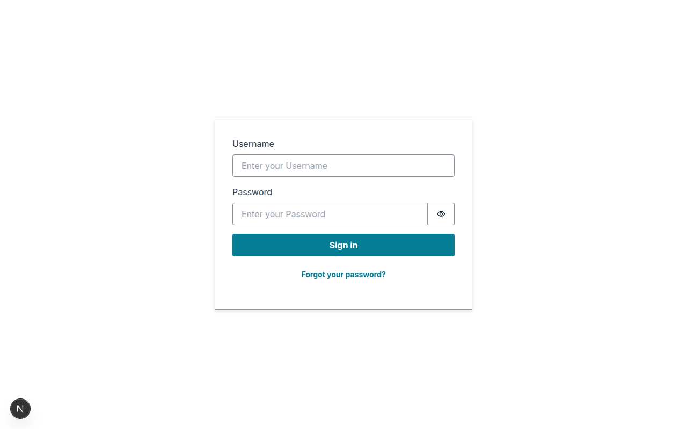
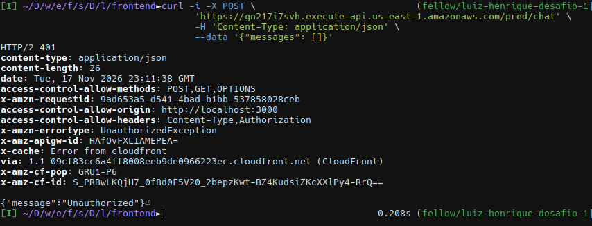
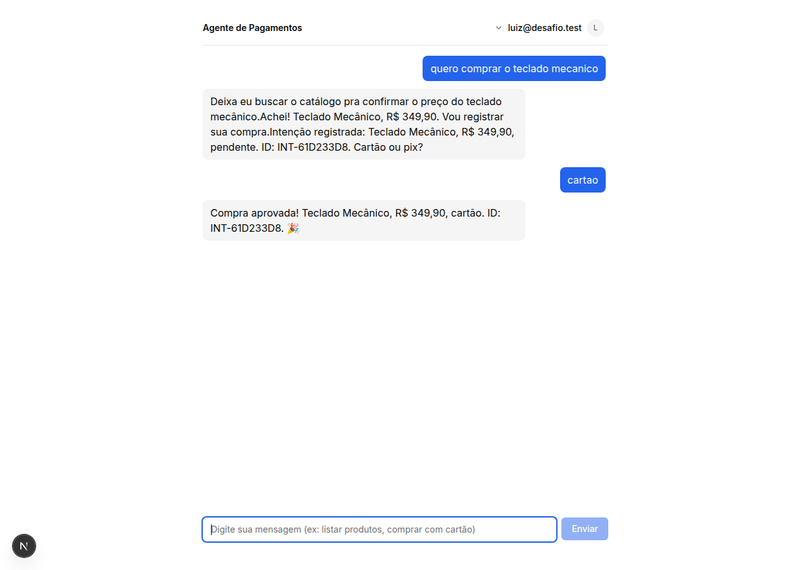
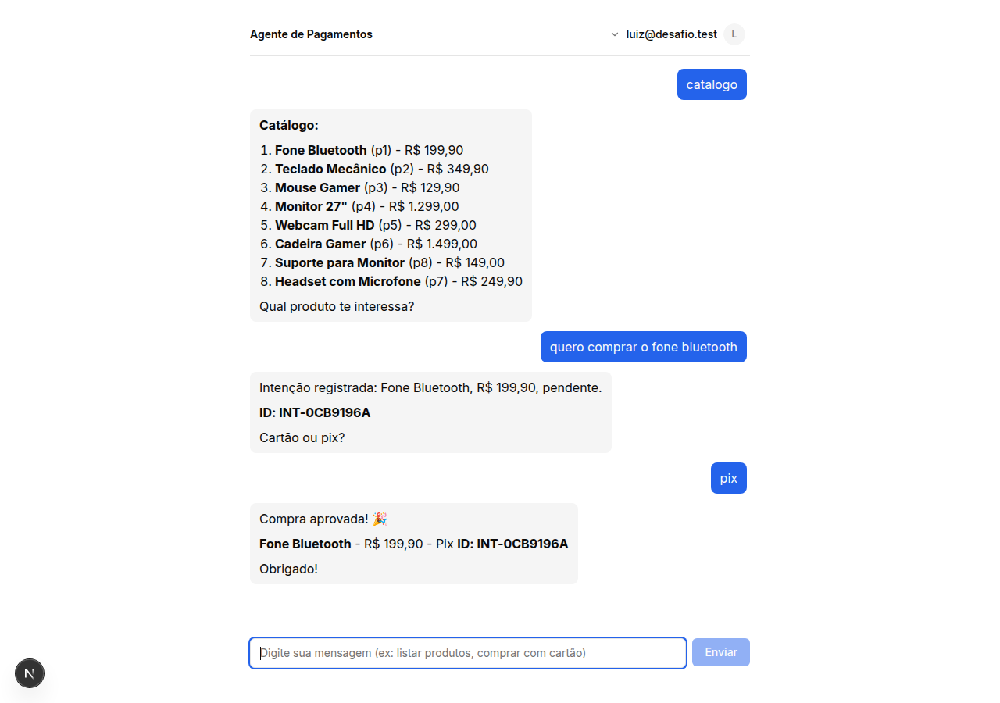
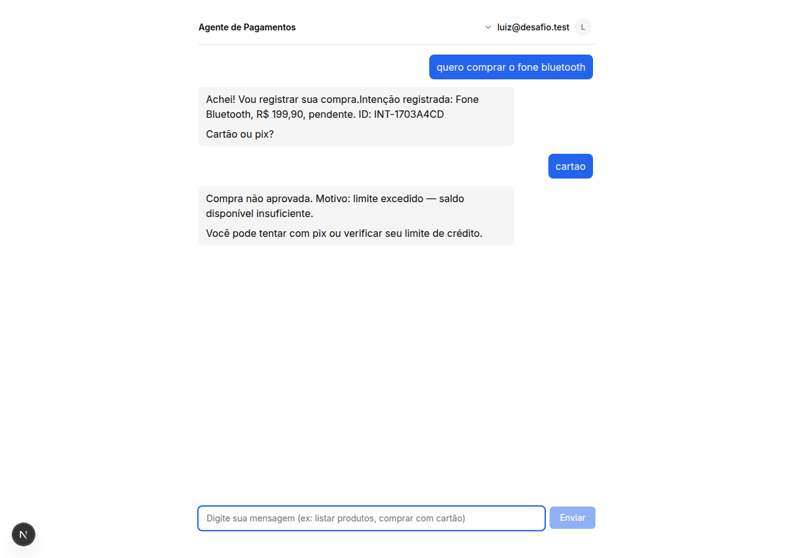
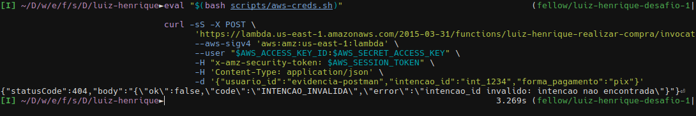

# Desafio 1 — Agente de Pagamentos na AWS (luiz-henrique)

Sprint 2 · AWS AI FDE Agentic Payments

Branch: `fellow/luiz-henrique-desafio-1` · Região: `us-east-1` · Prefixo: `luiz-henrique`

Última tag: **`v0.0.5`** (`0afba12`).

## Visão geral

O projeto leva para a AWS o chatbot de compras da Fase 1: login Cognito, chatbot 
no Bedrock AgentCore, três tools em Lambda e persistência em DynamoDB:

- `usuario_id` vem do `sub` do JWT, nunca do modelo;
- preço/produto vêm do `Catalogo` (`preco_centavos`), não do modelo;
- `realizar_compra` só paga intenção existente, do próprio usuário, `pendente` e não
  expirada;
- o débito do saldo e a mudança para `paga` acontecem na mesma transação condicional;
- IDs inventados geram falha visível (`INTENCAO_INVALIDA`), nunca uma cobrança.

### Estrutura do projeto

```
Desafio-1/luiz-henrique/
├── frontend/   # Next.js (App Router) + Amplify Authenticator; roda local
├── api/        # código das Lambdas do chat (API Gateway é definido em infra/)
├── agent/      # Strands no Bedrock AgentCore Runtime (Bedrock)
├── tools/      # Lambdas: listar_catalogo, registrar_intencao, realizar_compra
├── infra/      # CDK: DynamoDB, tools, agente, API, Cognito, ECR
├── scripts/    # credenciais, convite, ajustar limite, dev local, check:model/logs, destroy
├── tests/      # suíte Node
├── docs/       # documentação atual + archive/ + apresentacao/
└── README.md
```

`api/` não é o API Gateway: ele guarda o código das Lambdas. O API Gateway (REST e as rotas
`POST /chat`/`GET /conversas`) é criado em `infra/lib/api-stack.ts`.

## 1. Diagrama da arquitetura

```
Frontend Next.js local (http://localhost:3000 · login Cognito/Amplify)
        │
        ├─ POST /chat            Authorization: Bearer <IdToken>
        ├─ GET  /conversas       Authorization: Bearer <IdToken>
        │
        ▼
API Gateway REST (prod) + autorizador JWT Cognito
        │
        ▼
Lambda do chat
  ├─ valida o sub do token
  ├─ gerencia a linha na tabela Usuarios (lazy)
  ├─ lê/grava estado e histórico em Conversas
  └─ InvokeAgentRuntime
        │
        ▼
AgentCore Runtime (container arm64 no ECR)
  └─ Strands + BedrockModel (Claude Haiku 4.5)
       ├─ listar_catalogo    → Lambda → DynamoDB Catalogo
       ├─ registrar_intencao → Lambda → DynamoDB Catalogo + Intencoes
       └─ realizar_compra    → Lambda → TransactWriteItems (Intencoes + Usuarios)
```

### Serviços implementados

| Camada | Implementação | Onde |
|---|---|---|
| IaC | AWS CDK v2 (TypeScript), stack `Desafio1Stack` | `infra/bin/desafio-1.ts`, `infra/lib/desafio-1-stack.ts` |
| Frontend | Next.js App Router + Tailwind + Amplify Auth; roda local | `frontend/` |
| Auth | Cognito User Pool, `selfSignUpEnabled: false`, convite por admin | `infra/lib/api-stack.ts` |
| API REST | API Gateway REST, `POST /chat` e `GET /conversas` | `infra/lib/api-stack.ts` |
| Chat | Lambda Node 20 que chama o AgentCore Runtime | `api/index.ts` |
| Agente | Strands no AgentCore Runtime; imagem Docker arm64 | `agent/`, `infra/lib/agent-stack.ts` |
| Tools | 3 Lambdas Node 20 | `tools/`, `infra/lib/tools-stack.ts` |
| Dados | DynamoDB on-demand: `Usuarios`, `Conversas`, `Intencoes`, `Catalogo` | `infra/lib/database-stack.ts` |
| Imagem | `DockerImageAsset` no ECR | `infra/lib/agent-stack.ts` |
| Runtime | `CustomResource` com create/update/delete do AgentCore | `infra/lambda/agent-runtime/index.ts` |
| Modelo | Bedrock Claude Haiku 4.5 | `agent/index.ts` |

## 2. Instruções de deploy

### 2.1 Para avaliação (rodar frontend local apenas, api + agente já estão rodando na AWS)

O frontend é um Next.js comum e não depende dos scripts do projeto. Em um clone limpo:

```bash
git clone https://github.com/luiztosk/scholarship-fde-agentic-payments-challenges.git
cd scholarship-fde-agentic-payments-challenges/Desafio-1/luiz-henrique/frontend
npm install
npm run dev            # http://localhost:3000
```

- O `frontend/public/config.json` versionado já aponta para a API/Cognito atuais e contém
  apenas identificadores públicos.
- Use a porta **3000**; o CORS da API aceita apenas essa origem (`next dev -p 3000`).
- O login é o `Authenticator` do Cognito, sem cadastro (`hideSignUp`).
- O instrutor entra com o e-mail convidado; o Cognito envia senha temporária e ele escolhe
  a definitiva no primeiro login.
- Os scripts em `scripts/` servem ao ambiente de desenvolvimento (deploy, credenciais,
  agente local, convites); não são necessários para avaliar o frontend.
- O navegador só fala com o API Gateway; não recebe ARNs, account ID nem credenciais.

Para reenviar o convite do instrutor (aqui sim, com o AWS CLI autenticado):

```bash
cd Desafio-1/luiz-henrique
eval "$(bash scripts/aws-creds.sh)"
npm run user:invite -- instrutor@example.com 500
```

### 2.2 Deploy completo

Deploy completo do backend, tools, agente e API via CDK.

#### 2.2.1 Pré-requisitos

- AWS CLI v2 com perfil `desafio-1` (IAM Identity Center).
- Node.js 20+ e npm.
- Docker em execução (o CDK builda a imagem arm64 do agente).
- Permissões para criar/atualizar os recursos da stack.

```bash
aws sso login --profile desafio-1
cd Desafio-1/luiz-henrique
npm install
npm --prefix infra install
npm --prefix agent install
eval "$(bash scripts/aws-creds.sh)"
```

#### 2.2.2 Comando único — backend, tools, agente e API

```bash
npm run diff                  # revise o que será criado/alterado
npm run deploy:api-agent
```

`npm run deploy:api-agent` executa
`cdk deploy --require-approval never --outputs-file cdk-outputs.json` na pasta `infra/`.

> **Desvio em relação ao PDF:** o comando único cobre **backend, tools, agente e API**, mas
> **não** publica o frontend em S3 + CloudFront + OAC. A conta tem SCP que bloqueia esses
> recursos; o frontend roda local. O instrutor consegue rodar com
> `cd frontend && npm install && npm run dev`.
> O desvio está registrado em [`docs/REQUISITOS-PDF-E-AUDITORIA.md`](docs/REQUISITOS-PDF-E-AUDITORIA.md).

#### 2.2.3 Variáveis de ambiente

Copie `.env.example` para `.env` e preencha o necessário. Principais:

- `BEDROCK_MODEL_ID` — o `.env` usa `us.anthropic.claude-haiku-4-5-20251001-v1:0`.
  Sem essa variável no momento do deploy, o CDK usa
  `global.amazon.nova-2-lite-v1:0` silenciosamente.
- `TEST_EMAIL` / `TEST_PASSWORD` — usuário de teste local.
- `AWS_REGION` — `us-east-1`.

`.env` e `infra/cdk-outputs.json` são gitignorados. Nunca faça commit deles.

#### 2.2.4 Outputs do deploy

- `ApiUrl`
- `CognitoUserPoolId`
- `CognitoUserPoolClientId`
- `AgentRuntimeArn`
- `AgentStackAgentRuntimeIdE93B6B16` (ID do runtime)
- `UsuariosTableName`
- `EcrRepositoryUri`

#### 2.2.5 Verificação pós-deploy

```bash
npm run check:model    # runtime vivo + BEDROCK_MODEL_ID (read-only, sem custo de Bedrock)
npm run check:logs     # log groups/streams do agente e das Lambdas
npm run test:agent     # integração: 401, saldo, idempotência, agente, GET /conversas
```

## 3. Modelo do Bedrock

- **Modelo:** Amazon Bedrock — **Claude Haiku 4.5**
  (`us.anthropic.claude-haiku-4-5-20251001-v1:0`).
- **Runtime:** Strands Agents no Bedrock AgentCore Runtime.
- **Por que Haiku:** é o modelo recomendado no PDF, com boa relação custo/latência para
  tool use e conversas curtas de checkout.
- **Confirmado no runtime em 2026-11-17:** `luiz_henrique_agent-AD3mRGF7e9`, versão 15,
  status `READY`, Haiku 4.5.
- **Fallback de código:** `global.amazon.nova-2-lite-v1:0` apenas se `BEDROCK_MODEL_ID`
  não existir no deploy. Confirme o runtime vivo com `npm run check:model`; não confie só
  no `.env`.

## 4. Modelagem do DynamoDB

Tabelas prefixadas com `luiz-henrique`, billing on-demand, `RemovalPolicy.DESTROY`.
Detalhes adicionais em [`docs/MODELO-USUARIOS.md`](docs/MODELO-USUARIOS.md).

| Tabela | Chave | Guarda | Índices/TTL |
|---|---|---|---|
| `Usuarios` | PK `usuario_id` (= `sub`) | `email`, `limite_centavos` (saldo), `gasto_total_centavos`, `status`, `origem`, timestamps | — |
| `Conversas` | PK `conversa_id`, SK `usuario_id` | `pending_intencao_id`, `pending_status`, `mensagens_json` (histórico completo) | GSI `usuario_id-index` (`usuario_id`, `conversa_id`) |
| `Intencoes` | PK `intencao_id` | `usuario_id`, `produtos` (snapshot), `valor`, `valor_centavos`, `status`, `expira_em`, `created_at`, `forma_pagamento`, `pago_em`, `motivo_falha` | GSI `usuario_id-index` (`usuario_id`, `status`) |
| `Catalogo` | PK `id` | `nome`, `preco` (reais, exibição), `preco_centavos` (**fonte de verdade**) | seed idempotente pelo CDK |

### Regras de escrita

- `usuario_id` vem do `sub` do JWT, nunca do corpo nem do modelo.
- `registrar_intencao` recebe apenas `itens: [{ produto_id, quantidade }]`; nome e preço
  saem do `Catalogo` (`preco_centavos`).
- Compra: `TransactWriteItems` debita `Usuarios.limite_centavos` (condição
  `limite_centavos >= valor` e `status = ativo`) e marca a intenção como `paga`
  (condição `status = pendente`). Ou tudo acontece, ou nada é debitado.
- Intenção só é paga se existir, for do próprio usuário, estiver `pendente` e não expirada
  (15 minutos).
- `Conversas.mensagens_json` guarda o histórico completo; `GET /conversas` devolve a lista.
- `Usuarios.ultima_intencao_id` é legado e **não é mais lido nem escrito** pelo chat.

## 5. Permissões IAM

| Role/Componente | Permissões | Não tem |
|---|---|---|
| **Lambda do chat** (API Gateway) | `bedrock-agentcore:InvokeAgentRuntime`; `dynamodb:GetItem/PutItem/UpdateItem/Query` em `Usuarios` e `Conversas` | Acesso a `Intencoes`, transações ou Bedrock |
| **`listar_catalogo`** | `dynamodb:GetItem/Scan` em `Catalogo` | Outras tabelas |
| **`registrar_intencao`** | `dynamodb:PutItem` em `Intencoes`; `dynamodb:GetItem` em `Catalogo` | Usuários, transações |
| **`realizar_compra`** | `dynamodb:GetItem/UpdateItem/TransactWriteItems` em `Intencoes` e `Usuarios` | Outras tabelas |
| **AgentCore Runtime** | Invocar Bedrock, invocar as 3 Lambdas, ECR pull e logs (`AWSLambdaBasicExecutionRole`) | Acesso direto às tabelas |
| **Seed do catálogo** | `dynamodb:PutItem` em `Catalogo` | Outras tabelas |

- Sem `AdministratorAccess` e sem `Action: "*"` + `Resource: "*"`.
- Exceção documentada: `ecr:GetAuthorizationToken` usa `Resource: "*"` porque a API não
  oferece escopo por repositório. É uma ação específica, não um curinga de ações.
- O chat Lambda ainda faz criação lazy do item em `Usuarios`; o PDF cita apenas runtime +
  conversas para essa role. É um trade-off documentado para usuários criados pelo console
  do Cognito.

## 6. Evidências

Os 5 itens exigidos pelo PDF estão como imagens inline abaixo. Capturas adicionais em
[`docs/apresentacao/`](docs/apresentacao/README.md). Valores e IDs são simulados; nenhuma
cobrança real.

### 6.1 Login Cognito

Login no Cognito com o usuário de teste; o chat só abre autenticado.



### 6.2 Chamada à API sem token → 401

```bash
curl -i -X POST \
  'https://gn217i7svh.execute-api.us-east-1.amazonaws.com/prod/chat' \
  -H 'Content-Type: application/json' \
  --data '{"messages": []}'
```



### 6.3 Compra bem-sucedida com cartão e Pix





### 6.4 Tentativa bloqueada por limite excedido

Compra acima do saldo: a intenção é cancelada com `LIMITE_EXCEDIDO`, sem débito.



### 6.5 Tentativa com `intencao_id` inválido

O modelo não encaminha IDs inventados; a recusa é comprovada no backend:

```bash
eval "$(bash scripts/aws-creds.sh)"
curl -sS -X POST \
  'https://lambda.us-east-1.amazonaws.com/2015-03-31/functions/luiz-henrique-realizar-compra/invocations' \
  --aws-sigv4 'aws:amz:us-east-1:lambda' \
  --user "$AWS_ACCESS_KEY_ID:$AWS_SECRET_ACCESS_KEY" \
  -H "x-amz-security-token: $AWS_SESSION_TOKEN" \
  -H 'Content-Type: application/json' \
  -d '{"usuario_id":"evidencia-postman","intencao_id":"int_1234","forma_pagamento":"pix"}'
```



### 6.6 Outras evidências

| Caso | Resultado | Evidência |
|---|---|---|
| Chat inicial | Sessão autenticada, histórico carregado | [02-chat-inicial.png](docs/apresentacao/02-chat-inicial.png) |
| Catálogo | Lista com IDs e preços | [03-catalogo.png](docs/apresentacao/03-catalogo.png) |
| Intenção | ID retornado e status pendente | [04-intencao-fone.png](docs/apresentacao/04-intencao-fone.png) |
| Intenção do monitor | ID e valor corretos | [06-intencao-monitor.png](docs/apresentacao/06-intencao-monitor.png) |
| `GET /conversas` | Histórico do próprio usuário | `npm run test:agent` (teste de integração) |
| Novo produto após cancelamento | Novo ID, sem reutilizar o cancelado | `npm run test:agent` |

Reproduzir a demo:

```bash
npm run user:reset-limit -- luiz@desafio.test
cd frontend && npm run dev
# login com TEST_EMAIL/TEST_PASSWORD; use o roteiro em docs/apresentacao/README.md
```

## 7. Remoção de recursos

```bash
cd Desafio-1/luiz-henrique
eval "$(bash scripts/aws-creds.sh)"
npm run destroy
```

O comando roda `cdk destroy --force` e depois `scripts/destroy-cleanup.sh`. Confirme no
console/CLI que não restou:

- runtime do AgentCore;
- imagens no ECR;
- tabelas DynamoDB `luiz-henrique-*`;
- log groups `/aws/bedrock-agentcore/*` e `/aws/lambda/luiz-henrique-*`;
- roles IAM `luiz-henrique-*`;
- REST API do projeto.

Detalhes e verificação: [`docs/destroy-cleanup.md`](docs/destroy-cleanup.md).

## Comandos

Comandos do ambiente de desenvolvimento (deploy, agente, credenciais). Para apenas avaliar o
frontend, use `cd frontend && npm install && npm run dev` (§2.1).

| Comando | Efeito |
|---|---|
| `npm run setup` | instala dependências da raiz e do frontend |
| `npm run dev` | atalho de dev do frontend; usa `dev-frontend-local.sh` quando há `cdk-outputs.json` |
| `npm run dev:frontend` | regenera `config.json` a partir de `cdk-outputs.json` e sobe o frontend |
| `npm run dev:agent` | agente local em `http://localhost:3031` (Bedrock real) |
| `npm run deploy:api-agent` | deploy do backend/agente (CDK) |
| `npm run diff` | `cdk diff` |
| `npm run test:local` | sobe o agente local e roda o fluxo de regressão (fallback, Haiku) |
| `npm run test:agent` | testes de integração na stack implantada |
| `npm run check:model` | lê o `BEDROCK_MODEL_ID` do runtime (read-only, sem custo de Bedrock) |
| `npm run check:logs` | lista log groups/streams do agente e das Lambdas (read-only) |
| `npm run user:invite -- <email> [limite]` | cria usuário no Cognito + saldo + convite |
| `npm run user:set-limit -- <email\|sub> <valor>` | ajusta o saldo disponível |
| `npm run user:reset-limit -- <email>` | volta ao saldo padrão (R$ 500) |
| `npm run destroy` | destroy + limpeza de órfãos |

## Agente local (iteração rápida)

O agente local usa o mesmo `agent/index.ts` e o mesmo Bedrock do runtime. Com os ARNs das
tools configurados, chama as Lambdas reais; sem ARNs, usa o fallback em memória que replica
IDs, códigos, status, expiração e saldo.

```bash
eval "$(scripts/aws-creds.sh)"
export BEDROCK_MODEL_ID=us.anthropic.claude-haiku-4-5-20251001-v1:0
npm run dev:agent
```

Detalhes e paridade local/remota: [`docs/DEV-LOCAL-AGENTE.md`](docs/DEV-LOCAL-AGENTE.md).

## Limitações e pendências

- Frontend local; sem URL pública S3/CloudFront/OAC (SCP da conta) e sem deploy de frontend
  no comando IaC. Decisão registrada em `docs/REQUISITOS-PDF-E-AUDITORIA.md`.
- A suíte ampla de 100+ casos e o redirecionamento para catálogo estão planejados em
  `docs/TEST-STRATEGY.md` (caso `REFUSAL-LOOP-01`).
- A coleção Postman em `tests/` está quebrada e precisa de correção; ela não é usada pelas
  evidências da §6.
- O chat Lambda ainda cria o item em `Usuarios` no primeiro acesso; ver §5.

## Custos

- Orçamento atual: **US$ 20**, aproximadamente **US$ 5** gastos.
- Serviços em uso: DynamoDB on-demand, Lambda, API Gateway REST, Cognito, ECR,
  AgentCore Runtime e CloudWatch Logs.
- Não crie VPC/NAT, CloudFront, Amplify Hosting, jobs agendados ou outros serviços pagos
  sem necessidade.
- Para iterar prompt, use o fallback local e evite chamadas repetidas ao Bedrock.
- `check:model` e `check:logs` são somente leitura.
- Estimativa da suíte 100+: [`docs/TEST-STRATEGY.md`](docs/TEST-STRATEGY.md) §8.

## Critérios de conclusão do PDF

- [ ] Frontend publicado em S3 + CloudFront, com URL pública e bucket privado (OAC).
  **Pendente:** a conta tem SCP que bloqueia S3/CloudFront/OAC; o frontend roda local via
  `npm run dev`, e essa adaptação está documentada.
- [x] Login com Cognito funcionando; chat inacessível sem autenticação.
  **Concluído:** `Authenticator` + JWT; o chat exige token válido e o teste de integração
  cobre login e `401`.
- [x] Auto cadastro desabilitado; usuários criados apenas por convite do administrador.
  **Concluído:** `selfSignUpEnabled: false`, `hideSignUp` e convite via
  `npm run user:invite`.
- [x] Endpoints do webchat expostos pelo API Gateway, com autorizador JWT do Cognito.
  **Concluído:** `POST /chat` e `GET /conversas` com autorizador Cognito.
- [x] Requisição sem token ou com token inválido rejeitada com 401 pelo API Gateway.
  **Concluído:** teste de integração sem token retorna `401`.
- [x] Agente Strands rodando no Bedrock AgentCore Runtime, com modelo do Bedrock.
  **Concluído:** runtime v15 `READY`, Claude Haiku 4.5.
- [x] As três ferramentas executando em Lambda.
  **Concluído:** `listar_catalogo`, `registrar_intencao` e `realizar_compra`.
- [x] Usuários, conversas e intenções persistidos no DynamoDB.
  **Concluído:** `Usuarios`, `Conversas` (com histórico), `Intencoes` e `Catalogo`.
- [ ] Roles com menor privilégio, sem permissões curinga.
  **Parcial:** sem `AdministratorAccess` e sem `Action: "*"`; a única exceção é
  `ecr:GetAuthorizationToken` com `Resource: "*"`, exigida pela API do ECR.
- [ ] Ambiente completo criado rodando o script IaC, sem passos manuais não documentados.
  **Parcial:** backend, tools, agente e API sobem com `npm run deploy:api-agent`; o frontend
  é um passo local documentado, então o ambiente “completo” do PDF não é 100% via IaC.
- [ ] Pull request com a sua pasta, sem credenciais, com a documentação descrita no README.
  **Pendente:** commits e tags estão no repositório; a branch/PR ainda não foi publicado.

## WebSocket (trabalho iniciado)

Iniciamos uma API Gateway WebSocket, mas ela ainda não está funcional: `$connect` autentica
e grava a conexão; `$default` retorna `Internal server error`. O chat usa REST. Código e
próximos passos estão em [`docs/WS-NEXT.md`](docs/WS-NEXT.md); não faz parte da demo/entrega
atual.

## Documentação

Comece por [`docs/README.md`](docs/README.md). Apresentação:
[`docs/apresentacao/`](docs/apresentacao/README.md). Estratégia de testes:
[`docs/TEST-STRATEGY.md`](docs/TEST-STRATEGY.md). Históricos em
[`docs/archive/`](docs/archive/README.md).

## Regras essenciais

- Tudo em `us-east-1`; prefixo `luiz-henrique`.
- Cognito sem auto cadastro; usuários entram por convite.
- `usuario_id` vem do `sub` do token, nunca do corpo nem do modelo.
- Valor da compra vem da intenção salva; pagamento e limite usam escritas condicionais.
- Nenhum segredo no Git.
- Manter a aplicação no ar até a correção e criar o usuário do instrutor no Cognito.
