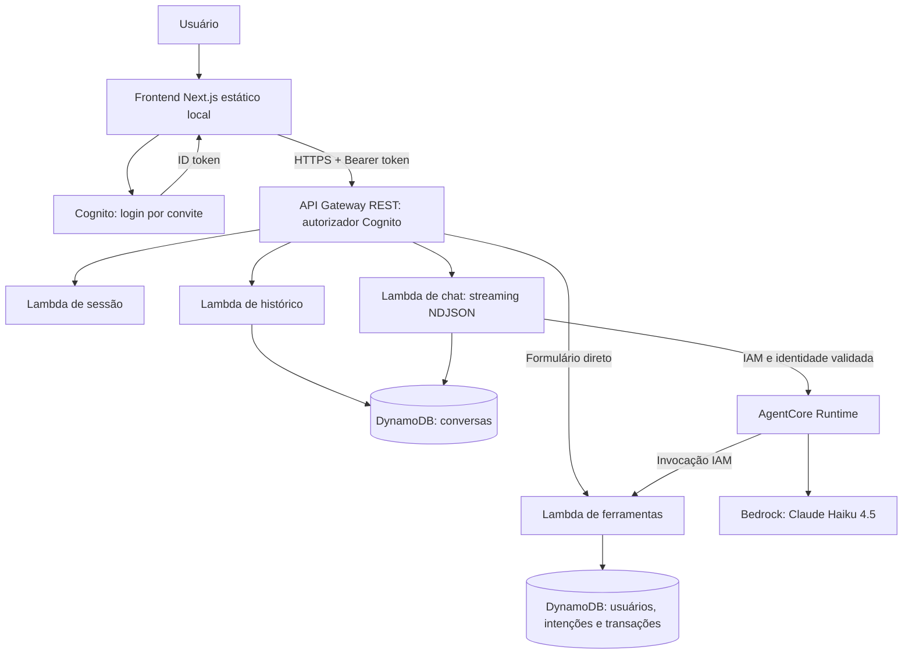

# Agente de Pagamentos na AWS

Projeto individual do Desafio 1: migrar o agente de pagamentos da Fase 1 para a AWS.

## Estado atual

Backend publicado com Cognito, API REST protegida, ferramentas Lambda, DynamoDB,
AgentCore Runtime e chat com histórico. **Entrega conforme nova orientação do Pedro em
16/11/2026: frontend somente local, com README de execução; backend e autenticação na AWS.**
Deploy do frontend/CloudFront não é pendência desta entrega. Instruções em [infra/README.md](infra/README.md).

**Atualização (16/11/2026):** após envio do formulário, o Haiku respondeu `pong` e o teste
real Lambda → AgentCore → Haiku → ferramentas passou, incluindo confirmação, compra única,
histórico completo e isolamento. Os dados temporários foram removidos. O usuário também
validou o chat pelo navegador com login real, incluindo compras por Pix e cartão, e confirmou
recusa por limite insuficiente e expiração pelo formulário. Saldo final informado: R$ 502,10.
Veja [registro do chat e próximos passos](docs/CHAT-2026-11-16.md).

O usuário confirmou login e compra de monitor via Pix pela interface autenticada, que
mostrou limite restante de R$ 3.100,10. Ferramentas persistem em três tabelas DynamoDB;
conversas usam uma quarta tabela. Validações: 20 testes de ferramentas, dez de infraestrutura,
dez de chat/agente, testes anteriores de DynamoDB/Lambda e rejeição de tokens ausentes ou
inválidos nas oito rotas. O teste de interface do chat usa respostas simuladas, sem credenciais reais.

Documentação: [agente e streaming](agent/README.md), [API de pagamentos](docs/API-PAGAMENTOS.md),
[DynamoDB](docs/DYNAMODB.md), [implantação inicial](docs/DEPLOY-2026-11-15.md).
O código original permanece em `ollama-chat/` e `ollama-tools/` como base da migração.

O acesso inicial por SSO, a região, a listagem S3, o orçamento com e-mail verificado e uma chamada ao Claude Haiku 4.5 foram confirmados pelo usuário. Consulte o [registro das validações AWS](docs/VALIDACAO-AWS.md) e o [plano de implementação por etapas](docs/PLANO-DE-IMPLEMENTACAO.md).

Origem: https://github.com/luiztosk/squad-03-desafio-MCP-agentic
O trabalho original foi desenvolvido pela Squad 03. Esta cópia inicia um histórico próprio para a adaptação individual.
As instruções originais estão em [docs/README-fase1.md](docs/README-fase1.md).

Os requisitos, esclarecimentos da reunião, regras de negócio e checklist de entrega estão no [guia consolidado do desafio](docs/GUIA-DO-DESAFIO-1.md).

## Diretrizes da migração

- Frontend local; backend na AWS, autenticação Cognito e cadastro somente por convite.
- Chat exposto pelo API Gateway, com validação do token antes da Lambda.
- Agente no Bedrock AgentCore Runtime e modelo do Amazon Bedrock.
- Strands é opcional, conforme esclarecimento do Pedro na reunião.
- Ferramentas de pagamento em Lambda; persistência no DynamoDB.
- Infraestrutura como código: CDK, Terraform ou CloudFormation.
- Região us-east-1, menor privilégio e orçamento de US$ 20 por mês.
- Preservar regras e contratos da Fase 1, corrigindo falhas de validação e evitando pagamentos duplicados.

## Evidências e entrega

O [índice de evidências](docs/EVIDENCIAS-E-ENTREGA.md) reúne resultados, origem de cada
comprovação e pendências. Há capturas reais de login, acesso, Pix, cartão, limite e
expiração; o teste de intenção inválida e os logs do agente estão registrados em texto.
Em 17/11/2026, a atualização de auditoria foi publicada e a integração completa passou
novamente, com seis chamadas correlacionadas no CloudWatch. Veja a
[evidência da auditoria](docs/evidencias/auditoria-ferramentas.md).
Os prints em `docs/screenshots/` pertencem à Fase 1 e não comprovam a migração AWS.

A preparação da entrega usa a branch `fellow/paulo-antonio-desafio-1` e a pasta
`Desafio-1/paulo-antonio/`. Publicar o pull request após revisar as pendências do índice;
a preparação local não significa que o pull request já foi aberto.

## Arquitetura implementada



Frontend local em `http://127.0.0.1:4173`, conforme o formato solicitado para entrega.
S3 privado + CloudFront/OAC permanecem no código como alternativa legada, não usada na entrega.
O bucket privado de **artefatos de implantação** já existe e não hospeda o frontend.

Modelo: `us.anthropic.claude-haiku-4-5-20251001-v1:0`, recomendado pelo Pedro.
As stacks ficam em `us-east-1`; o perfil de inferência `us.` pode encaminhar chamadas
para `us-east-1`, `us-east-2` e `us-west-2`, previstas nas permissões do runtime.

Decisões: CDK TypeScript; REST API com autorizador Cognito e response streaming;
AWS SDK para o ciclo do agente (Strands opcional); ZIP Node.js 22 ARM64 no AgentCore,
sem Docker/ECR; chamada direta de ferramentas Lambda, sem MCP Gateway opcional.
O modelo prepara a intenção; o pagamento requer confirmação explícita no botão.

## Executar e publicar

Pré-requisitos: Node.js 24 (versão usada localmente), pnpm 11.25.0, AWS CLI v2,
perfil SSO `desafio-1` e acesso ao Haiku na conta do programa. O convite Cognito do
usuário e o cadastro inicial da Anthropic são passos manuais documentados.
Não são necessárias access keys permanentes.

Na raiz do projeto, execute cada comando separadamente:

```powershell
aws sso login --profile desafio-1
aws sts get-caller-identity --profile desafio-1
cd infra
pnpm install --frozen-lockfile --store-dir ../.pnpm-store
pnpm run deploy --account CONTA_DE_12_DIGITOS --profile desafio-1 --prefix paulo-antonio --mode backend
```

Substitua `CONTA_DE_12_DIGITOS` pelo número conferido na conta destinada ao desafio.
O último comando instala dependências, compila, prepara o bucket de artefatos, publica
dados e aplicação, e gera `.deploy/config.json`. Ampliações de permissões são mostradas
pelo CDK. O script de deploy é único; a instalação inicial da ferramenta é pré-requisito.

Depois do deploy, partindo de `infra/`:

```powershell
cd ../frontend
node scripts/preview-local.mjs --aws
```

Abra `http://127.0.0.1:4173`, entre com o usuário Cognito convidado e use o chat ou o
formulário de compras. Não troque por `localhost`: CORS está restrito à origem indicada.
No primeiro login, substitua a senha temporária. O limite inicial simulado é R$ 5.000;
ele não é restaurado ao sair ou atualizar a página. Todos os pagamentos são fictícios.

Use **sempre `--mode backend` para esta entrega**. O modo legado `--mode full` não é
necessário e não foi validado na conta. Consulte o [procedimento do backend](infra/README.md).
O comando de deploy foi validado em 17/11/2026 a partir de
`Desafio-1/paulo-antonio/infra`: instalou dependências, compilou frontend/backend,
confirmou as três stacks existentes sem alterações e gerou a configuração local.
Isso valida a atualização do ambiente existente; não é um teste em conta vazia.

### Rodar somente o frontend com o backend já existente

Não é necessário fazer outro deploy para abrir a interface. Com o repositório clonado,
Node.js 24 e pnpm no PATH, execute a partir da raiz:

```powershell
cd frontend
pnpm install --frozen-lockfile --store-dir ../.pnpm-store
pnpm run build
```

Se `.deploy/config.json` já foi gerado anteriormente, avance para o comando de iniciar
o servidor. Em uma cópia nova, volte à raiz (`cd ..`), entre no SSO e recupere **somente
a configuração pública** da stack existente (não recria recursos):

```powershell
aws sso login --profile desafio-1
$stackJson = aws cloudformation describe-stacks --stack-name paulo-antonio-pagamentos --profile desafio-1 --region us-east-1 --output json
if ($LASTEXITCODE -ne 0) { throw 'Não foi possível consultar a stack. Confira o login e o nome da stack.' }
$stackInfo = $stackJson | ConvertFrom-Json
$outputs = @{}
$stackInfo.Stacks[0].Outputs | ForEach-Object { $outputs[$_.OutputKey] = $_.OutputValue }
$config = @{ apiUrl = $outputs.ApiUrl; region = $outputs.Region; userPoolId = $outputs.UserPoolId; userPoolClientId = $outputs.UserPoolClientId }
New-Item -ItemType Directory -Path .deploy -Force | Out-Null
$config | ConvertTo-Json | Set-Content -Path .deploy/config.json -Encoding ascii
cd frontend
```

Use o nome real da stack/perfil se tiver publicado com outro prefixo. Quem não tiver
permissão de consultar a stack pode receber esse arquivo de configuração do responsável;
ele contém apenas URL e identificadores públicos, nunca senha, token ou chave AWS.
O login da aplicação é separado do SSO: o responsável precisa criar o usuário no Cognito.

Na pasta `frontend/`, inicie:

```powershell
node scripts/preview-local.mjs --aws
```

Mantenha o terminal aberto e acesse `http://127.0.0.1:4173`. Para encerrar, use `Ctrl+C`.
Após mudanças no frontend, gere outro build e atualize o navegador com `Ctrl+F5`.
Se a porta 4173 estiver ocupada, encerre a instância anterior; não mude a porta sem
ajustar o CORS do backend. Se `node`/`pnpm` não forem reconhecidos, instale os pré-requisitos
e reabra o terminal. Sem `--aws`, o servidor mostra apenas a prévia offline com login fictício.

## Persistência e permissões

| Tabela (`<prefixo>-pagamentos-`) | Chave | Finalidade |
|---|---|---|
| `usuarios` | `userId` | `sub` Cognito, limite e gasto em centavos |
| `intencoes` | `id` | Titular, produto, quantidade, valor, prazo e estado |
| `transacoes` | `id` | Compra aprovada; identificador derivado da intenção |
| `conversas` | `userId` + `conversationId` | Histórico completo, confirmação pendente e controle de execução |

As quatro tabelas são sob demanda, sem TTL. Preço e identidade são determinados pelo
backend. A compra altera gasto, intenção e transação atomicamente, com condições que
impedem duplicidade e concorrência acima do saldo. Detalhes em [DynamoDB](docs/DYNAMODB.md).

| Componente | Permissões da aplicação |
|---|---|
| Sessão | Somente logs próprios |
| Histórico | `GetItem`/`Query` em conversas e logs próprios |
| Chat | `GetItem`/`PutItem`/`UpdateItem` em conversas, invocação do runtime e logs próprios |
| AgentCore | Modelo/perfil Haiku e regiões previstos, Lambda de ferramentas, ZIP específico e logs; sem DynamoDB |
| Ferramentas | Leitura/gravação condicionais nas três tabelas de pagamentos; sem Scan/Delete/Bedrock |

O runtime pode listar grupos de logs na conta para configuração do serviço; escrita e
política de logs ficam restritas ao prefixo do agente. Não há políticas administrativas
nas roles da aplicação. `OPTIONS` permite preflight; as oito rotas funcionais exigem Cognito.
Credenciais e tokens não são versionados. Tokens ficam no sessionStorage da aba; histórico
fica no DynamoDB. ID tokens têm validade de 15 minutos; logout não garante revogação
instantânea de um token já copiado.

## Testes e limitações

Veja [evidências e roteiro de entrega](docs/EVIDENCIAS-E-ENTREGA.md). Há testes locais,
integrações reais com dados isolados e validações manuais do usuário. Esses grupos têm
alcances diferentes: invocar Lambda via SSO não comprova o autorizador do API Gateway.

O histórico integral é mantido por conversa; ao exceder limites documentados em
[agent/README.md](agent/README.md), o usuário deve iniciar outra conversa. Não se truncam
mensagens antigas silenciosamente. A listagem mostra até 100 conversas. Não há retry
automático de pagamento após resultado incerto; consulte a intenção antes de repetir.

## Remoção dos recursos

Somente após o período de correção combinado e preservação das evidências:

1. Confira conta, prefixo e outputs. Identifique os recursos exatos do projeto.
2. Se tiver usado o modo completo, esvazie apenas o bucket do frontend correspondente.
3. Em `infra/`, use `pnpm exec cdk destroy paulo-antonio-pagamentos --profile desafio-1 --context prefix=paulo-antonio --context backendOnly=true` e revise a confirmação. Para implantação completa, use `backendOnly=false`.
4. Remova separadamente `paulo-antonio-pagamentos-dados` via CDK: isso apaga as quatro tabelas e seus registros.
5. Confira e exclua os grupos de logs do AgentCore criados fora da stack, inclusive o residual da tentativa revertida listado em [CHAT-2026-11-16.md](docs/CHAT-2026-11-16.md).
6. Esvazie somente o bucket de artefatos identificado na stack `paulo-antonio-assets` e exclua essa stack pelo CloudFormation.
7. Confira resíduos de runtime, Lambdas, roles, API, Cognito, tabelas, logs e, se aplicável, S3/CloudFront/OAC. Não apague recursos compartilhados do programa.

A limpeza final não foi executada. Não há imagens nem repositório ECR neste projeto.
