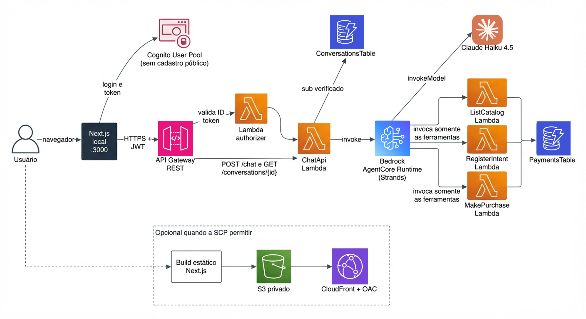

# Agente de pagamentos — AWS Sprint 2

Projeto de migração do chatbot de pagamentos da fase 1 para uma arquitetura AWS. A aplicação preserva as regras de catálogo, criação de intenção e pagamento simulado, adicionando autenticação Cognito, API protegida, agente Strands no Amazon Bedrock AgentCore e persistência em DynamoDB.

## Estado da implementação

- Backend implantado em `us-east-1`: Cognito, API Gateway, Lambdas, Bedrock AgentCore e tabelas DynamoDB.
- Modelo confirmado: Claude Haiku 4.5 (`us.anthropic.claude-haiku-4-5-20251001-v1:0`).
- Frontend executado localmente em `http://localhost:3000`. O deploy em S3/CloudFront está opcional. A stack padrão não cria esses recursos.
- A stack `ViniciusPaymentsBudget` configura alertas de orçamento de US$ 20. Alertas não são limite rígido de gastos nem impedem consumo.
- Ainda devem ser adicionadas as evidências de resposta 401 sem token e de recusa de `intencao_id` inválido. As imagens disponíveis estão em [docs/evidencias](docs/evidencias/).

## Arquitetura implementada

O API Gateway aplica o authorizer Cognito antes de encaminhar a requisição às rotas. A identidade usada pelo backend vem da claim `sub` validada, nunca de um `userId` enviado no corpo. O frontend pode permanecer local e chamar a API HTTPS. Quando permitir OAC, `deployFrontend=true` habilita bucket privado e distribuição pelo CloudFront.

## Organização do código

- `frontend/`: interface Next.js, autenticação Cognito e cliente da API.
- `api/src/handler.ts`: endpoints de chat, histórico, integração com o runtime e persistência da conversa.
- `api/src/authorizer.ts`: valida token Cognito e emite a política de autorização para API Gateway.
- `agent/main.py`: agente Strands executado no Bedrock AgentCore Runtime.
- `tools/src/lambda-handlers.ts`: handlers Lambda das ferramentas.
- `tools/src/cloud.ts`: operações de catálogo, intenção e pagamento sobre DynamoDB.
- `infra/lib/payments-stack.ts`: recursos CDK da aplicação.
- `infra/lib/budget-stack.ts`: alertas de orçamento.
- `infra/scripts/prepare-local.ps1`: prepara builds e pacotes de Lambda e do agente.
- `infra/scripts/provision-user.ps1`: convida usuário Cognito e grava seu limite individual.
- `infra/scripts/deploy.ps1`: preparação e deploy CDK em um comando.
- `docs/evidencias/`: capturas dos cenários já demonstrados.

## Modelo do Bedrock

Foi usado `us.anthropic.claude-haiku-4-5-20251001-v1:0`, perfil de inferência do Claude Haiku 4.5 em `us-east-1`. É o modelo Haiku recomendado para o desafio e foi habilitado pelo coordenador da conta. O ID está configurado no CDK; para utilizá-lo, o perfil precisa ter acesso ao modelo e as permissões organizacionais devem permitir a invocação.

## Persistência no DynamoDB

As duas tabelas usam `PAY_PER_REQUEST`, criptografia gerenciada pela AWS e chave composta `PK` (partition key) + `SK` (sort key). Não há GSI.

### `PaymentsTable`

| PK | SK | Conteúdo |
|---|---|---|
| `CATALOG` | `PRODUCT#<id>` | Produto, preço em BRL, estoque e dados de apresentação. |
| `USER#` | `PROFILE` | Limite individual de compra e dados de criação do perfil. |
| `USER#` | `INTENT#<id>` | Intenção vinculada ao produto, quantidade, total calculado, conversa, estado e validade. `expiresAt` habilita TTL. |
| `USER#` | `TRANSACTION#<id>` | Compra simulada, intenção, valor, meio de pagamento e data. |
| `USER#` | `AUDIT#<timestamp>#<id>` | Registro da ferramenta, parâmetros/resultados e contexto da conversa. |

### `ConversationsTable`

| PK | SK | Conteúdo |
|---|---|---|
| `USER#` | `CONVERSATION#<uuid>` | Metadados, versão, lock e timestamps da conversa. |
| `USER#` | `CONVERSATION#<uuid>#MSG#<sequência>` | Histórico completo enviado ao agente, incluindo chamadas de ferramenta e resultados. |
| `USER#` | `CONVERSATION#<uuid>#DISPLAY#<sequência>` | Mensagens apresentadas na interface. |

O uso de `USER#` particiona os dados por identidade validada. As condições/transações do DynamoDB protegem atualização de limite, estoque e estado da intenção contra corrida e duplicidade.

## Regras de negócio e segurança

- As ferramentas oferecem catálogo, criação de intenção e compra simulada por cartão ou Pix.
- O preço e o total são lidos/calculados no backend; o modelo não escolhe livremente o valor cobrado.
- A intenção deve pertencer ao usuário autenticado e à conversa, estar pendente e não estar expirada. Sua validade é de 10 minutos.
- O pagamento usa a intenção persistida; não há integração com adquirente ou movimentação real de dinheiro.
- O limite padrão criado pela stack é BRL 500. `provision-user.ps1` permite registrar um limite individual.
- A inscrição pública no Cognito está desabilitada; o usuário é convidado pelo operador.
- As rotas exigem JWT. Requisição sem token ou token inválido deve ser recusada com HTTP 401.
- API keys não são usadas como mecanismo de autenticação.

## Permissões IAM (resumo)

As policies detalhadas e os recursos são definidos em `infra/lib/payments-stack.ts`. O CDK também gera permissões auxiliares de logs, métricas e tracing para os serviços que as utilizam.

| Role | Acesso principal |
|---|---|
| `ChatApi` Lambda | Leitura/gravação/consulta/atualização/transação apenas na `ConversationsTable`, com `LeadingKeys` `USER#*`; invocação do runtime configurado. |
| `CognitoTokenAuthorizer` Lambda | Escrita de logs. A validação do JWT é local, usando metadados/chaves públicas do User Pool. |
| AgentCore Runtime | Invocar o modelo de inferência Claude configurado; invocar somente as três Lambdas de ferramenta; permissões de Marketplace condicionadas a chamadas via Bedrock. Não acessa DynamoDB diretamente. |
| `ListCatalog` Lambda | Leitura e gravação/consulta necessárias apenas na `PaymentsTable`, limitadas às chaves de catálogo e do usuário. |
| `RegisterIntent` Lambda | Leitura/gravação/consulta necessárias apenas na `PaymentsTable`, limitadas às chaves de catálogo e do usuário. |
| `MakePurchase` Lambda | Leitura, gravação, atualização e transação apenas na `PaymentsTable`, limitadas às chaves de catálogo e do usuário. |
| API Gateway | Escrita de logs de acesso no grupo de logs configurado. |
| Role de deploy do CDK | Vem do bootstrap CDK da conta; o ambiente atual foi bootstrapado com permissões administrativas. É uma role de implantação da conta, separada das roles de runtime da aplicação. |

## Pré-requisitos

- Windows PowerShell 5.1 ou PowerShell 7.
- Node.js/npm compatíveis com os projetos (Node.js 20+ recomendado), AWS CLI v2, AWS CDK CLI (`npx` usa a versão do projeto) e `uv` para preparar o agente Python.
- Acesso SSO ao perfil AWS com permissões para CDK/CloudFormation, IAM, Lambda, API Gateway, Cognito, DynamoDB, Bedrock AgentCore, Bedrock Runtime, ECR/S3 de assets e AWS Budgets. A organização também precisa permitir os recursos solicitados.
- Modelo Claude Haiku 4.5 autorizado na conta/região.
- Email válido para receber alertas do AWS Budgets.

O frontend usa somente os IDs/URLs públicos do User Pool e da API.

## Deploy passo a passo

### 1. Entrar no diretório e autenticar por SSO

Na raiz `Desafio-1/vinicius-leoncio`:

~~~powershell
$env:AWS_PROFILE = "desafio-1"
aws sso login --profile $env:AWS_PROFILE
aws sts get-caller-identity --profile $env:AWS_PROFILE
aws configure get region --profile $env:AWS_PROFILE
~~~

Confirme que a conta é a correta e que a região é `us-east-1`. O ambiente CDK precisa ser bootstrapado uma vez por conta/região. Se ainda não existir `CDKToolkit`, faça o bootstrap com o perfil correto:

~~~powershell
Set-Location .\infra
npx cdk bootstrap aws://<ACCOUNT_ID>/us-east-1 --profile desafio-1
Set-Location ..
~~~

Substitua `<ACCOUNT_ID>` pelo campo `Account` retornado por `get-caller-identity`. O bootstrap cria recursos de suporte do CDK, que não são removidos ao destruir as stacks da aplicação.

### 2. Sintetizar e revisar, sem criar recursos

~~~powershell
Set-Location .\infra
npm ci
npm run build
npx cdk ls
npx cdk synth
~~~

`synth` gera templates localmente. Não implanta recursos. O deploy pode criar recursos pagos; confirme região, conta, orçamento e mudanças propostas antes de aceitar.

### 3. Preparar e implantar

Volte à raiz do projeto e rode o script único. Ele prepara os artefatos localmente, compila o CDK e implanta as stacks de orçamento e aplicação:

~~~powershell
Set-Location ..
.\infra\scripts\deploy.ps1 -Profile "desafio-1" -BudgetAlertEmail "seu-email@exemplo.com"
~~~

O caminho `Set-Location ..` pressupõe que você está em `infra`; se já estiver na raiz, não execute essa linha. Por segurança, o script deixa o frontend fora da AWS, refletindo o bloqueio atual de CloudFront/OAC. Para publicar frontend depois que a SCP for corrigida:

~~~powershell
.\infra\scripts\deploy.ps1 -Profile "desafio-1" -BudgetAlertEmail "seu-email@exemplo.com" -DeployFrontend
~~~

O CDK pedirá aprovação para mudanças sensíveis. Revise a lista de recursos e autorize somente se estiver correta. Não use `--require-approval never` para contornar essa revisão.

Para inspecionar os outputs depois do deploy:

~~~powershell
aws cloudformation describe-stacks --stack-name ViniciusPaymentsSprint2 --profile desafio-1 --region us-east-1 --query "Stacks[0].Outputs" --output table --no-cli-pager
~~~

### 4. Configurar e iniciar o frontend local

Copie `frontend/.env.local.example` para `frontend/.env.local` e preencha os valores correspondentes aos outputs do stack (URL da API, região, User Pool ID e Client ID). Não versione `.env.local`.

~~~powershell
Set-Location .\frontend
npm ci
npm run dev
~~~

Acesse `http://localhost:3000`. O usuário deve ser criado/convidado pelo operador; não há cadastro público. Para criar usuário e limite de compra, use o script de provisionamento com os IDs/nomes dos outputs:

~~~powershell
$env:AWS_PROFILE = "desafio-1"
$env:AWS_DEFAULT_REGION = "us-east-1"
Set-Location .\infra
.\scripts\provision-user.ps1 -UserPoolId "<USER_POOL_ID>" -PaymentsTableName "<PAYMENTS_TABLE_NAME>" -Email "usuario@exemplo.com" -LimitBRL 500
~~~

## Evidências do desafio

As capturas existentes estão na pasta [docs/evidencias](docs/evidencias/).

| Requisito | Evidência |
|---|---|
| Login | [login.png](docs/evidencias/login.png) |
| Compra aprovada com cartão | [cartão.png](docs/evidencias/cartão.png) |
| Compra aprovada com Pix | [pix.png](docs/evidencias/pix.png) |
| Tentativa bloqueada por limite excedido | [limite-excedido.png](docs/evidencias/limite-excedido.png) |
| API rejeita chamada sem token com HTTP 401 | [401.png](docs/evidencias/401.png) |
| `intencao_id` inválido é recusado | [intenção-invalida.png](docs/evidencias/intenção-invalida.png) |

## Destruir os recursos da aplicação

Execute no diretório `infra`, com o mesmo perfil e região. A remoção apaga os dados das tabelas e os recursos da aplicação; salve antes qualquer evidência ou dado que queira manter.

~~~powershell
npx cdk destroy --all --profile desafio-1
~~~

Confirme a operação quando o CDK pedir. Verifique que `ViniciusPaymentsSprint2` e `ViniciusPaymentsBudget` foram removidas:

~~~powershell
aws cloudformation describe-stacks --stack-name ViniciusPaymentsSprint2 --profile desafio-1 --region us-east-1 --no-cli-pager
aws cloudformation describe-stacks --stack-name ViniciusPaymentsBudget --profile desafio-1 --region us-east-1 --no-cli-pager
~~~

O `CDKToolkit` é compartilhado pelo CDK e permanece após o comando. Não remova o bootstrap da conta sem avaliar se outros projetos o utilizam. Se o frontend opcional foi publicado, confirme no CloudFormation que a stack foi removida e verifique eventuais objetos/recursos retidos. O orçamento envia alertas, mas não garante que os custos fiquem abaixo de US$ 20; acompanhe Billing/Cost Explorer e desligue o ambiente ao terminar os testes.

## Referências internas

- Requisitos recebidos: [docs/desafio.md](docs/desafio.md).
- Modelo de dados: [docs/dynamodb-model.md](docs/dynamodb-model.md).
- Roteiro de testes: [docs/roteiro-de-testes.md](docs/roteiro-de-testes.md).
- Infraestrutura CDK: [infra/README.md](infra/README.md).
